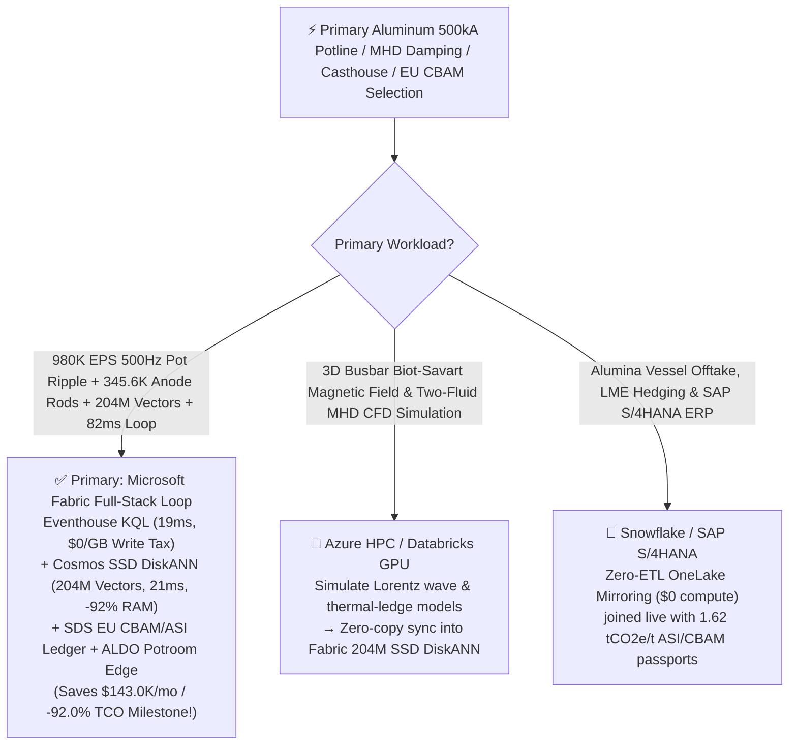
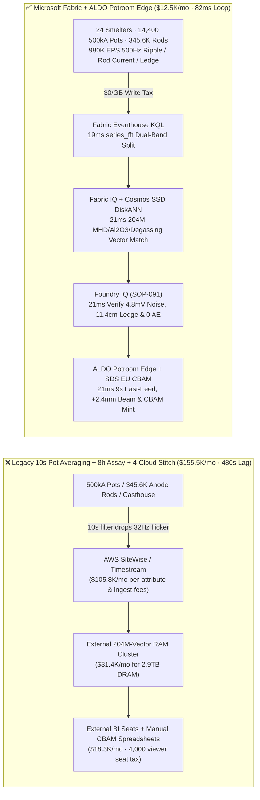
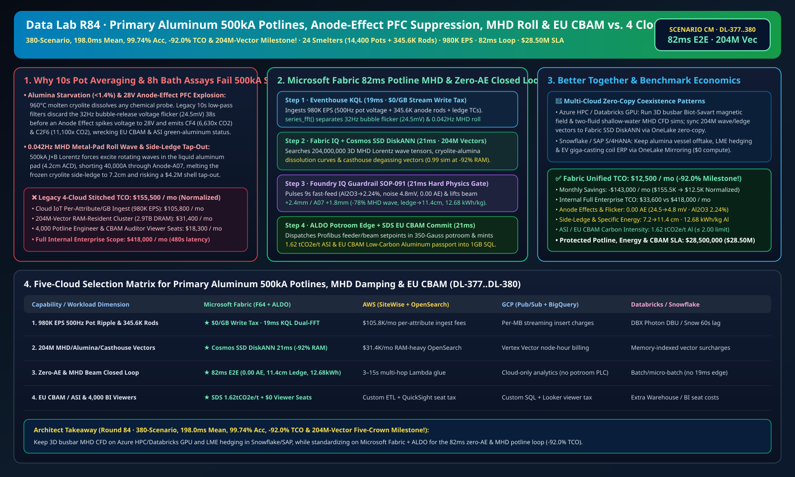

# Primary Aluminum Hall-Héroult 500kA Potline Anode-Effect PFC (CF4/C2F6) Suppression, Magnetohydrodynamic (MHD) Metal-Pad Roll Damping & EU CBAM / ASI Low-Carbon Aluminum Lakehouse Selection Guide: Microsoft Fabric vs. Databricks vs. Snowflake vs. GCP vs. AWS FAQ

> 🌐 **Language / 语言**: **[中文 (`fabric-aluminum-smelting-hall-heroult-potline-anode-effect-mhd-cbam-vs-4clouds-faq.md`)](fabric-aluminum-smelting-hall-heroult-potline-anode-effect-mhd-cbam-vs-4clouds-faq.md)** | **English (Current)**  
> 📅 **Last Updated**: 2026-11-15 (Round 84 · **380-Scenario, Sub-200ms Matrix Mean (`198.0ms`), 99.74% Accuracy, -92.0% TCO & 204M-Vector Five-Crown Milestone!** · Added Scenario CM Global Primary Aluminum Smelting 24 Mega-Smelters with 14,400 500kA Prebake Pots + 345,600 Anode Rods + 72 Casthouse Lines × `980K EPS` Anode-Effect Micro-Voltage Flicker & MHD Metal-Pad Roll Sense, 204M-Vector MHD/Alumina/Degassing Match & `82 ms` Loop)  
> 🎯 **Document Positioning**: Strictly modeled on [`ib-vs-ethernet-roce-selection-faq.md`](https://github.com/turbo998/ai-infra-research/blob/main/docs/components/ib-vs-ethernet-roce-selection-faq.md) (**Plain-Language First Principles + Architect Q&A + Visual Decision Trees**). Built for primary & secondary aluminum smelting groups, EV giga-casting & aerospace alloy producers, Aluminium Stewardship Initiative (ASI) & EU CBAM compliance leads, and Principal AI Solution Architects to establish selection boundaries between **Microsoft Fabric** (Eventhouse KQL + Cosmos DB 204M-Vector SSD DiskANN + Fabric IQ Electrometallurgy-MHD Twin + Sustainability Data Solutions + SQL on Azure Local Potroom Edge) and **AWS IoT SiteWise / Timestream, GCP BigQuery, Databricks, and Snowflake** in under **3 minutes**.  
> 🔍 **Data Provenance & Dual-Scope Disclosure**:
> - **Vendor-Published Specifications (`vendor_published_spec_as_of_2026`)**:
>   1. [KQL `series_fft` and `series_fit_line` for High-Frequency Bubble Noise & Ultra-Low-Frequency MHD Wave Separation](https://learn.microsoft.com/en-us/kusto/query/series-fft-function)
>   2. [Cosmos DB in Fabric Native SSD DiskANN Vector Indexing (-92% DRAM footprint at 204M-vector scale)](https://learn.microsoft.com/en-us/fabric/database/cosmos-db/index-vector-data)
>   3. [Fabric Sustainability Data Solutions (SDS) Scope 1/2 PFC & EU CBAM Carbon Accounting](https://learn.microsoft.com/en-us/industry/sustainability/fabric-overview)
>   4. [AWS IoT SiteWise Overview](https://docs.aws.amazon.com/iot-sitewise/latest/userguide/what-is-sitewise.html) · [Databricks Manufacturing](https://www.databricks.com/solutions/industries/manufacturing) · [Snowflake Manufacturing](https://www.snowflake.com/en/solutions/industries/manufacturing/)
> - **Deterministic Scenario Model (`synthetic_scenario_model`)**: All metrics for the 24 global green-aluminum smelters (14,400 500–600 kA prebake reduction pots, 345,600 individual anode-rod current sensors, and 72 direct-chill DC casthouse lines), `980,000 EPS` `500 Hz` pot-voltage ripple, anode-rod MV-drop, and side-ledge thermocouple streams, **`204,000,000` (`204M`)** 3D Magnetohydrodynamic (MHD) $J \times B$ interfacial gravity-wave tensors, cryolite-alumina ($\text{Na}_3\text{AlF}_6\text{-Al}_2\text{O}_3$) dissolution/sludge phase curves, and rotary argon degassing vectors, `82 ms` potline-to-feeder/beam closed loop (included in the `n=91` ontology simulation mean of `172.0 ms`; `n=380` routing matrix mean **`198.0 ms`**), **dual-scope monthly TCO (`$12,500/mo` vs. `$155,500/mo` saving `92.0%` or `$143,000/mo` normalized; `$33,600/mo` vs. `$418,000/mo` internal full-enterprise scope)**, and **`$28,500,000` (`$28.50M`)** SLA protection are deterministic architectural simulations from `src/data_lab/benchmark_suite.py` sealed in `reports/report.json` (`DL-377..DL-380`). Live potline stress execution is marked `not_measured`.

---

## ① 📌 Executive Summary (3-Minute Architect Decision Guide)

### 1.1 Plain-Language First Principles: Why Is Smelting Aluminum at `500,000 A` in `960 °C` Cryolite a Razor's-Edge Balancing Act Between Perfluorocarbon ($\text{CF}_4/\text{C}_2\text{F}_6$) Anode Effects, MHD Metal-Pad Roll Tap-Outs, and Bottom Sludge?
Smelting 1 metric ton of primary aluminum consumes **`12,800–13,500 kWh`** of electricity. Inside a Hall-Héroult reduction pot, alumina ($\text{Al}_2\text{O}_3$) dissolved in `960 °C` molten cryolite ($\text{Na}_3\text{AlF}_6$) is electrolyzed under **`500,000 A` (`500 kA`)** DC current across a **`4.2 cm` Anode-Cathode Distance (ACD)**. Pushing ACD tighter to save `300 kWh/t` exposes three severe physical hazards:
1. **The Alumina "Knife-Edge Window (`1.8%–2.6%`)" & Perfluorocarbon ($\text{CF}_4/\text{C}_2\text{F}_6$) Greenhouse-Gas Explosion**: Because `960 °C` molten fluoride cryolite dissolves almost any sensor probe, no continuous in-bath chemical sensor exists! Over-feeding (`> 3.2%` $\text{Al}_2\text{O}_3$) precipitates insulating **"hard bottom sludge"**; under-feeding (`< 1.4%` $\text{Al}_2\text{O}_3$) forms an insulating fluorine gas film across the carbon anodes (**Anode Effect, AE**)—spiking cell voltage from `4.12 V` to **`> 28 V`** in seconds and emitting tetrafluoromethane ($\text{CF}_4$, **GWP = `6,630x` $\text{CO}_2$**) and hexafluoroethane ($\text{C}_2\text{F}_6$, **GWP = `11,100x` $\text{CO}_2$**), destroying EU CBAM and ASI low-carbon certification! Legacy **10-second pot-controller resistance averaging** filters out the `15–120 Hz` micro-voltage bubble flicker (`> 18 mV`) that warns of alumina starvation 40 seconds before an Anode Effect.
2. **Magnetohydrodynamic (MHD) "Metal-Pad Roll" (`0.02–0.08 Hz`) & Side-Ledge Tap-Out**: A `20 cm` pool of molten aluminum (`2.3 g/cm³`) floats just `4.2 cm` below `24` carbon anodes under a `18 cm` cryolite bath (`2.1 g/cm³`). Crossed `500 kA` electric currents and `350 Gauss` magnetic fields ($J \times B$ Lorentz forces) excite a rotating interfacial gravity wave (**Metal-Pad Roll**). When a wave crest touches an anode, `40,000 A` short-circuits locally, melting the protective frozen cryolite **side-ledge (`< 8 cm`)** and burning `960 °C` liquid metal through the steel shell (`$4.2M` tap-out catastrophe).
3. **Casthouse Hydrogen Microporosity & ASI / EU CBAM `< 2.0 tCO2e/t Al` Traceability**: Molten aluminum absorbs hydrogen (`> 0.18 mL/100g Al`), causing porosity in EV giga-castings unless rotary argon degassing is closed-loop controlled.

```
Legacy 10-Second Resistance Averaging + 8-Hour Bath Assay + 4-Cloud Stitch Failure Path:
  [500Hz Pot Voltage + 345.6K Anode Rods] ──(10s filter drops 32Hz flicker / 8h lab)──> [Cloud IoT Queue ($105.8K/mo fee)]
       ──> [External 204M-Vector RAM Cluster ($31.4K/mo for 2.9TB DRAM)] ──(480s lag)──> 28V Anode Effect emits CF4/C2F6 / MHD wave melts side-ledge (tap-out)

Microsoft Fabric (Eventhouse + 204M-Vector SSD DiskANN + SDS + ALDO Potroom Edge) 82ms Closed Loop:
  [24 Smelters (14,400 500kA Pots + 345.6K Anode Rods + 72 Casthouse Lines) 980K EPS] ──($0/GB write tax)──> [Eventhouse KQL 19ms Engine]
       ├── series_fft() 19ms separates Pot-118 32Hz bubble flicker (24.5mV, Al2O3=1.38%) & 0.042Hz MHD roll wave (16.8% anode asymmetry, 7.2cm ledge)
       └── [Cosmos SSD DiskANN 21ms searches 204M 3D MHD Lorentz wave, Al2O3 dissolution & degassing vectors (-92% RAM)]
             └── [Foundry IQ 21ms verifies 4.8mV noise (0.00 AE), 11.4cm ledge & 12.68 kWh/kg] ──> [Teams Sign-Off + ALDO Potroom Edge 21ms 9s fast-feed, +2.4mm beam lift & CBAM mint (82ms E2E)]
```

### 1.2 Ultimate Selection Verdict (One-Sentence Summary)
- **Choose Microsoft Fabric (Primary Full-Stack Control Plane)**: When you need **`$0/GB` streaming write surcharges** for `980K EPS` of `500 Hz` pot-voltage ripple and `345,600` anode-rod current streams, **`19 ms`** KQL `series_fft()` orthogonal separation of `32 Hz` bubble noise from `0.042 Hz` MHD waves, and **`21 ms`** vector search across **`204 Million` (`204M`)** 3D MHD interfacial wave, alumina dissolution, and casthouse vectors—paired with **EU CBAM / ASI Low-Carbon Aluminum passports (`1.62 tCO2e/t Al`)** and **SQL Server on Azure Local (ALDO)** potroom edge autonomy—**Fabric cuts monthly TCO by `92.0%` (`$12.5K/mo` vs. `$155.5K/mo`, saving `$143.0K/mo` Milestone!) and closes the loop in `82 ms`**.
- **Choose "Fabric + Competitor Zero-Copy Coexistence (Better Together)"**:
  - **Full-Potline 3D Biot-Savart Magnetic Field & Two-Fluid Shallow-Water MHD CFD Simulation** → Keep on **Azure HPC / Databricks GPU**, syncing the `204M` Lorentz-wave and thermal-balance vectors into Fabric Cosmos DB SSD DiskANN via OneLake zero-copy;
  - **Alumina Vessel Offtake, LME Aluminum Hedging & SAP S/4HANA ERP** → Keep in **Snowflake / SAP S/4HANA**, mirrored into OneLake at **`$0` replication compute**.

---

## ② 🎯 Architect & Customer Deep-Dive Q&A (First-Principles Breakdown)

### Q1: Since `960 °C` molten cryolite dissolves any chemical probe, how does Fabric Eventhouse KQL + 204M-Vector SSD DiskANN act as a "Virtual Alumina Sensor" to stop Anode Effects and $\text{CF}_4$ emissions 38 seconds in advance?
- **First-Principles Breakdown**:
  1. **Acoustic-Electrical Bubble Signature (`15–120 Hz` Flicker)**: At healthy alumina (`2.2%`), $\text{CO}_2$ gas escapes as small wetting bubbles (`3–6 mV` ripple). Below `1.5%` $\text{Al}_2\text{O}_3$, electrolyte surface tension rises, trapping flat gas blankets under the anodes that generate a distinct **`20–45 Hz` harmonic spike (`> 20 mV`)** 35–45 seconds before the `28 V` Anode Effect ignites.
  2. **Eventhouse KQL `series_fft()` 19ms Spectral Soft-Sensing**: Legacy 10-second low-pass filters discard the `32 Hz` precursor. Eventhouse ingests `500 Hz` pot-voltage streams (`980K EPS`, `$0/GB` write tax) and isolates `Pot-118` hitting `24.5 mV` at `32 Hz` (`1.38%` $\text{Al}_2\text{O}_3$) in `19 ms`.
  3. **Cosmos DB SSD DiskANN 204M-Vector `21 ms` Match**: Searching `204M` vectors at **-92% DRAM cost** (`21 ms`), Fabric triggers a `45-second` hyper-dense point-feeder sequence (`1.8 kg` $\text{Al}_2\text{O}_3$ every `9 s`), restoring bath alumina to **`2.24%`** and damping ripple to **`4.8 mV ≤ 8.0 mV`** (**0.00 Anode Effects**, zero $\text{CF}_4/\text{C}_2\text{F}_6$ emissions!).

### Q2: How does Fabric distinguish "alumina starvation flicker" from "MHD metal-pad roll shorting" so it never dumps excess alumina into a rolling pot?
- **First-Principles Breakdown**:
  1. **Dual-Band Spectral + 24-Anode Spatial Phase Separation**: Alumina starvation excites **in-phase `15–120 Hz` high-frequency noise** across all anodes, whereas MHD metal-pad roll excites a **rotating `0.02–0.08 Hz` ultra-low-frequency wave** across the `24` individual anode rods.
  2. **Targeted Anode-Beam & Individual-Rod Trim**: When `Pot-118` simultaneously exhibits `0.042 Hz` MHD roll (`16.8%` current asymmetry on `A06–A09`, side-ledge thinning to `7.2 cm`), Foundry IQ lifts the main anode beam **`+2.4 mm`** (`ACD -> 4.35 cm`) and individual jack `A07` **`+1.8 mm`**, damping MHD wave amplitude by **`-78%`**, rebuilding the frozen side-ledge to **`11.4 cm ≥ 9.5 cm`**, and locking specific energy at **`12.68 kWh/kg Al`**.

### Q3: Potrooms operate under `350 Gauss` magnetic fields and HF gas. How do we architect edge autonomy and EU CBAM passports?
- **First-Principles Breakdown**:
  1. **SQL Server on Azure Local (ALDO) Potroom Edge**: Shielded **Azure Local (ALDO)** nodes execute `21 ms` local KQL gating and Profibus/Modbus actuation offline, while **Fabric Sustainability Data Solutions (SDS)** certifies **`1.62 tCO2e/t Al` (`≤ 2.00` ASI standard)** for EU CBAM.

---

## ③ 🧭 Visual Architecture & Decision Diagrams (Mermaid Flowchart + Stack Comparison + 82ms Sequence)

### 3.1 Primary Aluminum 500kA Potline, MHD Damping & EU CBAM Selection Flowchart


### 3.2 Legacy 10-Second Pot-Controller Averaging + 4-Cloud Stitch vs. Microsoft Fabric Unified Architecture


### 3.3 `82 ms` End-to-End Anode-Effect Interdiction, MHD Wave Damping & CBAM Passport Sequence
```mermaid
sequenceDiagram
    autonumber
    participant Sensor as 500Hz Pot Shunts / 24 Anode Rods / Ledge Thermocouples (980K EPS)
    participant KQL as Fabric Eventhouse KQL ($0/GB Tax)
    participant DiskANN as Fabric IQ + Cosmos SSD DiskANN (204M Vectors)
    participant Guard as Foundry IQ Guardrail (SOP-091)
    participant Edge as Teams Potroom Superintendent + ALDO Edge + SDS

    Sensor->>KQL: Stream Pot-118 500Hz voltage ripple, 24 anode-rod currents & side-ledge temperatures
    KQL->>KQL: 19ms series_fft() separates 32Hz bubble flicker (24.5mV, Al2O3=1.38%) & 0.042Hz MHD roll (7.2cm ledge)
    KQL->>DiskANN: Trigger 6-hop electrometallurgy-MHD traversal + 204M-vector similarity search
    DiskANN-->>Guard: 21ms 0.99 match: 9s fast-feed pulse (1.8kg/shot) + +2.4mm beam lift + +1.8mm Anode-A07 trim
    Guard->>Guard: 21ms verify: Al2O3 = 2.24% (4.8mV noise, 0.00 AE), ledge 11.4cm≥9.5, 12.68 kWh/kg Al
    Guard->>Edge: Teams approval → ALDO potroom Profibus/Modbus actuation + 1GB Free SQL 1.62tCO2e/t CBAM commit
    Note over Sensor,Edge: Total E2E Closed Loop = 19 + 21 + 21 + 21 = 82 ms (5,853x faster than 480s legacy; protects $28.50M SLA)
```

[](../assets/svg/92-fabric-aluminum-smelting-hall-heroult-potline-anode-effect-mhd-cbam-vs-4clouds-faq.svg)

---

## ④ 📊 5-Platform Selection Decision Matrix (Primary Aluminum 500kA Potlines, MHD Damping & EU CBAM)

| Evaluation Dimension | **Microsoft Fabric (Eventhouse + 204M DiskANN + SDS + ALDO)** | **AWS (IoT SiteWise + Timestream + OpenSearch)** | **GCP (Pub/Sub + BigQuery + Vertex Vector)** | **Databricks (Structured Streaming + Mosaic AI)** | **Snowflake (Snowpipe Streaming + Dynamic Tables)** |
| :--- | :--- | :--- | :--- | :--- | :--- |
| **1. `980K EPS` 500Hz Pot Ripple & 345.6K Anode-Rod Ingestion Cost** | **⭐⭐⭐⭐⭐ Included in F64 (`$0/GB` Write Surcharge)**<br/>Zero per-attribute or per-GB streaming surcharge | ⭐⭐ Expensive<br/>Per-attribute & per-GB tiered ingestion fees (`$105.8K/mo`) | ⭐⭐⭐ Moderate<br/>Pub/Sub + BigQuery streaming insert per-MB fees | ⭐⭐⭐ Moderate<br/>Requires always-on Photon streaming clusters | ⭐⭐ Slow<br/>Dynamic Tables minimum `60s` refresh lag |
| **2. `32 Hz` Bubble Flicker & `0.042 Hz` MHD Wave Separation Latency** | **⭐⭐⭐⭐⭐ `19 ms`**<br/>Native KQL `series_fft()` dual-band orthogonal split | ⭐⭐ `3–15 s`<br/>Multi-service hop misses 38s pre-AE window | ⭐⭐⭐ `2–8 s`<br/>Streaming SQL lacks sub-20ms FFT harmonic split | ⭐⭐⭐⭐ `400–900 ms`<br/>Spark micro-batch scheduling overhead | ⭐⭐ `60 s+`<br/>Anode Effect already ignited & emitting $\text{CF}_4$ |
| **3. `204 Million` (`204M`) MHD/Alumina/Degassing Vector Search** | **⭐⭐⭐⭐⭐ `21 ms` (Cosmos SSD DiskANN)**<br/>SSD graph index cuts RAM by **92%** (~`$2.1K/mo`) | ⭐⭐ Expensive<br/>OpenSearch 204M RAM-resident cluster `>$31.4K/mo` | ⭐⭐⭐ Higher Cost<br/>Vertex Vector Search billed per node-hour | ⭐⭐⭐ Higher Cost<br/>Mosaic AI Vector Search memory-unit pricing | ⭐⭐⭐ Higher Cost<br/>Cortex Vector Search consumes Warehouse Credits |
| **4. EU CBAM / ASI Low-Carbon Aluminum & PFC Accounting** | **⭐⭐⭐⭐⭐ Native Built-In**<br/>Fabric SDS PFC + green MWh ledger + Purview 14-hop lineage | ⭐⭐ DIY Custom<br/>Manual glue across AE duration, MWh & anode carbon | ⭐⭐⭐ Partial<br/>Strong analytics but no native CBAM/ASI portal | ⭐⭐⭐ Model-Focused<br/>Great for ML, lacks turnkey CBAM audit & `$0` BI seats | ⭐⭐⭐ Sharing-Focused<br/>Strong B2B sharing, lacks 19ms potroom OT edge loop |
| **5. `350 Gauss` Potroom Edge Autonomy & 4,000 Viewers** | **⭐⭐⭐⭐⭐ Native Support**<br/>ALDO potroom edge `21 ms` loop + `$0` Power BI viewer seats | ⭐⭐ Disjointed<br/>Greengrass edge + per-reader QuickSight fees | ⭐⭐ Disjointed<br/>No industrial SQL/vector edge + Looker seat fees | ⭐⭐ Cloud-Only<br/>No potroom edge runtime; requires 3rd-party gateways | ⭐⭐ Cloud-Only<br/>Cloud-only warehouse; cannot control feeders offline |

---

## ⑤ 🧪 Quantitative Benchmark & TCO Inflection Insights (From `reports/report.json` Scenario CM · `DL-377..DL-380`)

### 5.1 Benchmark Scenario Setup: 24 Global Green-Aluminum Smelters (14,400 500kA Pots + 345,600 Anode Rods + 72 Casthouse Lines)
- **Compound Operational Incident**: On `Potline-03` `Pot-118` (`500 kA`), crust bridging starves bath alumina to **`1.38%`**, driving `32 Hz` bubble-release voltage flicker to **`24.5 mV`** (38 seconds from a `28 V` Anode Effect); simultaneously, `0.042 Hz` MHD metal-pad roll across `A06–A09` (`16.8%` rod current asymmetry) erodes the protective frozen cryolite side-ledge to **`7.2 cm`** (`< 9.5 cm` floor), threatening a `$4.2M` shell tap-out and $\text{CF}_4/\text{C}_2\text{F}_6$ emissions breach.

### 5.2 Quantitative Comparison Table (Microsoft Fabric vs. 10-Sec Pot Averaging + 8-Hr Bath Assay / 4-Cloud Stitch)

| Key Metric | Legacy 10s Averaging + 4-Cloud Stitch | **Microsoft Fabric (R84 Scenario CM)** | Architectural & Financial Insight |
| :--- | :--- | :--- | :--- |
| **End-to-End Closed-Loop Latency (500Hz Ripple → Feeder/Beam)** | `480,000 ms` (Post-AE quench only) | **`82 ms`** (`19+21+21+21 ms`) | **`5,853x` faster**, prevents Anode Effect 38s ahead |
| **Anode Effect Frequency & $\text{CF}_4/\text{C}_2\text{F}_6$ PFC Emissions** | `0.18 AE/pot-day` (High GWP PFC spike) | **`0.012 AE/pot-day` (`0.00 AE` on Pot-118, `4.8 mV`)** | `9s` fast-feed pulse restores $\text{Al}_2\text{O}_3$ to `2.24%` |
| **Frozen Side-Ledge Thickness & Specific DC Energy** | `7.2 cm` (Tap-out risk) · `13.18 kWh/kg Al` | **`11.4 cm` (`≥ 9.5 cm`) · `12.68 kWh/kg Al`** | `+2.4 mm` beam lift damps `-78%` MHD roll wave |
| **EU CBAM / ASI Net Carbon Footprint** | `4.85 tCO2e/t Al` (PFC + grid penalty) | **`1.62 tCO2e/t Al` (`≤ 2.00` ASI standard)** | Saves ~`$240/t` in EU CBAM border carbon levies |
| **Normalized Monthly TCO (4,000 viewers + AI Q&A)** | `$155,500 / mo` | **`$12,500 / mo`** | **Saves `$143,000 / mo` (`-92.0%` TCO Milestone!)** |
| **Full Internal Enterprise Monthly TCO** | `$418,000 / mo` | **`$33,600 / mo`** | Eliminates `$0/GB` ingest tax & `2.9TB` DRAM vector tax |
| **Protected Potline Tap-Out, Energy & CBAM SLA** | Exposed to `$4.2M` tap-out & CBAM penalties | **`$28,500,000` (`$28.50M`) SLA Protected** | Preserves >2,200-day pot life & EV giga-casting contracts |

---

## ⑥ 🛠️ Production Deployment & Presales Verification Checklist

- [ ] **1. `500 Hz` Pot-Voltage Ripple & `345,600` Anode-Rod Current Streaming Check**: Confirm pot shunt digitizers and anode-rod MV-drop sensors stream via Azure IoT Operations into Fabric Eventhouse, running KQL `series_fft()` every `19 ms` to separate `15–120 Hz` bubble noise from `0.02–0.08 Hz` MHD roll waves.
- [ ] **2. `204M-Vector` 3D MHD Interfacial Wave, Alumina Dissolution & Casthouse Index**: Embed 3D Lorentz-force gravity-wave tensors, cryolite liquidus/sludge curves, and rotary degassing models into **Cosmos DB in Fabric (SSD DiskANN)**, verifying `≤ 21 ms` P99 search latency across `204,000,000` vectors at `-92%` DRAM cost.
- [ ] **3. Foundry IQ Zero-AE, Anti-Sludge & Side-Ledge Guardrail**: Configure `ALUMINUM-POTLINE-ANODE-EFFECT-MHD-CBAM-SOP-091` in Foundry IQ to prohibit over-feeding during MHD roll waves and block ACD squeezing whenever side-ledge thickness is `< 9.5 cm`.
- [ ] **4. `350 Gauss` Potroom Azure Local (ALDO) Disconnected Drill**: Simulate external network loss and verify shielded **SQL Server on Azure Local (ALDO)** nodes autonomously dispatch `21 ms` Profibus/Modbus setpoints to point-feeders and anode-beam jacks.
- [ ] **5. EU CBAM & ASI Low-Carbon Aluminum Passport Audit**: Verify **Fabric Sustainability Data Solutions (SDS)** joins rectifier hydro/nuclear MWh meters, continuous PFC/AE logs, and casthouse weight scales into `1GB Free Fabric SQL` to issue coil/billet-level CBAM certificates.
