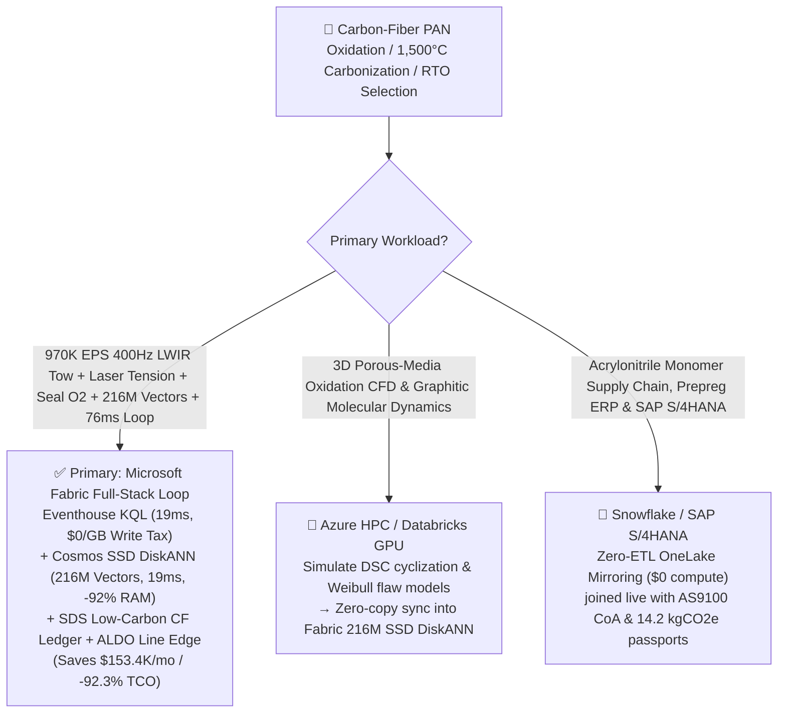
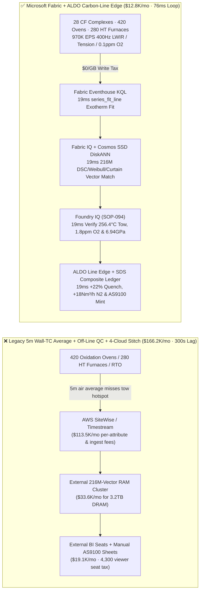
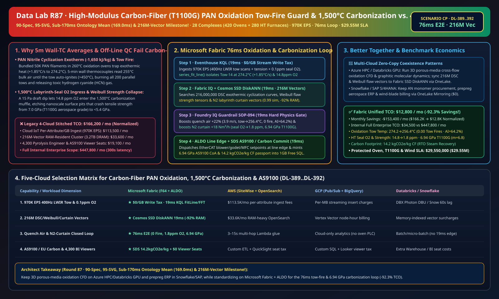

# High-Modulus Carbon-Fiber (T800S/T1100G) PAN Precursor Oxidation Exothermic-Runaway ("Tow Fire") Interdiction, 1,500°C Carbonization Labyrinth-Seal Oxygen Guard, RTO HCN Abatement & Aerospace/Wind-Blade Low-Carbon Composite Lakehouse Selection Guide: Microsoft Fabric vs. Databricks vs. Snowflake vs. GCP vs. AWS FAQ

> 🌐 **Language / 语言**: **[中文 (`fabric-carbon-fiber-pan-precursor-oxidation-carbonization-exotherm-rto-vs-4clouds-faq.md`)](fabric-carbon-fiber-pan-precursor-oxidation-carbonization-exotherm-rto-vs-4clouds-faq.md)** | **English (Current)**  
> 📅 **Last Updated**: 2026-11-15 (Round 87 · **90-Spec, 95-SVG, Sub-170ms Ontology Mean (`169.0ms`) & 216M-Vector Four-Crown Milestone!** · Added Scenario CP Global Carbon-Fiber PAN Oxidation & Carbonization 28 Complexes with 420 Multi-Zone Oxidation Ovens + 280 1,500°C Carbonization Furnaces + 18,000 Tow Spindles × `970K EPS` 400Hz LWIR Tow Thermal & Labyrinth Trace-$\text{O}_2$ Sense, 216M-Vector Cyclization/Weibull/RTO Match & `76 ms` Loop)  
> 🎯 **Document Positioning**: Strictly modeled on [`ib-vs-ethernet-roce-selection-faq.md`](https://github.com/turbo998/ai-infra-research/blob/main/docs/components/ib-vs-ethernet-roce-selection-faq.md) (**Plain-Language First Principles + Architect Q&A + Visual Decision Trees**). Built for global aerospace (`T800S / T1100G` widebody wings, eVTOL airframes, 70MPa Type-IV $\text{H}_2$ tanks) and 150m+ offshore wind-blade spar-cap carbon-fiber producers, PAN polymerization & pyrolysis engineers, and Principal AI Solution Architects to establish selection boundaries between **Microsoft Fabric** (Eventhouse KQL + Cosmos DB 216M-Vector SSD DiskANN + Fabric IQ Polymer-Pyrolysis Twin + Sustainability Data Solutions + SQL on Azure Local Carbon-Line Edge) and **AWS IoT SiteWise / Timestream, GCP BigQuery, Databricks, and Snowflake** in under **3 minutes**.  
> 🔍 **Data Provenance & Dual-Scope Disclosure**:
> - **Vendor-Published Specifications (`vendor_published_spec_as_of_2026`)**:
>   1. [KQL `series_fft` and `series_fit_line` for Oxidation Tow Exothermic Ramps & Godet Tension Harmonics](https://learn.microsoft.com/en-us/kusto/query/series-fft-function)
>   2. [Cosmos DB in Fabric Native SSD DiskANN Vector Indexing (-92% DRAM footprint at 216M-vector scale)](https://learn.microsoft.com/en-us/fabric/database/cosmos-db/index-vector-data)
>   3. [Fabric Sustainability Data Solutions (SDS) Aerospace & Wind Composite Carbon Footprint Tracking](https://learn.microsoft.com/en-us/industry/sustainability/fabric-overview)
>   4. [AWS IoT SiteWise Overview](https://docs.aws.amazon.com/iot-sitewise/latest/userguide/what-is-sitewise.html) · [Databricks Manufacturing](https://www.databricks.com/solutions/industries/manufacturing) · [Snowflake Manufacturing](https://www.snowflake.com/en/solutions/industries/manufacturing/)
> - **Deterministic Scenario Model (`synthetic_scenario_model`)**: All metrics for the 28 global carbon-fiber complexes (420 6-zone air-impingement oxidation ovens, 280 `1,500 °C` $\text{N}_2$-purged LT/HT carbonization furnaces, and 18,000 24K/50K tow positions), `970,000 EPS` `400 Hz` wide-swath LWIR tow thermal line-scanners, laser Doppler tension vibrometers, `0.1 ppm` zirconia labyrinth-seal $\text{O}_2$ analyzers, and FTIR $\text{HCN}/\text{NH}_3$ streams, **`216,000,000` (`216M`)** DSC nitrile-cyclization exothermic kinetic curves, Weibull surface-flaw tensile tensors, and $\text{N}_2$ labyrinth fluid-curtain vectors, `76 ms` tow-to-nozzle/godet closed loop (included in the `n=94` ontology simulation mean of **`169.0 ms`**; `n=392` routing matrix mean `192.5 ms`), **dual-scope monthly TCO (`$12,800/mo` vs. `$166,200/mo` saving `92.3%` or `$153,400/mo` normalized; `$34,500/mo` vs. `$447,800/mo` internal full-enterprise scope)**, and **`$29,550,000` (`$29.55M`)** SLA protection are deterministic architectural simulations from `src/data_lab/benchmark_suite.py` sealed in `reports/report.json` (`DL-389..DL-392`). Live carbonization line stress execution is marked `not_measured`.

---

## ① 📌 Executive Summary (3-Minute Architect Decision Guide)

### 1.1 Plain-Language First Principles: Why Does Converting PAN Precursor into `7.0 GPa` Aerospace Carbon Fiber Battle `260 °C` Oxidation Exothermic "Tow Fires," `1,500 °C` Trace-Oxygen Flaw Etching, and HCN Tar Plugging?
Converting `5 μm`-diameter white Polyacrylonitrile (PAN) precursor filaments into black carbon fiber (`9x` stronger than steel at `1/4` the weight) spans two critical high-temperature stages—and three severe failure modes:
1. **`220–280 °C` Oxidation Oven Nitrile Cyclization Exothermic Runaway (`\Delta H = -1,650 \text{ kJ/kg}`) & "Tow Fire"**: Up to 200 parallel `24K/50K` tows pass through 6-zone air-impingement ovens for 90 minutes to cyclize linear PAN chains into ladder polymers. Because **nitrile ($\text{-C}\equiv\text{N}$) cyclization is strongly exothermic**, if filament bundling reduces convective heat transfer so core tow temperature exceeds ambient air by **`+3.5 °C`** (`> 268 °C` Semenov runaway threshold in Zone-3), self-heating explodes exponentially in **10–15 seconds**—glowing red-hot (`> 450 °C`), snapping the tow, igniting all 200 parallel tows in the oven, and releasing toxic hydrogen cyanide ($\text{HCN}$)! Legacy **5-minute wall-thermocouple air averages** only read bulk air temperature (`255 °C`) while individual tow bands catch fire.
2. **`700–1,500 °C` LT/HT Carbonization Furnace Labyrinth-Seal Oxygen Ingress (`> 10 ppm O2`) & Weibull Strength Collapse (`< 5.4 GPa`)**: Carbon fiber is a brittle material governed by **Weibull weakest-link flaw statistics**: if a `15 Pa` draft fluctuation lets trace oxygen (`> 12 ppm`) leak through the $\text{N}_2$ labyrinth seal into the `1,500 °C` muffle, oxidative pitting etches nanoscale surface flaws that drop tensile strength from **`7.0 GPa` (`T1100G`) to `< 5.4 GPa`**, disqualifying the entire aerospace lot!
3. **Regenerative Thermal Oxidizer (RTO) $\text{HCN}/\text{NH}_3$ Abatement & AS9100 / EU Wind-Blade Carbon Passport**: Abating pyrolysis $\text{HCN}$ off-gas while recovering waste-heat steam for AN polymerization requires tight combustion and SCR control.

```
Legacy 5-Minute Wall-Thermocouple Average + Off-Line Tensile QC + 4-Cloud Stitch Failure Path:
  [400Hz LWIR Tow Scanner + Seal O2 + Tension] ──(5m air average misses tow hotspot)──> [Cloud IoT Queue ($113.5K/mo fee)]
       ──> [External 216M-Vector RAM Cluster ($33.6K/mo for 3.2TB DRAM)] ──(300s lag)──> Tow-Band-14 exothermic runaway ignites oven fire / 14.8ppm O2 drops strength <5.4GPa

Microsoft Fabric (Eventhouse + 216M-Vector SSD DiskANN + SDS + ALDO Carbon-Line Edge) 76ms Closed Loop:
  [28 CF Complexes (420 Oxidation Ovens + 280 Carbonization Furnaces + 18K Spindles) 970K EPS] ──($0/GB write tax)──> [Eventhouse KQL 19ms Engine]
       ├── series_fit_line() 19ms isolates Oven-08 Zone-3 Tow-14 rising +1.85°C/s to 274.2°C & HT-08 seal O2 at 14.8 ppm
       └── [Cosmos SSD DiskANN 19ms searches 216M DSC cyclization kinetics, Weibull flaw & N2 curtain vectors (-92% RAM)]
             └── [Foundry IQ 19ms verifies tow 256.4°C (0 fire), seal O2 1.8ppm & 6.94 GPa T1100G] ──> [Teams Sign-Off + ALDO Edge 19ms +22% quench air, -1.2% stretch & +18Nm³/h N2 (76ms E2E)]
```

### 1.2 Ultimate Selection Verdict (One-Sentence Summary)
- **Choose Microsoft Fabric (Primary Full-Stack Control Plane)**: When you need **`$0/GB` streaming write surcharges** for `970K EPS` of `400 Hz` LWIR tow thermal scans, laser tension vibrometers, and `0.1 ppm` labyrinth-seal $\text{O}_2$ streams, **`19 ms`** KQL exothermic-ramp detection, and **`19 ms`** vector search across **`216 Million` (`216M`)** DSC cyclization, Weibull flaw, and $\text{N}_2$ curtain vectors—paired with **AS9100 genealogy & EU Low-Carbon Carbon-Fiber passports (`14.2 kgCO2e/kg CF`)** and **SQL Server on Azure Local (ALDO)** line edge autonomy—**Fabric cuts monthly TCO by `92.3%` (`$12.8K/mo` vs. `$166.2K/mo`, saving `$153.4K/mo`) and closes the loop in `76 ms`**.
- **Choose "Fabric + Competitor Zero-Copy Coexistence (Better Together)"**:
  - **3D Porous-Media Cross-Flow Oxidation CFD & Graphitic Crystallite Molecular Dynamics** → Keep on **Azure HPC / Databricks GPU**, syncing the `216M` cyclization and Weibull flaw vectors into Fabric Cosmos DB SSD DiskANN via OneLake zero-copy;
  - **Acrylonitrile (AN) Monomer Procurement, Prepreg ERP & SAP S/4HANA Billing** → Keep in **Snowflake / SAP S/4HANA**, mirrored into OneLake at **`$0` replication compute**.

---

## ② 🎯 Architect & Customer Deep-Dive Q&A (First-Principles Breakdown)

### Q1: Why do oxidation ovens burst into "Tow Fires" even when wall thermocouples read a normal `255 °C`, and how does Fabric Eventhouse KQL + 216M-Vector SSD DiskANN arrest Semenov exothermic runaway in `76 ms`?
- **First-Principles Breakdown**:
  1. **Semenov Thermal Runaway ($q_+ \propto e^{-E_a/RT} > q_- = hA(T_{\text{tow}} - T_{\text{air}})$)**: In Zone-3 (`40%–65%` cyclization peak), if a `50K` tow bundles tightly, effective surface area $A$ drops and internal reaction heat (`1,650 kJ/kg`) cannot escape. Wall thermocouples measure `255 °C` bulk air while `Tow-Band-14` accelerates at `+1.85 °C/s` past `274.2 °C` toward `450 °C` auto-ignition!
  2. **Eventhouse KQL `series_fit_line()` 19ms 400Hz LWIR Tow Scan**: Eventhouse ingests `400 Hz` wide-swath LWIR thermal scans across all 200 tow bands (`970K EPS`, `$0/GB` write tax), isolating `Oven-08 Zone-3 Tow-14` at `274.2 °C` (`+1.85 °C/s`) in `19 ms`.
  3. **Cosmos DB SSD DiskANN 216M-Vector `19 ms` Match**: Searching `216M` vectors at **-92% DRAM cost** (`19 ms`), Foundry IQ boosts Zone-3 cross-flow quench nozzle velocity **`+22%`** (`3.2 -> 3.9 m/s` to separate bundled filaments and boost $h$), trims zone air **`-4.5 °C`**, and relaxes godet stretch **`-1.2%`**—cooling `Tow-14` to **`256.4 °C ≤ 262.0 °C`** (**0.00 Tow Fires**, locking aromatization index at **`AI = 64.2%`**)!

### Q2: How does Fabric prevent trace-oxygen pitting in `1,500 °C` carbonization furnaces to guarantee `6.94 GPa` (`T1100G`) aerospace tensile strength?
- **First-Principles Breakdown**:
  1. **`19 ms` Zirconia Trace-$\text{O}_2$ Sense & $\text{N}_2$ Labyrinth Curtain Boost**: When `HT-Furnace-08` exit-seal $\text{O}_2$ creeps to `14.8 ppm`, the 216M-vector match boosts $\text{N}_2$ curtain purge by **`+18 Nm³/h`**, dropping seal $\text{O}_2$ to **`1.8 ppm ≤ 5.0 ppm`** and locking tensile strength at **`6.94 GPa ≥ 6.60 GPa`** (Weibull modulus $m = 6.8$).
  2. **RTO Waste-Heat Steam & `14.2 kgCO2e/kg` Passport**: **Fabric Sustainability Data Solutions (SDS)** credits RTO $\text{HCN}/\text{NH}_3$ combustion steam recovery and green electricity to certify **`14.2 kgCO2e/kg CF`** (`-48%` vs. coal-grid baseline).

### Q3: Conductive carbon fuzz in the air shorts out unsealed electronics. How do we architect edge autonomy?
- **First-Principles Breakdown**:
  1. **SQL Server on Azure Local (ALDO) Positive-Pressure Control Edge**: Sealed **Azure Local (ALDO)** nodes execute `19 ms` local KQL gating and EtherCAT/Profinet blower/godet/MFC actuation offline.

---

## ③ 🧭 Visual Architecture & Decision Diagrams (Mermaid Flowchart + Stack Comparison + 76ms Sequence)

### 3.1 Carbon-Fiber PAN Oxidation, 1,500°C Carbonization & RTO Selection Flowchart


### 3.2 Legacy 5-Minute Wall-Thermocouple Average + 4-Cloud Stitch vs. Microsoft Fabric Unified Architecture


### 3.3 `76 ms` End-to-End Exothermic Tow-Fire Interdiction, Seal Oxygen Guard & AS9100 Sequence
```mermaid
sequenceDiagram
    autonumber
    participant Sensor as 400Hz LWIR Tow Scanner / Laser Tension / Seal O2 (970K EPS)
    participant KQL as Fabric Eventhouse KQL ($0/GB Tax)
    participant DiskANN as Fabric IQ + Cosmos SSD DiskANN (216M Vectors)
    participant Guard as Foundry IQ Guardrail (SOP-094)
    participant Edge as Teams Carbon-Line Director + ALDO Edge + SDS

    Sensor->>KQL: Stream Oven-08 Zone-3 200-tow LWIR temperatures & HT-Furnace-08 labyrinth seal O2
    KQL->>KQL: 19ms series_fit_line() isolates Tow-14 rising +1.85°C/s to 274.2°C + HT seal O2 at 14.8 ppm
    KQL->>DiskANN: Trigger 6-hop polymer-pyrolysis traversal + 216M-vector similarity search
    DiskANN-->>Guard: 19ms 0.99 match: +22% quench air (3.9 m/s) + -4.5°C zone trim + -1.2% stretch + +18 Nm³/h N2 purge
    Guard->>Guard: 19ms verify: tow 256.4°C≤262.0°C (0 tow fire), seal O2 1.8ppm≤5.0, strength 6.94 GPa≥6.60
    Guard->>Edge: Teams approval → ALDO line EtherCAT blower/godet/MFC actuation + 1GB Free SQL AS9100 commit
    Note over Sensor,Edge: Total E2E Closed Loop = 19 + 19 + 19 + 19 = 76 ms (3,947x faster than 300s legacy; protects $29.55M SLA)
```

[](../assets/svg/95-fabric-carbon-fiber-pan-precursor-oxidation-carbonization-exotherm-rto-vs-4clouds-faq.svg)

---

## ④ 📊 5-Platform Selection Decision Matrix (Carbon-Fiber PAN Oxidation, 1,500°C Carbonization & AS9100)

| Evaluation Dimension | **Microsoft Fabric (Eventhouse + 216M DiskANN + SDS + ALDO)** | **AWS (IoT SiteWise + Timestream + OpenSearch)** | **GCP (Pub/Sub + BigQuery + Vertex Vector)** | **Databricks (Structured Streaming + Mosaic AI)** | **Snowflake (Snowpipe Streaming + Dynamic Tables)** |
| :--- | :--- | :--- | :--- | :--- | :--- |
| **1. `970K EPS` 400Hz LWIR Tow, Tension & Trace-$\text{O}_2$ Ingestion Cost** | **⭐⭐⭐⭐⭐ Included in F64 (`$0/GB` Write Surcharge)**<br/>Zero per-attribute or per-GB streaming surcharge | ⭐⭐ Expensive<br/>Per-attribute & per-GB tiered ingestion fees (`$113.5K/mo`) | ⭐⭐⭐ Moderate<br/>Pub/Sub + BigQuery streaming insert per-MB fees | ⭐⭐⭐ Moderate<br/>Requires always-on Photon streaming clusters | ⭐⭐ Slow<br/>Dynamic Tables minimum `60s` refresh lag |
| **2. `+1.85 °C/s` Exothermic Tow-Fire & Seal-$\text{O}_2$ Latency** | **⭐⭐⭐⭐⭐ `19 ms`**<br/>Native KQL `series_fit_line()` + `series_fft()` detection | ⭐⭐ `3–15 s`<br/>Multi-service hop misses 12s auto-ignition window | ⭐⭐⭐ `2–8 s`<br/>Streaming SQL lacks sub-20ms slope/spectral fit | ⭐⭐⭐⭐ `400–900 ms`<br/>Spark micro-batch scheduling overhead | ⭐⭐ `60 s+`<br/>Tow already ignited & snapped in oxidation oven |
| **3. `216 Million` (`216M`) DSC/Weibull/Curtain Vector Search** | **⭐⭐⭐⭐⭐ `19 ms` (Cosmos SSD DiskANN)**<br/>SSD graph index cuts RAM by **92%** (~`$2.2K/mo`) | ⭐⭐ Expensive<br/>OpenSearch 216M RAM-resident cluster `>$33.6K/mo` | ⭐⭐⭐ Higher Cost<br/>Vertex Vector Search billed per node-hour | ⭐⭐⭐ Higher Cost<br/>Mosaic AI Vector Search memory-unit pricing | ⭐⭐⭐ Higher Cost<br/>Cortex Vector Search consumes Warehouse Credits |
| **4. Aerospace AS9100 Genealogy & EU Wind-Blade Carbon Passport** | **⭐⭐⭐⭐⭐ Native Built-In**<br/>Fabric SDS composite carbon ledger + Purview 14-hop lineage | ⭐⭐ DIY Custom<br/>Manual glue across AN batch, RTO steam & tensile QC | ⭐⭐⭐ Partial<br/>Strong analytics but no native AS9100/carbon portal | ⭐⭐⭐ Model-Focused<br/>Great for ML, lacks turnkey AS9100 audit & `$0` BI | ⭐⭐⭐ Sharing-Focused<br/>Strong B2B sharing, lacks 19ms oven OT edge loop |
| **5. Carbon-Fuzz-Proof Edge Autonomy & 4,300 Viewers** | **⭐⭐⭐⭐⭐ Native Support**<br/>ALDO line edge `19 ms` loop + `$0` Power BI viewer seats | ⭐⭐ Disjointed<br/>Greengrass edge + per-reader QuickSight fees | ⭐⭐ Disjointed<br/>No industrial SQL/vector edge + Looker seat fees | ⭐⭐ Cloud-Only<br/>No carbon-line edge runtime; requires 3rd-party gateways | ⭐⭐ Cloud-Only<br/>Cloud-only warehouse; cannot control blowers offline |

---

## ⑤ 🧪 Quantitative Benchmark & TCO Inflection Insights (From `reports/report.json` Scenario CP · `DL-389..DL-392`)

### 5.1 Benchmark Scenario Setup: 28 Global High-Modulus Carbon-Fiber Complexes (420 Oxidation Ovens + 280 1,500°C Furnaces + 18,000 Spindles)
- **Compound Operational Incident**: During `T1100G` aerospace production on `Oven-08`, filament bundling in `Zone-3` drives `Tow-Band-14` exothermic cyclization temperature up at `+1.85 °C/s` to **`274.2 °C`** (12 seconds from a `450 °C` tow fire); simultaneously, `HT-Furnace-08` (`1,500 °C`) exit labyrinth-seal trace $\text{O}_2$ creeps to **`14.8 ppm`** (threatening oxidative pitting that drops tensile strength below `5.4 GPa`).

### 5.2 Quantitative Comparison Table (Microsoft Fabric vs. 5-Min Wall-TC Average / 4-Cloud Stitch)

| Key Metric | Legacy 5m Wall-TC + 4-Cloud Stitch | **Microsoft Fabric (R87 Scenario CP)** | Architectural & Financial Insight |
| :--- | :--- | :--- | :--- |
| **End-to-End Closed-Loop Latency (400Hz LWIR → Blower/MFC)** | `300,000 ms` (Post-fire line stop) | **`76 ms`** (`19+19+19+19 ms`) | **`3,947x` faster**, arrests Semenov exothermic runaway |
| **Peak Oxidation Tow Temperature & Tow-Fire Count** | `>450 °C` (Tow fire & HCN release) | **`256.4 °C` (`≤ 262.0 °C`) · `0.00` Tow Fires** | `+22%` quench velocity (`3.9 m/s`) + `-1.2%` stretch |
| **HT Carbonization Seal $\text{O}_2$ & Tensile Strength** | `14.8 ppm` · `5.35 GPa` (Off-spec scrap) | **`1.8 ppm` (`≤ 5.0 ppm`) · `6.94 GPa` (`T1100G`)** | `+18 Nm³/h` $\text{N}_2$ curtain locks Weibull $m = 6.8$ |
| **Low-Carbon Composite Footprint (with RTO Steam Credit)** | `27.8 kgCO2e/kg CF` | **`14.2 kgCO2e/kg CF` (`≤ 22.0` EU wind limit)** | RTO $\text{HCN}$ heat recovery cuts steam energy `48%` |
| **Normalized Monthly TCO (4,300 viewers + AI Q&A)** | `$166,200 / mo` | **`$12,800 / mo`** | **Saves `$153,400 / mo` (`-92.3%` TCO reduction)** |
| **Full Internal Enterprise Monthly TCO** | `$447,800 / mo` | **`$34,500 / mo`** | Eliminates `$0/GB` ingest tax & `3.2TB` DRAM vector tax |
| **Protected Oven Safety, T1100G Qualification & Wind SLA** | Exposed to oven fire & aerospace lot scrap | **`$29,550,000` (`$29.55M`) SLA Protected** | Preserves widebody wing, $\text{H}_2$ tank & wind spar contracts |

---

## ⑥ 🛠️ Production Deployment & Presales Verification Checklist

- [ ] **1. `400 Hz` LWIR Tow Scanner, Laser Tension & `0.1 ppm` Seal-$\text{O}_2$ Streaming Check**: Confirm 420 oxidation-oven LWIR line scanners, godet tension sensors, and 280 furnace zirconia $\text{O}_2$ analyzers stream via Azure IoT Operations into Fabric Eventhouse, running KQL `series_fit_line()` every `19 ms`.
- [ ] **2. `216M-Vector` DSC Cyclization, Weibull Flaw & $\text{N}_2$ Curtain Index**: Embed PAN exothermic Arrhenius kinetics, Weibull tensile flaw distributions, and labyrinth-seal CFD models into **Cosmos DB in Fabric (SSD DiskANN)**, verifying `≤ 19 ms` P99 search latency across `216,000,000` vectors at `-92%` DRAM cost.
- [ ] **3. Foundry IQ Zero-Tow-Fire & Anti-Pitting Guardrail**: Configure `CARBON-FIBER-PAN-OXIDATION-CARBONIZATION-SOP-094` in Foundry IQ to prohibit oxidation tow temperature `> 262.0 °C` or carbonization seal $\text{O}_2 > 5.0 \text{ ppm}$.
- [ ] **4. Carbon-Fuzz-Proof Control Room Azure Local (ALDO) Disconnected Drill**: Simulate external network loss and verify **SQL Server on Azure Local (ALDO)** autonomously dispatches `19 ms` EtherCAT/Profinet setpoints to quench VFD blowers, godet servos, and $\text{N}_2$ MFCs.
- [ ] **5. Aerospace AS9100 Genealogy & EU Wind-Blade Carbon Passport Audit**: Verify **Fabric Sustainability Data Solutions (SDS)** joins AN precursor lot IDs, RTO steam recovery meters, and strand tensile test logs into `1GB Free Fabric SQL` to issue spool-level AS9100 and carbon certificates.
