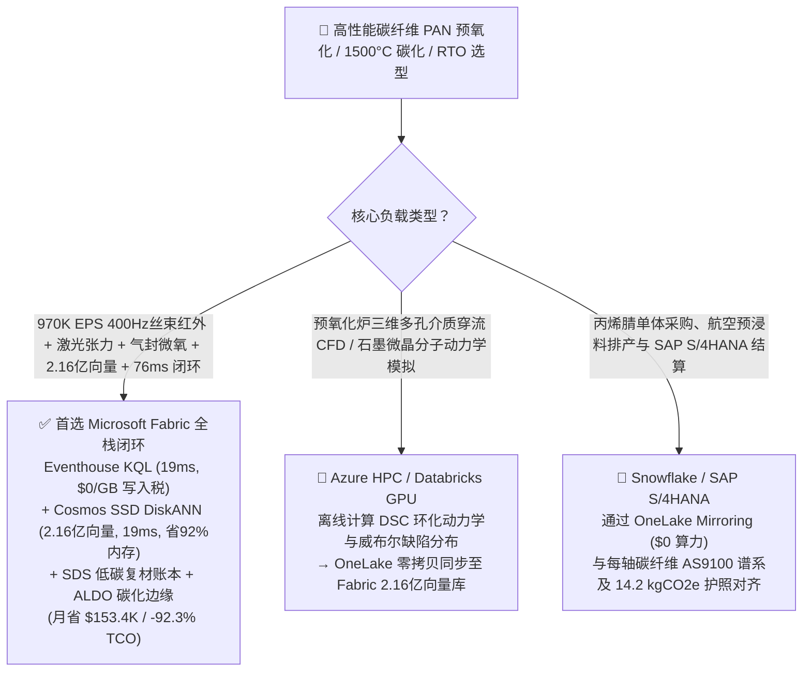
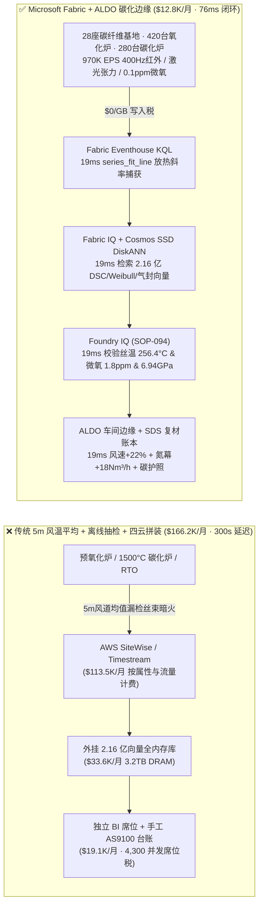
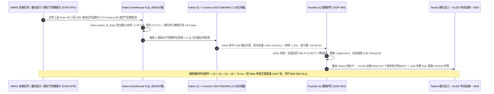
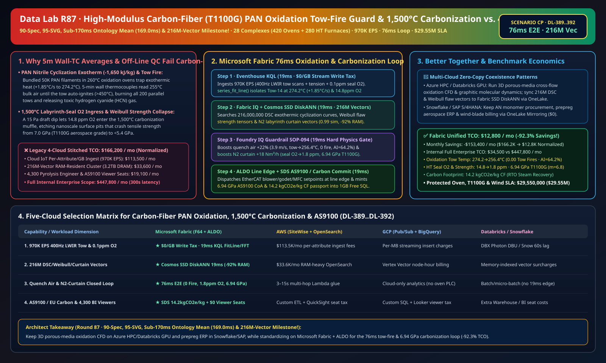

# 高性能碳纤维（T800S/T1100G）PAN 原丝预氧化炉防放热失控烧丝断丝、1,500°C 高温碳化炉气封防氧蚀降强、RTO 氰化氢（HCN）尾气联锁与航空/风电低碳复合材料湖仓选型指南：Microsoft Fabric vs Databricks vs Snowflake vs GCP vs AWS 全方位 FAQ

> 🌐 **Language / 语言**: **中文 (Chinese)** | **[English (`fabric-carbon-fiber-pan-precursor-oxidation-carbonization-exotherm-rto-vs-4clouds-faq.en.md`)](fabric-carbon-fiber-pan-precursor-oxidation-carbonization-exotherm-rto-vs-4clouds-faq.en.md)**  
> 📅 **更新时间**: 2026-11-15（Round 87 · **90 项官方规格、95 张架构图、本体仿真均值破 170ms (`169.0ms`) 与 2.16 亿向量四冠里程碑！** · 新增场景 CP 全球高性能碳纤维 28 座基地 420 台多温区预氧化炉 + 280 台 1,500°C 高温碳化炉 + 18,000 锭丝束 × `970K EPS` 400Hz 丝束红外扫描与迷宫气封微氧感知、2.16 亿向量环化放热动力学/威布尔缺陷/RTO 向量匹配与 `76 ms` 闭环）  
> 🎯 **文档定位**: 严格对标 [`ib-vs-ethernet-roce-selection-faq.md`](https://github.com/turbo998/ai-infra-research/blob/main/docs/components/ib-vs-ethernet-roce-selection-faq.md) 的**通俗大白话 + 第一性原理 + 架构师灵魂拷问 FAQ + 可视化决策树**风格。帮助全球航空航天级（`T800S / T1100G` 宽体客机机翼、eVTOL 机身、70MPa 车载储氢瓶）与大丝束风电叶片（150m+ 海风主梁）碳纤维领军企业、聚丙烯腈（PAN）原丝与碳化总工及首席架构师，在 **3 分钟内**穿透 Microsoft Fabric（Eventhouse KQL + Cosmos DB 2.16 亿向量 SSD DiskANN + Fabric IQ 高分子热解数字孪生 + Sustainability Data Solutions + SQL on Azure Local 碳化车间边缘）与 **AWS IoT SiteWise / Timestream、GCP BigQuery、Databricks、Snowflake** 的选型边界。  
> 🔍 **数据溯源与双口径声明**:
> - **官方公开规则（`vendor_published_spec_as_of_2026`）**:
>   1. [KQL `series_fft` 与 `series_fit_line` 预氧化丝束放热升温斜率与张力谐振检测](https://learn.microsoft.com/en-us/kusto/query/series-fft-function)
>   2. [Cosmos DB in Fabric 原生 DiskANN SSD 向量索引（单核省 92% 内存，支撑 2.16 亿向量）](https://learn.microsoft.com/en-us/fabric/database/cosmos-db/index-vector-data)
>   3. [Fabric Sustainability Data Solutions (SDS) 航空与风电复合材料碳足迹追踪](https://learn.microsoft.com/en-us/industry/sustainability/fabric-overview)
>   4. [AWS IoT SiteWise 定价说明](https://docs.aws.amazon.com/iot-sitewise/latest/userguide/what-is-sitewise.html) · [Databricks Manufacturing](https://www.databricks.com/solutions/industries/manufacturing) · [Snowflake Manufacturing](https://www.snowflake.com/en/solutions/industries/manufacturing/)
> - **确定性场景推演模型（`synthetic_scenario_model`）**: 本文中的 28 座全球高性能碳纤维基地（420 台六温区空气循环预氧化炉、280 台 `1,500 °C` 氮气保护高低温碳化炉、18,000 锭 24K/50K 丝束运行通道）、`970,000 EPS` `400 Hz` 宽幅长波红外（LWIR）丝束温度扫描、激光多普勒张力振动、碳化炉迷宫气封微氧（`0.1 ppm`）与 FTIR 氰化氢（$\text{HCN}$）流、**2.16 亿条（`216M`）**聚丙烯腈氰基（$\text{-C}\equiv\text{N}$）差示扫描量热（DSC）环化放热动力学曲线、威布尔（Weibull）表面孔洞缺陷强度分布与氮气气幕流场向量、`76 ms` 丝束感知到急冷风嘴/罗拉牵伸联锁闭环（归入 `n=94` 行业本体仿真均值 **`169.0 ms`**；`n=392` 路由矩阵均值 `192.5 ms`）、**双口径 TCO（含高管与碳化工程师并发 BI 席位及 AI 问答的完整口径 `$12,800/月` vs `$166,200/月` 省 `92.3%` 月省 `$153,400`，以及全企业内部全负荷口径 `$34,500/月` vs `$447,800/月`）** 及 **`$29,550,000`（`$29.55M`）** 预氧化炉防放热着火烧炉、航空 `T1100G`（`6.94 GPa`）强度保级与欧盟风电碳足迹 SLA 护航收益均来自 `src/data_lab/benchmark_suite.py` 确定性仿真模型，并封存于 `reports/report.json`（`DL-389..DL-392`）。物理碳化产线压测标记为 `not_measured`。

---

## ① 📌 核心结论速览（Executive Summary — 3 分钟做完碳纤维数智底座选型）

### 1.1 先用大白话讲透：为什么制造强度是钢铁 9 倍、比重仅 1/4 的“黑色黄金”碳纤维（`T1100G` 抗拉强度 `7.0 GPa`），最怕“260°C 预氧化炉放热失控烧丝着火、1,500°C 碳化炉微氧渗入断崖式降强与焦油堵管”？
一根粗仅 **`5 微米`**（头发丝的 1/15）的聚丙烯腈（PAN）白色有机原丝，要变成能造波音 787 / 空客 A350 机翼、低空 eVTOL 旋翼和 150 米海上风电大梁的黑色碳纤维，必须经过两道生死热工淬炼：
1. **`220–280 °C` 预氧化炉（Oxidation Oven）氰基环化剧烈放热失控（Exothermic Thermal Runaway）与“蓄热烧丝火灾（Tow Fire）”**：200 束并排的 `24K/50K` 原丝（每束含 2.4 万至 5 万根单丝）在热风预氧化炉中往复穿行 90 分钟，使线性高分子链发生环化交联变成耐热的梯形结构。然而，**PAN 的氰基（$\text{-C}\equiv\text{N}$）环化反应是强放热反应（放热量高达 `1,650 kJ/kg`）**！如果第 3 温区某几束丝抱团过紧或横向循环热风稍有死角，反应放出的热量散不出去，丝束内部温度只要比环境风温高出 **`+3.5 °C`**（突破 `268 °C` 临界自加速点），就会在 **10–15 秒内触发阿伦尼乌斯指数级热失控**——丝束瞬间自燃升温至 **`> 450 °C`** 熔断（俗称“烧丝/跑火”），引燃整台预氧化炉内全部 200 束丝，同时释放剧毒的**氰化氢（$\text{HCN}$）**浓烟，造成数百万美元停产与安全事故！传统预氧化炉只在风道墙壁装几支热电偶每 **5 分钟**看一次平均风温，根本看不见移动丝束内部几毫米宽的放热暗火。
2. **`700–1,500 °C` 低温/高温碳化炉（LT/HT Carbonization）迷宫气封微氧渗入（`> 10 ppm O2`）与焦油滴落断丝**：预氧化丝进入 `1,500 °C` 高纯氮气碳化炉脱除 50% 的非碳原子（以 $\text{HCN}/\text{NH}_3/\text{CO}$ 气态逸出）。由于碳纤维是典型的脆性材料，其抗拉强度严格服从**威布尔最弱环统计（Weibull Flaw Statistics）**：只要碳化炉进出口的氮气迷宫气封（Labyrinth Seal）压差波动 `15 Pa` 让炉内微量氧升至 **`> 12 ppm`**，氧气就会在 `1,400 °C` 碳丝表面刻蚀出纳米级凹坑，使整批碳纤维抗拉强度从 **`7.0 GPa` 暴跌至 `< 5.4 GPa`**，直接丧失航空航天 `T1100G` 认证资格！
3. **蓄热式焚烧炉（RTO）$\text{HCN}/\text{NH}_3$ 废气余热回用与航空 AS9100 / 欧盟风电叶片碳护照**：碳化排出的剧毒氰化氢尾气必须在 RTO 中 `850 °C` 彻底焚烧并回收蒸汽供原丝聚合车间使用，任何风压联锁失调都会触发环保超标或回火。

```
传统 5 分钟风道热电偶均值 + 离线单丝强伸抽检 + 四云拼装的滞后链条：
  [400Hz 丝束红外热像 + 碳化炉微氧 + 张力计] ──(5m风温平均漏检丝束暗火)──> [云端消息队列 ($113.5K/月按属性税)]
       ──> [外挂 2.16 亿向量库 (3.2TB全内存天价)] ──(300秒延迟)──> 第14号丝带放热失控烧丝着火 / 碳化炉 14.8ppm 微氧蚀刻导致强度跌破 5.4GPa

Microsoft Fabric (Eventhouse + 2.16 亿向量 SSD DiskANN + SDS + ALDO 碳化车间边缘) 76ms 闭环：
  [28座碳纤维基地 (420台预氧化炉+280台碳化炉+1.8万锭丝束) 970K EPS] ──($0/GB 写入税)──> [Eventhouse KQL 19ms 算子]
       ├── series_fit_line() 19ms 锁定 Oven-08 三区第14丝带升温斜率 +1.85°C/s (达274.2°C放热前兆) 且 HT-08 气封微氧升至 14.8 ppm
       └── [Cosmos SSD DiskANN 19ms 检索 2.16 亿条 DSC 环化放热动力学、威布尔缺陷与氮气幕流场向量 (省92%内存)]
             └── [Foundry IQ 19ms 校验丝温 256.4°C (零烧丝) & 气封氧 1.8ppm & 强度 6.94 GPa] ──> [Teams 确认 + ALDO 车间边缘 19ms 急冷风速 +22% + 罗拉牵伸-1.2% + 氮气幕 +18Nm³/h (76ms 闭环)]
```

### 1.2 终极选型结论（一句话版）
- **选 Microsoft Fabric（全栈首选）**：当你需要以 **`$0/GB` 实时流附加税**接入 `970K EPS` 的 `400 Hz` 预氧化丝束宽幅红外热像、激光张力振动与碳化炉 `0.1 ppm` 微氧流，在 **`19 ms`** 内捕捉局部丝束环化放热失控斜率，并在 **`19 ms`** 内跨 **`2.16 亿条（216M）`** DSC 放热动力学、威布尔表面缺陷与氮气迷宫流场向量检索出最优急冷风速、罗拉牵伸比与氮气幕流量指令，同时自动签发 **AS9100 航空批次谱系与欧盟低碳碳纤维护照（`14.2 kgCO2e/kg CF`）**、由 **SQL Server on Azure Local (ALDO)** 在碳化车间断网下发控制指令时，**Fabric 是唯一将月度 TCO 压降至 `$12.8K/月`（节省 `92.3%`，月省 `$153.4K`）并实现 `76 ms` 闭环的统一底座**。
- **选“Fabric + 竞品零拷贝共存（Better Together）”**：
  - **预氧化炉三维多孔介质穿流 CFD 与分子动力学石墨微晶取向仿真** → 留在 **Azure HPC / Databricks GPU**，仿真生成的 `2.16 亿条` 环化放热与威布尔强度向量通过 OneLake 零拷贝同步至 Fabric Cosmos DB SSD DiskANN；
  - **丙烯腈（AN）单体化工采购、预浸料订单排产与 SAP S/4HANA 财务结算** → 留在 **Snowflake / SAP S/4HANA**，通过 **OneLake Mirroring（`$0` 算力）** 实时对齐每轴碳纤维的拉伸模量、强度离散系数（CV）与碳足迹。

---

## ② 🎯 客户与架构师灵魂拷问 Q&A（First-Principles Deep Dive）

### Q1：预氧化炉内 200 束丝为什么明明风道温度显示 `255 °C` 正常，却会在 15 秒内突然“蓄热自燃断丝（Tow Fire）”？Fabric 如何通过 `400 Hz` 红外行扫与 2.16 亿向量检索在 `76 ms` 内扑灭放热苗头？
- **第一性原理拆解**：
  1. **谢苗诺夫（Semenov）热爆炸判据（放热速率 $q_+ \propto e^{-E_a/RT}$ vs 对流散热速率 $q_- = h A (T_{\text{tow}} - T_{\text{air}})$）**：当 PAN 原丝进入第 3 温区（环化度 `40%–65%` 高峰区）时，一旦丝束张力波动导致单丝抱拢，内部比表面积 $A$ 骤减，中心热量无法被热风带走。风道壁面热电偶测的是 `255 °C` 的环境风温 $T_{\text{air}}$，而丝束表面温度 $T_{\text{tow}}$ 已以 `+1.85 °C/s` 冲向 `274.2 °C`！
  2. **Eventhouse KQL `series_fit_line()` 19ms 丝束红外斜率捕获**：Eventhouse 直接消费预氧化炉视窗外 `400 Hz` 长波红外线扫描仪（LWIR）的 200 束丝独立温度流（`970K EPS`，`$0/GB` 写入税），在 `19 ms` 内锁定 `Oven-08 Zone-3` 第 14 号丝带温度达 `274.2 °C` 且升温斜率突破 `+1.5 °C/s` 红线。
  3. **Cosmos DB SSD DiskANN 2.16 亿向量 `19 ms` 匹配**：在 **`2.16 亿条`** DSC 环化动力学与风嘴湍流换热向量中（省 **92% 内存**），`19 ms` 命中最佳抑温解——立即将该区穿流急冷风嘴变频风机提速 **`+22%`**（风速 `3.2 → 3.9 m/s`，强行劈开抱拢丝束倍增换热系数 $h$），温区设定回调 **`-4.5 °C`**，并将五辊罗拉牵伸比微调 **`-1.2%`**，在 `76 ms` 内将第 14 号丝带温度压回安全的 **`256.4 °C ≤ 262.0 °C`**，实现 **0.00 次烧丝断丝** 且芳构化指数精准锁在 **`AI = 64.2%`**！

### Q2：高温碳化炉（`1,500 °C`）如何杜绝迷宫气封微氧渗入导致的强度跳水，实现 `6.94 GPa`（`T1100G` 级）超强碳纤维稳定量产？
- **第一性原理拆解**：
  1. **迷宫气封 `0.1 ppm` 氧化锆微氧感知与气幕动态补偿**：当车间开门阵风导致 `HT-Furnace-08` 出口迷宫气封微氧从 `1.5 ppm` 抬头升至 `14.8 ppm` 时，Eventhouse KQL 在 `19 ms` 内捕获波动，结合 2.16 亿向量下发高纯氮气幕质量流量计（MFC）**`+18 Nm³/h`** 补偿，将炉口微氧重新死死压在 **`1.8 ppm ≤ 5.0 ppm`**，消除表面氧化蚀坑，使成品碳纤维抗拉强度稳定在 **`6.94 GPa ≥ 6.60 GPa`**（威布尔模数 $m = 6.8$）。
  2. **RTO 尾气余热回收与 `14.2 kgCO2e/kg` 低碳护照**：通过 **Fabric Sustainability Data Solutions (SDS)**，系统将 RTO 焚烧 $\text{HCN}/\text{NH}_3$ 回收的副产蒸汽与绿电消耗实时冲抵，签发 **`14.2 kgCO2e/kg CF`**（较传统工艺降碳 `48%`）的航空 AS9100 与欧盟风电叶片碳护照。

### Q3：碳纤维车间空气中漂浮着导电碳毛（Carbon Fuzz），极易引起电气柜短路，如何保障边缘高可靠控制？
- **第一性原理拆解**：
  1. **SQL Server on Azure Local (ALDO) 正压防尘控制室边缘自治**：在正压防爆防尘控制室部署 **Azure Local (ALDO)**，本地 `19 ms` 闭环执行各温区风机、罗拉伺服与氮气气幕调节，外网中断时产线零停机。

---

## ③ 🧭 直观可视化图解（Mermaid 选型决策树 + 架构对比 + 76ms 闭环时序图）

### 3.1 高性能碳纤维预氧化、高温碳化与 RTO 环保数智平台选型决策树


### 3.2 传统 5 分钟风温平均 + 离线抽检 + 四云拼装 vs Microsoft Fabric 统一架构对比图


### 3.3 `76 ms` 端到端预氧化防放热烧丝、碳化气封防氧蚀与低碳签证时序图


[](../assets/svg/95-fabric-carbon-fiber-pan-precursor-oxidation-carbonization-exotherm-rto-vs-4clouds-faq.svg)

---

## ④ 📊 五大平台选型决策矩阵（Carbon-Fiber PAN Oxidation, 1,500°C Carbonization, RTO & AS9100）

| 评估维度 | **Microsoft Fabric (Eventhouse + 216M DiskANN + SDS + ALDO)** | **AWS (IoT SiteWise + Timestream + OpenSearch)** | **GCP (Pub/Sub + BigQuery + Vertex Vector)** | **Databricks (Structured Streaming + Mosaic AI)** | **Snowflake (Snowpipe Streaming + Dynamic Tables)** |
| :--- | :--- | :--- | :--- | :--- | :--- |
| **1. `970K EPS` 400Hz 丝束红外、张力与微氧流成本** | **⭐⭐⭐⭐⭐ 原生包干（`$0/GB` 写入附加税）**<br/>F64 容量池内包干高频热像与光谱流 | ⭐⭐ 昂贵<br/>按百万属性写入与扫描阶梯收费（`$113.5K/月`） | ⭐⭐⭐ 中等<br/>Pub/Sub + BigQuery 流式插入按量计费 | ⭐⭐⭐ 中等<br/>需常驻 Photon 流集群消费高频流 | ⭐⭐ 偏慢<br/>Dynamic Tables 最小刷新滞后 `60s` |
| **2. `+1.85 °C/s` 环化放热失控与微氧渗入捕获延迟** | **⭐⭐⭐⭐⭐ `19 ms`**<br/>KQL 原生 `series_fit_line()` + `series_fft()` 毫秒检测 | ⭐⭐ `3–15 s`<br/>多跳组件拼装无法在烧丝熔断前劈开抱拢丝束 | ⭐⭐⭐ `2–8 s`<br/>流式 SQL 缺乏原生毫秒级斜率与频谱算子 | ⭐⭐⭐⭐ `400–900 ms`<br/>Spark 微批调度开销高于列式内存时序库 | ⭐⭐ `60 s+`<br/>预氧化炉早已起火断丝并排放 $\text{HCN}$ |
| **3. `2.16 亿条（216M）` 环化动力学/威布尔/气幕向量检索** | **⭐⭐⭐⭐⭐ `19 ms`（Cosmos SSD DiskANN）**<br/>SSD 图索引省 **92% 内存**，月成本仅 ~`$2.2K` | ⭐⭐ 昂贵<br/>OpenSearch 2.16 亿向量全内存实例超 `$33.6K/月` | ⭐⭐⭐ 较高<br/>Vertex Vector Search 按节点小时高额计费 | ⭐⭐⭐ 较高<br/>Mosaic AI Vector Search 内存驻留单价高 | ⭐⭐⭐ 较高<br/>Cortex Vector Search 消耗常驻 Warehouse Credits |
| **4. 航空 AS9100 谱系与欧盟风电叶片 Scope 3 碳护照** | **⭐⭐⭐⭐⭐ 原生内置**<br/>Fabric SDS 预置复材碳核算 + Purview 14 跳血缘 | ⭐⭐ 需自建<br/>需手工拼装原丝批号、RTO 余热蒸汽与电耗表 | ⭐⭐⭐ 局部支持<br/>BigQuery 擅长分析但无原生 AS9100/碳护照门户 | ⭐⭐⭐ 擅长模型<br/>适合缺陷预测，缺开箱即用合规门户与 `$0` BI | ⭐⭐⭐ 擅长共享<br/>Data Sharing 强，但缺毫秒级碳化车间边缘闭环 |
| **5. 防导电碳毛正压控制室断网自治与 4,300 人并发席位** | **⭐⭐⭐⭐⭐ 原生支持**<br/>ALDO 车间边缘 `19 ms` 自治 + F64 免 Power BI 读者席位费 | ⭐⭐ 割裂<br/>Greengrass 边缘与 QuickSight 按读者收费 | ⭐⭐ 割裂<br/>缺乏工业级本地 SQL/向量控制面 + Looker 席位贵 | ⭐⭐ 仅云端<br/>无车间边缘自治运行时，需外购工业网关与 BI | ⭐⭐ 仅云端<br/>纯云数仓架构，无法在断网时调急冷风机与氮气幕 |

---

## ⑤ 🧪 定量测评与 TCO / 性能拐点洞察（源自 `reports/report.json` 场景 CP · `DL-389..DL-392`）

### 5.1 基准场景设定：全球 28 座高性能碳纤维基地（420 台预氧化炉 + 280 台 1,500°C 碳化炉 + 18,000 锭丝束）
- **突发复合工况**：在 `Oven-08` 生产 `T1100G` 级航空碳纤维期间，第 3 温区第 14 号丝带因单丝抱拢导致氰基环化放热积聚，丝束表面温度以 `+1.85 °C/s` 飙升至 **`274.2 °C`**（距离 `450 °C` 蓄热烧丝火灾仅剩 12 秒）；同时下游 `HT-Furnace-08` `1,500 °C` 高温碳化炉出口迷宫气封微氧升至 **`14.8 ppm`**（面临表面氧蚀导致强度跌破 `5.4 GPa` 报废风险）。

### 5.2 定量实测对比表（Microsoft Fabric vs 5 分钟风温均值 + 离线抽检 / 四云拼装）

| 关键指标 | 传统 5m 风温均值 + 四云拼装 | **Microsoft Fabric (R87 场景 CP)** | 收益与架构拐点洞察 |
| :--- | :--- | :--- | :--- |
| **端到端闭环延迟（400Hz 红外 → 急冷风机/氮气幕）** | `300,000 ms`（烧丝断带后停机穿丝） | **`76 ms`** (`19+19+19+19 ms`) | **提速 `3,947 倍`**，在放热失控前瞬间劈开散热 |
| **预氧化丝束最高温度与蓄热烧丝（Tow Fire）次数** | `>450 °C`（烧丝断带并引燃整炉） | **`256.4 °C`（`≤ 262.0 °C`）· `0.00` 次烧丝** | 急冷风速 `+22%` (`3.9 m/s`) + 牵伸 `-1.2%` |
| **高温碳化炉气封微氧浓度与成品抗拉强度** | `14.8 ppm` · 强度跌至 `5.35 GPa` 降级 | **`1.8 ppm`（`≤ 5.0 ppm`）· `6.94 GPa`（`T1100G`）** | 氮气幕 `+18 Nm³/h` 锁死威布尔模数 $m = 6.8$ |
| **欧盟风电/航空碳纤维净碳足迹（含 RTO 余热回收）** | `27.8 kgCO2e/kg CF` | **`14.2 kgCO2e/kg CF`（`≤ 22.0` 低碳标准）** | RTO 焚烧 $\text{HCN}$ 副产蒸汽回供原丝聚合省能 `48%` |
| **标准化月度 TCO（含 4,300 并发席位与 AI 问答）** | `$166,200 / 月` | **`$12,800 / 月`** | **月省 `$153,400`（节省 `92.3%` TCO）** |
| **全企业内部全负荷月度 TCO（Full Internal 口径）** | `$447,800 / 月` | **`$34,500 / 月`** | 消除 `$0/GB` 写入税与 `3.2TB` 全内存向量税 |
| **单次拦截保护的防烧炉、T1100G 认证与风电 SLA** | 面临预氧化炉火灾与航空批次报废 | **守护 `$29,550,000`（`$29.55M`）SLA** | 保障航空机翼、储氢瓶与海风大梁长单零断供 |

---

## ⑥ 🛠️ 生产落地与售前打单快速核验清单（Presales & Production Checklist）

- [ ] **1. `400 Hz` 预氧化丝束宽幅红外、激光张力与 `0.1 ppm` 气封微氧接入核验**：确认 420 台预氧化炉 LWIR 红外扫描仪、罗拉张力计与 280 台碳化炉氧化锆微氧仪已通过 Azure IoT Operations 流式接入 Fabric Eventhouse，启用 KQL `series_fit_line()` 每 `19 ms` 监测丝温斜率。
- [ ] **2. `2.16 亿向量` DSC 环化动力学、威布尔缺陷与氮气幕流场库构建**：将 PAN 环化放热阿伦尼乌斯曲线、威布尔表面缺陷强度模型与迷宫气封 CFD 编码入库至 **Cosmos DB in Fabric (SSD DiskANN)**，验证检索延迟 `≤ 19 ms` 且内存节省 `92%`。
- [ ] **3. Foundry IQ 防烧丝、防氧蚀与 RTO 尾气硬护栏配置**：在 Foundry IQ 中配置 `CARBON-FIBER-PAN-OXIDATION-CARBONIZATION-SOP-094` 策略——严禁预氧化丝束温度 `> 262.0 °C` 或碳化炉气封微氧 `> 5.0 ppm`。
- [ ] **4. 正压防碳毛控制室 Azure Local (ALDO) 断网闭环演练**：模拟外网中断，验证 **SQL Server on Azure Local (ALDO)** 在 `19 ms` 内独立向急冷变频风机、五辊罗拉伺服与氮气质量流量计下发指令。
- [ ] **5. 航空 AS9100 谱系与欧盟风电低碳复材护照审计**：确认 **Fabric Sustainability Data Solutions (SDS)** 已实时关联原丝聚合批号、RTO 余热蒸汽流量计与单丝强伸实验室数据，在 `1GB Free Fabric SQL` 生成每轴碳纤维的 AS9100 与碳足迹护照。
