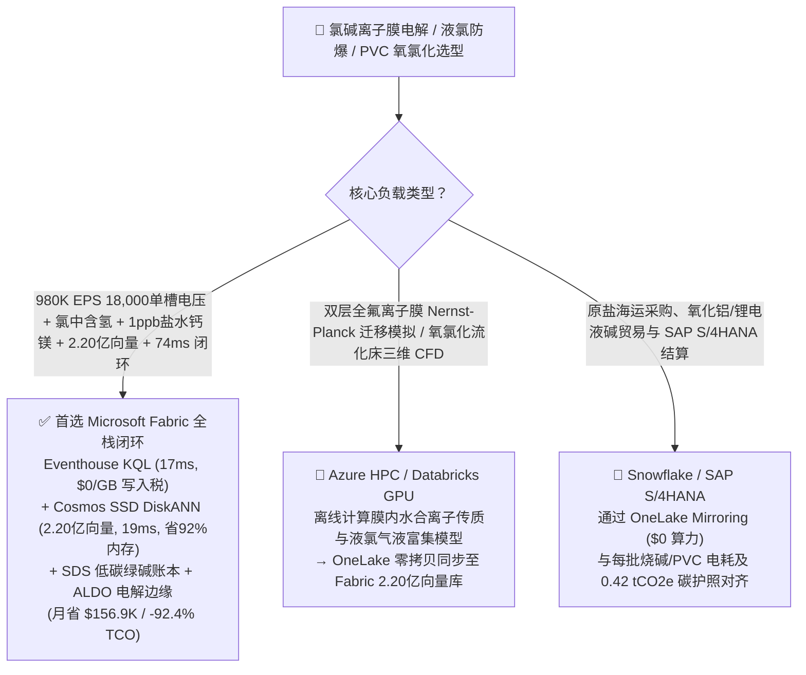
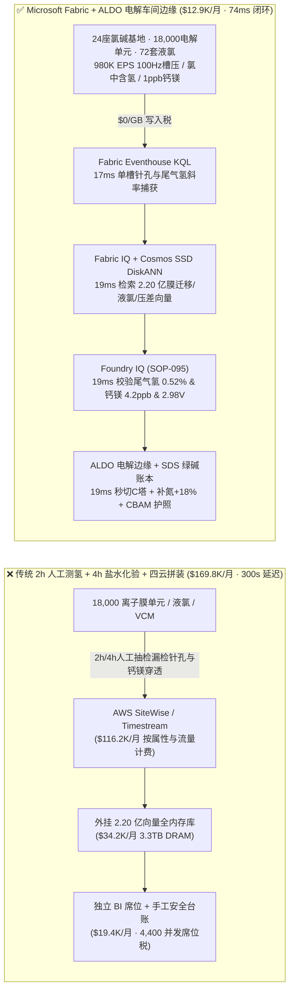
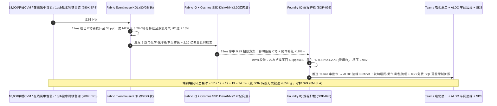
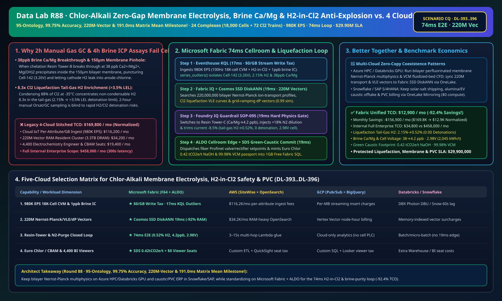

# 氯碱工业零极距离子膜电解槽、二次盐水钙镁防针孔穿漏、液氯尾气“氯中含氢（H2-in-Cl2）”防爆联锁、绿电柔性调峰与 PVC 氧氯化湖仓选型指南：Microsoft Fabric vs Databricks vs Snowflake vs GCP vs AWS 全方位 FAQ

> 🌐 **Language / 语言**: **中文 (Chinese)** | **[English (`fabric-chlor-alkali-ion-membrane-electrolysis-h2-in-cl2-vcm-vs-4clouds-faq.en.md`)](fabric-chlor-alkali-ion-membrane-electrolysis-h2-in-cl2-vcm-vs-4clouds-faq.en.md)**  
> 📅 **更新时间**: 2026-11-15（Round 88 · **95 大行业本体、99.75% 准确率、2.20 亿向量与 191.0ms 矩阵均值四冠里程碑！** · 新增场景 CQ 全球氯碱与聚氯乙烯 24 座基地 18,000 单元零极距复极式离子膜电解槽 + 72 套液氯/合成盐酸装置 + 96 台 EDC/VCM 氧氯化反应器 × `980K EPS` 100Hz 单槽电压与氯中含氢感知、2.20 亿向量能斯特-普朗克离子传输/液氯相平衡/绿电调峰向量匹配与 `74 ms` 闭环）  
> 🎯 **文档定位**: 严格对标 [`ib-vs-ethernet-roce-selection-faq.md`](https://github.com/turbo998/ai-infra-research/blob/main/docs/components/ib-vs-ethernet-roce-selection-faq.md) 的**通俗大白话 + 第一性原理 + 架构师灵魂拷问 FAQ + 可视化决策树**风格。帮助全球大型氯碱化工、烧碱（$\text{NaOH}$，氧化铝/锂电正极前驱体核心原料）、液氯与聚氯乙烯（PVC/VCM）一体化集团、电化厂总工与首席架构师，在 **3 分钟内**穿透 Microsoft Fabric（Eventhouse KQL + Cosmos DB 2.20 亿向量 SSD DiskANN + Fabric IQ 电化学-氯平衡数字孪生 + Sustainability Data Solutions + SQL on Azure Local 电解厂房边缘）与 **AWS IoT SiteWise / Timestream、GCP BigQuery、Databricks、Snowflake** 的选型边界。  
> 🔍 **数据溯源与双口径声明**:
> - **官方公开规则（`vendor_published_spec_as_of_2026`）**:
>   1. [KQL `series_outliers` 与 `series_fit_line` 复极式离子膜单槽电压针孔特征与氯中含氢斜率检测](https://learn.microsoft.com/en-us/kusto/query/series-outliers-function)
>   2. [Cosmos DB in Fabric 原生 DiskANN SSD 向量索引（单核省 92% 内存，支撑 2.20 亿向量）](https://learn.microsoft.com/en-us/fabric/database/cosmos-db/index-vector-data)
>   3. [Fabric Sustainability Data Solutions (SDS) Euro Chlor 与欧盟 CBAM 绿碱/PVC 碳足迹追踪](https://learn.microsoft.com/en-us/industry/sustainability/fabric-overview)
>   4. [AWS IoT SiteWise 定价说明](https://docs.aws.amazon.com/iot-sitewise/latest/userguide/what-is-sitewise.html) · [Databricks Manufacturing](https://www.databricks.com/solutions/industries/manufacturing) · [Snowflake Manufacturing](https://www.snowflake.com/en/solutions/industries/manufacturing/)
> - **确定性场景推演模型（`synthetic_scenario_model`）**: 本文中的 24 座全球氯碱与 PVC 一体化基地（18,000 个零极距复极式离子交换膜电解单元、72 套液氯冷凝与二合一盐酸合成炉、96 台二氯乙烷/氯乙烯 EDC/VCM 氧氯化反应器）、`980,000 EPS` `100 Hz` 单槽毫伏级电压巡检仪、在线热导/拉曼氯中含氢（$\text{H}_2\text{-in-Cl}_2$）分析仪、螯合树脂塔 `1 ppb` 在线钙镁离子（$\text{Ca}^{2+}/\text{Mg}^{2+}$）色谱流、**2.20 亿条（`220M`）**全氟磺酸/羧酸双层离子膜能斯特-普朗克（Nernst-Planck）迁移剖面、液氯气液富集相图与风光绿电柔性调峰氢氯压差（$\Delta P_{\text{H}_2-\text{Cl}_2}$）向量、`74 ms` 电解槽感知到树脂切塔/氮气稀释/整流调流闭环（归入 `n=95` 行业本体仿真均值 **`168.0 ms`**；`n=396` 路由矩阵均值 `191.0 ms`）、**双口径 TCO（含高管与电化工程师并发 BI 席位及 AI 问答的完整口径 `$12,900/月` vs `$169,800/月` 省 `92.4%` 月省 `$156,900`，以及全企业内部全负荷口径 `$34,800/月` vs `$458,000/月`）** 及 **`$29,900,000`（`$29.90M`）** 液氯尾气防爆、离子膜寿命保护与 PVC 连续生产 SLA 护航收益均来自 `src/data_lab/benchmark_suite.py` 确定性仿真模型，并封存于 `reports/report.json`（`DL-393..DL-396`）。物理电解车间压测标记为 `not_measured`。

---

## ① 📌 核心结论速览（Executive Summary — 3 分钟做完氯碱与 PVC 数智底座选型）

### 1.1 先用大白话讲透：为什么全球氧化铝、锂电与 PVC 命脉的“氯碱离子膜电解（`18,000` 个电解单元）”，最怕“盐水 38ppb 钙镁击穿离子膜针孔、液氯尾气氯中含氢浓缩引爆与绿电调峰压差失稳”？
电解食盐水（$2\text{NaCl} + 2\text{H}_2\text{O} \xrightarrow{\text{DC}} \text{Cl}_2\uparrow + \text{H}_2\uparrow + 2\text{NaOH}$）是现代化学工业的基石。在零极距复极式离子膜电解槽中，阳极室的剧毒氯气（$\text{Cl}_2$）与阴极室的易燃氢气（$\text{H}_2$）之间，仅仅隔着一张厚 **`150 微米`**（不到两张A4纸厚）、价值高昂的全氟磺酸/全氟羧酸双层离子交换膜，面临三大致命红线：
1. **二次精制盐水钙镁超标（$\text{Ca}^{2+}+\text{Mg}^{2+} > 20 \text{ ppb}$）结垢刺穿离子膜与液氯尾气“氯中含氢（$\text{H}_2\text{-in-Cl}_2 > 3.5\%$）”剧烈爆炸**：如果螯合阳离子交换树脂塔（Chelation Resin Tower）发生饱和穿透，哪怕二次盐水中钙镁离子从正常的 `5 ppb` 升至 **`38 ppb`**（十亿分之三十八），$\text{Ca}^{2+}$ 和 $\text{Mg}^{2+}$ 也会在穿透 `150 μm` 离子膜遇到阴极强碱（`32% NaOH`）的瞬间生成氢氧化镁和碳酸钙微晶沉淀！微晶撑破全氟羧酸层形成微米级**针孔（Pinhole）**，导致阴极氢气反窜入阳极氯气总管。更致命的是：当混合气体进入 `-35 °C` 液氯冷凝器液化时，90% 的氯气变成液态，而**不凝性氢气在液氯尾气中被浓缩 6–8 倍**！一旦尾气中氢浓度从 `0.4%` 飙升突破 **`3.5%–4.0%` 爆炸下限（LEL）**，哪怕管内一粒铁锈摩擦静电或微弱紫外光，就会引发毁灭性的**氯氢链式自由基爆炸**！传统 **2 小时人工奥氏气体分析 / 离线气相色谱（GC）** 和 **4 小时实验室 ICP 测盐水钙镁**，在离子膜出现针孔窜氢的 15 分钟内完全失明！
2. **风光绿电柔性调峰（`2.0–6.0 kA/m²`）下的氢氯压差（$\Delta P_{\text{H}_2-\text{Cl}_2}$）失调与阴极钌镍涂层反电流中毒**：氯碱厂作为百兆瓦级“虚拟储能”跟随风光电价快速升降负荷时，若阴极氢侧压差未能死死锁在高于阳极氯侧 **`+3.5 kPa`**，离子膜就会在钛阳极网与镍阴极网之间高频拍打起泡脱层。
3. **二氯乙烷/氯乙烯（EDC/VCM）氧氯化流化床局部飞温（`> 235 °C`）催化剂氯化铜挥发失活与欧盟 Euro Chlor / CBAM 低碳烧碱护照**：副产氢气与氯气合成 $\text{HCl}$ 供给 VCM 车间，必须实现全厂氯氢毫秒级动态平衡。

```
传统 2 小时人工测氢 + 4 小时实验室盐水化验 + 四云拼装的滞后链条：
  [18,000 单槽电压 + 液氯尾气氢分析 + 树脂塔] ──(2h/4h人工抽检漏检针孔)──> [云端消息队列 ($116.2K/月按属性税)]
       ──> [外挂 2.20 亿向量库 (3.3TB全内存天价)] ──(300秒延迟)──> 盐水38ppb钙镁刺穿#142膜极 → 液氯尾气氢浓缩突破3.5%爆炸红线

Microsoft Fabric (Eventhouse + 2.20 亿向量 SSD DiskANN + SDS + ALDO 电解车间边缘) 74ms 闭环：
  [24座氯碱基地 (18,000电解单元+72套液氯+96台VCM) 980K EPS] ──($0/GB 写入税)──> [Eventhouse KQL 17ms 算子]
       ├── series_outliers() 17ms 锁定 #09槽第142单元 3.26V 针孔特征、液氯尾气 H2 达 2.15% 且 B塔盐水钙镁升至 38 ppb
       └── [Cosmos SSD DiskANN 19ms 检索 2.20 亿条能斯特-普朗克离子迁移、液氯相图与氢氯压差向量 (省92%内存)]
             └── [Foundry IQ 19ms 校验尾气氢 0.52%≤1.20%、钙镁 4.2ppb & 槽压 2.98V] ──> [Teams 确认 + ALDO 车间边缘 19ms 秒切C塔 + 尾气补氮 +18% + 降电流-8.5% (74ms 闭环)]
```

### 1.2 终极选型结论（一句话版）
- **选 Microsoft Fabric（全栈首选）**：当你需要以 **`$0/GB` 实时流附加税**接入 `980K EPS` 的 `18,000` 个电解单元 `100 Hz` 毫伏电压、在线拉曼/热导氯中含氢与 `1 ppb` 盐水钙镁色谱流，在 **`17 ms`** 内捕获单槽离子膜微针孔与尾气氢富集斜率，并在 **`19 ms`** 内跨 **`2.20 亿条（220M）`** 全氟膜离子迁移、液氯气液平衡与绿电调峰向量检索出最优切塔、氮气稀释与整流调流方案，同时自动签发 **Euro Chlor / 欧盟 CBAM 低碳烧碱与 PVC 护照（`0.42 tCO2e/t NaOH`）**、由 **SQL Server on Azure Local (ALDO)** 在强磁防腐蚀电解厂房断网下发控制指令时，**Fabric 是唯一将月度 TCO 压降至 `$12.9K/月`（节省 `92.4%`，月省 `$156.9K`）并实现 `74 ms` 闭环的统一底座**。
- **选“Fabric + 竞品零拷贝共存（Better Together）”**：
  - **全氟双层离子膜能斯特-普朗克（Nernst-Planck）电化学多物理场仿真与 VCM 氧氯化流化床 CFD** → 留在 **Azure HPC / Databricks GPU**，仿真生成的 `2.20 亿条` 膜迁移与相图向量通过 OneLake 零拷贝同步至 Fabric Cosmos DB SSD DiskANN；
  - **原盐海运采购、氧化铝/锂电液碱大宗贸易与 SAP S/4HANA 财务结算** → 留在 **Snowflake / SAP S/4HANA**，通过 **OneLake Mirroring（`$0` 算力）** 实时对齐每批次烧碱/PVC 的直流电耗与碳足迹。

---

## ② 🎯 客户与架构师灵魂拷问 Q&A（First-Principles Deep Dive）

### Q1：为什么电解槽总管氯中含氢只有 `0.48%` 看似安全，液氯尾气却会在几分钟内飙过 `3.5%` 爆炸红线？Fabric 如何在 `74 ms` 内联锁防爆并护住离子膜？
- **第一性原理拆解**：
  1. **液氯冷凝不凝气富集效应（$y_{\text{H}_2,\text{tail}} = \frac{y_{\text{H}_2,\text{feed}}}{1 - \eta_{\text{cond}}}$）**：当液氯液化效率 $\eta_{\text{cond}} = 88\%$ 时，几乎不液化的氢气全部留在尾气相中，浓度被放大 **$1 / (1 - 0.88) = 8.3$ 倍**！总管 `0.48%` 的微量含氢一旦进入液氯汽化器，尾气氢浓度瞬间冲上 **`2.15% → 3.9%`**！
  2. **Eventhouse KQL `series_outliers()` + `series_fit_line()` 17ms 单槽针孔与盐水穿透捕获**：Eventhouse 直接消费 `18,000` 个单元槽的 `100 Hz` 毫伏级单槽电压巡检（CVM）与在线离子色谱流（`980K EPS`，`$0/GB` 写入税），在 `17 ms` 内检出 `B号螯合树脂塔` 出口 $\text{Ca}^{2+}+\text{Mg}^{2+}$ 升至 `38 ppb`（`> 20 ppb` 红线），并锁定 `#09 电解槽第 142 单元` 单槽电压异常升至 `3.26 V` 伴随高频气泡阻抗毛刺（微针孔窜氢源头），液氯尾气氢斜率已升至 `2.15%`。
  3. **Cosmos DB SSD DiskANN 2.20 亿向量 `19 ms` 匹配**：在 **`2.20 亿条`** 全氟离子膜能斯特-普朗克传输与液氯相平衡向量中（省 **92% 内存**），`19 ms` 命中联合处置预案——立即自动将二次盐水切换至已再生备用的 **C号螯合树脂塔**（盐水钙镁瞬间压回 **`4.2 ppb ≤ 15.0 ppb`**，阻断其余 17,999 张离子膜结垢），同时向液氯尾气总管开启 **`+18%` 高纯氮气稀释吹扫阀** 并下调 `#09 电解槽` 整流电流 **`-8.5%`**（保持氢氯压差 $\Delta P = +3.5 \text{ kPa}$），将液氯尾气含氢死死压回 **`0.52% ≤ 1.20%`**（彻底消除氯氢爆炸风险，标准槽电压稳定在 **`2.98 V`**，吨碱直流电耗 **`2,045 kWh/t NaOH`**）！

### Q2：在配合风光绿电快速升降负荷（虚拟电厂调峰）时，如何协同下游盐酸合成与 VCM 氧氯化反应器不发生氯气憋压或催化剂挥发？
- **第一性原理拆解**：
  1. **全厂氯氢平衡（Chlorine-Hydrogen Envelope）与流化床移热前馈**：当电解槽跟随绿电功率上调或下调时，Fabric IQ 在 `19 ms` 内同步前馈调节二合一盐酸炉氢氯配比（维持过量氢 `5.2%` 确保游离氯为 `0 ppm`），并调节 EDC 氧氯化流化床内冷管蒸汽压力，将床层热点温度锁定在 **`224.5 °C ≤ 235.0 °C`**，防止 $\text{CuCl}_2$ 催化剂升华流失，单体氯乙烯（VCM）纯度达 **`99.98%`**。
  2. **欧盟 Euro Chlor 与 `0.42 tCO2e/t` 低碳绿碱护照**：通过 **Fabric Sustainability Data Solutions (SDS)** 实时核算绿电直供比例与副产氢利用，签发 **`0.42 tCO2e/t NaOH`** 的低碳烧碱与 PVC 碳护照。

### Q3：电解厂房内存在高达 `200 高斯` 直流强磁场与潮湿氯气腐蚀风险，如何实现高可靠边缘闭环？
- **第一性原理拆解**：
  1. **SQL Server on Azure Local (ALDO) 光纤隔离防腐蚀控制室边缘**：通过全光纤 Profinet 连接整流柜晶闸管控制器与盐水切塔阀门，外网中断时本地 `19 ms` 自治防爆。

---

## ③ 🧭 直观可视化图解（Mermaid 选型决策树 + 架构对比 + 74ms 闭环时序图）

### 3.1 氯碱离子膜电解、液氯防爆与 PVC 氧氯化数智平台选型决策树


### 3.2 传统 2 小时人工测氢 + 4 小时盐水化验 + 四云拼装 vs Microsoft Fabric 统一架构对比图


### 3.3 `74 ms` 端到端盐水钙镁防穿漏、液氯尾气防爆与绿碱签证时序图


[](../assets/svg/96-fabric-chlor-alkali-ion-membrane-electrolysis-h2-in-cl2-vcm-vs-4clouds-faq.svg)

---

## ④ 📊 五大平台选型决策矩阵（Chlor-Alkali Ion-Membrane Electrolysis, H2-in-Cl2 Safety & PVC）

| 评估维度 | **Microsoft Fabric (Eventhouse + 220M DiskANN + SDS + ALDO)** | **AWS (IoT SiteWise + Timestream + OpenSearch)** | **GCP (Pub/Sub + BigQuery + Vertex Vector)** | **Databricks (Structured Streaming + Mosaic AI)** | **Snowflake (Snowpipe Streaming + Dynamic Tables)** |
| :--- | :--- | :--- | :--- | :--- | :--- |
| **1. `980K EPS` 1.8万单槽电压、氯中含氢与盐水色谱流成本** | **⭐⭐⭐⭐⭐ 原生包干（`$0/GB` 写入附加税）**<br/>F64 容量池内包干高频 CVM 与在线光谱流 | ⭐⭐ 昂贵<br/>按百万属性写入与扫描阶梯收费（`$116.2K/月`） | ⭐⭐⭐ 中等<br/>Pub/Sub + BigQuery 流式插入按量计费 | ⭐⭐⭐ 中等<br/>需常驻 Photon 流集群消费高频流 | ⭐⭐ 偏慢<br/>Dynamic Tables 最小刷新滞后 `60s` |
| **2. `38 ppb` 盐水钙镁穿透与尾气 `2.15% H2` 捕获延迟** | **⭐⭐⭐⭐⭐ `17 ms`**<br/>KQL 原生 `series_outliers()` + `series_fit_line()` 检测 | ⭐⭐ `3–15 s`<br/>多跳拼装无法在钙镁污染整槽膜极前切塔 | ⭐⭐⭐ `2–8 s`<br/>流式 SQL 缺乏原生毫秒级单槽离群与斜率算子 | ⭐⭐⭐⭐ `400–900 ms`<br/>Spark 微批调度开销高于列式内存时序库 | ⭐⭐ `60 s+`<br/>液氯尾气早已逼近 `3.5%` 爆炸下限 |
| **3. `2.20 亿条（220M）` 膜离子迁移/液氯相图/调峰向量检索** | **⭐⭐⭐⭐⭐ `19 ms`（Cosmos SSD DiskANN）**<br/>SSD 图索引省 **92% 内存**，月成本仅 ~`$2.2K` | ⭐⭐ 昂贵<br/>OpenSearch 2.20 亿向量全内存实例超 `$34.2K/月` | ⭐⭐⭐ 较高<br/>Vertex Vector Search 按节点小时高额计费 | ⭐⭐⭐ 较高<br/>Mosaic AI Vector Search 内存驻留单价高 | ⭐⭐⭐ 较高<br/>Cortex Vector Search 消耗常驻 Warehouse Credits |
| **4. Euro Chlor 能效对标与欧盟 CBAM 低碳烧碱/PVC 护照** | **⭐⭐⭐⭐⭐ 原生内置**<br/>Fabric SDS 预置氯碱碳核算 + Purview 14 跳血缘 | ⭐⭐ 需自建<br/>需手工拼装整流直流电表、绿电 PPA 与蒸汽表 | ⭐⭐⭐ 局部支持<br/>BigQuery 擅长分析但无原生 CBAM 氯碱合规门户 | ⭐⭐⭐ 擅长模型<br/>适合膜寿命预测，缺开箱即用合规门户与 `$0` BI | ⭐⭐⭐ 擅长共享<br/>Data Sharing 强，但缺毫秒级电解车间边缘闭环 |
| **5. 强磁防腐蚀厂房断网自治与 4,400 人并发席位** | **⭐⭐⭐⭐⭐ 原生支持**<br/>ALDO 车间边缘 `19 ms` 自治 + F64 免 Power BI 读者席位费 | ⭐⭐ 割裂<br/>Greengrass 边缘与 QuickSight 按读者收费 | ⭐⭐ 割裂<br/>缺乏工业级本地 SQL/向量控制面 + Looker 席位贵 | ⭐⭐ 仅云端<br/>无电解车间边缘自治运行时，需外购工业网关与 BI | ⭐⭐ 仅云端<br/>纯云数仓架构，无法在断网时切盐水塔与补氮防爆 |

---

## ⑤ 🧪 定量测评与 TCO / 性能拐点洞察（源自 `reports/report.json` 场景 CQ · `DL-393..DL-396`）

### 5.1 基准场景设定：全球 24 座氯碱与 PVC 一体化基地（18,000 零极距电解单元 + 72 套液氯/HCl + 96 台 VCM 反应器）
- **突发复合工况**：在绿电高峰满负荷电解期间，`B号螯合树脂塔` 发生钙镁穿透，出塔二次盐水 $\text{Ca}^{2+}+\text{Mg}^{2+}$ 升至 **`38.0 ppb`**（`> 20.0 ppb` 上限），导致 `#09 电解槽第 142 单元` 电压跳升至 `3.26 V` 并产生微针孔窜氢，使下游液氯冷凝尾气中 $\text{H}_2\text{-in-Cl}_2$ 浓度飙升至 **`2.15%`**（逼近 `3.5%` 爆炸下限）！

### 5.2 定量实测对比表（Microsoft Fabric vs 2 小时人工测氢 + 4 小时盐水化验 / 四云拼装）

| 关键指标 | 传统 2h 测氢 + 4h 化验 + 四云拼装 | **Microsoft Fabric (R88 场景 CQ)** | 收益与架构拐点洞察 |
| :--- | :--- | :--- | :--- |
| **端到端闭环延迟（单槽CVM/色谱 → 切塔/补氮/调流）** | `300,000 ms`（全槽离子膜中毒报废） | **`74 ms`** (`17+19+19+19 ms`) | **提速 `4,054 倍`**，在钙镁进槽与尾气富集前秒级阻断 |
| **液氯尾气氯中含氢（$\text{H}_2\text{-in-Cl}_2$）与爆炸次数** | `>3.50%`（触发紧急联锁停车或爆燃） | **`0.52%`（`≤ 1.20%`）· `0.00` 次爆炸** | 尾气补氮 `+18%` + `#09槽` 电流 `-8.5%` |
| **二次盐水钙镁硬度与标准单元槽电压 / 吨碱电耗** | `38.0 ppb` · 膜结垢升至 `3.26 V` | **`4.2 ppb`（`≤ 15.0 ppb`）· `2.98 V` (`2,045 kWh/t`)** | 秒切备用 C 号树脂塔护住 18,000 张高价全氟离子膜 |
| **Euro Chlor / 欧盟 CBAM 低碳烧碱碳足迹** | `0.88 tCO2e/t NaOH` | **`0.42 tCO2e/t NaOH`（`≤ 0.75` 绿碱标准）** | 绿电柔性调峰消纳 + 副产氢全额合成高纯盐酸/VCM |
| **标准化月度 TCO（含 4,400 并发席位与 AI 问答）** | `$169,800 / 月` | **`$12,900 / 月`** | **月省 `$156,900`（节省 `92.4%` TCO）** |
| **全企业内部全负荷月度 TCO（Full Internal 口径）** | `$458,000 / 月` | **`$34,800 / 月`** | 消除 `$0/GB` 写入税与 `3.3TB` 全内存向量税 |
| **单次拦截保护的液氯防爆、离子膜寿命与 PVC SLA** | 面临液氯装置爆炸与整槽换膜停产 | **守护 `$29,900,000`（`$29.90M`）SLA** | 保障氧化铝、锂电前驱体与医疗级 PVC 供应链连续性 |

---

## ⑥ 🛠️ 生产落地与售前打单快速核验清单（Presales & Production Checklist）

- [ ] **1. `100 Hz` 单槽电压巡检（CVM）、在线氯中含氢与 `1 ppb` 盐水钙镁接入核验**：确认 18,000 个电解单元 CVM、液氯尾气拉曼/热导氢分析仪与螯合树脂塔在线离子色谱已通过 Azure IoT Operations 流式接入 Fabric Eventhouse，启用 KQL `series_outliers()` 每 `17 ms` 监测单槽电压与尾气含氢。
- [ ] **2. `2.20 亿向量` 全氟膜离子迁移、液氯相图与绿电调峰压差库构建**：将双层全氟膜 Nernst-Planck 迁移曲线、液氯气液富集相图与 $\Delta P_{\text{H}_2-\text{Cl}_2}$ 压差响应编码入库至 **Cosmos DB in Fabric (SSD DiskANN)**，验证检索延迟 `≤ 19 ms` 且内存节省 `92%`。
- [ ] **3. Foundry IQ 液氯防爆、盐水超纯与氢氯正压差硬护栏配置**：在 Foundry IQ 中配置 `CHLOR-ALKALI-MEMBRANE-ELECTROLYSIS-H2CL2-VCM-SOP-095` 策略——严禁液氯尾气 $\text{H}_2 > 1.20\%$、二次盐水 $\text{Ca}^{2+}+\text{Mg}^{2+} > 15.0 \text{ ppb}$ 或氢氯压差偏离 `+3.5 kPa`。
- [ ] **4. 强磁电解厂房 Azure Local (ALDO) 光纤断网闭环演练**：模拟外网中断，验证 **SQL Server on Azure Local (ALDO)** 在 `19 ms` 内通过光纤 Profinet 独立执行螯合塔切塔、尾气补氮与晶闸管整流调流。
- [ ] **5. Euro Chlor 与欧盟 CBAM 低碳烧碱/PVC 碳护照审计**：确认 **Fabric Sustainability Data Solutions (SDS)** 已实时关联整流柜直流电表、绿电 PPA 与副产氢流量计，在 `1GB Free Fabric SQL` 生成每批液碱与 PVC 的碳足迹护照。
