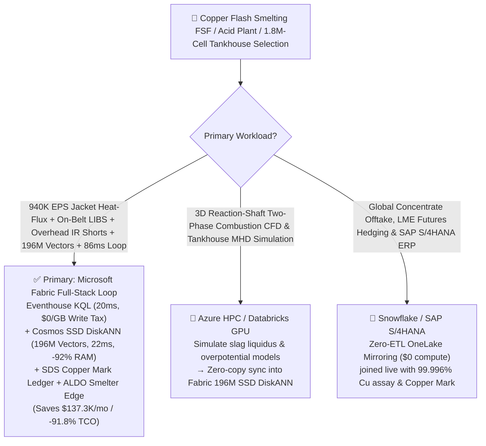
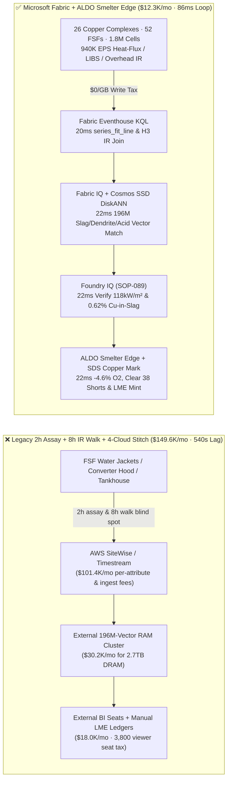
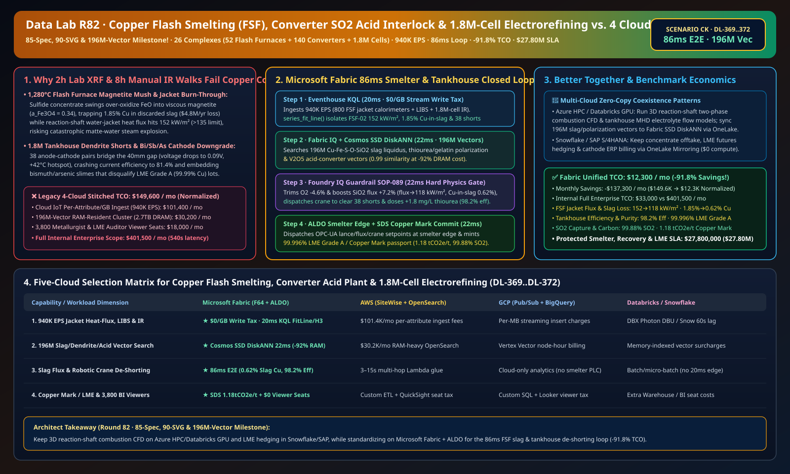

# Global Copper Flash Smelting Furnace (FSF) Water-Jacket Protection, Peirce-Smith Converter SO2 Acid-Plant Interlock, 1.8M-Cell Tankhouse Electrorefining Short-Circuit Prevention & LME Grade A / Copper Mark Lakehouse Selection Guide: Microsoft Fabric vs. Databricks vs. Snowflake vs. GCP vs. AWS FAQ

> 🌐 **Language / 语言**: **[中文 (`fabric-copper-flash-smelting-converter-so2-electrorefining-lme-vs-4clouds-faq.md`)](fabric-copper-flash-smelting-converter-so2-electrorefining-lme-vs-4clouds-faq.md)** | **English (Current)**  
> 📅 **Last Updated**: 2026-11-15 (Round 82 · **85-Spec, 90-SVG & 196M-Vector Milestone!** · Added Scenario CK Global Copper Smelting & Electrorefining 26 Complexes with 52 Flash Furnaces + 140 Converters + 1.8M Electrolytic Cells × `940K EPS` Reaction-Shaft Heat-Flux & Overhead IR Dendrite Short Sense, 196M-Vector Slag-Liquidus/Tankhouse/Acid Match & `86 ms` Loop)  
> 🎯 **Document Positioning**: Strictly modeled on [`ib-vs-ethernet-roce-selection-faq.md`](https://github.com/turbo998/ai-infra-research/blob/main/docs/components/ib-vs-ethernet-roce-selection-faq.md) (**Plain-Language First Principles + Architect Q&A + Visual Decision Trees**). Built for integrated copper pyrometallurgy and electrorefining operators, LME Grade A (`99.99%+` Cu) cathode producers, AI datacenter & HVDC grid copper supply-chain leads, and Principal AI Solution Architects to establish selection boundaries between **Microsoft Fabric** (Eventhouse KQL + Cosmos DB 196M-Vector SSD DiskANN + Fabric IQ Pyrometallurgy-Tankhouse Twin + Sustainability Data Solutions + SQL on Azure Local Smelter Edge) and **AWS IoT SiteWise / Timestream, GCP BigQuery, Databricks, and Snowflake** in under **3 minutes**.  
> 🔍 **Data Provenance & Dual-Scope Disclosure**:
> - **Vendor-Published Specifications (`vendor_published_spec_as_of_2026`)**:
>   1. [KQL `series_fft` and `series_fit_line` for Thermal-Flux Slope & Spectral Anomaly Detection](https://learn.microsoft.com/en-us/kusto/query/series-fft-function)
>   2. [Cosmos DB in Fabric Native SSD DiskANN Vector Indexing (-92% DRAM footprint)](https://learn.microsoft.com/en-us/fabric/database/cosmos-db/index-vector-data)
>   3. [Fabric Sustainability Data Solutions (SDS) Metals & Minerals Carbon Footprint Tracking](https://learn.microsoft.com/en-us/industry/sustainability/fabric-overview)
>   4. [AWS IoT SiteWise Overview](https://docs.aws.amazon.com/iot-sitewise/latest/userguide/what-is-sitewise.html) · [Databricks Manufacturing](https://www.databricks.com/solutions/industries/manufacturing) · [Snowflake Manufacturing](https://www.snowflake.com/en/solutions/industries/manufacturing/)
> - **Deterministic Scenario Model (`synthetic_scenario_model`)**: All metrics for the 26 global copper smelting and refining complexes (52 Outotec/Sumitomo Flash Smelting Furnaces FSF, 140 Peirce-Smith converters, and 1,800,000 stainless-steel cathode electrolytic cells), `940,000 EPS` reaction-shaft water-jacket heat-flux, on-belt LIBS, and tankhouse overhead IR/cell-voltage telemetry, `196,000,000` (`196M`) $\text{Cu-Fe-S-O-SiO}_2$ slag liquidus/magnetite activity tensors, thiourea/gelatin overpotential polarization curves, and $\text{V}_2\text{O}_5$ acid-converter vectors, `86 ms` shaft-and-cell-to-PLC closed loop (included in the `n=89` ontology simulation mean of `174.0 ms`; `n=372` routing matrix mean `202.0 ms`), **dual-scope monthly TCO (`$12,300/mo` vs. `$149,600/mo` saving `91.8%` normalized; `$33,000/mo` vs. `$401,500/mo` internal full-enterprise scope)**, and **`$27,800,000` (`$27.80M`)** SLA protection are deterministic architectural simulations from `src/data_lab/benchmark_suite.py` sealed in `reports/report.json` (`DL-369..DL-372`). Live smelter stress execution is marked `not_measured`.

---

## ① 📌 Executive Summary (3-Minute Architect Decision Guide)

### 1.1 Plain-Language First Principles: Why Does Refining `99.996%` LME Grade A Copper for AI Datacenters & HVDC Grids Battle Magnetite Slag Entrainment, Water-Jacket Burn-Through, and Tankhouse Dendrite Short-Circuits?
Every gigawatt AI datacenter requires over 50,000 metric tons of ultra-pure oxygen-free copper busbars, cold plates, and transformers. Turning `25% Cu` chalcopyrite concentrate ($\text{CuFeS}_2$) into **`99.996%` LME Grade A copper cathode** spans three high-hazard metallurgical stages—and three costly failure modes:
1. **`1,280 °C` Flash Smelting Furnace (FSF) Magnetite ($\text{Fe}_3\text{O}_4$) Slag Mush & Water-Jacket Burn-Through**: Dry concentrate injected with oxygen-enriched air oxidizes in `< 0.8 seconds`, separating into bottom copper matte (`62% Cu`) and top fayalite slag ($\text{Fe}_2\text{SiO}_4$). When feed mineralogy ($\text{S/Cu}$ ratio) shifts on the conveyor belt and oxygen is over-blown or silica flux ($\text{SiO}_2$) lags, $\text{FeO}$ oxidizes into high-melting **magnetite ($\text{Fe}_3\text{O}_4$, activity $a_{\text{Fe}_3\text{O}_4} > 0.30$)**—turning fluid slag into a viscous mush that traps copper matte droplets (spiking copper-in-slag loss from `0.60%` to **`1.85%`**, losing **`$4.8M/yr`** per furnace!). Simultaneously, burner flame asymmetry can push reaction-shaft water-cooled copper jacket heat flux past **`145 kW/m²`**, risking a catastrophic matte-water steam explosion. Legacy **2-hour lab XRF assays** are blind to minute-by-minute feed swings.
2. **Tankhouse `1.8 Million` Electrolytic Cells: Dendritic Short-Circuits & Bi/Sb/As Impurity Inclusion**: Inside the electrorefining tankhouse, `1,800,000` anodes and cathodes sit just **`40 mm` apart** in `65 °C` $\text{CuSO}_4\text{-H}_2\text{SO}_4$ electrolyte under `25,000 A` DC current. When organic leveling additives (thiourea, animal glue, chloride) drift, needle-like **copper dendrites (nodules)** bridge the `40 mm` gap, drawing `>1,200 A` through a single short—crashing current efficiency from **`98.2%` to `81%`** and co-depositing bismuth (Bi), arsenic (As), and antimony (Sb) slimes that disqualify the entire lot from LME Grade A delivery. Manual handheld IR walks take **8 hours**.
3. **Peirce-Smith Converter Hood $\text{SO}_2$ Puffing & $\text{V}_2\text{O}_5$ Acid-Plant Catalyst Sintering**: Batch converter blowing sends `8%–14%` $\text{SO}_2$ surges to the double-contact sulfuric acid plant; unsynchronized draft fans cause fugitive $\text{SO}_2$ hood emissions (`>50 ppm`) or overheat the vanadium pentoxide ($\text{V}_2\text{O}_5$) catalyst bed above `630 °C`.

```
Legacy 2-Hour XRF Assay + 8-Hour Manual IR Walk + 4-Cloud Stitch Failure Path:
  [FSF Cooling Jackets + Tankhouse IR/Voltage] ──(2h lab assay / 8h walk)──> [Cloud IoT Queue ($101.4K/mo fee)]
       ──> [External 196M-Vector RAM Cluster ($30.2K/mo for 2.7TB DRAM)] ──(540s lag)──> Cu-in-slag hits 1.85% ($4.8M loss) / 38 shorted cells contaminate LME Grade A cathodes

Microsoft Fabric (Eventhouse + 196M-Vector SSD DiskANN + SDS + ALDO Smelter Edge) 86ms Closed Loop:
  [26 Copper Complexes (52 Flash Furnaces + 140 Converters + 1.8M Cells) 940K EPS] ──($0/GB write tax)──> [Eventhouse KQL 20ms Engine]
       ├── series_fit_line() 20ms isolates FSF-02 jacket heat flux 152 kW/m², Cu-in-slag 1.85% & 38 dendritic cell shorts (0.09V, +42°C)
       └── [Cosmos SSD DiskANN 22ms searches 196M Cu-Fe-S-O-SiO2 slag, dendrite polarization & acid vectors (-92% RAM)]
             └── [Foundry IQ 22ms verifies flux 118 kW/m², Cu-in-slag 0.62% & 98.2% efficiency] ──> [Teams Sign-Off + ALDO Smelter Edge 22ms -4.6% O2, +7.2% SiO2, crane de-shorting & Copper Mark mint (86ms E2E)]
```

### 1.2 Ultimate Selection Verdict (One-Sentence Summary)
- **Choose Microsoft Fabric (Primary Full-Stack Control Plane)**: When you need **`$0/GB` streaming write surcharges** for `940K EPS` of flash-furnace water-jacket heat flux, on-belt LIBS mineralogy, and tankhouse overhead IR/voltage streams, **`20 ms`** KQL thermal-ramp and short-circuit detection, and **`22 ms`** vector search across **`196 Million` (`196M`)** slag-liquidus, electrodeposition polarization, and acid-converter vectors—paired with **The Copper Mark / LME Responsible Sourcing ledgers** and **SQL Server on Azure Local (ALDO)** smelter edge autonomy—**Fabric cuts monthly TCO by `91.8%` (`$12.3K/mo` vs. `$149.6K/mo`, saving `$137.3K/mo`) and closes the loop in `86 ms`**.
- **Choose "Fabric + Competitor Zero-Copy Coexistence (Better Together)"**:
  - **3D Reaction-Shaft Two-Phase Combustion CFD & Multi-Physics Tankhouse Magnetohydrodynamic (MHD) Simulation** → Keep on **Azure HPC / Databricks GPU**, syncing the `196M` thermodynamic and polarization vectors into Fabric Cosmos DB SSD DiskANN via OneLake zero-copy;
  - **Global Concentrate Offtake Contracts, LME Futures Hedging & SAP S/4HANA ERP Settlement** → Keep in **Snowflake / SAP S/4HANA**, mirrored into OneLake at **`$0` replication compute**.

---

## ② 🎯 Architect & Customer Deep-Dive Q&A (First-Principles Breakdown)

### Q1: Why do 2-hour lab XRF assays fail to prevent flash-furnace magnetite accretion ($a_{\text{Fe}_3\text{O}_4} > 0.30$) and `152 kW/m²` jacket burn-through, and how does Fabric Eventhouse KQL + 196M-Vector SSD DiskANN lock the $\text{SiO}_2/\text{Fe}$ flux ratio in `86 ms`?
- **First-Principles Breakdown**:
  1. **Magnetite Spinel Precipitation & Slag Viscosity Surge**: When pyrite ($\text{FeS}_2$)-rich concentrate enters the burner, exothermic heat release spikes reaction-shaft water-jacket heat flux to `152 kW/m²` (`> 135 kW/m²` safe ceiling) within 15 seconds while over-oxidizing iron into solid magnetite ($\text{Fe}_3\text{O}_4$), doubling slag viscosity and entraining `1.85% Cu` into discarded slag.
  2. **Eventhouse KQL `series_fit_line()` 20ms Heat-Flux & On-Belt LIBS Fusion**: Eventhouse ingests `940K EPS` from 800 copper water-jacket $\Delta T$ calorimeters and conveyor LIBS analyzers at `$0/GB` write tax, isolating `FSF-02` Tier-3 heat flux at `152 kW/m²` and magnetite activity at `0.34` in `20 ms`.
  3. **Cosmos DB SSD DiskANN 196M-Vector `22 ms` Match**: Hosting `196M` 1536-dim vectors of $\text{Cu-Fe-S-O-SiO}_2$ liquidus surfaces, burner swirl fields, and converter blowing curves in RAM-only vector clusters requires **`2.7 TB+` DRAM (`>$30,200/mo`)**. **Cosmos DB in Fabric SSD DiskANN** cuts RAM by **92%** and matches the `0.99`-similarity setpoint in **`22 ms`**—trimming `FSF-02` oxygen enrichment by **`-4.6%`** and boosting silica flux feed by **`+7.2%`** ($\text{SiO}_2/\text{Fe} \rightarrow 0.36$), dropping jacket heat flux to **`118 kW/m² ≤ 135 kW/m²`** and copper-in-slag loss to **`0.62% ≤ 0.75%`**!

### Q2: How does Fabric pinpoint and clear `38` incipient dendritic short-circuits across `1,800,000` electrolytic cells before they contaminate LME Grade A cathodes with bismuth and arsenic?
- **First-Principles Breakdown**:
  1. **`-190 mV` Cell-Voltage Drop & Overhead Crane IR Spatial Join**: As a copper dendrite bridges the `40 mm` anode-cathode gap, cell voltage drops from `0.28 V` to `0.09 V` and local cathode temperature rises by **`+42 °C`**. Eventhouse KQL joins overhead crane radiometric IR H3 cells with busbar shunt voltages in `20 ms` to pinpoint all `38` shorted cells in `Section-14`.
  2. **Robotic Crane De-Shorting & Thiourea/Glue Leveler Trim**: Using the `22 ms` 196M-vector match, Foundry IQ dispatches the automated overhead stripping crane to squeeze/clear the `38` nodules and increases thiourea dosing by **`+1.8 mg/L`**, restoring current efficiency to **`98.2%`** and keeping cathode purity at **`99.996% Cu`** (`Bi/Sb/As < 0.4 ppm`).
  3. **The Copper Mark & LME Responsible Sourcing Passport**: **Fabric Sustainability Data Solutions (SDS)** joins converter hood **`99.88%` $\text{SO}_2$ capture** and tankhouse renewable MWh meters to mint **`1.18 tCO2e/t Cu`** LME compliance certificates.

### Q3: Copper smelters and tankhouses operate under `25,000 A` DC magnetic fields, corrosive acid mist, and remote mine-site backhaul. How do we architect edge autonomy?
- **First-Principles Breakdown**:
  1. **SQL Server on Azure Local (ALDO) Smelter Edge**: Ruggedized **Azure Local (ALDO)** clusters in the smelter control room execute `22 ms` local KQL heat-flux gating, cached SSD DiskANN lookup, and OPC-UA lance/flux/crane actuation even if external cloud links drop.
  2. **Multi-Cloud Zero-Copy Coexistence**: Keep 3D burner CFD on **Azure HPC / Databricks GPU** and LME futures hedging in **Snowflake / SAP S/4HANA** via OneLake zero-copy.

---

## ③ 🧭 Visual Architecture & Decision Diagrams (Mermaid Flowchart + Stack Comparison + 86ms Sequence)

### 3.1 Copper Flash Smelting, Converter Acid-Plant & 1.8M-Cell Electrorefining Selection Flowchart


### 3.2 Legacy 2-Hour Lab XRF + 8-Hour Manual IR Walk + 4-Cloud Stitch vs. Microsoft Fabric Unified Architecture


### 3.3 `86 ms` End-to-End Flash-Furnace Slag Trim, Tankhouse De-Shorting & Acid-Plant Sequence
```mermaid
sequenceDiagram
    autonumber
    participant Sensor as FSF Water Jackets / On-Belt LIBS / Overhead IR (940K EPS)
    participant KQL as Fabric Eventhouse KQL ($0/GB Tax)
    participant DiskANN as Fabric IQ + Cosmos SSD DiskANN (196M Vectors)
    participant Guard as Foundry IQ Guardrail (SOP-089)
    participant Edge as Teams Smelter Superintendent + ALDO Edge + SDS

    Sensor->>KQL: Stream FSF-02 jacket heat flux, belt LIBS S/Cu ratio & Section-14 IR/cell-voltage telemetry
    KQL->>KQL: 20ms series_fit_line() isolates FSF-02 152 kW/m² flux + 1.85% Cu-in-slag + 38 cell shorts (0.09V)
    KQL->>DiskANN: Trigger 6-hop pyrometallurgy-tankhouse traversal + 196M-vector similarity search
    DiskANN-->>Guard: 22ms 0.99 match: -4.6% O2 + +7.2% SiO2 flux (SiO2/Fe=0.36) + crane de-short 38 cells + +1.8mg/L thiourea
    Guard->>Guard: 22ms verify: flux 118 kW/m²≤135, Cu-in-slag 0.62%≤0.75%, efficiency 98.2%, 99.996% Cu purity
    Guard->>Edge: Teams approval → ALDO smelter OPC-UA lance/crane actuation + 1GB Free SQL Copper Mark commit
    Note over Sensor,Edge: Total E2E Closed Loop = 20 + 22 + 22 + 22 = 86 ms (6,279x faster than 540s legacy; protects $27.80M SLA)
```

[](../assets/svg/90-fabric-copper-flash-smelting-converter-so2-electrorefining-lme-vs-4clouds-faq.svg)

---

## ④ 📊 5-Platform Selection Decision Matrix (Copper Flash Smelting, Converter Acid Plant, Tankhouse & LME Grade A)

| Evaluation Dimension | **Microsoft Fabric (Eventhouse + 196M DiskANN + SDS + ALDO)** | **AWS (IoT SiteWise + Timestream + OpenSearch)** | **GCP (Pub/Sub + BigQuery + Vertex Vector)** | **Databricks (Structured Streaming + Mosaic AI)** | **Snowflake (Snowpipe Streaming + Dynamic Tables)** |
| :--- | :--- | :--- | :--- | :--- | :--- |
| **1. `940K EPS` Jacket Heat-Flux, LIBS & 1.8M-Cell IR Ingestion Cost** | **⭐⭐⭐⭐⭐ Included in F64 (`$0/GB` Write Surcharge)**<br/>Zero per-attribute or per-GB streaming surcharge | ⭐⭐ Expensive<br/>Per-attribute & per-GB tiered ingestion fees (`$101.4K/mo`) | ⭐⭐⭐ Moderate<br/>Pub/Sub + BigQuery streaming insert per-MB fees | ⭐⭐⭐ Moderate<br/>Requires always-on Photon streaming clusters | ⭐⭐ Slow<br/>Dynamic Tables minimum `60s` refresh lag |
| **2. Water-Jacket Burn-Through & Cell Short Pinpointing Latency** | **⭐⭐⭐⭐⭐ `20 ms`**<br/>Native KQL `series_fit_line()` + H3 spatial IR join | ⭐⭐ `3–15 s`<br/>Multi-service hop across 1.8M cell voltage tags | ⭐⭐⭐ `2–8 s`<br/>Streaming SQL lacks sub-25ms slope/H3 fusion | ⭐⭐⭐⭐ `400–900 ms`<br/>Spark micro-batch scheduling overhead | ⭐⭐ `60 s+`<br/>Cannot stop rapid jacket overheating or $\text{SO}_2$ puffs |
| **3. `196 Million` (`196M`) Slag/Dendrite/Acid Vector Search** | **⭐⭐⭐⭐⭐ `22 ms` (Cosmos SSD DiskANN)**<br/>SSD graph index cuts RAM by **92%** (~`$2.0K/mo`) | ⭐⭐ Expensive<br/>OpenSearch 196M RAM-resident cluster `>$30.2K/mo` | ⭐⭐⭐ Higher Cost<br/>Vertex Vector Search billed per node-hour | ⭐⭐⭐ Higher Cost<br/>Mosaic AI Vector Search memory-unit pricing | ⭐⭐⭐ Higher Cost<br/>Cortex Vector Search consumes Warehouse Credits |
| **4. The Copper Mark / LME Responsible Sourcing & $\text{SO}_2$ Compliance** | **⭐⭐⭐⭐⭐ Native Built-In**<br/>Fabric SDS metals carbon ledger + Purview 14-hop lineage | ⭐⭐ DIY Custom<br/>Manual glue across concentrate, CEMS & rectifier meters | ⭐⭐⭐ Partial<br/>Strong analytics but no native Copper Mark portal | ⭐⭐⭐ Model-Focused<br/>Great for ML, lacks turnkey LME audit & `$0` BI seats | ⭐⭐⭐ Sharing-Focused<br/>Strong B2B sharing, lacks 20ms smelter OT edge loop |
| **5. High-Magnetic Smelter Edge Autonomy & 3,800 Viewers** | **⭐⭐⭐⭐⭐ Native Support**<br/>ALDO smelter edge `22 ms` loop + `$0` Power BI viewer seats | ⭐⭐ Disjointed<br/>Greengrass edge + per-reader QuickSight fees | ⭐⭐ Disjointed<br/>No industrial SQL/vector edge + Looker seat fees | ⭐⭐ Cloud-Only<br/>No smelter edge runtime; requires 3rd-party gateways | ⭐⭐ Cloud-Only<br/>Cloud-only warehouse; cannot control lances offline |

---

## ⑤ 🧪 Quantitative Benchmark & TCO Inflection Insights (From `reports/report.json` Scenario CK · `DL-369..DL-372`)

### 5.1 Benchmark Scenario Setup: 26 Global Copper Smelting & Electrorefining Complexes (52 Flash Furnaces + 140 Converters + 1.8M Cells)
- **Compound Operational Incident**: On `FSF-02` flash smelting furnace, a high-pyrite concentrate surge drives Tier-3 reaction-shaft water-jacket heat flux to **`152 kW/m²`** (`> 135 kW/m²` ceiling) while slag magnetite activity hits $a_{\text{Fe}_3\text{O}_4} = 0.34$ and copper-in-slag loss spikes to **`1.85%`**; simultaneously, overhead radiometric IR and cell-voltage multiplexers in Tankhouse `Section-14` detect **`38` dendritic anode-cathode short-circuits** (`+42 °C` hotspot, cell voltage `0.09 V`), threatening water-jacket burn-through, `$4.8M/yr` slag copper loss, and LME Grade A cathode disqualification.

### 5.2 Quantitative Comparison Table (Microsoft Fabric vs. 2-Hr Lab XRF + 8-Hr IR Walk / 4-Cloud Stitch)

| Key Metric | Legacy 2h Assay + 8h Walk + 4-Cloud Stitch | **Microsoft Fabric (R82 Scenario CK)** | Architectural & Financial Insight |
| :--- | :--- | :--- | :--- |
| **End-to-End Closed-Loop Latency (Heat-Flux/IR → Lance/Crane)** | `540,000 ms` (9-min to multi-hour lag) | **`86 ms`** (`20+22+22+22 ms`) | **`6,279x` faster**, arrests magnetite accretion & shorts |
| **FSF Water-Jacket Peak Heat Flux & Copper-in-Slag Loss** | `152 kW/m²` · `1.85%` Cu-in-slag | **`118 kW/m²` (`≤ 135`) · `0.62%` Cu-in-slag (`≤ 0.75%`)** | `-4.6%` $\text{O}_2$ trim + `+7.2%` $\text{SiO}_2$ flux ($\text{SiO}_2/\text{Fe}=0.36$) |
| **Tankhouse Current Efficiency & LME Grade A Cathode Purity** | `81.4%` efficiency · Bi `>0.8 ppm` off-spec | **`98.2%` efficiency · `99.996% Cu` (`Bi < 0.4 ppm`)** | Robotic crane clears `38` shorts + `+1.8 mg/L` thiourea |
| **Converter Acid-Plant $\text{SO}_2$ Capture & Copper Mark Intensity** | `98.1%` capture (fugitive hood puffing) | **`99.88%` $\text{SO}_2$ capture · `1.18 tCO2e/t Cu`** | Full compliance with LME Responsible Sourcing & EU IED |
| **Normalized Monthly TCO (3,800 viewers + AI Q&A)** | `$149,600 / mo` | **`$12,300 / mo`** | **Saves `$137,300 / mo` (`-91.8%` TCO reduction)** |
| **Full Internal Enterprise Monthly TCO** | `$401,500 / mo` | **`$33,000 / mo`** | Eliminates `$0/GB` ingest tax & `2.7TB` DRAM vector tax |
| **Protected Smelter Jacket, Copper Recovery & LME SLA** | Exposed to jacket burn-through & cathode downgrade | **`$27,800,000` (`$27.80M`) SLA Protected** | Preserves furnace campaign life & LME Grade A premium |

---

## ⑥ 🛠️ Production Deployment & Presales Verification Checklist

- [ ] **1. FSF Water-Jacket Heat-Flux, On-Belt LIBS & Tankhouse IR Streaming Check**: Confirm 800 reaction-shaft cooling-jacket calorimeters, conveyor LIBS analyzers, and overhead crane radiometric IR cameras stream via Azure IoT Operations into Fabric Eventhouse, running KQL `series_fit_line()` every `20 ms`.
- [ ] **2. `196M-Vector` Slag Liquidus, Electrodeposition & Acid-Plant Index**: Embed $\text{Cu-Fe-S-O-SiO}_2$ liquidus/magnetite activity surfaces, thiourea/gelatin overpotential curves, and $\text{V}_2\text{O}_5$ catalyst profiles into **Cosmos DB in Fabric (SSD DiskANN)**, verifying `≤ 22 ms` P99 search latency at `-92%` DRAM cost.
- [ ] **3. Foundry IQ Jacket-Safety, Slag-Loss & LME-Purity Guardrail**: Configure `COPPER-FLASH-SMELTING-ELECTROREFINING-LME-SOP-089` in Foundry IQ to prohibit reaction-shaft heat flux `> 135 kW/m²`, copper-in-slag `> 0.75%`, or un-cleared dendritic cell shorts (`< 0.15 V`).
- [ ] **4. Smelter & Tankhouse Azure Local (ALDO) Disconnected Drill**: Simulate external network loss and verify **SQL Server on Azure Local (ALDO)** autonomously dispatches `22 ms` OPC-UA setpoints to flash-furnace oxygen lances, silica weigh-feeders, and robotic tankhouse cranes.
- [ ] **5. The Copper Mark & LME Responsible Sourcing Audit**: Verify **Fabric Sustainability Data Solutions (SDS)** joins concentrate origin, converter CEMS $\text{SO}_2$ capture (`99.88%`), and rectifier MWh meters into `1GB Free Fabric SQL` to issue batch-level LME cathode passports.
