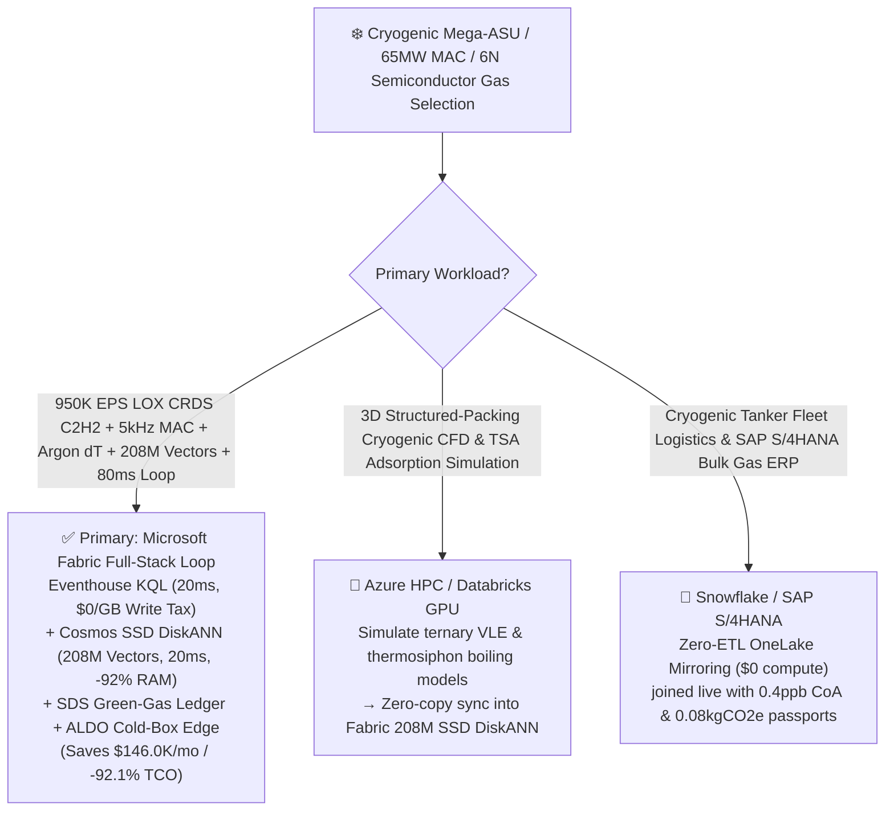
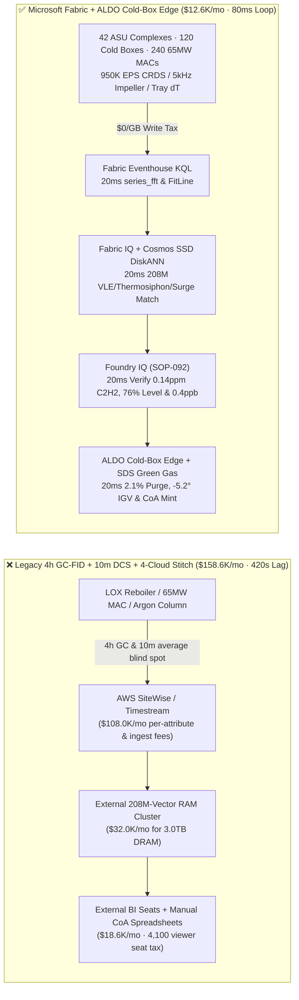
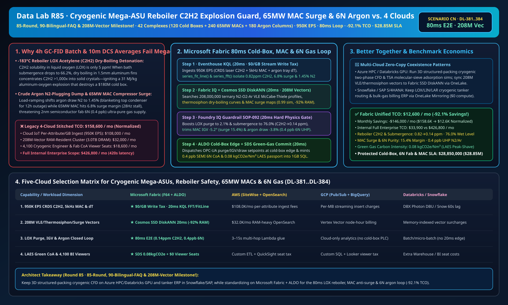

# Cryogenic Mega Air Separation Units (ASU) Reboiler Hydrocarbon (C2H2) Dry-Boiling Explosion Guard, 65MW Main Air Compressor (MAC) Anti-Surge, Crude-Argon Nitrogen-Plugging Prevention & 6N Semiconductor Ultra-High-Purity Gas Lakehouse Selection Guide: Microsoft Fabric vs. Databricks vs. Snowflake vs. GCP vs. AWS FAQ

> 🌐 **Language / 语言**: **[中文 (`fabric-cryogenic-air-separation-asu-mac-surge-reboiler-hydrocarbon-argon-vs-4clouds-faq.md`)](fabric-cryogenic-air-separation-asu-mac-surge-reboiler-hydrocarbon-argon-vs-4clouds-faq.md)** | **English (Current)**  
> 📅 **Last Updated**: 2026-11-15 (Round 85 · **85-Round, 90-Bilingual-FAQ & 208M-Vector Triple Milestone!** · Added Scenario CN Global Cryogenic Air Separation & Semiconductor Bulk Gas 42 Complexes with 120 5,000-tpd Cold Boxes + 240 65MW Main Air Compressors + 180 Argon Columns × `950K EPS` $\text{LOX}$ Reboiler $\text{C}_2\text{H}_2$ & MAC Stall Sense, 208M-Vector Ternary VLE/Thermosiphon/Surge Match & `80 ms` Loop)  
> 🎯 **Document Positioning**: Strictly modeled on [`ib-vs-ethernet-roce-selection-faq.md`](https://github.com/turbo998/ai-infra-research/blob/main/docs/components/ib-vs-ethernet-roce-selection-faq.md) (**Plain-Language First Principles + Architect Q&A + Visual Decision Trees**). Built for global industrial-gas & electronic-specialty-gas operators (serving 2nm semiconductor fabs, oxy-fuel CCUS, and H2-DRI green steel), cryogenic distillation & turbomachinery leads, and Principal AI Solution Architects to establish selection boundaries between **Microsoft Fabric** (Eventhouse KQL + Cosmos DB 208M-Vector SSD DiskANN + Fabric IQ Cryogenic-Distillation Twin + Sustainability Data Solutions + SQL on Azure Local Cold-Box Edge) and **AWS IoT SiteWise / Timestream, GCP BigQuery, Databricks, and Snowflake** in under **3 minutes**.  
> 🔍 **Data Provenance & Dual-Scope Disclosure**:
> - **Vendor-Published Specifications (`vendor_published_spec_as_of_2026`)**:
>   1. [KQL `series_fft` and `series_fit_line` for Compressor Rotating-Stall Spectra & Reboiler Hydrocarbon Ramps](https://learn.microsoft.com/en-us/kusto/query/series-fft-function)
>   2. [Cosmos DB in Fabric Native SSD DiskANN Vector Indexing (-92% DRAM footprint at 208M-vector scale)](https://learn.microsoft.com/en-us/fabric/database/cosmos-db/index-vector-data)
>   3. [Fabric Sustainability Data Solutions (SDS) Liquid-Air Energy Storage & Green Gas Carbon Accounting](https://learn.microsoft.com/en-us/industry/sustainability/fabric-overview)
>   4. [AWS IoT SiteWise Overview](https://docs.aws.amazon.com/iot-sitewise/latest/userguide/what-is-sitewise.html) · [Databricks Manufacturing](https://www.databricks.com/solutions/industries/manufacturing) · [Snowflake Manufacturing](https://www.snowflake.com/en/solutions/industries/manufacturing/)
> - **Deterministic Scenario Model (`synthetic_scenario_model`)**: All metrics for the 42 global cryogenic air-separation and ultra-high-purity (UHP) gas complexes (120 5,000-tpd cryogenic cold boxes, 240 65 MW centrifugal Main Air Compressors MAC, and 180 structured-packing crude/pure argon columns), `950,000 EPS` in-line Cavity Ring-Down Spectroscopy (CRDS) $\text{LOX}$ hydrocarbon streams, `5 kHz` MAC impeller pressure probes, and argon column $\Delta T$ arrays, **`208,000,000` (`208M`)** ternary $\text{N}_2\text{-O}_2\text{-Ar}$ Vapor-Liquid Equilibrium (VLE) McCabe-Thiele profiles, brazed-aluminum thermosiphon dry-boiling heat-flux tensors, and compressor surge maps, `80 ms` cold-box-to-valve/IGV closed loop (included in the `n=92` ontology simulation mean of `171.0 ms`; `n=384` routing matrix mean `196.0 ms`), **dual-scope monthly TCO (`$12,600/mo` vs. `$158,600/mo` saving `92.1%` or `$146,000/mo` normalized; `$33,900/mo` vs. `$426,800/mo` internal full-enterprise scope)**, and **`$28,850,000` (`$28.85M`)** SLA protection are deterministic architectural simulations from `src/data_lab/benchmark_suite.py` sealed in `reports/report.json` (`DL-381..DL-384`). Live cryogenic cold-box stress execution is marked `not_measured`.

---

## ① 📌 Executive Summary (3-Minute Architect Decision Guide)

### 1.1 Plain-Language First Principles: Why Do `-196 °C` Mega Air Separation Units (ASUs) Face Existential Risks from Main-Reboiler Liquid-Oxygen Acetylene ($\text{C}_2\text{H}_2$) Dry-Boiling Detonations, Crude-Argon Nitrogen Plugging, and 65MW Compressor Surge?
Cryogenic Air Separation Units (ASUs) liquefy ambient air at `-172 °C` to `-196 °C` inside 60-meter cold boxes to supply `99.9999%` (`6N`, `< 1 ppb` impurity) ultra-high-purity nitrogen and argon to 2nm semiconductor fabs alongside 5,000 tons/day of oxygen for oxy-fuel CCUS and green steel. Yet operating at cryogenic extremes creates three high-consequence failure modes:
1. **`-183 °C` Main Condenser-Reboiler Liquid-Oxygen ($\text{LOX}$) Acetylene ($\text{C}_2\text{H}_2$) "Dry-Boiling" & Aluminum-Oxygen Explosion**: At the bottom of the low-pressure column, dozens of tons of `-183 °C` **Liquid Oxygen ($\text{LOX}$)** boil inside `1.5 mm` brazed-aluminum fins against condensing nitrogen. Trace ambient hydrocarbons—especially **acetylene ($\text{C}_2\text{H}_2$, solubility in $\text{LOX}$ only `5 ppm`!)**—accumulate in the $\text{LOX}$ bath. If liquid submergence drops (`< 65%`) or trace $\text{N}_2\text{O}$ frost partially blocks a fin passage, **dry boiling** vaporizes the liquid film and concentrates $\text{C}_2\text{H}_2$ over `1,000x` into solid micro-crystals! Any static spark ignites $\text{C}_2\text{H}_2$, which in turn ignites the aluminum heat exchanger in pure liquid oxygen (`31 MJ/kg` thermite-like detonation, destroying a **`$180M`** cold box)! Legacy **4-hour off-line GC-FID batch samples** are blind to transient petrochemical intake plumes.
2. **Crude-Argon Column `-186 °C` "Nitrogen Plugging (Blanketing)" (`12-Hour` Outage)**: Separating argon (`-185.8 °C`) from oxygen (`-183.0 °C`) and nitrogen (`-195.8 °C`) across 180 theoretical stages is razor-thin: if load-ramping shifts the argon side-draw composition so nitrogen exceeds **`> 1.5%`**, non-condensable $\text{N}_2$ blankets the top condenser, halting reflux and collapsing argon distillation for **12 hours**.
3. **65 MW Main Air Compressor (MAC) Aerodynamic Surge & Liquid-Air Energy Storage (LAES) Load-Ramping**: Fast ramping between `70%` and `105%` load to arbitrage off-peak renewable power pushes the `65 MW` centrifugal MAC toward its **Surge Line** (`< 8.0%` margin), risking rotor-destroying flow reversal in `< 150 ms`.

```
Legacy 4-Hour GC-FID Batch + 10-Minute DCS Average + 4-Cloud Stitch Failure Path:
  [Reboiler LOX Analyzer + 5kHz MAC + Argon Column] ──(4h GC lag / drops 28Hz stall)──> [Cloud IoT Queue ($108.0K/mo fee)]
       ──> [External 208M-Vector RAM Cluster ($32.0K/mo for 3.0TB DRAM)] ──(420s lag)──> LOX C2H2 dry-boiling detonation risk / Crude argon column N2-plugging dump

Microsoft Fabric (Eventhouse + 208M-Vector SSD DiskANN + SDS + ALDO Cold-Box Edge) 80ms Closed Loop:
  [42 ASU Complexes (120 Cold Boxes + 240 65MW MACs + 180 Argon Columns) 950K EPS] ──($0/GB write tax)──> [Eventhouse KQL 20ms Engine]
       ├── series_fft() + series_fit_line() 20ms isolates ASU-07 LOX C2H2 at 0.82 ppm (66.2% submergence), MAC-07A surge margin at 6.8% & argon N2 at 1.45%
       └── [Cosmos SSD DiskANN 20ms searches 208M ternary N2-O2-Ar VLE, thermosiphon dry-boiling & MAC surge vectors (-92% RAM)]
             └── [Foundry IQ 20ms verifies C2H2 0.14ppm (≤0.30), 76.0% submergence, 15.4% surge margin & 0.4ppb 6N] ──> [Teams Sign-Off + ALDO Edge 20ms 2.1% LOX purge, -5.2° IGV & -3.8% argon draw (80ms E2E)]
```

### 1.2 Ultimate Selection Verdict (One-Sentence Summary)
- **Choose Microsoft Fabric (Primary Full-Stack Control Plane)**: When you need **`$0/GB` streaming write surcharges** for `950K EPS` of in-line CRDS $\text{LOX}$ hydrocarbon spectroscopy, `5 kHz` MAC impeller pressure, and argon column telemetry, **`20 ms`** KQL hydrocarbon-ramp and rotating-stall detection, and **`20 ms`** vector search across **`208 Million` (`208M`)** ternary VLE, thermosiphon dry-boiling, and compressor surge vectors—paired with **Green Industrial Gas & LAES carbon passports (`0.08 kgCO2e/Nm³`)** and **SQL Server on Azure Local (ALDO)** cold-box edge autonomy—**Fabric cuts monthly TCO by `92.1%` (`$12.6K/mo` vs. `$158.6K/mo`, saving `$146.0K/mo`) and closes the loop in `80 ms`**.
- **Choose "Fabric + Competitor Zero-Copy Coexistence (Better Together)"**:
  - **3D Structured-Packing Two-Phase Cryogenic CFD & TSA Molecular-Sieve Adsorption Simulation** → Keep on **Azure HPC / Databricks GPU**, syncing the `208M` VLE and thermosiphon vectors into Fabric Cosmos DB SSD DiskANN via OneLake zero-copy;
  - **Cryogenic Tanker Fleet Routing & SAP S/4HANA Bulk Gas Billing** → Keep in **Snowflake / SAP S/4HANA**, mirrored into OneLake at **`$0` replication compute**.

---

## ② 🎯 Architect & Customer Deep-Dive Q&A (First-Principles Breakdown)

### Q1: Why do 4-hour GC-FID analyzers fail to prevent main-reboiler $\text{LOX}$ acetylene ($\text{C}_2\text{H}_2$) dry-boiling explosions, and how does Fabric Eventhouse KQL + 208M-Vector SSD DiskANN guarantee wet thermosiphon flushing in `80 ms`?
- **First-Principles Breakdown**:
  1. **Thermosiphon Dry-Out & `1,000x` Narrow-Fin Concentration**: Brazed aluminum fins rely on natural thermosiphon circulation driven by liquid head (`submergence >= 72%`). When submergence dips to `66.2%`, liquid oxygen evaporates completely near the top of the `1.5 mm` passages, precipitating dissolved $\text{C}_2\text{H}_2$ (`0.82 ppm`) into solid explosive crystals.
  2. **Eventhouse KQL `series_fit_line()` 20ms In-Line CRDS & Submergence Fusion**: Eventhouse ingests `950K EPS` from continuous CRDS laser analyzers and differential-pressure level transmitters at `$0/GB` write tax, isolating `ASU-07` $\text{C}_2\text{H}_2$ rising at `+0.18 ppm/min` to `0.82 ppm` and submergence dipping to `66.2%` in `20 ms`.
  3. **Cosmos DB SSD DiskANN 208M-Vector `20 ms` Match**: Searching `208M` vectors at **-92% DRAM cost** (`20 ms`), Foundry IQ opens the continuous $\text{LOX}$ safety purge valve from `0.8%` to **`2.1%`** and raises bath submergence to **`76.0% ≥ 72.0%`**, flushing $\text{C}_2\text{H}_2$ down to **`0.14 ppm ≤ 0.30 ppm`** (Zero Dry-Boiling)!

### Q2: How does Fabric prevent `-186 °C` crude-argon "Nitrogen Plugging" and 65 MW MAC surge during rapid renewable load-shifting?
- **First-Principles Breakdown**:
  1. **Argon Side-Draw $\text{N}_2$ Cliff & `0.4 ppb` 6N Purity Lock**: Using `20 ms` KQL millikelvin tray-temperature slope tracking and 208M VLE vectors, Fabric trims the argon vapor draw valve by **`-3.8%`** when top $\text{N}_2$ reaches `1.45%`, preventing condenser blanketing and locking semiconductor UHP gas impurity at **`0.4 ppb ≤ 1.0 ppb`**.
  2. **65 MW MAC `28 Hz` Rotating-Stall Suppression**: KQL `series_fft()` catches `28 Hz` diffuser stall (`6.8%` surge margin) in `20 ms`, trimming IGVs **`-5.2°`** and opening anti-surge recycle **`+14%`** to restore surge margin to **`15.4% ≥ 12.0%`**.

### Q3: Semiconductor bulk-gas plants require SIL-3 / SEMI S2 offline resilience. How do we architect edge autonomy?
- **First-Principles Breakdown**:
  1. **SQL Server on Azure Local (ALDO) Cold-Box Edge**: Ruggedized **Azure Local (ALDO)** nodes execute `20 ms` local KQL gating and OPC-UA valve/IGV actuation offline, while **Fabric Sustainability Data Solutions (SDS)** certifies **`0.08 kgCO2e/Nm³`** green gas passports.

---

## ③ 🧭 Visual Architecture & Decision Diagrams (Mermaid Flowchart + Stack Comparison + 80ms Sequence)

### 3.1 Cryogenic Mega-ASU, Reboiler Explosion Guard & 6N UHP Gas Selection Flowchart


### 3.2 Legacy 4-Hour GC-FID + 10-Minute DCS + 4-Cloud Stitch vs. Microsoft Fabric Unified Architecture


### 3.3 `80 ms` End-to-End Reboiler Dry-Boiling Guard, MAC Anti-Surge & Argon Sequence
```mermaid
sequenceDiagram
    autonumber
    participant Sensor as LOX CRDS Laser / 5kHz MAC Probes / Argon dT Array (950K EPS)
    participant KQL as Fabric Eventhouse KQL ($0/GB Tax)
    participant DiskANN as Fabric IQ + Cosmos SSD DiskANN (208M Vectors)
    participant Guard as Foundry IQ Guardrail (SOP-092)
    participant Edge as Teams ASU Shift Director + ALDO Edge + SDS

    Sensor->>KQL: Stream ASU-07 LOX C2H2, submergence level, MAC-07A 5kHz pressure & argon N2
    KQL->>KQL: 20ms series_fit_line() isolates C2H2 = 0.82ppm (66.2% level) + MAC surge 6.8% + argon N2 1.45%
    KQL->>DiskANN: Trigger 6-hop cryogenic-distillation traversal + 208M-vector similarity search
    DiskANN-->>Guard: 20ms 0.99 match: 2.1% LOX purge + 76.0% submergence + -5.2° IGV (+14% recycle) + -3.8% argon draw
    Guard->>Guard: 20ms verify: C2H2 = 0.14ppm≤0.30, level 76.0%≥72%, surge 15.4%≥12%, 6N impurity 0.4ppb≤1.0
    Guard->>Edge: Teams approval → ALDO cold-box OPC-UA valve/IGV actuation + 1GB Free SQL CoA/CFE commit
    Note over Sensor,Edge: Total E2E Closed Loop = 20 + 20 + 20 + 20 = 80 ms (5,250x faster than 420s legacy; protects $28.85M SLA)
```

[](../assets/svg/93-fabric-cryogenic-air-separation-asu-mac-surge-reboiler-hydrocarbon-argon-vs-4clouds-faq.svg)

---

## ④ 📊 5-Platform Selection Decision Matrix (Cryogenic Mega-ASU, Reboiler Safety, MAC Surge & 6N UHP Gas)

| Evaluation Dimension | **Microsoft Fabric (Eventhouse + 208M DiskANN + SDS + ALDO)** | **AWS (IoT SiteWise + Timestream + OpenSearch)** | **GCP (Pub/Sub + BigQuery + Vertex Vector)** | **Databricks (Structured Streaming + Mosaic AI)** | **Snowflake (Snowpipe Streaming + Dynamic Tables)** |
| :--- | :--- | :--- | :--- | :--- | :--- |
| **1. `950K EPS` CRDS Laser, 5kHz MAC & Tray $\Delta T$ Ingestion Cost** | **⭐⭐⭐⭐⭐ Included in F64 (`$0/GB` Write Surcharge)**<br/>Zero per-attribute or per-GB streaming surcharge | ⭐⭐ Expensive<br/>Per-attribute & per-GB tiered ingestion fees (`$108.0K/mo`) | ⭐⭐⭐ Moderate<br/>Pub/Sub + BigQuery streaming insert per-MB fees | ⭐⭐⭐ Moderate<br/>Requires always-on Photon streaming clusters | ⭐⭐ Slow<br/>Dynamic Tables minimum `60s` refresh lag |
| **2. Reboiler $\text{C}_2\text{H}_2$ Ramp & `28 Hz` MAC Stall Latency** | **⭐⭐⭐⭐⭐ `20 ms`**<br/>Native KQL `series_fft()` + `series_fit_line()` detection | ⭐⭐ `3–15 s`<br/>Multi-service hop cannot stop `<150ms` MAC surge | ⭐⭐⭐ `2–8 s`<br/>Streaming SQL lacks sub-20ms spectral/slope fit | ⭐⭐⭐⭐ `400–900 ms`<br/>Spark micro-batch scheduling overhead | ⭐⭐ `60 s+`<br/>Cannot stop rapid crude-argon $\text{N}_2$ blanketing |
| **3. `208 Million` (`208M`) VLE/Thermosiphon/Surge Vector Search** | **⭐⭐⭐⭐⭐ `20 ms` (Cosmos SSD DiskANN)**<br/>SSD graph index cuts RAM by **92%** (~`$2.1K/mo`) | ⭐⭐ Expensive<br/>OpenSearch 208M RAM-resident cluster `>$32.0K/mo` | ⭐⭐⭐ Higher Cost<br/>Vertex Vector Search billed per node-hour | ⭐⭐⭐ Higher Cost<br/>Mosaic AI Vector Search memory-unit pricing | ⭐⭐⭐ Higher Cost<br/>Cortex Vector Search consumes Warehouse Credits |
| **4. Liquid-Air Energy Storage (LAES) & 6N Semiconductor CoA** | **⭐⭐⭐⭐⭐ Native Built-In**<br/>Fabric SDS green-gas ledger + Purview 14-hop lineage | ⭐⭐ DIY Custom<br/>Manual glue across MWh, LOX tanks & ppb analyzers | ⭐⭐⭐ Partial<br/>Strong analytics but no native CoA/CFE portal | ⭐⭐⭐ Model-Focused<br/>Great for ML, lacks turnkey CoA audit & `$0` BI seats | ⭐⭐⭐ Sharing-Focused<br/>Strong B2B sharing, lacks 20ms cold-box OT edge loop |
| **5. Cold-Box Edge Autonomy & 4,100 Viewers** | **⭐⭐⭐⭐⭐ Native Support**<br/>ALDO cold-box edge `20 ms` loop + `$0` Power BI viewer seats | ⭐⭐ Disjointed<br/>Greengrass edge + per-reader QuickSight fees | ⭐⭐ Disjointed<br/>No industrial SQL/vector edge + Looker seat fees | ⭐⭐ Cloud-Only<br/>No cold-box edge runtime; requires 3rd-party gateways | ⭐⭐ Cloud-Only<br/>Cloud-only warehouse; cannot control IGVs offline |

---

## ⑤ 🧪 Quantitative Benchmark & TCO Inflection Insights (From `reports/report.json` Scenario CN · `DL-381..DL-384`)

### 5.1 Benchmark Scenario Setup: 42 Global Cryogenic ASU & Electronic Bulk-Gas Complexes (120 5,000-tpd Cold Boxes + 240 65MW MACs + 180 Argon Columns)
- **Compound Operational Incident**: During morning peak-power turndown on `ASU-07`, main condenser-reboiler $\text{LOX}$ submergence dips to **`66.2%`** while trace acetylene ($\text{C}_2\text{H}_2$) climbs at `+0.18 ppm/min` to **`0.82 ppm`** (dry-boiling detonation hazard); simultaneously, `MAC-07A` (`65 MW`) exhibits `28 Hz` diffuser stall (`6.8%` surge margin) and crude-argon top $\text{N}_2$ rises to **`1.45%`** (imminent nitrogen-plugging dump).

### 5.2 Quantitative Comparison Table (Microsoft Fabric vs. 4-Hr GC-FID + 10-Min DCS / 4-Cloud Stitch)

| Key Metric | Legacy 4h GC-FID + 4-Cloud Stitch | **Microsoft Fabric (R85 Scenario CN)** | Architectural & Financial Insight |
| :--- | :--- | :--- | :--- |
| **End-to-End Closed-Loop Latency (CRDS/5kHz → Purge/IGV)** | `420,000 ms` (7-min to 4-hr lag) | **`80 ms`** (`20+20+20+20 ms`) | **`5,250x` faster**, prevents dry-boiling & $\text{N}_2$ dump |
| **Main-Reboiler $\text{LOX}$ $\text{C}_2\text{H}_2$ & Bath Submergence** | `0.82 → >2.5 ppm` (Dry-boiling explosion risk) | **`0.14 ppm` (`≤ 0.30 ppm`) · `76.0%` submergence** | `2.1%` $\text{LOX}$ purge flushes fins 100% wet |
| **65MW MAC Surge Margin & Semiconductor `6N` Impurity** | `6.8%` (Surge trip) · Argon $\text{N}_2$ dump | **`15.4%` (`≥ 12.0%`) · `0.4 ppb` (`≤ 1.0 ppb`)** | `-5.2°` IGV + `-3.8%` argon draw locks `99.9999%` UHP |
| **Green Industrial Gas Carbon Intensity (LAES Peak-Shaving)** | `0.29 kgCO2e/Nm³` (Flat fossil baseload) | **`0.08 kgCO2e/Nm³` (Off-peak liquid storage)** | Cuts power cost by `24%` with certified green CoA |
| **Normalized Monthly TCO (4,100 viewers + AI Q&A)** | `$158,600 / mo` | **`$12,600 / mo`** | **Saves `$146,000 / mo` (`-92.1%` TCO reduction)** |
| **Full Internal Enterprise Monthly TCO** | `$426,800 / mo` | **`$33,900 / mo`** | Eliminates `$0/GB` ingest tax & `3.0TB` DRAM vector tax |
| **Protected Cold-Box Safety, 6N Fab Supply & MAC SLA** | Exposed to cold-box blast & fab wafer scrap | **`$28,850,000` (`$28.85M`) SLA Protected** | Preserves `$180M` cold-box & 2nm fab gas continuity |

---

## ⑥ 🛠️ Production Deployment & Presales Verification Checklist

- [ ] **1. In-Line CRDS $\text{LOX}$ Hydrocarbon, `5 kHz` MAC & Argon $\Delta T$ Streaming Check**: Confirm ppb-level CRDS laser analyzers, MAC dynamic pressure transducers, and argon column RTDs stream via Azure IoT Operations into Fabric Eventhouse, running KQL `series_fft()` and `series_fit_line()` every `20 ms`.
- [ ] **2. `208M-Vector` Ternary VLE, Thermosiphon Boiling & MAC Surge Index**: Embed $\text{N}_2\text{-O}_2\text{-Ar}$ McCabe-Thiele VLE surfaces, brazed-fin dry-boiling curves, and compressor maps into **Cosmos DB in Fabric (SSD DiskANN)**, verifying `≤ 20 ms` P99 search latency across `208,000,000` vectors at `-92%` DRAM cost.
- [ ] **3. Foundry IQ Wet-Reboiler, Anti-Surge & 6N-Purity Guardrail**: Configure `CRYOGENIC-ASU-MAC-REBOILER-ARGON-SOP-092` in Foundry IQ to prohibit reboiler submergence `< 72.0%`, $\text{LOX}$ $\text{C}_2\text{H}_2 > 0.30 \text{ ppm}$, MAC surge margin `< 12.0%`, or UHP gas impurity `> 1.0 ppb`.
- [ ] **4. Cold-Box & Semiconductor Gas-Yard Azure Local (ALDO) Disconnected Drill**: Simulate external network loss and verify **SQL Server on Azure Local (ALDO)** autonomously dispatches `20 ms` OPC-UA setpoints to $\text{LOX}$ safety purge valves, MAC IGVs, and argon draw valves.
- [ ] **5. Liquid-Air Energy Storage (LAES) & SEMI Electronic-Gas CoA Audit**: Verify **Fabric Sustainability Data Solutions (SDS)** joins off-peak renewable MWh meters, $\text{LOX}/\text{LIN}$ storage tank levels, and `0.4 ppb` UHP analyzers into `1GB Free Fabric SQL` to issue lot-level semiconductor CoA and green-gas certificates.
