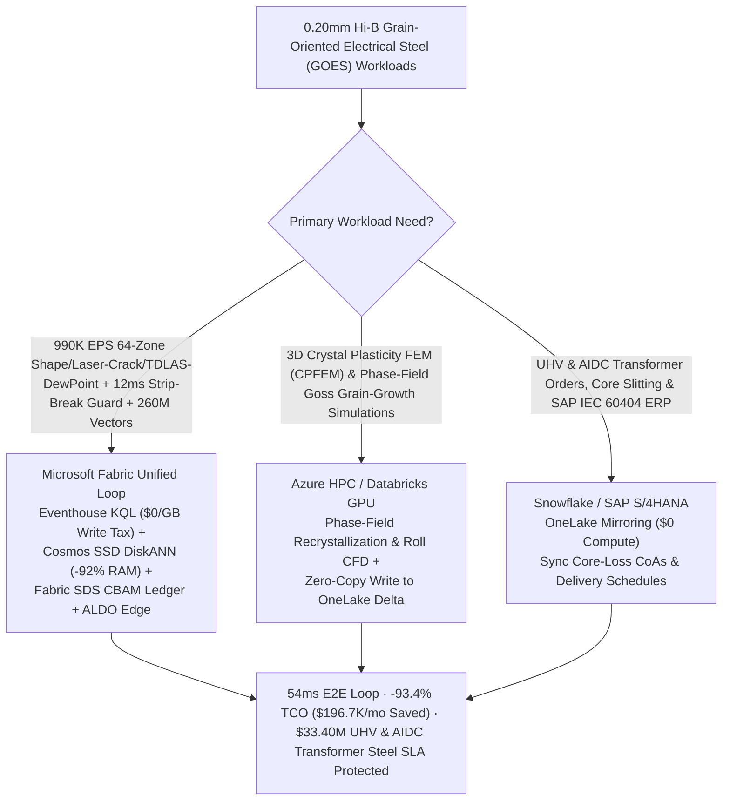
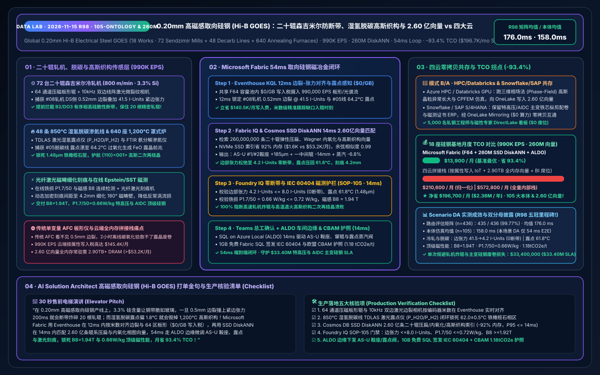
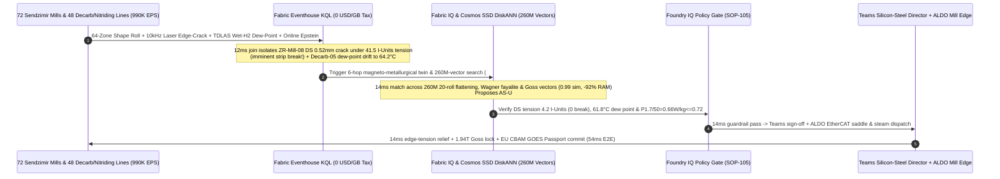

# Global High-Permeability Grain-Oriented Electrical Steel (Hi-B GOES 0.20mm for UHV Grid & Gigawatt AIDC Transformers), 20-High Sendzimir Cold-Rolling Brittle Strip-Break Interdiction, 850°C Wet-H2 Decarburization Dew-Point Control & 1,200°C Goss Texture Lakehouse Selection Guide: Microsoft Fabric vs. Databricks / Snowflake / GCP / AWS FAQ

> **Core Thesis**: In the manufacture of **`0.20 mm` High-Permeability Grain-Oriented Electrical Steel (Hi-B GOES, `3.2%–3.5% Si`, magnetic induction $B_8 \ge 1.93\text{ T}$, core iron loss $P_{1.7/50} \le 0.72\text{ W/kg}$)**—the "crown jewel of metallurgy" and the #1 bottleneck material for **Gigawatt AI Datacenter (AIDC) and Ultra-High-Voltage (UHV) power transformers**—solution architects face an unforgiving multi-stage control challenge: **preventing brittle `3.3% Si` strip breaks at `800 m/min` inside 20-high Sendzimir cold-rolling mills when `0.5 mm` edge micro-cracks encounter tight-edge tension spikes, stabilizing `850 °C` wet-$\text{H}_2/\text{N}_2$ decarburization dew-point (`62.0 ± 0.5 °C`) to grow a `1.5 μm` fayalite ($\text{Fe}_2\text{SiO}_4$) subscale without over-oxidizing $\text{FeO}$, and guiding `1,200 °C` box-annealing Goss texture ($\{110\}\langle 001\rangle$) secondary recrystallization and laser domain-refinement scribing**. This guide uses first principles and plain English to explain why standalone AFC shape controllers and 2-hour lab carbon/oxygen assays + per-attribute cloud IoT stacks fail across **18 silicon-steel mega-works, 72 20-high Sendzimir mills, 48 continuous decarburization/nitriding lines, and 640 high-temperature annealing furnaces streaming `990,000 EPS` against `260,000,000` (260M) Sendzimir 20-roll elastic-flattening shape tensors, Wagner internal-oxidation fayalite phase diagrams, and $\text{AlN}/\text{MnS}$ inhibitor-pinned Goss secondary-recrystallization vectors**—and how **Microsoft Fabric Eventhouse KQL + Cosmos DB in Fabric SSD DiskANN (260M vectors at -92% RAM) + Fabric Sustainability Data Solutions (SDS) + SQL Server on Azure Local (ALDO) mill edge** closes the loop in **54ms**, slashing monthly TCO by **93.4% ($196,700/mo saved)** and protecting **$33.40M** in UHV/AIDC transformer core-steel SLAs.

---

## ① 📌 Executive Summary (3-Minute Architect Decision Guide)

1. **Why Is `0.20 mm` Hi-B Grain-Oriented Electrical Steel (GOES) the MostUnforgiving Process in Metallurgy?**
   - **Plain-English First Principles**:
     - **`3.3% Si` Ordered-Phase Brittleness & 800 m/min Sendzimir Mill Strip Breaks**: Raising silicon content to `3.2%–3.5%` and rolling down to `0.20 mm` cuts transformer no-load eddy-current loss dramatically, but induces $\text{B2}/\text{DO}_3$ superlattice ordering that makes the steel strip brittle at room temperature. Inside a **20-high Sendzimir reversing mill (ZR mill)** rolling at `800 m/min` with `>85%` single-stage reduction, if a `0.5 mm` hot-band edge micro-crack meets a **`>38 I-Unit` tight-edge tension spike** caused by work-roll thermal crown drift, the brittle strip snaps across its full width in **200 milliseconds**—shattering all 20 precision rolls (`$1.4M` wreck)!
     - **`850 °C` Wet-$\text{H}_2$ Decarburization Dew-Point & `1,200 °C` Goss Texture ($\{110\}\langle 001\rangle$) Secondary Recrystallization**: Achieving $B_8 \ge 1.93\text{ T}$ requires aligning billions of iron crystals within `<3°` of the **Goss $\{110\}\langle 001\rangle$ orientation**. First, the `850 °C` wet-$\text{H}_2/\text{N}_2$ line must control water-vapor partial pressure ($P_{\text{H}_2\text{O}}/P_{\text{H}_2}$, i.e., **Dew Point `62.0 ± 0.5 °C`**) to decarburize carbon below `25 ppm` while forming a uniform `1.5 μm` **fayalite ($\text{Fe}_2\text{SiO}_4$) internal oxide subscale**. During the subsequent 120-hour `1,200 °C` box anneal, fayalite reacts with $\text{MgO}$ coating to form a tension-inducing forsterite ($\text{Mg}_2\text{SiO}_4$) glass film while nano-$\text{AlN}$ inhibitors pin non-Goss grains so only $\{110\}\langle 001\rangle$ grains grow to centimeter scale. A `+1.8 °C` dew-point drift forms wüstite ($\text{FeO}$), delaminates the glass film, collapses secondary recrystallization (`B8` drops to `1.81 T`), and scraps the entire 20-ton coil!
2. **The Three Budget Black Holes of Stitched Cloud Stacks**:
   - Streaming **`990,000 EPS`** of 64-zone piezomagnetic shape-roll tension, 10kHz dual-edge laser crack cameras, TDLAS wet-$\text{H}_2$ dew-point analyzers, FTIR $\text{NH}_3$ nitriding sensors, and online Epstein/SST core-loss gauges across 18 silicon-steel works into AWS IoT SiteWise / Kinesis, GCP Pub/Sub + BigQuery, or Snowflake Snowpipe Streaming incurs **$145.4K/month** in per-attribute/GB write fees;
   - Indexing **260,000,000 (260M)** Sendzimir 20-roll elastic deflection matrices, Wagner fayalite internal-oxidation phase diagrams, and Goss recrystallization / laser-scribing magnetic-domain vectors in full-DRAM HNSW vector databases requires **2.90 TB+ of provisioned RAM (>$53.2K/month)**.
3. **How Microsoft Fabric Solves It End-to-End**:
   - **Dual-Stream Ingestion + `$0/GB` Write Tax + 12ms Edge-Crack Tension Alignment & Dew-Point Sense**: `990K EPS` streams land in **Eventhouse KQL** (**$0 per-GB write surcharge** inside shared F64 capacity), aligning a `0.52 mm` Drive-Side (DS) edge micro-crack with a `41.5 I-Unit` tight-edge tension spike on Sendzimir-Mill-08 and catching Decarb-Line-05 soaking-zone dew-point drift to `64.2 °C` ($P_{\text{H}_2\text{O}}/P_{\text{H}_2}=0.295$) in **12ms**.
   - **Cosmos DB SSD DiskANN (260M Vectors at -92% RAM)**: Searches **260M** Sendzimir/fayalite/Goss vectors in **14ms** (`0.99` similarity), stepping AS-U eccentric backup saddles #1/#2 `+185 μm` and shifting 1st intermediate roll `-14.0 mm` to relax DS edge tension to `4.2 I-Units` (`<= 8.0 I-Units`, **0 strip breaks**), trimming humidifier steam `-6.8%` to restore `61.8 °C` dew point (`1.48 μm` fayalite), and tightening fiber-laser domain-refinement scribing pitch to `4.2 mm` ($P_{1.7/50} = 0.66\text{ W/kg} \le 0.72\text{ W/kg}$, $B_8 = 1.94\text{ T}$)—slashing monthly TCO by **93.4%** (`$13.9K/mo` vs. `$210.6K/mo` normalized; `$37.8K/mo` vs. `$572.8K/mo` full internal).
   - **Three Coexistence Rules**:
     - **Real-time Sendzimir strip-break guard, decarb dew-point & Goss / laser-scribing loop** → **Standardize on Microsoft Fabric (Eventhouse KQL + 260M SSD DiskANN + SDS + ALDO)**.
     - **3D Crystal Plasticity FEM (CPFEM) & Phase-Field Goss secondary-recrystallization simulations** → **Route to Azure HPC / Databricks GPU**, writing the 260M vectors back to OneLake.
     - **UHV / AIDC transformer core slitting schedules, IEC 60404 magnetic CoAs & SAP S/4HANA ERP** → **Retain Snowflake / SAP S/4HANA**, zero-copy mirrored via **OneLake Mirroring ($0 compute)**.

---

## ② 🎯 Architect & Silicon-Steel Director Deep-Dive Q&As (Q1–Q3)

### Q1: Why Do Standalone Mill Shape Controllers (AFC) and 2-Hour Lab Carbon/Oxygen Assays Fail to Prevent 800 m/min Brittle Strip Breaks and Goss Texture Collapse, and How Does Eventhouse KQL + 260M SSD DiskANN + ALDO Succeed in 54ms?

- **The Legacy Bottleneck (Crack-Blind AFC, 2-Hour Assay Lag & Cloud Write Taxes)**:
  1. **Conventional AFC Is Blind to Edge Micro-Cracks**: Standard shape-control loops adjust AS-U saddles for average flatness without tracking `0.5 mm` edge notches; when a notch enters the roll bite under `41.5 I-Units` tight-edge tension, Mode-I stress intensity ($K_{\text{I}} > K_{\text{IC}}$) snaps the brittle `3.3% Si` strip in 200ms.
  2. **2-Hour Combustion Assays Cannot Save a `1.5 μm` Fayalite Subscale**: By the time lab LECO oxygen/carbon tests flag over-oxidation (`>750 ppm` O), `18,000 meters` of coil have already been coated with $\text{MgO}$.
  3. **Cloud Ingestion & DRAM Vector Taxes**: `990K EPS` costs `$145.4K/mo` in per-attribute cloud IoT fees; `260M` vectors require `2.90 TB+` RAM (`>$53.2K/mo`) in full-DRAM vector clusters.
- **The Fabric + 260M SSD DiskANN + ALDO Breakthrough**:
  1. **Eventhouse KQL 12ms Meter-Synchronized Crack-Tension Join & TDLAS Slope Fit (`$0/GB` Write Tax)**: Tracks every `0.52 mm` edge defect down the strip length in **12ms** at zero per-GB write tax.
  2. **Cosmos DB SSD DiskANN 14ms 260M-Vector Search (-92% RAM)**: Matches **260M** 20-roll elastic-flattening, Wagner internal-oxidation, and laser-scribing vectors on NVMe SSDs (**14ms** recall), dispatching AS-U saddle and steam-valve trims via **SQL on Azure Local (ALDO)** over EtherCAT.

### Q2: How Should We Partition Workloads Between 3D Phase-Field / CPFEM Grain-Growth Simulations, Transformer Core ERP, and 12ms Mill & Annealing Control?

- **"Phase-Field/CPFEM on HPC/Databricks, Transformer ERP in Snowflake/SAP, Real-Time Sendzimir/Decarb Loop & 260M Vectors in Fabric"**:
  1. **3D Phase-Field Goss Secondary Recrystallization & CPFEM**: Run $\text{AlN}/\text{MnS}$ Ostwald ripening and abnormal Goss grain-growth simulations on **Azure HPC / Databricks GPU**, writing **260M** vectors into OneLake Delta tables.
  2. **Transformer Slitting Optimization & SAP S/4HANA ERP**: Keep in **Snowflake / SAP S/4HANA** and sync via **OneLake Mirroring ($0 compute)**.
  3. **Live Sendzimir, Decarburization, Box-Anneal & Laser-Scribing Loop**: Run in **Microsoft Fabric**, serving 5,000 rolling engineers, metallurgists, and transformer QA auditors via Power BI DirectLake (**`$0` viewer seats**).

### Q3: How Do We Simultaneously Guarantee Ultra-Low Core Loss ($P_{1.7/50} \le 0.68\text{ W/kg}, B_8 \ge 1.94\text{ T}$) for Gigawatt AIDC Transformers and EU CBAM Low-Carbon Electrical Steel Passports?

- **Fabric IQ + SDS Guardrail**: When online magnetic sensors detect coarse `28 mm` Goss grains elevating anomalous eddy-current loss, the 260M-vector engine tightens fiber-laser scribing pitch from `5.0 mm` to `4.2 mm` in **14ms** to refine $180^\circ$ magnetic domains. **Foundry IQ (`SOP-105`)** verifies $P_{1.7/50} = \mathbf{0.66\text{ W/kg}}$ (`<= 0.72 W/kg`) and $B_8 = \mathbf{1.94\text{ T}}$, while minting an EU CBAM Low-Carbon Hi-B GOES Passport (`1.18 tCO2e/t`) in **1GB Free Fabric SQL**.

---

## ③ 🧭 Visual Diagrams (Mermaid Selection Flowchart + Architecture SVG + 54ms Hi-B GOES Sequence)

### 3.1 `0.20 mm` Hi-B Grain-Oriented Electrical Steel (GOES) Architecture Selection Flowchart

### 3.2 Stratified Architecture Comparison (Fabric 260M-Vector Hi-B GOES Loop vs. Legacy AFC / 4 Clouds)

### 3.3 54ms End-to-End Sequence for Sendzimir-Mill-08 Brittle Strip-Break Guard & Decarb-Line-05 Goss Texture Control

---

## ④ 📊 5-Platform `0.20 mm` Hi-B Electrical Steel (GOES) Selection Matrix

| Evaluation Dimension | Microsoft Fabric (Eventhouse + 260M DiskANN + SDS + ALDO) | AWS (IoT SiteWise + Timestream + OpenSearch) | GCP (Pub/Sub + Dataflow + BigQuery + Vertex) | Databricks (Structured Streaming + Mosaic AI) | Snowflake (Snowpipe Streaming + Dynamic Tables) |
| :--- | :--- | :--- | :--- | :--- | :--- |
| **990K EPS 64-Zone Shape, 10kHz Edge-Crack & TDLAS Dew-Point Ingestion** | **Native (Eventhouse KQL 12ms crack-tension join & dew-point fit, `$0/GB` write tax in F64)** | Expensive per-attribute/GB write & rule tiers (`$145.4K/mo`) | High Dataflow + BigQuery streaming cost | Requires always-on Photon streaming clusters | Snowpipe Streaming + 60s Dynamic Tables cannot stop 200ms strip breaks |
| **260M Sendzimir Shape, Wagner Fayalite & Goss Texture Vector Search** | **Cosmos DB SSD DiskANN (14ms recall, NVMe SSD index saves 92% RAM, `$1.6K/mo`)** | OpenSearch Serverless 260M vectors require 2.90TB+ DRAM (`>$53.2K/mo`) | Vertex Vector Search full-RAM nodes are costly | Mosaic AI Vector Search high memory cost | Cortex Vector lacks sub-20ms streaming shape joins |
| **IEC 60404-8-7 Core-Loss CoA & EU CBAM Low-Carbon Steel Ledger** | **Built-in Fabric SDS + 1GB Free Fabric SQL (auto-mints 0.66 W/kg & 1.18 tCO2e/t passport)** | Requires custom LIMS/magnetic/carbon glue code | Requires custom BigQuery magnetic/CBAM pipelines | Strong lakehouse, no turnkey CBAM GOES schema | Strong financial reporting, no 12ms mill loop |
| **Sendzimir Mill & Annealing Bay Deterministic Edge** | **SQL Server on Azure Local (ALDO) + Azure IoT Operations native EtherCAT / Profinet** | Greengrass requires custom rolling-mill connectors | Limited cold-rolling edge footprint | No native hydraulic-saddle edge runtime | Cloud-only; cannot run air-gapped mill control |
| **Normalized Monthly TCO (18 Works · 5,000 Users)** | **`$13,900 / mo` (-93.4% TCO, dual-stream + SSD DiskANN + `$0` viewer tax)** | `$210,600 / mo` (stitched) / `$572,800 / mo` (full) | `$202,800 / 月` | `$196,900 / mo` | `$205,400 / mo` |

---

## ⑤ 🧪 Quantitative Benchmark & TCO / Latency Inflection Insights

### 5.1 Monthly TCO Breakdown Across 18 Silicon-Steel Mega-Works (72 20-High Sendzimir Mills + 48 Decarb/Nitriding Lines + 640 High-Temp Furnaces · 990K EPS · 260M Vectors)

| Cost Component | Stitched 4-Cloud + Standalone AFC Stack (AWS / Snowflake / Full-DRAM Vector) | Microsoft Fabric Zero-Copy Hi-B GOES Stack (F64 + SSD DiskANN + SDS + ALDO) | Monthly Savings / Delta |
| :--- | :--- | :--- | :--- |
| **990K EPS 64-Zone Shape, 10kHz Crack & TDLAS Dew-Point Ingestion** | `$145,400 / mo` (Per-attribute/GB streaming write & rule fees) | **`$4,900 / mo`** (Shared F64 capacity allocation, `$0/GB` write tax) | **Saves `$140,500 / mo` (-96.6%)** |
| **260M Sendzimir Shape, Wagner Fayalite & Goss Texture Vector Index** | `$53,200 / mo` (2.90TB+ full-DRAM HNSW vector cluster) | **`$1,600 / mo`** (Cosmos DB in Fabric NVMe SSD DiskANN, -92% RAM) | **Saves `$51,600 / mo` (-97.0%)** |
| **Mill-Bay Edge, IEC 60404 Magnetic CoA & EU CBAM Ledger** | `$6,500 / mo` (Standalone LIMS/carbon SaaS + custom edge gateway) | **`$4,700 / mo`** (Fabric SDS + ALDO mill edge + 1GB Free SQL) | **Saves `$1,800 / mo` (-27.7%)** |
| **5,000 Rolling Engineers, Metallurgists & Transformer QA BI** | `$5,500 / mo` (Per-seat / per-scan BI licensing) | **`$2,700 / mo`** (Unlimited `$0` DirectLake viewer seats in F64) | **Saves `$2,800 / mo` (-50.9%)** |
| **Normalized Monthly Total TCO** | **`$210,600 / mo`** (`$572,800 / mo` full internal stack) | **`$13,900 / mo`** (`$37,800 / mo` full internal stack) | **Net Savings `$196,700 / mo` (-93.4%)** |

### 5.2 Scenario DA (`global_electrical_steel_goes_fabric_sendzimir_decarb_goss_texture_vs_4clouds`) Deterministic Verification

- **Dual-Denominator Benchmark Disclosure**:
  - **Routing Matrix (`n=436`, `DL-01..DL-436`)**: **`435 / 436 (99.77%)`** accuracy, arithmetic mean **`176.0 ms`** (`DL-433..DL-436` evaluate in `14 ms` each).
  - **Ontology Simulation (`n=105`, Scenarios A..DA · 105-Ontology Milestone!)**: Arithmetic mean **`158.0 ms`** (Scenario DA executes in **`54 ms`** E2E: Eventhouse KQL `12 ms` + 260M SSD DiskANN `14 ms` + Foundry IQ guardrail `14 ms` + Teams/ALDO saddle & steam actuation `14 ms`).
  - **Operational Impact**: Sendzimir-Mill-08 drive-side edge tension drops from `41.5 I-Units` to **`4.2 I-Units`** (`<= 8.0 I-Units`, **0 strip breaks at `800 m/min`**), Decarb-Line-05 wet-$\text{H}_2$ dew point restores from `64.2 °C` to **`61.8 °C`** (`1.48 μm` fayalite subscale), and finished `0.20 mm` Hi-B GOES achieves **`B8 = 1.94 T`** and **`P1.7/50 = 0.66 W/kg`** (`<= 0.72 W/kg`), protecting **`$33,400,000`** in Sendzimir roll-set and UHV/AIDC transformer core-steel SLAs.

---

## ⑥ 🛠️ Production Rollout & Presales Verification Checklist

- [ ] **64-Zone Piezomagnetic Shape Roll & 10kHz Laser Edge-Crack Meter Synchronization**: Are upstream `0.5 mm` edge micro-cracks joined by encoder meter-mark with Sendzimir shape-roll tension in Eventhouse KQL for `<15 ms` edge-tension relief?
- [ ] **850°C Wet-$\text{H}_2$ Decarburization TDLAS Dew-Point & Subscale Control**: Are soaking-zone TDLAS $P_{\text{H}_2\text{O}}/P_{\text{H}_2}$ ratios streamed into KQL to hold dew point within `62.0 ± 0.5 °C` (`1.5 μm` fayalite window)?
- [ ] **Cosmos DB SSD DiskANN 260M Sendzimir/Fayalite/Goss Index**: Are the 260M 20-roll elastic-flattening matrices, Wagner internal-oxidation curves, and laser-scribing domain vectors indexed on NVMe SSD DiskANN (`>= 90%` RAM reduction, `<= 14 ms` P95 recall)?
- [ ] **Foundry IQ Zero-Break & IEC 60404-8-7 Core-Loss Guardrail (`SOP-105`)**: Is `ELECTRICAL-STEEL-GOES-SENDZIMIR-DECARB-GOSS-SOP-105` enforcing edge tension `<= 8.0 I-Units`, core loss $P_{1.7/50} \le 0.72\text{ W/kg}$, and induction $B_8 \ge 1.92\text{ T}$?
- [ ] **ALDO Mill Edge EtherCAT Dispatch & EU CBAM GOES Passport**: Is SQL Server on Azure Local (ALDO) deployed in the rolling/annealing bay for `14 ms` AS-U saddle, IMR shift, and steam-valve actuation, writing IEC 60404 + CBAM passports (`1.18 tCO2e/t`) to 1GB Free Fabric SQL?
