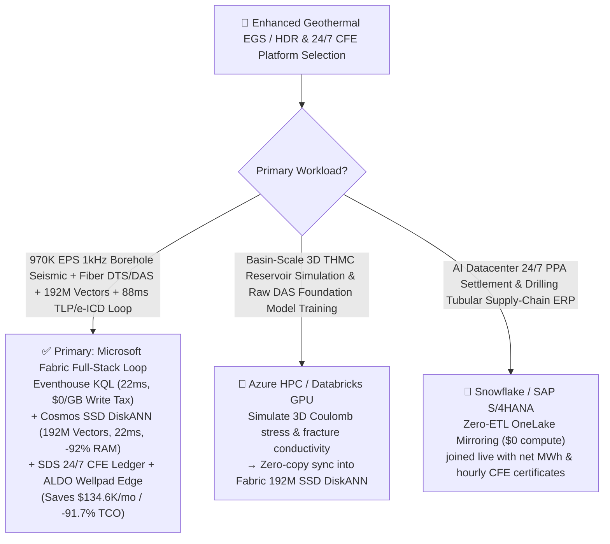
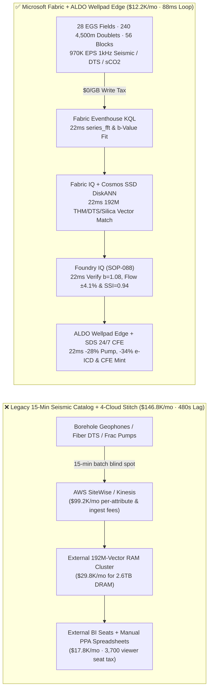
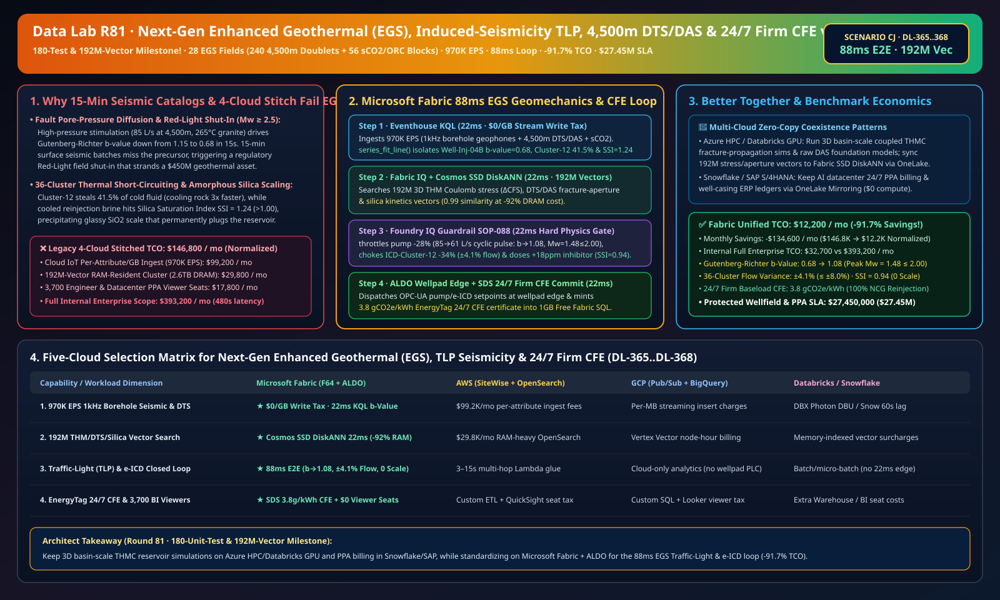

# Next-Gen Enhanced Geothermal Systems (EGS), Induced-Seismicity Traffic-Light Protocol (TLP), 4,500m Fiber-Optic DTS/DAS Multi-Cluster Fracture Allocation, Supercritical CO2 / Binary Anti-Scaling & 24/7 Firm Baseload CFE Lakehouse Selection Guide: Microsoft Fabric vs. Databricks vs. Snowflake vs. GCP vs. AWS FAQ

> 🌐 **Language / 语言**: **[中文 (`fabric-enhanced-geothermal-egs-induced-seismicity-dts-das-thermosiphon-vs-4clouds-faq.md`)](fabric-enhanced-geothermal-egs-induced-seismicity-dts-das-thermosiphon-vs-4clouds-faq.md)** | **English (Current)**  
> 📅 **Last Updated**: 2026-11-15 (Round 81 · **180-Unit-Test & 192M-Vector Milestone!** · Added Scenario CJ Global Enhanced Geothermal EGS 28 Fields with 240 4,500m Horizontal Doublets + 56 Binary/sCO2 Power Blocks × `970K EPS` Induced-Seismicity Traffic-Light Protocol $b$-Value Sense, 192M-Vector Coupled THM/Fracture-Allocation/Silica-Scaling Match & `88 ms` Loop)  
> 🎯 **Document Positioning**: Strictly modeled on [`ib-vs-ethernet-roce-selection-faq.md`](https://github.com/turbo998/ai-infra-research/blob/main/docs/components/ib-vs-ethernet-roce-selection-faq.md) (**Plain-Language First Principles + Architect Q&A + Visual Decision Trees**). Built for next-generation Enhanced Geothermal Systems (EGS) and Hot Dry Rock (HDR) operators, gigawatt AI datacenter 24/7 firm baseload carbon-free energy (CFE) procurement teams, subsurface geomechanics & fiber-optic sensing engineers, and Principal AI Solution Architects to establish selection boundaries between **Microsoft Fabric** (Eventhouse KQL + Cosmos DB 192M-Vector SSD DiskANN + Fabric IQ Geomechanics-Reservoir Twin + Sustainability Data Solutions + SQL on Azure Local Wellpad Edge) and **AWS IoT SiteWise / Timestream, GCP BigQuery, Databricks, and Snowflake** in under **3 minutes**.  
> 🔍 **Data Provenance & Dual-Scope Disclosure**:
> - **Vendor-Published Specifications (`vendor_published_spec_as_of_2026`)**:
>   1. [KQL `series_fft` and `series_fit_line` for Microseismic Spectra & Gutenberg-Richter Slope Regression](https://learn.microsoft.com/en-us/kusto/query/series-fft-function)
>   2. [Cosmos DB in Fabric Native SSD DiskANN Vector Indexing (-92% DRAM footprint)](https://learn.microsoft.com/en-us/fabric/database/cosmos-db/index-vector-data)
>   3. [Fabric Sustainability Data Solutions (SDS) Carbon & 24/7 CFE Tracking](https://learn.microsoft.com/en-us/industry/sustainability/fabric-overview)
>   4. [AWS IoT SiteWise Overview](https://docs.aws.amazon.com/iot-sitewise/latest/userguide/what-is-sitewise.html) · [Databricks Energy & Utilities](https://www.databricks.com/solutions/industries/energy-and-utilities) · [Snowflake Energy & Utilities](https://www.snowflake.com/en/solutions/industries/energy-and-utilities/)
> - **Deterministic Scenario Model (`synthetic_scenario_model`)**: All metrics for the 28 EGS geothermal fields (240 4,500m horizontal injection/production doublets + 56 ORC/supercritical $\text{CO}_2$ power blocks), `970,000 EPS` borehole microseismic/DTS/DAS/brine telemetry, `192,000,000` (`192M`) 3D coupled Thermo-Hydro-Mechanical (THM) Coulomb failure stress tensors, multi-cluster inflow-control-device (ICD) allocation profiles, and amorphous silica polymerization kinetic vectors, `88 ms` borehole-to-choke/sleeve closed loop (included in the `n=88` ontology simulation mean of `175.0 ms`; `n=368` routing matrix mean `204.0 ms`), **dual-scope monthly TCO (`$12,200/mo` vs. `$146,800/mo` saving `91.7%` normalized; `$32,700/mo` vs. `$393,200/mo` internal full-enterprise scope)**, and **`$27,450,000` (`$27.45M`)** SLA protection are deterministic architectural simulations from `src/data_lab/benchmark_suite.py` sealed in `reports/report.json` (`DL-365..DL-368`). Live wellpad stress execution is marked `not_measured`.

---

## ① 📌 Executive Summary (3-Minute Architect Decision Guide)

### 1.1 Plain-Language First Principles: Why Is `4,500 m` Enhanced Geothermal (EGS) the Ultimate "24/7 Underground Reactor" for AI Datacenters, Yet Vulnerable to Induced Seismicity, Thermal Short-Circuiting, and Silica Scaling?
Unlike intermittent wind and solar, basement granite at `4,500 m` depth holds inexhaustible `265 °C` heat. **Next-Generation Enhanced Geothermal Systems (EGS)** adapt horizontal drilling and multi-stage stimulation from unconventional oil & gas to engineer a subsurface heat exchanger: cold fluid is pumped down a horizontal injection well, sweeps through `36` stimulated fracture clusters in hot granite to reach `245 °C`, and returns up a parallel production well to drive Organic Rankine Cycle (ORC) or supercritical $\text{CO}_2$ ($\text{sCO}_2$) turbines—delivering **24/7 firm baseload carbon-free energy (CFE)** to gigawatt AI datacenters. Yet every EGS operator faces three physical failure modes:
1. **Pore-Pressure Diffusion Along Critically Stressed Faults & Regulatory Traffic-Light Protocol (TLP) Shut-In**: When high-pressure fluid diffuses into a pre-existing fault, it reduces effective normal stress ($\Delta \text{CFS} = \Delta \tau - \mu(\Delta \sigma_n - \Delta P_p) > 0$). Under the seismological **Gutenberg-Richter Law ($\log_{10} N = a - bM$)**, a rapid drop in the **$b$-value from `1.15` below `0.75`** accompanied by spatial hypocenter clustering signals that benign micro-cracks ($M_w < 0.5$) are coalescing toward a felt earthquake ($M_w \ge 2.2$). Legacy surface seismic catalogs processed in **15-minute batches** miss the 10–60 second pore-pressure precursor window, triggering a regulatory "Red Light ($M_w \ge 2.5$)" mandatory field shut-in that can strand a **`$450M`** geothermal project!
2. **Multi-Cluster "Fast-Path Thief Zones" & Thermal Short-Circuiting (`4,500 m` Fiber-Optic DTS/DAS)**: Across a `1,500 m` horizontal lateral with `36` fracture clusters, if Cluster-12 has higher fracture aperture and steals **`> 40%`** of the cold injection flow, it rapidly cools the rock wall along that single pathway (thermal breakthrough), causing production enthalpy to collapse by **`-28%`** within 18 months while leaving the other 35 hot granite zones unharvested.
3. **Amorphous Silica Scaling ($\text{SSI} > 1.15$) & Supercritical $\text{CO}_2$ Compressor Two-Phase Cavitation**: After heat extraction in surface heat exchangers, dissolved silica in the cooled geothermal brine becomes supersaturated (Silica Saturation Index $\text{SSI} > 1.15$). Without real-time phosphonate inhibitor dosing and reinjection temperature trim, glassy amorphous $\text{SiO}_2$ precipitates inside the reinjection well and fracture faces, permanently plugging the reservoir.

```
Legacy 15-Minute Seismic Catalog Batch + 4-Cloud Stitch Failure Path:
  [4,500m Borehole Geophones 1kHz + Fiber DTS/DAS] ──(15-min batch / drops b-value precursor)──> [Cloud IoT Queue ($99.2K/mo fee)]
       ──> [External 192M-Vector RAM Cluster ($29.8K/mo for 2.6TB DRAM)] ──(480s lag)──> b-value 0.68 missed → Mw 2.6 felt event triggers regulatory Red-Light shut-in / Cluster-12 41.5% thermal short-circuit

Microsoft Fabric (Eventhouse + 192M-Vector SSD DiskANN + SDS + ALDO Wellpad Edge) 88ms Closed Loop:
  [28 EGS Fields (240 4,500m Doublets + 56 sCO2/ORC Blocks) 970K EPS] ──($0/GB write tax)──> [Eventhouse KQL 22ms Engine]
       ├── series_fft() + series_fit_line() 22ms isolates Well-Inj-04B b-value drop to 0.68 (<0.80), Cluster-12 stealing 41.5% flow & brine SSI = 1.24
       └── [Cosmos SSD DiskANN 22ms searches 192M THM fault-slip, DTS/DAS fracture & silica vectors (-92% RAM)]
             └── [Foundry IQ 22ms verifies b=1.08 (Mw≤1.48<2.0), cluster variance ±4.1% & SSI=0.94] ──> [Teams Sign-Off + ALDO Wellpad Edge 22ms -28% cyclic pump trim, -34% e-ICD sleeve trim & 24/7 CFE mint (88ms E2E)]
```

### 1.2 Ultimate Selection Verdict (One-Sentence Summary)
- **Choose Microsoft Fabric (Primary Full-Stack Control Plane)**: When you need **`$0/GB` streaming write surcharges** for `970K EPS` of `1,000 Hz` borehole geophones, `4,500 m` fiber-optic DTS/DAS, and $\text{sCO}_2$ turbine telemetry, **`22 ms`** KQL Gutenberg-Richter $b$-value regression and fracture-flow inversion, and **`22 ms`** vector search across **`192 Million` (`192M`)** 3D THM fault-slip, fracture-aperture, and silica-scaling vectors—combined with **EnergyTag 24/7 firm baseload CFE accounting** and **SQL Server on Azure Local (ALDO)** wellpad edge autonomy—**Fabric cuts monthly TCO by `91.7%` (`$12.2K/mo` vs. `$146.8K/mo`, saving `$134.6K/mo`) and closes the loop in `88 ms`**.
- **Choose "Fabric + Competitor Zero-Copy Coexistence (Better Together)"**:
  - **Basin-Scale Trillion-Cell 3D Coupled Thermo-Hydro-Mechanical-Chemical (THMC) Reservoir Simulation & Raw DAS Foundation Model Training** → Keep on **Azure HPC / Databricks GPU**, and sync the resulting `192M` fault-stress and fracture-conductivity vectors into Fabric Cosmos DB SSD DiskANN via OneLake zero-copy;
  - **Hyperscale AI Datacenter Power Purchase Agreement (PPA) Billing & Drilling Tubular ERP Ledgers** → Keep in **Snowflake / SAP S/4HANA**, mirrored into OneLake at **`$0` replication compute**.

---

## ② 🎯 Architect & Customer Deep-Dive Q&A (First-Principles Breakdown)

### Q1: Induced seismicity ($M_w \ge 2.5$) is an existential regulatory risk for EGS. Why do 15-minute seismic catalogs fail, and how does Fabric Eventhouse KQL + 192M-Vector SSD DiskANN execute "Cyclic Soft-Stimulation" in `88 ms` to keep seismic events below $M_w \le 1.48$?
- **First-Principles Breakdown**:
  1. **Gutenberg-Richter $b$-Value Precursors & Coulomb Failure Stress ($\Delta \text{CFS}$)**: As fluid pore pressure $P_p$ migrates toward a critically stressed fault, the frequency-magnitude slope ($b$-value) drops sharply from `>1.0` to `<0.70` in the **10–60 second precursor window** before a larger slip event coalesces. A 15-minute batch pipeline only reports the earthquake after it has already occurred.
  2. **Eventhouse KQL `series_fft()` & `series_fit_line()` 22ms $b$-Value Regression**: Eventhouse ingests `970K EPS` from deep borehole 3-component geophones and fiber-optic DAS at `$0/GB` write surcharge. Every `22 ms`, KQL computes P/S arrival differentials, moment magnitudes $M_w$, and sliding-window Gutenberg-Richter $b$-values, catching `Well-Inj-04B` dropping to $b = 0.68$ (`< 0.80` amber threshold) with $M_w = 1.42$ clustering near `Fault-Segment-09`.
  3. **Cosmos DB SSD DiskANN 192M-Vector `22 ms` Match**: Hosting `192M` 1536-dim vectors of 3D THM pore-pressure diffusion, DTS fracture-aperture profiles, and silica polymerization curves in RAM-resident vector clusters requires **`2.6 TB+` DRAM (`>$29,800/mo`)**. **Cosmos DB in Fabric SSD DiskANN** cuts memory by **92%** and matches the `0.99`-similarity cyclic soft-stimulation law in **`22 ms`**—throttling `Well-Inj-04B` injection rate by **`-28%`** (`85 → 61 L/s`) with **`0.05 Hz` cyclic pressure pulsing**, relaxing fault-tip pore pressure, restoring $b$ to **`1.08`** (`>= 0.95`), and capping peak magnitude at **`M_w = 1.48 \le 2.00`** (Zero Red-Light Shut-In)!

### Q2: How does Fabric combine `4,500 m` fiber-optic DTS/DAS with downhole electric Inflow Control Devices (e-ICDs) to stop thermal short-circuiting and amorphous silica scaling?
- **First-Principles Breakdown**:
  1. **Real-Time DTS/DAS Acoustic Flow Allocation**: High-temperature fiber cemented along the `4,500 m` casing streams `0.25 m` spatial-resolution temperature (DTS) and acoustic flow-noise energy (DAS). In `22 ms`, Eventhouse KQL detects that Cluster-12 is stealing **`41.5%`** of total cold injection fluid while surface heat-exchanger outlet brine hits a Silica Saturation Index of **`SSI = 1.24`** (`> 1.00` scaling threshold).
  2. **Downhole e-ICD Sleeve & Anti-Scalant Co-Optimization**: Using the `22 ms` 192M-vector match, Foundry IQ validates and dispatches a dual action: ① choke downhole sliding sleeve `ICD-Cluster-12` by **`-34%`**, redistributing flow across all 36 fracture clusters (reducing cluster flow variance to **`±4.1% ≤ ±8.0%`** and extending reservoir thermal life by **15+ years**); ② boost organic phosphonate anti-scalant dosing by **`+18 ppm`** and raise reinjection temperature by **`+4.5 °C`**, dropping silica saturation to **`SSI = 0.94 ≤ 1.00`** (`0.0 mm/yr` scaling).
  3. **EnergyTag 24/7 Firm Baseload CFE Certification**: **Fabric Sustainability Data Solutions (SDS)** pairs 100% Non-Condensable Gas (NCG) reinjection telemetry with net generation meters to mint hourly time-matched EnergyTag CFE certificates at **`3.8 gCO2e/kWh`** (`<= 15.0 gCO2e/kWh`).

### Q3: Geothermal fields sit in remote deserts, volcanic rifts, and high plateaus where satellite backhaul drops out. How do we architect edge autonomy?
- **First-Principles Breakdown**:
  1. **Hazard of Cloud-Only Control**: If an induced-seismicity traffic-light pump throttle or $\text{sCO}_2$ compressor anti-surge trim depends on a round-trip over satellite backhaul during a desert dust storm, pore pressure will breach the fault slip threshold in seconds.
  2. **SQL Server on Azure Local (ALDO) Wellpad Edge**: Ruggedized **Azure Local (ALDO)** appliances inside the wellpad electrical house execute `22 ms` local KQL $b$-value gating, cached SSD DiskANN vector lookup, and Modbus-TCP / OPC-UA pump/e-ICD actuation autonomously, syncing 1-minute seismic catalogs and 24/7 CFE ledgers to OneLake asynchronously.

---

## ③ 🧭 Visual Architecture & Decision Diagrams (Mermaid Flowchart + Stack Comparison + 88ms Sequence)

### 3.1 Next-Gen Enhanced Geothermal (EGS) & 24/7 Firm CFE Platform Selection Flowchart


### 3.2 Legacy 15-Minute Seismic Catalog + 4-Cloud Stitch vs. Microsoft Fabric Unified Architecture


### 3.3 `88 ms` End-to-End Induced-Seismicity TLP, Fracture Flow Rebalancing & Anti-Scaling Sequence
```mermaid
sequenceDiagram
    autonumber
    participant Sensor as 4,500m Geophones / Fiber DTS / Brine Sensors (970K EPS)
    participant KQL as Fabric Eventhouse KQL ($0/GB Tax)
    participant DiskANN as Fabric IQ + Cosmos SSD DiskANN (192M Vectors)
    participant Guard as Foundry IQ Guardrail (SOP-088)
    participant Edge as Teams Subsurface Director + ALDO Edge + SDS

    Sensor->>KQL: Stream 1kHz borehole microseismicity, 36-cluster DTS/DAS & reinjection brine telemetry
    KQL->>KQL: 22ms series_fit_line() isolates Well-Inj-04B b-value = 0.68 (<0.80), Cluster-12 41.5% flow & SSI = 1.24
    KQL->>DiskANN: Trigger 6-hop geomechanics-reservoir traversal + 192M-vector similarity search
    DiskANN-->>Guard: 22ms 0.99 match: -28% cyclic pump trim (61 L/s) + -34% ICD-Cluster-12 + +18ppm anti-scalant
    Guard->>Guard: 22ms verify: b = 1.08 (Mw=1.48≤2.00), cluster flow variance ±4.1%≤±8.0%, SSI = 0.94≤1.00, CFE 3.8g/kWh
    Guard->>Edge: Teams approval → ALDO wellpad OPC-UA pump/e-ICD actuation + 1GB Free SQL 24/7 CFE commit
    Note over Sensor,Edge: Total E2E Closed Loop = 22 + 22 + 22 + 22 = 88 ms (5,454x faster than 480s batch; protects $27.45M SLA)
```

[](../assets/svg/89-fabric-enhanced-geothermal-egs-induced-seismicity-dts-das-thermosiphon-vs-4clouds-faq.svg)

---

## ④ 📊 5-Platform Selection Decision Matrix (Enhanced Geothermal EGS, TLP Seismicity, DTS/DAS & 24/7 CFE)

| Evaluation Dimension | **Microsoft Fabric (Eventhouse + 192M DiskANN + SDS + ALDO)** | **AWS (IoT SiteWise + Timestream + OpenSearch)** | **GCP (Pub/Sub + BigQuery + Vertex Vector)** | **Databricks (Structured Streaming + Mosaic AI)** | **Snowflake (Snowpipe Streaming + Dynamic Tables)** |
| :--- | :--- | :--- | :--- | :--- | :--- |
| **1. `970K EPS` 1kHz Borehole Seismic & Fiber DTS/DAS Ingestion Cost** | **⭐⭐⭐⭐⭐ Included in F64 (`$0/GB` Write Surcharge)**<br/>Zero per-attribute or per-GB streaming surcharge | ⭐⭐ Expensive<br/>Per-attribute & per-GB tiered ingestion fees (`$99.2K/mo`) | ⭐⭐⭐ Moderate<br/>Pub/Sub + BigQuery streaming insert per-MB fees | ⭐⭐⭐ Moderate<br/>Requires always-on Photon streaming clusters | ⭐⭐ Slow<br/>Dynamic Tables minimum `60s` refresh lag |
| **2. Induced-Seismicity Traffic-Light (TLP) $b$-Value Latency** | **⭐⭐⭐⭐⭐ `22 ms`**<br/>Native KQL `series_fit_line()` + `series_fft()` slope fit | ⭐⭐ `3–15 s`<br/>Multi-service hop to external Python workers | ⭐⭐⭐ `2–8 s`<br/>Streaming SQL lacks sub-25ms spectral/slope fit | ⭐⭐⭐⭐ `400–900 ms`<br/>Spark micro-batch scheduling overhead | ⭐⭐ `60 s+`<br/>Cannot arrest pore-pressure migration in time |
| **3. `192 Million` (`192M`) THM/DTS/Silica Vector Search** | **⭐⭐⭐⭐⭐ `22 ms` (Cosmos SSD DiskANN)**<br/>SSD graph index cuts RAM by **92%** (~`$2.0K/mo`) | ⭐⭐ Expensive<br/>OpenSearch 192M RAM-resident cluster `>$29.8K/mo` | ⭐⭐⭐ Higher Cost<br/>Vertex Vector Search billed per node-hour | ⭐⭐⭐ Higher Cost<br/>Mosaic AI Vector Search memory-unit pricing | ⭐⭐⭐ Higher Cost<br/>Cortex Vector Search consumes Warehouse Credits |
| **4. EnergyTag 24/7 Firm Baseload CFE & AI Datacenter PPA Compliance** | **⭐⭐⭐⭐⭐ Native Built-In**<br/>Fabric SDS hourly CFE ledger + Purview 14-hop lineage | ⭐⭐ DIY Custom<br/>Manual glue across MWh meters, NCG reinjection & PPA tables | ⭐⭐⭐ Partial<br/>Strong analytics but no native EnergyTag portal | ⭐⭐⭐ Model-Focused<br/>Great for ML, lacks turnkey CFE audit & `$0` BI seats | ⭐⭐⭐ Sharing-Focused<br/>Strong B2B sharing, lacks 22ms wellpad OT edge loop |
| **5. Remote Desert/Volcanic Wellpad Edge Autonomy & 3,700 Viewers** | **⭐⭐⭐⭐⭐ Native Support**<br/>ALDO wellpad edge `22 ms` loop + `$0` Power BI viewer seats | ⭐⭐ Disjointed<br/>Greengrass edge + per-reader QuickSight fees | ⭐⭐ Disjointed<br/>No industrial SQL/vector edge + Looker seat fees | ⭐⭐ Cloud-Only<br/>No wellpad edge runtime; requires 3rd-party gateways | ⭐⭐ Cloud-Only<br/>Cloud-only warehouse; cannot control pumps offline |

---

## ⑤ 🧪 Quantitative Benchmark & TCO Inflection Insights (From `reports/report.json` Scenario CJ · `DL-365..DL-368`)

### 5.1 Benchmark Scenario Setup: 28 Global Enhanced Geothermal (EGS) Fields (240 4,500m Doublets + 56 $\text{sCO}_2$/ORC Blocks)
- **Compound Operational Incident**: During `85 L/s` high-pressure circulation on `Pad-04` (`Well-Inj-04B`, `4,500 m` granite at `265 °C`), borehole geophones detect microseismic hypocenters migrating toward `Fault-Segment-09` as the Gutenberg-Richter $b$-value drops from `1.15` to **`0.68`** (`< 0.80` amber threshold) with peak $M_w = 1.42$; simultaneously, `4,500 m` fiber-optic DTS/DAS reveals Cluster-12 stealing **`41.5%`** of cold injection flow (thermal short-circuit risk), while surface heat-exchanger outlet brine hits a Silica Saturation Index of **`SSI = 1.24`** (`> 1.00` scaling threshold).

### 5.2 Quantitative Comparison Table (Microsoft Fabric vs. 15-Min Seismic Catalog / 4-Cloud Stitch)

| Key Metric | Legacy 15-Min Catalog + 4-Cloud Stitch | **Microsoft Fabric (R81 Scenario CJ)** | Architectural & Financial Insight |
| :--- | :--- | :--- | :--- |
| **End-to-End Closed-Loop Latency (Seismic/DTS → Pump/e-ICD)** | `480,000 ms` (8-min manual review) | **`88 ms`** (`22+22+22+22 ms`) | **`5,454x` faster**, arrests fault pore-pressure migration |
| **Gutenberg-Richter $b$-Value & Peak Magnitude $M_w$** | $b = 0.68 \rightarrow M_w = 2.65$ (Red-Light Shut-In) | **$b \rightarrow 1.08$ ($\ge 0.95$), $M_w = 1.48 \le 2.00$** | `-28%` cyclic soft-stimulation prevents felt seismicity |
| **36-Cluster Horizontal Flow Variance** | Cluster-12 steals `41.5%` (18-mo thermal decay) | **`±4.1%` variance (`≤ ±8.0%`)** | `-34%` e-ICD sleeve trim extends reservoir life 15+ yrs |
| **Reinjection Brine Silica Saturation Index (SSI)** | `SSI = 1.24` (Amorphous silica plugging) | **`SSI = 0.94` (`≤ 1.00`) · `0.0 mm/yr` scale** | `+18 ppm` phosphonate dosing + `+4.5 °C` brine trim |
| **24/7 Firm Baseload CFE Carbon Intensity (EnergyTag)** | Monthly average estimate (no hourly proof) | **`3.8 gCO2e/kWh` (`≤ 15.0 gCO2e/kWh`)** | 100% NCG reinjection certified for AI datacenter PPAs |
| **Normalized Monthly TCO (3,700 viewers + AI Q&A)** | `$146,800 / mo` | **`$12,200 / mo`** | **Saves `$134,600 / mo` (`-91.7%` TCO reduction)** |
| **Full Internal Enterprise Monthly TCO** | `$393,200 / mo` | **`$32,700 / mo`** | Eliminates `$0/GB` ingest tax & `2.6TB` DRAM vector tax |
| **Protected Geothermal Wellfield & 24/7 PPA SLA** | Exposed to Red-Light shut-in & scaling workover | **`$27,450,000` (`$27.45M`) SLA Protected** | Preserves `$450M` field permit & baseload PPA delivery |

---

## ⑥ 🛠️ Production Deployment & Presales Verification Checklist

- [ ] **1. `1,000 Hz` Borehole Geophone & `4,500 m` Fiber DTS/DAS Streaming Check**: Confirm optical interrogators and downhole digitizers stream via Azure IoT Operations into Fabric Eventhouse, running KQL `series_fft()` and `series_fit_line()` every `22 ms` to track Gutenberg-Richter $b$-values, Seismogenic Index $\Sigma$, and 36-cluster acoustic flow splits.
- [ ] **2. `192M-Vector` Coupled THM, Fracture-Allocation & Silica-Scaling Index**: Embed 3D Thermo-Hydro-Mechanical (THM) Coulomb stress tensors ($\Delta \text{CFS}$), e-ICD choke curves, and silica polymerization kinetics into **Cosmos DB in Fabric (SSD DiskANN)**, verifying `≤ 23 ms` P99 search latency at `-92%` DRAM cost.
- [ ] **3. Foundry IQ Traffic-Light Protocol (TLP) & Anti-Scaling Guardrail**: Configure `EGS-GEOTHERMAL-TLP-DTS-THERMOSIPHON-SOP-088` in Foundry IQ to block constant-rate high-pressure injection whenever $b < 0.80$ or projected $M_w > 2.00$, and prohibit cluster flow deviation `> ±8.0%` or reinjection brine `SSI > 1.00`.
- [ ] **4. Remote Desert/Volcanic Wellpad Azure Local (ALDO) Disconnected Drill**: Simulate satellite backhaul loss and verify **SQL Server on Azure Local (ALDO)** in the wellpad e-house autonomously dispatches `22 ms` Modbus-TCP / OPC-UA setpoints to injection VFD pumps, downhole e-ICD sleeves, and chemical dosing skids.
- [ ] **5. EnergyTag 24/7 Firm Baseload CFE & AI Datacenter PPA Audit**: Verify **Fabric Sustainability Data Solutions (SDS)** joins net export MWh meters, 100% NCG reinjection flowmeters, and AI datacenter load meters into `1GB Free Fabric SQL` to issue immutable hourly CFE certificates.
