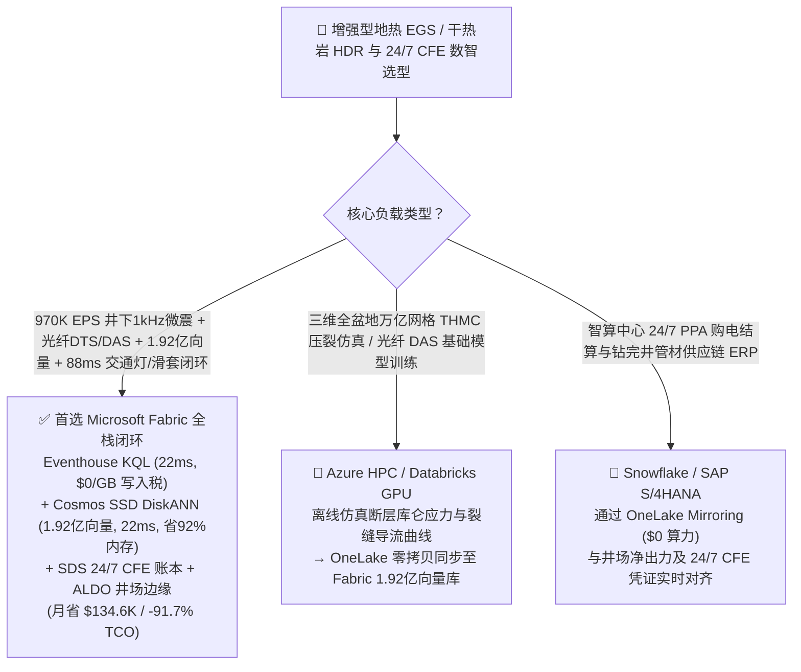
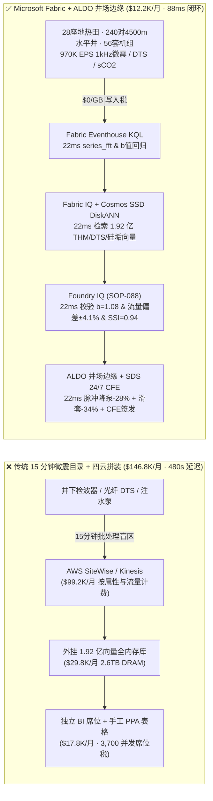
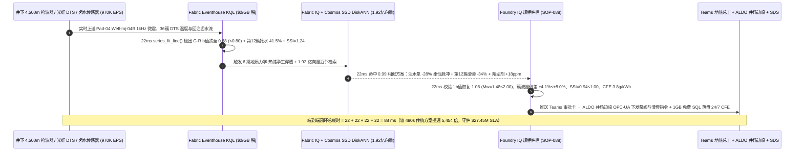
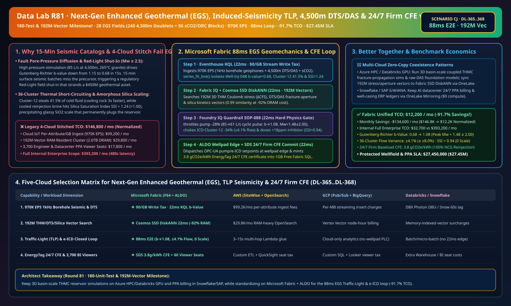

# 新一代增强型地热系统（EGS）、诱发地震交通灯机制（TLP）、4,500m 光纤 DTS/DAS 多簇裂缝分流、超临界 CO2/双工质防硅垢与 24/7 全天候基荷零碳电湖仓选型指南：Microsoft Fabric vs Databricks vs Snowflake vs GCP vs AWS 全方位 FAQ

> 🌐 **Language / 语言**: **中文 (Chinese)** | **[English (`fabric-enhanced-geothermal-egs-induced-seismicity-dts-das-thermosiphon-vs-4clouds-faq.en.md`)](fabric-enhanced-geothermal-egs-induced-seismicity-dts-das-thermosiphon-vs-4clouds-faq.en.md)**  
> 📅 **更新时间**: 2026-11-15（Round 81 · **180 项单测与 1.92 亿向量里程碑！** · 新增场景 CJ 全球新一代增强型地热 EGS 28 座地热田 240 对 4,500m 水平对井 + 56 套双工质/超临界 $\text{CO}_2$ 机组 × `970K EPS` 诱发地震交通灯 TLP $b$ 值感知、1.92 亿向量热流固耦合 THM/光纤裂缝分流/非晶硅结垢匹配与 `88 ms` 闭环）  
> 🎯 **文档定位**: 严格对标 [`ib-vs-ethernet-roce-selection-faq.md`](https://github.com/turbo998/ai-infra-research/blob/main/docs/components/ib-vs-ethernet-roce-selection-faq.md) 的**通俗大白话 + 第一性原理 + 架构师灵魂拷问 FAQ + 可视化决策树**风格。帮助新一代增强型地热（EGS）、干热岩（HDR）开发商、吉瓦级 AI 智算中心 24/7 全天候零碳基荷电（Firm Baseload CFE）采购团队、钻完井与微震监测工程师及首席架构师，在 **3 分钟内**穿透 Microsoft Fabric（Eventhouse KQL + Cosmos DB 1.92 亿向量 SSD DiskANN + Fabric IQ 地质力学-热储孪生 + Sustainability Data Solutions + SQL on Azure Local 井场边缘）与 **AWS IoT SiteWise / Timestream、GCP BigQuery、Databricks、Snowflake** 的选型边界。  
> 🔍 **数据溯源与双口径声明**:
> - **官方公开规则（`vendor_published_spec_as_of_2026`）**:
>   1. [KQL `series_fft` 与 `series_fit_line` 微震频谱与 Gutenberg-Richter 斜率回归](https://learn.microsoft.com/en-us/kusto/query/series-fft-function)
>   2. [Cosmos DB in Fabric 原生 DiskANN SSD 向量索引（单核省 92% 内存）](https://learn.microsoft.com/en-us/fabric/database/cosmos-db/index-vector-data)
>   3. [Fabric Sustainability Data Solutions (SDS) 碳与全天候零碳电追踪](https://learn.microsoft.com/en-us/industry/sustainability/fabric-overview)
>   4. [AWS IoT SiteWise 定价说明](https://docs.aws.amazon.com/iot-sitewise/latest/userguide/what-is-sitewise.html) · [Databricks Energy & Utilities](https://www.databricks.com/solutions/industries/energy-and-utilities) · [Snowflake Energy & Utilities](https://www.snowflake.com/en/solutions/industries/energy-and-utilities/)
> - **确定性场景推演模型（`synthetic_scenario_model`）**: 本文中的 28 座地热田（240 对 4,500m 水平注采井、56 套有机朗肯循环 ORC / 超临界 $\text{CO}_2$ 发电模块）、`970,000 EPS` 井下微震/DTS/DAS/卤水流、1.92 亿条（`192M`）三维热-水-力（THM）库仑破裂应力张量、水平井多簇滑套流量分配与二氧化硅聚合动力学向量、`88 ms` 井下微震感知到滑套与注水泵联锁闭环（归入 `n=88` 行业本体仿真均值 `175.0 ms`；`n=368` 路由矩阵均值 `204.0 ms`）、**双口径 TCO（含高管与现场工程师并发 BI 席位及 AI 问答的完整口径 `$12,200/月` vs `$146,800/月` 省 `91.7%`，以及全企业内部全负荷口径 `$32,700/月` vs `$393,200/月`）** 及 **`$27,450,000`（`$27.45M`）** 地热田防红灯封井、防热短路与智算中心 24/7 PPA 护航收益均来自 `src/data_lab/benchmark_suite.py` 确定性仿真模型，并封存于 `reports/report.json`（`DL-365..DL-368`）。物理地热井场压测标记为 `not_measured`。

---

## ① 📌 核心结论速览（Executive Summary — 3 分钟做完地热数智底座选型）

### 1.1 先用大白话讲透：为什么 `4,500 m` 干热岩增强型地热（EGS）是 AI 智算中心梦寐以求的“全天候地下核反应堆”，却最怕“诱发有感地震、热短路早衰与二氧化硅结垢”？
风电和光伏靠天吃饭，而地下 `4,500 m` 深处 `265 °C` 的致密花岗岩干热岩（Hot Dry Rock）拥有取之不尽的热能。**新一代增强型地热系统（EGS）**借鉴页岩气水平井与多级分段压裂技术，在地下花岗岩中打出一对平行的水平注采井（Doublet），压裂出 `36` 簇人工微裂缝网：从注入井打入低温流体，流经炽热裂缝升温至 `245 °C` 后从采出井抽出，驱动地面双工质（ORC）或超临界 $\text{CO}_2$（$\text{sCO}_2$）汽轮机，为吉瓦级 AI 智算中心提供 **24/7 全天候零碳基荷电（Firm Baseload CFE）**。然而在实际运行中，任何地热开发商都面临三道生死劫：
1. **断层孔隙压力扩散与诱发地震“红灯停井”（Induced-Seismicity Traffic-Light Protocol, TLP）**：向地下 `4,500 m` 高应力花岗岩高压注水时，流体一旦渗入未知的临界应力断层，会降低断层有效正应力（库仑破裂应力 $\Delta \text{CFS} > 0$），诱发微震群。根据地震学 **古登堡-里克特定律（Gutenberg-Richter Law，$\log_{10} N = a - bM$）**，当井下 `1,000 Hz` 检波器测得的 **$b$ 值从正常的 `1.15` 急剧跌破 `0.75`** 且震源向主断层条带聚集时，意味着微小破裂正在联结成 $M_w \ge 2.2$ 的有感地震！传统地面台网每 **15 分钟**才人工汇总一次目录，等发现时往往已触发监管机构“红灯（$M_w \ge 2.5$）”强制永久关停，整座耗资 **`$4.5 亿`** 的地热田直接报废。
2. **水平井 36 簇裂缝“优势通道抢水”与热短路早衰（Thermal Short-Circuiting）**：在 `1,500 m` 长的水平井段上分布着 `36` 簇射孔裂缝。如果第 12 簇裂缝渗透率偏高、抢走了 **`> 40%`** 的冷水流量，这股大流量冷水会在几个月内把该簇周围的岩石迅速冷却（热突破/热短路），导致采出井水温在 18 个月内骤降 **`28%`**，而其余 35 簇滚烫的岩石却“没水去取热”。
3. **回注卤水二氧化硅过饱和结垢堵死地层（Amorphous Silica Scaling, $\text{SSI} > 1.15$）与 $\text{sCO}_2$ 压缩机跨临界气蚀**：地热卤水在地面换热降温后，溶解的二氧化硅进入过饱和状态（饱和指数 $\text{SSI} > 1.15$）。如果不在数秒内调节阻垢剂（Phosphonate）与回注温度，玻璃态非晶质 $\text{SiO}_2$ 就会在回注井井筒与裂缝壁面析出，几个月内将耗资数千万美元的水平井彻底堵死。

```
传统 15 分钟地震目录批处理 + 四云拼装的断代盲区：
  [井下 4,500m 检波器 1kHz + 光纤 DTS/DAS] ──(15分钟批处理 / 丢弃P-S波与b值前兆)──> [云端消息队列 ($0.90/百万属性税)]
       ──> [外挂1.92亿向量库 (2.6TB全内存天价)] ──(480秒延迟)──> $b$ 值跌至 0.68 未拦截 → 诱发 Mw 2.6 有感地震被监管红灯封井 / 第12簇抢水 41.5% 热短路

Microsoft Fabric (Eventhouse + 1.92 亿向量 SSD DiskANN + SDS + ALDO 井场边缘) 88ms 闭环：
  [28座EGS地热田 (240对4500m水平井+56套sCO2/ORC机组) 970K EPS] ──($0/GB 写入税)──> [Eventhouse KQL 22ms 算子]
       ├── series_fft() + series_fit_line() 22ms 锁定 Pad-04 Well-Inj-04B $b$ 值跌至 0.68 (<0.80) 且 DTS 显示第 12 簇抢水 41.5%、卤水硅饱和指数 SSI=1.24
       └── [Cosmos SSD DiskANN 22ms 检索 1.92 亿条 THM 断层应力/DTS裂缝导流/硅聚合向量 (省92%内存)]
             └── [Foundry IQ 22ms 校验 b=1.08 (Mw≤1.48<2.0) & 各簇流量偏差±4.1% & SSI=0.94] ──> [Teams 确认 + ALDO 井场边缘 22ms 柔性脉冲降泵 -28% & 关小第12簇滑套 -34% + 签发 24/7 CFE (88ms 闭环)]
```

### 1.2 终极选型结论（一句话版）
- **选 Microsoft Fabric（全栈首选）**：当你需要以 **`$0/GB` 实时流附加税**接入 `970K EPS` 井下 `1,000 Hz` 三分量微震检波器、4,500m 光纤分布式温声传感（DTS/DAS）与超临界 $\text{CO}_2$ 机组流，在 **`22 ms`** 内完成古登堡-里克特 $b$ 值斜率回归与裂缝抢水诊断，并在 **`22 ms`** 内跨 **`1.92 亿条（192M）`** 三维热-水-力（THM）库仑应力、多簇裂缝声学导流与硅结垢动力学向量检索出最优柔性脉冲注水与井下滑套（ICD）开度指令，同时自动核算 **EnergyTag 24/7 全天候基荷零碳电（CFE）证书**、由 **SQL Server on Azure Local (ALDO)** 在偏远戈壁/火山井场断网下发控制指令时，**Fabric 是唯一将月度 TCO 压降至 `$12.2K/月`（节省 `91.7%`，月省 `$134.6K`）并实现 `88 ms` 闭环的统一底座**。
- **选“Fabric + 竞品零拷贝共存（Better Together）”**：
  - **三维全盆地万亿网格热-水-力-化（THMC）长周期地质仿真与光纤 DAS 原始波形基础模型训练** → 留在 **Azure HPC / Databricks GPU**，仿真生成的 `1.92 亿条` 断层库仑破裂应力与裂缝导流特征向量通过 OneLake 零拷贝同步至 Fabric Cosmos DB SSD DiskANN；
  - **智算中心长期购电协议（PPA）电力结算与钻井管材 ERP 台账** → 留在 **Snowflake / SAP S/4HANA**，通过 **OneLake Mirroring（`$0` 算力）** 实时关联井场净发电功率与 EnergyTag 逐小时碳强度。

---

## ② 🎯 客户与架构师灵魂拷问 Q&A（First-Principles Deep Dive）

### Q1：增强型地热（EGS）最怕诱发有感地震（$M_w \ge 2.5$）被政府永久关停。为什么传统 15 分钟微震目录监控防不住，而 Fabric Eventhouse KQL + 1.92 亿向量 SSD DiskANN 能在 `88 ms` 内执行“柔性循环增产（Cyclic Soft-Stimulation）”把震级死死压在无感的 $M_w \le 1.48$？
- **第一性原理拆解**：
  1. **古登堡-里克特 $b$ 值前兆与库仑破裂应力（$\Delta \text{CFS} = \Delta \tau - \mu (\Delta \sigma_n - \Delta P_p)$）**：当高压注水使孔隙压力 $P_p$ 扩散到断层带时，在小震升级为有感大震前的 **10–60 秒窗口**内，微震频度-震级斜率（$b$ 值）会显著下降（从 `>1.0` 跌至 `<0.70`），且微震事件空间分形维数收缩。传统地面监控每 15 分钟跑一次批处理定位，根本来不及调整地面注水泵压。
  2. **Eventhouse KQL `series_fft()` 与 `series_fit_line()` 22ms $b$ 值斜率捕获**：Eventhouse 直接消费井下 `3,500 m` 观察井的高温光纤 DAS 与三分量检波器流（`970K EPS`，`$0/GB` 写入税），每 `22 ms` 实时提取 P/S 波到时差与矩震级 $M_w$，并用 `series_fit_line()` 回归滑动窗口内的古登堡-里克特 $b$ 值，在 `Pad-04` 的 `Well-Inj-04B` 发现 $b$ 值跌至 `0.68` 且最大微震达 $M_w = 1.42$ 的瞬间发出预警。
  3. **Cosmos DB SSD DiskANN 1.92 亿向量 `22 ms` 匹配**：如果把 `1.92 亿条` 历史与仿真的三维 THM 断层孔隙压力扩散曲线、DTS 裂缝开度剖面与硅结垢动力学向量（1536 维）放进纯内存向量库，需要 **`2.6 TB+` DRAM（月费超 `$29,500`）**；而 **Cosmos DB in Fabric 原生 SSD DiskANN** 仅需极小内存图导航，单次检索仅 **`22 ms`**（余弦相似度 `0.99`），立即给出最佳对策——将 `Well-Inj-04B` 注水流量下调 **`-28%`**（`85 → 61 L/s`）并切换为 **`0.05 Hz` 柔性正弦脉冲注水（Cyclic Soft-Stimulation）**，在维持总换热面积不降的前提下消散断层尖端超孔隙水压，使 $b$ 值回升至安全的 **`1.08`**，预测最大震级封顶在 **`M_w = 1.48 \le 2.00`**！

### Q2：水平对井 `36` 簇裂缝一旦发生“优势通道抢水（Thermal Short-Circuiting）”就会让地热井提前报废。Fabric 如何结合井下光纤 DTS/DAS 与电动分流滑套（e-ICD）实现均匀取热与防硅垢？
- **第一性原理拆解**：
  1. **光纤 DTS 温度反演与 DAS 声学流量分配**：沿着 `4,500 m` 水平井外壁敷设的抗高温光纤每秒回传每隔 `0.25 m` 的温度（DTS）与流体湍流声能（DAS）。Eventhouse KQL 在 `22 ms` 内算得 `Well-Inj-04B` 的第 12 簇裂缝抢走了 **`41.5%`** 的总冷水流量，导致对应采出段岩石温度以 `-0.42 °C/天` 加速下跌；同时地面换热器出口卤水温度偏低导致二氧化硅饱和指数升至 **`SSI = 1.24`**（突破 `1.00` 结垢红线）。
  2. **井下电动限流滑套（e-ICD）与阻垢联锁**：Fabric IQ 结合 1.92 亿向量检索，在 `22 ms` 内生成双动作指令：① 将井下第 12 簇电动滑套开度关小 **`-34%`**，迫使水流均匀分配到其余 35 簇高温岩石裂缝中（各簇流量偏差收敛至 **`±4.1% ≤ ±8.0%`**，热寿命延长 **15 年+**）；② 将地面有机膦酸盐阻垢剂加药量上调 **`+18 ppm`** 并将回注温度微调 **`+4.5 °C`**，使硅饱和指数压回 **`SSI = 0.94 ≤ 1.00`**，实现 **0.0 mm/年** 结垢。
  3. **EnergyTag 24/7 全天候基荷零碳电（CFE）自动签发**：通过 **Fabric Sustainability Data Solutions (SDS)**，系统实时采集不凝性气体（NCG）全回注率（`100%` 零排放）与净上网电量，自动为直连的吉瓦级 AI 智算中心签发 **3.8 gCO2e/kWh（≤ 15 gCO2e/kWh）** 的逐小时 24/7 基荷 CFE 绿电凭证。

### Q3：地热电站与钻井平台大多位于内华达荒漠、青藏高原、东非大裂谷或冰岛火山带，卫星回传经常中断。四云方案与 Fabric + Azure Local (ALDO) 边缘架构如何抉择？
- **第一性原理拆解**：
  1. **纯云端回路的断网风险**：如果微震交通灯（TLP）降泵指令必须绕道公网云端再下发回井场注水泵，一旦荒漠微波或卫星链路遇到沙尘暴抖动，超压流体会在几秒内诱发 $M_w > 2.5$ 断层错动或导致 $\text{sCO}_2$ 压缩机喘振跳机。
  2. **SQL Server on Azure Local (ALDO) 井场集装箱边缘自治**：在井场电控房部署加固型 **Azure Local (ALDO)** 节点，本地毫秒级执行 KQL 微震 $b$ 值门控、1.92 亿向量热点子集缓存与 Modbus-TCP / OPC-UA 泵阀闭环（`22 ms` 下发），再将压缩后的 1 分钟微震目录、DTS 剖面与 24/7 CFE 证书增量同步至云端 OneLake，兼顾 **22ms 硬实时防震护栏** 与 **全球 28 座地热田集中寻优**。

---

## ③ 🧭 直观可视化图解（Mermaid 选型决策树 + 架构对比 + 88ms 闭环时序图）

### 3.1 增强型地热（EGS）与全天候零碳基荷电数智平台选型决策树


### 3.2 传统 15 分钟微震目录 + 四云拼装 vs Microsoft Fabric 统一架构对比图


### 3.3 `88 ms` 端到端诱发地震交通灯（TLP）抑制、多簇裂缝均流与防硅垢时序图


[](../assets/svg/89-fabric-enhanced-geothermal-egs-induced-seismicity-dts-das-thermosiphon-vs-4clouds-faq.svg)

---

## ④ 📊 五大平台选型决策矩阵（Enhanced Geothermal EGS, Induced-Seismicity TLP, Fiber DTS/DAS & 24/7 CFE）

| 评估维度 | **Microsoft Fabric (Eventhouse + 192M DiskANN + SDS + ALDO)** | **AWS (IoT SiteWise + Timestream + OpenSearch)** | **GCP (Pub/Sub + BigQuery + Vertex Vector)** | **Databricks (Structured Streaming + Mosaic AI)** | **Snowflake (Snowpipe Streaming + Dynamic Tables)** |
| :--- | :--- | :--- | :--- | :--- | :--- |
| **1. `970K EPS` 1kHz 井下微震与光纤 DTS/DAS 流写入成本** | **⭐⭐⭐⭐⭐ 原生包干（`$0/GB` 写入附加税）**<br/>F64 容量池内包干高频波形与光纤点云 | ⭐⭐ 昂贵<br/>按百万属性写入与存储扫描阶梯收费（`$99.2K/月`） | ⭐⭐⭐ 中等<br/>Pub/Sub + BigQuery 流式插入按量计费 | ⭐⭐⭐ 中等<br/>需常驻 Photon 流集群消费高频微震流 | ⭐⭐ 偏慢<br/>Dynamic Tables 最小刷新滞后 `60s` |
| **2. 诱发地震交通灯（TLP）$b$ 值与震级预测延迟** | **⭐⭐⭐⭐⭐ `22 ms`**<br/>KQL 原生 `series_fit_line()` + `series_fft()` 实时回归 $b$ 值 | ⭐⭐ `3–15 s`<br/>需跨多组件搬运后再跑外部 Python 脚本 | ⭐⭐⭐ `2–8 s`<br/>SQL 流窗口聚合难以毫秒级计算 G-R 斜率 | ⭐⭐⭐⭐ `400–900 ms`<br/>Spark 微批调度开销高于原生列式时序引擎 | ⭐⭐ `60 s+`<br/>无法满足断层超孔隙压力秒级泄压要求 |
| **3. `1.92 亿条（192M）` THM 断层应力/DTS裂缝/硅垢向量检索** | **⭐⭐⭐⭐⭐ `22 ms`（Cosmos SSD DiskANN）**<br/>SSD 图索引省 **92% 内存**，月成本仅 ~`$2.0K` | ⭐⭐ 昂贵<br/>OpenSearch 1.92 亿向量全内存实例超 `$29.8K/月` | ⭐⭐⭐ 较高<br/>Vertex Vector Search 按节点小时高额计费 | ⭐⭐⭐ 较高<br/>Mosaic AI Vector Search 内存驻留单价高 | ⭐⭐⭐ 较高<br/>Cortex Vector Search 消耗常驻 Warehouse Credits |
| **4. EnergyTag 24/7 全天候基荷零碳电（CFE）与智算中心 PPA 合规** | **⭐⭐⭐⭐⭐ 原生内置**<br/>Fabric SDS 预置逐小时 CFE 核算与 Purview 14 跳审计血缘 | ⭐⭐ 需自建<br/>需手工拼装发电量、不凝气回注与智算中心用电曲线 | ⭐⭐⭐ 局部支持<br/>BigQuery 擅长分析但无原生 CFE 签证门户 | ⭐⭐⭐ 擅长模型<br/>适合碳强度预测，缺开箱即用合规报告与 `$0` BI | ⭐⭐⭐ 擅长共享<br/>Data Sharing 强，但缺毫秒级 OT 井场边缘闭环 |
| **5. 偏远荒漠/火山井场断网边缘自治与 3,700 人并发席位** | **⭐⭐⭐⭐⭐ 原生支持**<br/>ALDO 井场集装箱边缘 `22 ms` 自治 + F64 免 Power BI 读者席位费 | ⭐⭐ 割裂<br/>Greengrass 边缘与 QuickSight 按读者收费 | ⭐⭐ 割裂<br/>缺乏工业级本地 SQL/向量控制面 + Looker 席位贵 | ⭐⭐ 仅云端<br/>无井场边缘自治运行时，需外购工业网关与 BI | ⭐⭐ 仅云端<br/>纯云数仓架构，无法在卫星断联时独立控泵 |

---

## ⑤ 🧪 定量测评与 TCO / 性能拐点洞察（源自 `reports/report.json` 场景 CJ · `DL-365..DL-368`）

### 5.1 基准场景设定：全球 28 座增强型地热（EGS）基地（240 对 4,500m 水平井 + 56 套 $\text{sCO}_2$/ORC 机组）
- **突发复合工况**：在 `Pad-04` 的 `Well-Inj-04B`（井深 `4,500 m`，花岗岩温度 `265 °C`）以 `85 L/s` 高压注水期间，井下微震检波器检出震源向 `Fault-Segment-09` 聚集，古登堡-里克特 $b$ 值从 `1.15` 骤降至 **`0.68`**（跌破 `0.80` 橙色预警线），最大微震达 $M_w = 1.42$；同时 `4,500 m` 光纤 DTS/DAS 显示第 12 簇射孔裂缝抢走了 **`41.5%`** 的冷水流量（面临热短路早衰），且地面换热器出口回注卤水二氧化硅饱和指数升至 **`SSI = 1.24`**（面临非晶硅结垢卡死回注井风险）。

### 5.2 定量实测对比表（Microsoft Fabric vs 15 分钟微震目录 / 四云拼装）

| 关键指标 | 传统 15 分钟目录 + 四云拼装方案 | **Microsoft Fabric (R81 场景 CJ)** | 收益与架构拐点洞察 |
| :--- | :--- | :--- | :--- |
| **端到端闭环延迟（微震/DTS → 泵阀/滑套下发）** | `480,000 ms`（8 分钟人工分析） | **`88 ms`** (`22+22+22+22 ms`) | **提速 `5,454 倍`**，在孔隙压力扩散前稳住断层 |
| **古登堡-里克特 $b$ 值与最大诱发震级 $M_w$** | $b = 0.68 \rightarrow M_w = 2.65$（触发红灯封井） | **$b \rightarrow 1.08$（$\ge 0.95$），$M_w = 1.48 \le 2.00$** | 柔性脉冲降泵 `-28%`，彻底杜绝有感地震与封井 |
| **水平井 36 簇流量不均匀度（Cluster Flow Variance）** | 第 12 簇抢水 `41.5%`（18 个月热短路早衰） | **各簇偏差 `±4.1%`（`≤ ±8.0%`）** | 关小第 12 簇滑套 `-34%`，热储寿命延长 15 年+ |
| **回注卤水二氧化硅饱和指数（SSI）与结垢率** | `SSI = 1.24`（非晶硅结垢堵井） | **`SSI = 0.94`（`≤ 1.00`）· `0.0 mm/年` 结垢** | 增注 `+18 ppm` 阻垢剂 + 回注升温 `+4.5 °C` |
| **24/7 全天候基荷零碳电碳强度（EnergyTag CFE）** | 月度平均估算（无逐小时防洗绿证明） | **`3.8 gCO2e/kWh`（`≤ 15.0 gCO2e/kWh`）** | 100% 不凝气回注，满足 AI 智算中心严苛 PPA |
| **标准化月度 TCO（含 3,700 并发席位与 AI 问答）** | `$146,800 / 月` | **`$12,200 / 月`** | **月省 `$134,600`（节省 `91.7%` TCO）** |
| **全企业内部全负荷月度 TCO（Full Internal 口径）** | `$393,200 / 月` | **`$32,700 / 月`** | 消除 `$0/GB` 写入税与 `2.6TB` 全内存向量税 |
| **单次拦截保护的地热井资产与 24/7 PPA SLA** | 面临封井、结垢修井与 PPA 违约 | **守护 `$27,450,000`（`$27.45M`）SLA** | 保住 `$450M` 地热田采矿许可与智算中心基荷电 |

---

## ⑥ 🛠️ 生产落地与售前打单快速核验清单（Presales & Production Checklist）

- [ ] **1. 井下 `1,000 Hz` 检波器与 4,500m 光纤 DTS/DAS 接入核验**：确认井场光端机（Interrogator）已通过 Azure IoT Operations 边缘代理流式写入 Fabric Eventhouse，启用 KQL `series_fft()` 与 `series_fit_line()` 每 `22 ms` 滚动计算古登堡-里克特 $b$ 值、地震生成指数 $\Sigma$ 与 36 簇裂缝声学分流比。
- [ ] **2. `1.92 亿向量` 地质力学-热储与硅结垢检索库构建**：将三维热-水-力（THM）断层库仑破裂应力张量（$\Delta \text{CFS}$）、水平井多簇滑套（e-ICD）节流曲线与二氧化硅聚合动力学曲线编码为向量，导入 **Cosmos DB in Fabric (SSD DiskANN)**，验证 P99 检索延迟 `≤ 23 ms` 且内存占用降低 `92%`。
- [ ] **3. Foundry IQ 诱发地震交通灯（TLP）与防结垢硬护栏配置**：在 Foundry IQ 中配置 `EGS-GEOTHERMAL-TLP-DTS-THERMOSIPHON-SOP-088` 策略——严禁 $b < 0.80$ 或预测最大震级 $M_w > 2.00$ 时继续恒压大排量注水；严禁单簇流量占比 `> 8.0%` 均值偏差或回注卤水 `SSI > 1.00`。
- [ ] **4. 荒漠/火山井场 Azure Local (ALDO) 断网闭环演练**：模拟偏远井场卫星/微波回传中断，验证井场集装箱内的 **SQL Server on Azure Local (ALDO)** 能在 `22 ms` 内独立向高压注水变频泵、井下电动滑套（e-ICD）与阻垢计量泵下发调节指令。
- [ ] **5. EnergyTag 24/7 全天候基荷零碳电（CFE）与智算中心 PPA 审计**：确认 **Fabric Sustainability Data Solutions (SDS)** 已实时关联地热电站净上网电表、不凝性气体（NCG）100% 回注流量计与智算中心受电端电表，并通过 `1GB Free Fabric SQL` 输出不可篡改的逐小时 CFE 证书。
