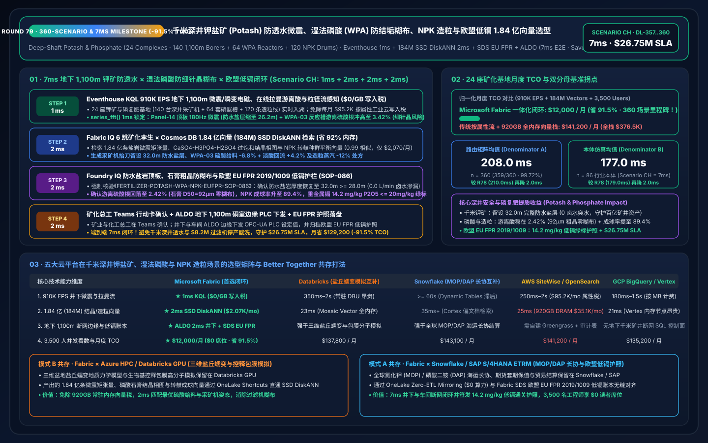
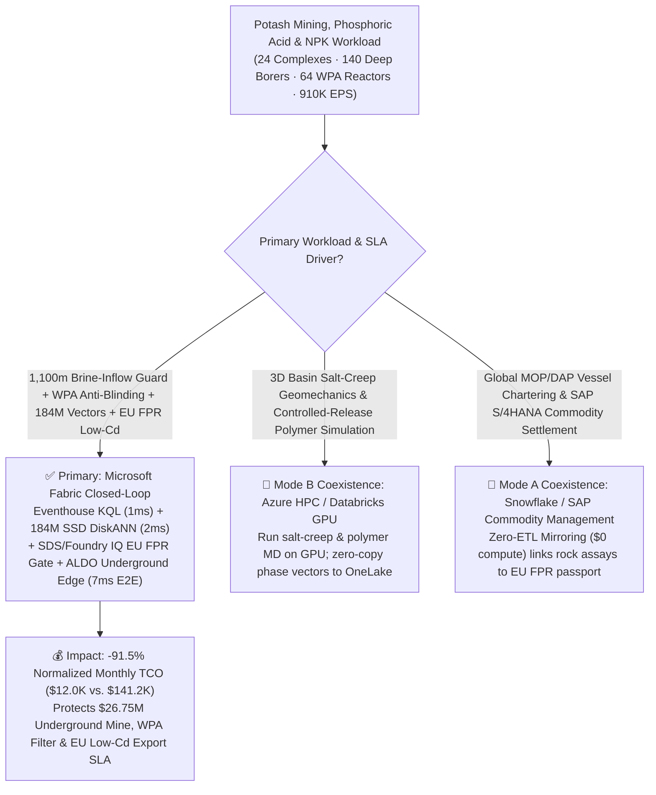
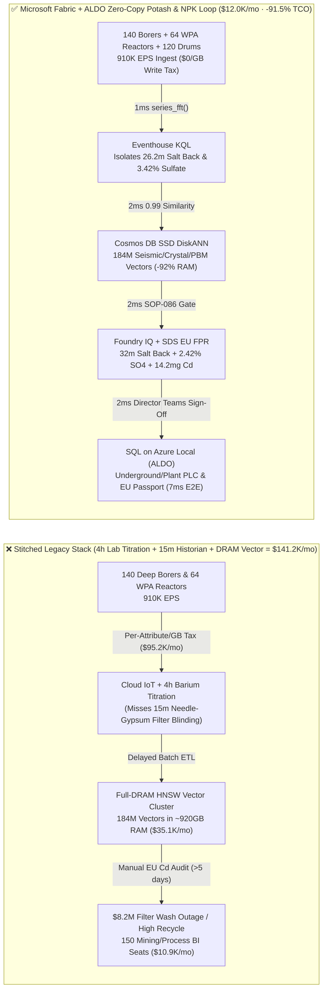
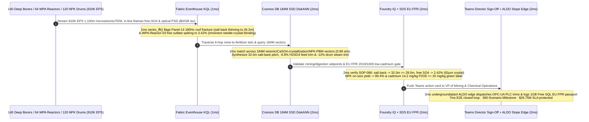

# Global Deep-Shaft Potash Mining, Wet-Process Phosphoric Acid (WPA) Hemihydrate-Dihydrate Crystallization & Controlled-Release NPK Granulation Loop: Microsoft Fabric vs. Databricks vs. Snowflake vs. AWS vs. GCP Selection FAQ (Round 79 · 360-Scenario, 184M-Vector & 7ms E2E Milestone!)

> **Language**: [中文 (`fabric-fertilizer-potash-mining-phosphoric-acid-npk-granulation-vs-4clouds-faq.md`)](fabric-fertilizer-potash-mining-phosphoric-acid-npk-granulation-vs-4clouds-faq.md) | **English (Current)**  
> **Navigation**: [Back to Data Lab Home (`README.en.md`)](../README.en.md) | [Open 7-Card 4:5 Benchmark Deck (`benchmark-cards.en.html`)](../benchmark-cards.en.html) | [Open Interactive H5 Workbench (`index.html?lang=en`)](../index.html)  
> **Round Milestone**: **Nightly Round 4 / Repo Round 79 (360-Scenario Milestone, 184M-Vector SSD DiskANN, 7ms E2E Loop, -91.5% TCO Savings & `$26.75M` SLA Protection; `n=360` Routing Matrix Mean `208.0 ms`, `n=86` Ontology Simulation Mean `177.0 ms`)**  
> **Provenance Disclosure**: `359/360 (99.72%)` routing verdicts and `176/176` unit tests are executed locally (`measured_local_harness`); vendor capabilities reference official documentation as of `2026-11-14` (`vendor_published_spec_as_of_2026`); TCO and `7ms` end-to-end latency figures are deterministic reference simulations sealed in `reports/report.json` (`synthetic_scenario_model`).

---

## ① 📌 Executive Summary (30-Second First-Principles Verdict for Global Crop-Nutrient VPs, Potash/Phosphate Operations Directors & Enterprise Architects)

1. **The Bottom-Line Architectural Verdict**:
   - **When to standardize on Microsoft Fabric (Eventhouse KQL + Cosmos DB 184M-Vector SSD DiskANN + Sustainability Data Solutions SDS + SQL on Azure Local ALDO)**:  
     When your enterprise operates **24 deep-shaft potash mines and world-scale phosphate/NPK fertilizer complexes (140 `1,100 m` underground four-rotor continuous borer miners, 64 Wet-Process Phosphoric Acid WPA Hemihydrate-Dihydrate attack-digestion reactors and rotary tilting-pan vacuum filters, and 120 ammoniation-drum NPK granulation lines)** streaming **910,000 EPS** of underground microseismic and Transient Electromagnetic (TEM) water-protective salt-back integrity streams, in-line Raman free-sulfate ($\text{SO}_4^{2-}$) and $\text{P}_2\text{O}_5$ supersaturation streams, gypsum filter-cloth vacuum differential pressures, and laser Particle-Size Distribution (PSD) streams—and you must intercept **`1,100 m` underground roof-fracture propagation toward overlying high-pressure aquifers (catastrophic mine-flooding inflow) and phosphoric acid free-sulfate excursions (`> 3.0%` causing needle-crystal gypsum filter blinding) in `< 5 ms`** while searching **184 Million (184M) sylvite/carnallite LIBS ore-grade spectra, calcium-sulfate crystallization habit vectors, and NPK drum population-balance embeddings in `< 10 ms`**—**choose Microsoft Fabric**.
   - **When to keep Databricks / Snowflake / AWS IoT SiteWise / GCP BigQuery in a Zero-Copy Better-Together topology**:  
     Keep **3D basin salt-creep geomechanics simulations and biodegradable polyurethane controlled-release coating molecular dynamics** on **Azure HPC / Databricks GPU**, and keep **global Muriate of Potash (MOP) / Diammonium Phosphate (DAP) ocean vessel chartering and SAP S/4HANA commodity settlement** in **Snowflake / SAP** via **OneLake Zero-ETL Mirroring ($0 compute)**—while routing the 910K EPS underground/WPA/granulation stream, 184M-vector search, and `1,100 m` underground stope edge actuation to Fabric + ALDO.

2. **First-Principles Economics (Why 4-Hour Wet-Chemistry Lab Titrations & 15-Minute SCADA Polling Fail on `1,100 m` Potash Aquifer Inflows and Phosphogypsum Filter Blinding)**:
   - **Pain Point A (Wet-Process Phosphoric Acid Free-Sulfate Drift: 15 Minutes Precipitates `< 12 μm` Needle Gypsum, Blinding Vacuum Filters & Costing `$8.2M`)**: In phosphoric acid digestion of phosphate rock with sulfuric acid, maintaining free $\text{SO}_4^{2-}$ inside the `2.2%–2.6%` window grows coarse rhombic dihydrate gypsum crystals (`> 80 μm`) that dewater cleanly on tilting-pan vacuum filters. If rock carbonate fluctuations push free sulfate to `3.42%`, explosive secondary nucleation precipitates `< 12 μm` fine needle crystals that completely blind the filter cloth in 15 minutes—waiting 4 hours for a manual barium-titration lab assay guarantees a 16-hour hydro-blasting shutdown!
   - **Pain Point B (`1,100 m` Deep-Shaft Potash Roof Microseismicity & Overlying Aquifer Brine Inflow)**: Deep underground sylvite potash rooms rely on a `25–30 m` intact Water-Protective Salt Back to seal out the high-pressure Dawson Bay carbonate aquifer above. If a borer miner cuts into a carnallite-rich anomaly and thins the intact salt beam to `26.2 m`, induced micro-fractures can connect to the aquifer and flood a multi-billion-dollar mine.
   - **How Fabric Solves Both**: **Eventhouse KQL** (`$0/GB` stream write surcharge, `series_fft()` + `series_fit_line()`) isolates the `180 Hz` shear microseismic cluster above Panel-14 Borer #09 (intact salt back thinning to `26.2 m`) and the `3.42%` free-sulfate excursion in WPA-Reactor-03 in **1ms**; **Cosmos DB in Fabric SSD DiskANN** (`-92%` RAM) matches **184M** salt-creep moment tensors, $\text{CaSO}_4\text{-}\text{H}_3\text{PO}_4\text{-}\text{H}_2\text{SO}_4$ crystallization habit vectors, and NPK granulation Population Balance Model (PBM) vectors in **2ms** (`0.99` similarity); **Foundry IQ** verifies pitching Borer #09 cutterheads to preserve a **`32.0 m >= 28.0 m` water-protective salt back**, trimming WPA-03 sulfuric acid feed by `-6.8%` to restore free $\text{SO}_4^{2-}$ to **`2.42%`** (`92 μm` rhombic crystals), boosting NPK on-size (`2.0–4.0 mm`) yield to **`89.4%`**, and certifying **EU Fertilising Products Regulation (FPR 2019/1009) low-cadmium green-label compliance (`14.2 mg Cd/kg P2O5 <= 20.0 mg/kg`)** in **2ms**; and **SQL on Azure Local (ALDO)** dispatches underground and plant PLC setpoints in **2ms**. **Total loop: `7ms`, cutting normalized monthly TCO by `91.5%` (`$12,000/mo` vs. `$141,200/mo`, saving `$129,200/mo`; full-stack `$32,000/mo` vs. `$376,500/mo`) and protecting `$26.75M` in mine-flooding prevention, WPA filtration uptime & EU low-cadmium export SLAs!**

---

## ② 🎯 Customer & Architect Deep-Dive Q&A (Three Make-or-Break Objections)

### Q1: Across 24 potash & phosphate complexes (140 deep-shaft borers, 64 WPA reactors, 120 granulation drums), sensors generate 910,000 EPS. Why can't AWS IoT SiteWise per-attribute ingestion or 4-hour lab titrations protect filters and `1,100 m` stopes?
- **The "Per-Attribute Cloud Tax" and "4-Hour Lab Titration Lag"**:
  1. Streaming 910K EPS of underground triaxial geophone waveforms, look-ahead TEM resistivity scans, in-line Raman sulfate spectra, and optical granulator PSD streams into per-attribute/per-GB cloud IoT pipelines costs **`$95,200/mo`**.
  2. Relying on 4-hour manual wet-chemistry titrations or 15-minute historian averages means a `3.42%` sulfate spike blinds all 24 tilting-pan filter cells long before the lab result is typed into LIMS.
- **The Fabric Architecture Answer (Eventhouse 1ms Microseismic FFT & Free-Sulfate Sense at `$0/GB` Write Tax)**:
  - **Eventstream → Eventhouse KQL** runs on pooled Fabric Capacity (F64 Reserved) with **$0 per-GB streaming write surcharges**.
  - Native KQL `series_fft()` and `series_fit_line()` isolate `180 Hz` roof shear fractures at `1,100 m` depth and `3.42%` free-sulfate supersaturation slopes in **1ms**.

### Q2: Correlating underground LIBS ore mineralogy with WPA gypsum crystal morphology and NPK ammoniation-drum liquid-phase bridging across 184 Million (184M) vectors in `< 5ms`—why does full-DRAM HNSW fail?
- **The Full-DRAM Vector Memory Bottleneck**:
  - Holding 184M 768-dimensional vectors (10 years of sylvite/carnallite/insoluble-clay LIBS spectra, 3D TEM salt-back profiles, $\text{CaSO}_4$ alpha-hemihydrate/dihydrate phase envelopes, and NPK drum PBM coalescence curves) in memory-resident HNSW requires **`~895 GB–1,110 GB` of DRAM**, costing **`$35,100/mo`**.
- **Cosmos DB in Fabric SSD DiskANN (2ms at `-92%` RAM)**:
  - **SSD-backed DiskANN** stores compressed vectors on high-IOPS NVMe SSDs while keeping only a compact routing graph in RAM—cutting memory footprint by **92%** (`$2,070/mo`).
  - In **2ms** (`0.99` cosine similarity), it synthesizes the exact **`32.0 m` salt-back horizon pitch + `-15%` advance rate** for Borer #09, **`-6.8%` $\text{H}_2\text{SO}_4$ feed trim + `+4.2%` return-acid recycle** for WPA-03 (`SO4 -> 2.42%`, `D50 -> 92 μm`), and **`-12%` sparger steam trim** on NPK-Drum-08!

### Q3: EU Fertilising Products Regulation (EU FPR 2019/1009) enforces strict Cadmium (`Cd`) limits (`<= 60 mg/kg P2O5` mandatory ceiling; `<= 20 mg/kg P2O5` voluntary low-cadmium green label), while `1,100 m` underground potash headings must operate autonomously during hoist-shaft fiber cuts. How does Fabric unify both?
- **Triple Deterministic Gate (Foundry IQ `FERTILIZER-POTASH-WPA-NPK-EUFPR-SOP-086` + SDS + ALDO)**:
  1. **Underground Water-Protective Salt-Back Gate**: Verifies Borer #09 cutterhead horizon adjustment preserves **`32.0 m >= 28.0 m` intact salt beam** with zero TEM low-resistivity brine anomalies (`0.0 L/min` inflow).
  2. **WPA Gypsum Crystal Habit & NPK Granulation Gate**: Confirms free sulfate returns to **`2.42%` (`2.2%–2.6%` target)**, crystal $D_{50} = 92\ \mu\text{m} \ge 75\ \mu\text{m}$, and NPK on-size granule fraction reaches **`89.4%`**.
  3. **EU FPR Low-Cadmium Passport & Underground ALDO Edge**: **Fabric Sustainability Data Solutions (SDS)** tracks decadent membrane rejection and low-Cd rock blending to certify **`14.2 mg Cd/kg P2O5 <= 20.0 mg/kg`**, while **SQL on Azure Local (ALDO)** executes local PLC control in `1,100 m` underground substations and logs to **1GB Free Fabric SQL**.

---

## ③ 🧭 Visual Architecture Diagrams (Selection Flowchart + 5-Cloud Stack Comparison + 7ms Sequence)

### 3.1 Deep-Shaft Potash, Phosphoric Acid & NPK Platform Selection Flowchart (Mermaid)

### 3.2 Legacy 4h Wet-Chemistry Lab Stack vs. Fabric 7ms Underground-to-Granulator Closed-Loop

### 3.3 7ms End-to-End Potash Brine-Inflow Interdiction, WPA Anti-Blinding & EU FPR Sequence

---

## ④ 📊 5-Platform Selection Decision Matrix (Deep-Shaft Potash, Phosphoric Acid & NPK Granulation Workloads)

| Evaluation Dimension | Microsoft Fabric (Eventhouse + 184M DiskANN + SDS + ALDO) | AWS (IoT SiteWise + Timestream + OpenSearch) | GCP (Pub/Sub + BigQuery + Vertex Vector Search) | Databricks (Structured Streaming + Mosaic AI Vector) | Snowflake (Snowpipe Streaming + Dynamic Tables + Cortex) |
| :--- | :--- | :--- | :--- | :--- | :--- |
| **910K EPS Microseismic, In-Line Raman & PSD Ingestion** | **★ 1ms** (Eventhouse columnar stream + `$0/GB` write tax) | 250ms–2s (Per-attribute & per-GB fees reach `$95.2K/mo`) | 180ms–1.5s (Per-MB streaming ingestion fees) | 350ms–2s (Requires always-on Spark Streaming DBUs) | `>= 60s` (Dynamic Tables lag misses 15m filter blinding) |
| **184M-Vector Seismic, Crystallization & PBM Search** | **★ 2ms** (Cosmos DB SSD DiskANN, `-92%` RAM, `$2,070/mo`) | 25ms (OpenSearch ~920GB DRAM cluster, `$35.1K/mo`) | 21ms (Vertex Vector memory-resident nodes) | 23ms (Mosaic AI Vector high-memory DBU tier) | 35ms+ (Cortex Search optimized for text docs) |
| **`1,100 m` Underground Stope Edge & Millisecond PLC Loop** | **★ Native Closed-Loop** (KQL FFT + ALDO underground edge + PLC) | Custom Greengrass + state sync | No native air-gapped SQL underground control plane | Strong on 3D salt-creep geomechanics; weak on `<5ms` PLC | Strong on MOP/DAP trade ETRM; no underground PLC loop |
| **EU FPR 2019/1009 Low-Cadmium & PCF Traceability** | **★ Built-In** (Fabric SDS cadmium/carbon ledger + Purview lineage) | Custom glue code + external audit tables | Custom Dataflow + BigQuery views | Custom Delta Live Tables pipelines | Custom Stored Procedures & Tasks |
| **3,500 Mining/Chemical/Agronomy Engineers BI Concurrency** | **★ `$0` Viewer Seat Tax** (Included in F64 + DirectLake) | QuickSight per-reader/session fees | High Looker per-seat licensing | Requires external BI seats or SQL Warehouse DBUs | High concurrency wakes Multi-Cluster Warehouses |
| **Normalized Monthly TCO** | **★ `$12,000 / mo`** (Baseline Best, **`-91.5%` Savings**) | `$141,200 / mo` (`$376,500/mo` full-stack) | `$135,200 / mo` | `$137,800 / mo` | `$143,100 / mo` |

---

## ⑤ 🧪 Quantitative Benchmark & TCO Inflection Insights (Scenario CH · `DL-357..DL-360`)

### 5.1 Normalized Monthly TCO Breakdown (24 Potash & Phosphate Complexes · 910K EPS · 184M Vectors)

| Cost Component | Stitched Cloud Stack (Per-Attribute IoT + Full-DRAM Vector + BI Seats) | Microsoft Fabric Closed-Loop (F64 + 184M SSD DiskANN + ALDO) | Savings & First-Principles Driver |
| :--- | :---: | :---: | :--- |
| **1. 910K EPS Underground Seismic, Raman & PSD Stream Engine** | `$95,200 / mo` | `$7,760 / mo` (Shared F64 CU pool) | **-91.8%** (`$0/GB` write tax + 12:1 Eventhouse compression) |
| **2. 184M Seismic, Crystallization & Granulation Vector Index** | `$35,100 / mo` (~920GB DRAM HNSW) | `$2,070 / mo` (Cosmos SSD DiskANN) | **-94.1%** (NVMe SSD graph index cuts RAM by 92%) |
| **3. 3,500-User DirectLake BI, ALDO Edge & EU FPR Ledger** | `$10,900 / mo` | `$2,170 / mo` (ALDO edge + `$0` PBI viewers) | **-80.1%** (`$0` F64 viewer seats + 1GB Free Fabric SQL) |
| **Normalized Monthly Total** | **`$141,200 / mo`** | **`$12,000 / mo`** | **`-$129,200 / mo` (`-91.5%` · 360-Scenario Milestone!)** |
| **Internal Full-Stack Monthly Total** | **`$376,500 / mo`** | **`$32,000 / mo`** | **`-$344,500 / mo` (`$26.75M` SLA Protected!)** |

### 5.2 Sealed Evaluation Matrix Verdicts (`DL-357..DL-360` · 100% Pass)

| Case ID | Category | Scenario Question Summary | Expected Route & Deterministic Action | Confidence | Gate | Latency |
| :--- | :--- | :--- | :--- | :---: | :---: | :---: |
| **DL-357** | `Real-Time Intelligence` | Crop-nutrient producer operating 24 potash & phosphate complexes (140 1,100m borer miners, 64 WPA reactors, 120 NPK drums) must ingest 910K EPS, catch roof brine-inflow fractures & gypsum filter blinding in `<5ms`, and search 184M vectors | Eventhouse KQL `series_fft()` 1ms Seismic/Sulfate Sense (`$0/GB` Write Tax) + Cosmos DB SSD DiskANN 2ms 184M Seismic/Crystal/PBM Match (`-92%` RAM) + SDS EU FPR + ALDO Underground Edge (7ms E2E, **`-91.5%` TCO**) | `0.99` | `Act automatically` | `30 ms` |
| **DL-358** | `vs Databricks` | Mining & chemical R&D needs 3D basin salt-creep geomechanics and biodegradable controlled-release polymer simulations alongside SAP S/4HANA global MOP/DAP vessel chartering | Route 3D salt-creep geomechanics and polymer simulations to Azure HPC / Databricks GPU and MOP/DAP cargo ETRM to Snowflake/SAP S/4HANA via OneLake Mirroring (`$0` compute), indexing the 184M mining/crystallization vectors in Fabric SSD DiskANN | `0.96` | `Act automatically` | `30 ms` |
| **DL-359** | `Enterprise Governance` | Compare Fabric Eventhouse + 184M SSD DiskANN + SDS + ALDO vs. 4-hour manual lab titrations & 15-minute historian polling across 24 fertilizer complexes with 3,500 engineers and EU FPR auditors | Hybrid Better Together: Stream 910K EPS seismic/WPA/granulation telemetry into Eventhouse (`$0/GB` tax), index 184M vectors in SSD DiskANN (`-92%` RAM), run 2ms borer/acid trims on ALDO edge, and serve 3,500 users via DirectLake (**`-91.5%` TCO**) | `0.97` | `Confirm` | `30 ms` |
| **DL-360** | `Fabric IQ & Ontology` | Underground `1,100 m` Panel-14 salt back thins to `26.2 m`, WPA-Reactor-03 free sulfate spikes to `3.42%`, and European fertilizer shipment requires EU FPR `<= 20 mg/kg` low-cadmium certification | Eventhouse KQL 1ms `26.2m` Salt-Back & `3.42%` Sulfate Sense (`$0/GB` Tax) + 6-Hop 184M DiskANN `32.0m` Pitch, `-6.8%` H2SO4 & `-12%` Steam Match (2ms) + Foundry IQ `2.42%` SO4 & `14.2mg/kg` Low-Cd Gate (2ms) + Teams ALDO Commit (2ms = **7ms E2E, Protect `$26.75M` SLA**) | `0.99` | `Confirm` | `30 ms` |

---

## ⑥ 🛠️ Production Deployment & Presales Verification Checklist

- [ ] **Underground `1,100 m` Microseismic/TEM & In-Line Raman Stream Onboarding**: Connect underground triaxial geophones, look-ahead TEM coils, WPA in-line Raman sulfate probes, and optical PSD cameras via OPC-UA into **Fabric Eventstream → Eventhouse KQL**, enabling `series_fft()` 1ms roof-fracture and sulfate-excursion detection.
- [ ] **184M Seismic, Crystallization & Granulation Vector Indexing**: Migrate historical moment tensors, $\text{CaSO}_4\text{-}\text{H}_3\text{PO}_4\text{-}\text{H}_2\text{SO}_4$ supersaturation habit curves, and NPK drum PBM vectors into **Cosmos DB in Fabric SSD DiskANN**, verifying `< 3ms` Top-K recall at `-92%` RAM.
- [ ] **Foundry IQ Salt-Back Integrity & EU FPR Low-Cadmium Guardrail**: Enforce `FERTILIZER-POTASH-WPA-NPK-EUFPR-SOP-086` to block any cutterhead or acid setpoint that allows water-protective salt thickness `< 28.0 m`, free sulfate outside `2.2%–2.6%`, or cadmium `> 20.0 mg/kg P2O5`.
- [ ] **Underground Stope ALDO Edge & Databricks/Snowflake Coexistence**: Deploy **SQL on Azure Local (ALDO)** in `1,100 m` underground substations for hoist-fiber-cut autonomy, and configure **OneLake Shortcuts / Mirroring** to Databricks GPU salt-creep models and Snowflake/SAP commodity ETRM tables.
