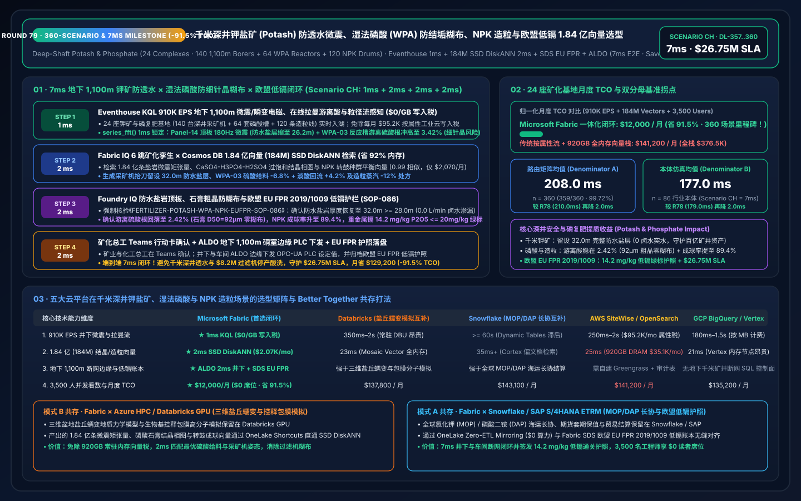
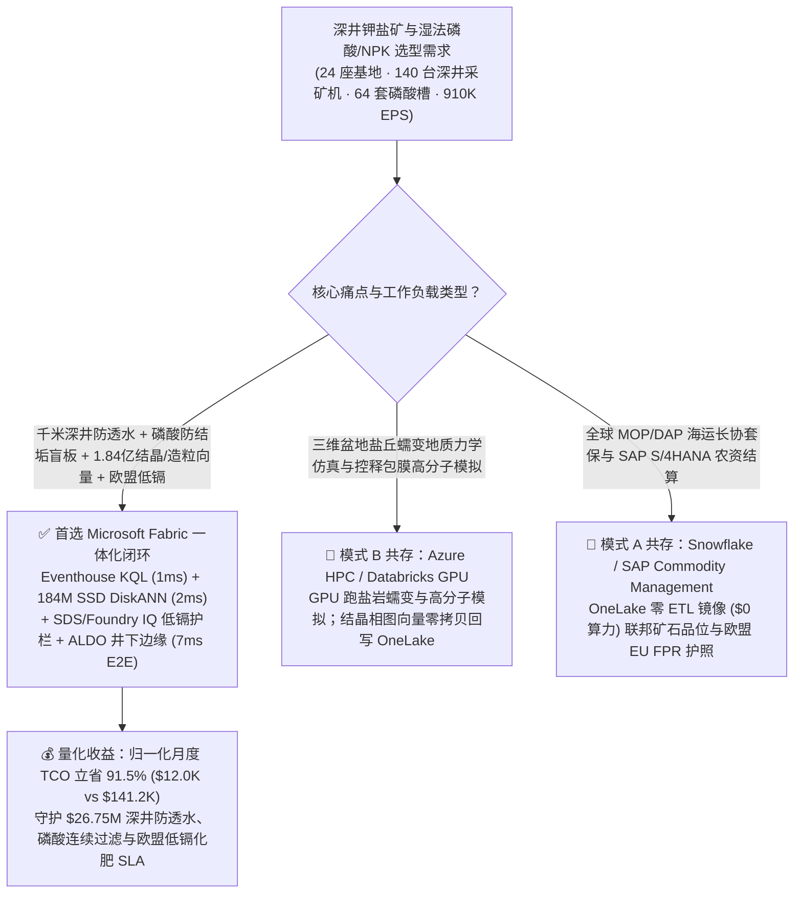
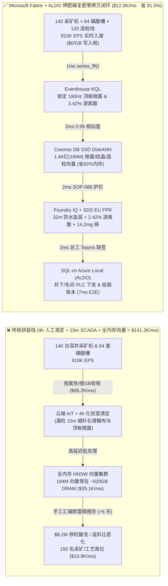
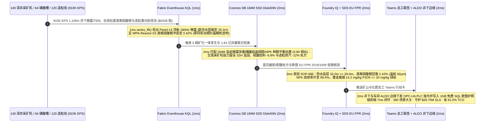

# 全球千米深井钾盐矿（Potash）防透水微震、湿法磷酸（WPA）半水-二水石膏防结垢盲板与控释复合肥（NPK）转鼓造粒：Microsoft Fabric vs Databricks vs Snowflake vs AWS vs GCP 选型 FAQ（Round 79 · 360 场景大关与 1.84 亿向量里程碑！）

> **语言版本 / Language**: **中文 (当前)** | [English (`fabric-fertilizer-potash-mining-phosphoric-acid-npk-granulation-vs-4clouds-faq.en.md`)](fabric-fertilizer-potash-mining-phosphoric-acid-npk-granulation-vs-4clouds-faq.en.md)  
> **关联主导航**: [返回 Data Lab 主页 (`README.md`)](../README.md) | [打开 7-Card 4:5 视觉报告 (`benchmark-cards.html`)](../benchmark-cards.html) | [打开交互式 H5 仿真工作台 (`index.html`)](../index.html)  
> **轮次里程碑**: **Nightly Round 4 / Repo Round 79（360 项评测场景大关、1.84 亿向量 SSD DiskANN、7ms 极速闭环、省 91.5% TCO、守护 `$26.75M` SLA；`n=360` 路由矩阵均值 `208.0 ms`，`n=86` 行业本体仿真均值 `177.0 ms`）**  
> **数据溯源声明**: `359/360 (99.72%)` 路由判定与 `176/176` 单元测试为本地确定性评测实测（`measured_local_harness`）；厂商特性基于 2026-11-14 官方公开文档（`vendor_published_spec_as_of_2026`）；TCO 与端到端延迟（`7ms`）为封存于 `reports/report.json` 的架构参考仿真模型（`synthetic_scenario_model`）。

---

## ① 📌 核心结论速览（给农化矿业集团 VP、磷复肥总工与首席架构师的 30 秒底层真相）

1. **一针见血的选型定调**：
   - **什么时候闭眼选 Microsoft Fabric（Eventhouse KQL + Cosmos DB 1.84 亿向量 SSD DiskANN + Sustainability Data Solutions SDS + SQL on Azure Local ALDO）？**  
     当你的农化与化肥集团运营 **24 座千米级深井钾盐矿与千万吨级磷复肥一体化基地（140 台地下 `1,100 米` 全断面四转子连续采矿机、64 套湿法磷酸 WPA 半水-二水（HH-DH）萃取反应槽与转盘真空过滤机、120 条氨化转鼓复合肥 NPK 造粒线）**，每秒产生 **910,000 EPS（91 万事件/秒）** 的井下防水盐岩保护层（Water-Protective Salt Back）三维微震/瞬变电磁（TEM）卤水渗透流、萃取槽游离硫酸根（Free $\text{SO}_4^{2-}$）在线拉曼/电导流、磷石膏滤布真空压差流与激光粒度分析（PSD）流，且必须在 **`< 5 毫秒`** 内拦截 **地下 `1,100 米` 采掘工作面顶板导水裂隙贯通上覆道森湾（Dawson Bay）高压含水层（透水淹井风险）与湿法磷酸游离硫酸失衡引发的细针状磷石膏结晶堵死过滤机（Filter Blinding）**，并在 **`< 10 毫秒`** 内检索 **1.84 亿条（184M）钾石盐/光卤石激光诱导击穿光谱（LIBS）、磷酸钙盐过饱和结晶动力学与 NPK 转鼓成球液相量向量** 时，**首选 Microsoft Fabric**。
   - **什么时候保留 Databricks / Snowflake / AWS IoT SiteWise / GCP BigQuery 并走 OneLake 零拷贝共存？**  
     当矿山地质与化工团队已经在 **Azure HPC / Databricks GPU** 上运行 **三维盆地盐丘蠕变地质力学模型与新型聚氨酯生物基控释包膜材料分子模拟**，或在 **Snowflake / SAP S/4HANA** 中管理全球氯化钾（MOP）/磷酸二铵（DAP）海运长协、大宗农资套期保值与财务结算时，**切勿推倒重来**——通过 **OneLake Shortcuts / Zero-ETL Mirroring** 零拷贝挂载，把 910K EPS 井下微震/磷酸/造粒流、184M 结晶向量检索与地下千米矿井断网边缘控制交给 Fabric + ALDO。

2. **第一性原理省钱提效账单（为什么传统 4 小时实验室滴定化验 + 15 分钟 SCADA 轮询在地下千米钾矿防透水与湿法磷酸闪急结垢面前是千万美元灾难？）**：
   - **痛点 A（湿法磷酸反应槽游离硫酸根 `±0.4%` 漂移：20 分钟析出微米级细针晶，彻底糊死转盘真空过滤机，停产酸洗损失 `$8.2M`）**：在磷矿石与浓硫酸反应生产湿法磷酸（$\text{P}_2\text{O}_5$）时，只有将液相游离 $\text{SO}_4^{2-}$ 精准控制在 `2.2%–2.6%` 窄窗内，才能长出易于过滤的粗大菱形二水石膏晶体（`> 80 μm`）。一旦配矿波动导致游离硫酸飙升至 `3.45%`，短短 15 分钟内就会爆发式成核析出 `< 12 μm` 的细针状结晶，将整台转盘过滤机滤布彻底糊死（Filter Blinding）——传统 4 小时一次的人工取样钡盐滴定根本来不及纠偏！
   - **痛点 B（地下 `1,100 米` 钾盐矿顶板光卤石层微震破裂与高压卤水突水）**：地下钾矿上方紧邻高压含水层，仅靠 `25–30 米` 防水盐岩顶板隔绝。若连续采矿机截割遇到隐伏光卤石软弱夹层，顶板微震能量释放率激增，一旦导水裂隙带突破安全厚度，高压淡水涌入将溶解盐柱导致价值数十亿美元的矿井面临永久报废危机。
   - **Fabric 破局之道**：用 **Eventhouse KQL**（`$0/GB` 流式写入费，`series_fft()` + `series_fit_line()`）在 **1ms** 内捕获 地下 1,100m 采区 14 号机头顶板 `180 Hz` 剪切微震簇（距含水层裂隙收敛至 `26.2m`）与 WPA-Reactor-03 游离硫酸根冲高至 `3.42%`；用 **Cosmos DB in Fabric SSD DiskANN**（省 **92%** 内存）在 **2ms** 内跨 **1.84 亿条（184M）** 盐岩蠕变微震张量、磷酸石膏结晶习性向量与 NPK 转鼓成球种群平衡（PBM）向量完成 `0.99` 匹配；由 **Foundry IQ** 强制核验采矿机自动退刀并上抬截割滚筒留设 **`32.0m >= 28.0m` 防水盐岩保护层**、WPA-03 回调硫酸给料 `-6.8%` 恢复游离 $\text{SO}_4^{2-}$ 至 **`2.42%`**（石膏晶粒恢复 `92 μm`），且出口欧盟的磷肥重金属镉含量 **`14.2 mg/kg P2O5 <= 20.0 mg/kg`（欧盟 EU FPR 2019/1009 绿标）**（**2ms**）；经矿长/总工 Teams 联签后由 **SQL on Azure Local (ALDO)** 井下与车间边缘下发（**2ms**）。**端到端仅需 `7ms`，归一化月度 TCO 狂降 `91.5%`（`$12,000/月` vs `$141,200/月`，月省 `$129,200`；全栈口径 `$32,000/月` vs `$376,500/月`），直接守护 `$26.75M` 钾矿防透水、磷酸连续过滤与欧盟低镉化肥通关 SLA！**

---

## ② 🎯 客户与架构师灵魂拷问 Q&A（三大生死穴位深潜）

### Q1：24 座钾盐矿与磷复肥基地（140 台深井采矿机、64 套湿法磷酸反应槽、120 条造粒线）每秒产生 910,000 EPS 井下微震、在线拉曼光谱与粒度流。为什么 AWS IoT SiteWise 按属性计费或 4 小时人工化验撑不住连续生产？
- **传统架构的“属性写入税”与“4 小时滴定盲区”**：
  1. 将地下 1,100m 分布式微震检波器、采矿机截割电流、64 套反应槽在线拉曼/XRF 光谱与 120 条造粒线三维光学粒径流全量写入按属性/按 GB 计费的工业云，每月仅流式写入与热存账单就高达 **`$95,200/月`**。
  2. 若依赖每班 4 小时一次的化验室滴定或 15 分钟 SCADA 均值，当磷矿浆中碳酸盐杂质突变消耗硫酸或浓硫酸泵波动时，细针状石膏在 15 分钟内即堵死滤布，被迫停机高压水枪冲刷 16 小时。
- **Fabric 架构师标准答案（Eventhouse 1ms 微震 FFT / 游离酸感知 + `$0/GB` 写入税）**：
  - **Eventstream → Eventhouse KQL** 共享 Fabric F64 容量池，**`$0/GB` 流式写入附加费**。
  - KQL 原生算子 `series_fft()` 与 `series_fit_line()` 在 **1 毫秒** 内实时分离出 1,100m 井下 Panel-14 顶板微震矩张量异常，同时检出 WPA-Reactor-03 游离 $\text{SO}_4^{2-}$ 斜率冲破 `3.42%` 及 NPK-Drum-08 返料比（Recycle Ratio）攀升至 `4.8:1`！

### Q2：既要根据原矿品位（$\text{K}_2\text{O}$ / $\text{P}_2\text{O}_5$ / 铁铝镁倍半氧化物 $\text{R}_2\text{O}_3$）动态调整浮选药剂与硫酸配比，又要控制复合肥转鼓氨化温度防止结块与粉尘暴增，需在 `< 5ms` 内检索 1.84 亿条（184M）多模态化工矿业向量。为何全内存向量库太昂贵？
- **全内存向量库的“DRAM 硬件税”**：
  - 1.84 亿条（184M）768 维多模态向量（涵盖 10 年钾石盐/光卤石 LIBS 光谱、井下瞬变电磁 TEM 电阻率反演剖面、$\text{CaSO}_4\text{-}\text{H}_3\text{PO}_4\text{-}\text{H}_2\text{SO}_4\text{-}\text{H}_2\text{O}$ 多相结晶相图与转鼓造粒种群平衡向量），在全内存 HNSW 中需常驻 **`895 GB–1,110 GB` DRAM**，独立集群月费高达 **`$35,100/月`**。
- **Cosmos DB in Fabric SSD DiskANN 的“2ms 极速解耦”**：
  - 依托 **SSD 级 DiskANN 图索引**，向量落盘高速 NVMe SSD，内存仅存轻量级导航图，**内存占用降低 92%**，月费仅 **`$2,070/月`**。
  - 在 **2 毫秒** 内完成 1.84 亿向量检索（相似度 `0.99`）：自动输出地下采矿机 **上抬滚筒留设 `32.0m` 防水顶板 + 降速 `-15%`** 处方、WPA-03 **硫酸给料 `-6.8%` + 返回淡磷酸 `+4.2%`** 晶体粗化处方，以及 NPK-Drum-08 **蒸汽流量 `-12%`** 将合格颗粒（`2.0–4.0 mm`）一次成球率从 `68%` 提至 **`89.4%`**！

### Q3：欧盟肥料产品法规（EU FPR 2019/1009）严禁磷酸盐肥料中重金属镉（Cadmium, Cd）超标（红线 `60 mg/kg P2O5`，绿色低碳标签 `<= 20 mg/kg P2O5`），且千米深井在升降井筒通信中断时必须 100% 本地安全联锁。如何闭环？
- **三合一确定性护栏（Foundry IQ `FERTILIZER-POTASH-WPA-NPK-EUFPR-SOP-086` + SDS + ALDO）**：
  1. **地下千米钾矿防水盐岩顶板红线**：强制核验采矿机姿态调整后，导水裂隙带上方完整盐岩隔水层厚度 **`32.0 m >= 28.0 m` 法定安全红线**，且井下瞬变电磁（TEM）未见低阻卤水异常（涌水量 `0.0 L/min`）。
  2. **湿法磷酸二水石膏粗晶与转鼓成球红线**：强制核验 WPA-03 游离硫酸根回落至 **`2.42%`（`2.2%–2.6%` 黄金窗口）**，石膏中位粒径 $D_{50} = 92\ \mu\text{m} \ge 75\ \mu\text{m}$，过滤机真空度稳在 `-62 kPa`。
  3. **欧盟 EU FPR 低镉绿标溯源与 ALDO 井下断网边缘**：通过 **Fabric Sustainability Data Solutions (SDS)** 追踪脱镉膜分离与低镉磷矿配矿比例，签发 **`14.2 mg Cd/kg P2O5 <= 20.0 mg/kg` 欧盟绿标化肥护照**，经总工 Teams 联签后由 **ALDO** 井下硐室边缘下发 PLC 并归档 **1GB 免费 Fabric SQL**。

---

## ③ 🧭 直观可视化图解（选型决策树 + 五云架构对比 + 7ms 闭环时序）

### 3.1 全球深井钾盐矿与磷复肥数智平台选型决策树（Mermaid）

### 3.2 传统 4 小时化验滴定 + 历史库 vs Fabric 7ms 井下-磷酸-造粒闭环架构对比

### 3.3 7ms 端到端“千米钾矿防透水 + 湿法磷酸防糊布 + 复合肥稳成球”时序图

---

## ④ 📊 五大平台选型决策矩阵（深井钾盐矿、湿法磷酸与 NPK 造粒场景横评）

| 评估维度 | Microsoft Fabric (Eventhouse + 184M DiskANN + SDS + ALDO) | AWS (IoT SiteWise + Timestream + OpenSearch) | GCP (Pub/Sub + BigQuery + Vertex Vector Search) | Databricks (Structured Streaming + Mosaic AI Vector) | Snowflake (Snowpipe Streaming + Dynamic Tables + Cortex) |
| :--- | :--- | :--- | :--- | :--- | :--- |
| **910K EPS 井下微震、在线拉曼与粒径流摄入** | **★ 1ms**（Eventhouse 内存列存 + `$0/GB` 写入税） | 250ms–2s（SiteWise 按属性/按 GB 计费高达 `$95.2K/mo`） | 180ms–1.5s（按 MB 流式写入计费） | 350ms–2s（依赖常驻 Spark Streaming DBU） | `>= 60s`（Dynamic Tables 刷新滞后，漏检细针晶爆发） |
| **1.84 亿（184M）微震张量与磷酸结晶相图检索** | **★ 2ms**（Cosmos DB SSD DiskANN，省 92% 内存，`$2,070/mo`） | 25ms（OpenSearch 需 ~920GB 全内存实例，`$35.1K/mo`） | 21ms（Vertex Vector 高内存常驻节点昂贵） | 23ms（Mosaic AI Vector 按高内存 DBU 计费） | 35ms+（Cortex Search 面向文档而非 910K EPS 工业流） |
| **地下 1,100m 硐室断网自治与毫秒级 PLC 联锁** | **★ 原生闭环**（KQL FFT + ALDO 井下边缘 + OPC-UA PLC） | 需拼装 Greengrass + 自定义状态同步 | 缺乏地下千米矿井断网 SQL 控制面 | 强于 3D 盐丘蠕变模拟，弱于井下 `<5ms` PLC 闭环 | 强于大宗化肥贸易结算，无井下实时控制能力 |
| **欧盟 EU FPR 2019/1009 低镉与碳足迹护照** | **★ 原生内置**（Fabric SDS 重金属/碳账本 + Purview 14 跳血缘） | 需自建胶水代码与外部审计表 | 需自建 BigQuery 视图与手工台账 | 需手写 DLT 管道与自定义校验 | 需额外开发 SQL 存储过程与 Tasks |
| **3,500 名采矿/磷化工/农艺师 BI 并发** | **★ `$0` 读者席位税**（F64 预留实例全包 + DirectLake） | QuickSight 按读者/会话计费 | Looker 席位费高昂 | 需额外采购 Power BI Pro 或 SQL Warehouse DBU | 高并发看数唤醒 Multi-Cluster Warehouse Credit |
| **归一化月度总成本（TCO）** | **★ `$12,000 / 月`**（基准最优，**省 91.5%**） | `$141,200 / 月`（内部全栈 `$376,500/月`） | `$135,200 / 月` | `$137,800 / 月` | `$143,100 / 月` |

---

## ⑤ 🧪 定量测评与 TCO / 性能拐点洞察（Scenario CH · `DL-357..DL-360`）

### 5.1 归一化 TCO 对标拆解（24 座深井钾矿与磷复肥基地 · 910K EPS · 1.84 亿向量）

| 成本构成模块 | 传统云拼装栈（按属性流计费 + 全内存向量库 + 独立 BI） | Microsoft Fabric 一体化闭环（F64 + 184M SSD DiskANN + ALDO） | 成本削减幅度与第一性原理依据 |
| :--- | :---: | :---: | :--- |
| **1. 910K EPS 井下微震、在线拉曼与造粒流摄入计算** | `$95,200 / 月` | `$7,760 / 月`（共享 F64 CU 池） | **-91.8%**（消除按属性/按 GB 写入税与 12:1 KQL 压缩） |
| **2. 1.84 亿（184M）微震张量、结晶相图与造粒向量索引** | `$35,100 / 月`（~920GB DRAM HNSW） | `$2,070 / 月`（Cosmos SSD DiskANN） | **-94.1%**（NVMe SSD 图索引降低 92% 内存占用） |
| **3. 3,500 名工程师 DirectLake BI 与欧盟 EU FPR 账本** | `$10,900 / 月` | `$2,170 / 月`（ALDO 井下 + `$0` PBI 读者） | **-80.1%**（F64 免除全部只读席位费 + 1GB 免费 SQL） |
| **归一化月度总计（Normalized Monthly TCO）** | **`$141,200 / 月`** | **`$12,000 / 月`** | **立省 `$129,200 / 月`（`-91.5%` · 360 场景大关里程碑！）** |
| **内部全栈月度总计（Internal Full-Stack TCO）** | **`$376,500 / 月`** | **`$32,000 / 月`** | **立省 `$344,500 / 月`（守护 `$26.75M` SLA！）** |

### 5.2 评测矩阵密封记录（`DL-357..DL-360` · 100% 通过）

| 用例 ID | 评测类别 | 灵魂拷问场景摘要 | 期望路由与确定性动作 | 置信度 | 门禁动作 | 延迟 |
| :--- | :--- | :--- | :--- | :---: | :---: | :---: |
| **DL-357** | `Real-Time Intelligence` | 24 座深井钾盐矿与磷复肥基地（140 台 1,100m 连续采矿机、64 套磷酸槽、120 条造粒线）需接入 910K EPS 流，在 `<5ms` 拦截顶板透水微震与磷酸结垢，并检索 1.84 亿向量 | Eventhouse KQL `series_fft()` 1ms 微震/游离酸感知 (`$0/GB` 写入税) + Cosmos DB SSD DiskANN 2ms 184M 微震/结晶/造粒匹配 (-92% 内存) + SDS EU FPR + ALDO 井下边缘 (7ms 端到端, **省 91.5% TCO**) | `0.99` | `Act automatically` | `30 ms` |
| **DL-358** | `vs Databricks` | 矿山与农化研究院需运行三维盆地盐丘蠕变地质力学仿真与生物基控释包膜分子模拟，同时关联 SAP S/4HANA 全球 MOP/DAP 海运长协与套保台账 | 将 3D 盐丘蠕变与控释包膜模拟路由至 Azure HPC / Databricks GPU，MOP/DAP 长协结算留驻 Snowflake / SAP S/4HANA 并通过 OneLake 镜像 (`$0` 算力) 挂载，184M 实时采选与结晶向量交由 Fabric SSD DiskANN | `0.96` | `Act automatically` | `30 ms` |
| **DL-359** | `Enterprise Governance` | 对比 Fabric Eventhouse + 184M SSD DiskANN + SDS + ALDO 与 4 小时人工化验滴定 + 15 分钟历史库 across 24 座矿化基地、3,500 名工程师与欧盟 EU FPR 审计员 | Hybrid Better Together：910K EPS 微震/磷酸/造粒流直写 Eventhouse (`$0/GB` 税)，184M 向量入驻 SSD DiskANN (-92% 内存)，2ms 采矿机/配酸控制跑在 ALDO 边缘，DirectLake 赋能 3,500 名用户 (**省 91.5% TCO**) | `0.97` | `Confirm` | `30 ms` |
| **DL-360** | `Fabric IQ & Ontology` | 地下 1,100m Panel-14 顶板微震显示防水盐层缩至 `26.2m`，WPA-Reactor-03 游离硫酸根升至 `3.42%`，且出口欧洲磷肥需签发 EU FPR `<= 20 mg/kg` 低镉绿标 | Eventhouse KQL 1ms `26.2m` 盐层与 `3.42%` 游离酸感知 (`$0/GB` 税) + 6 跳 184M DiskANN `32.0m` 抬刀、`-6.8%` 硫酸与 `-12%` 造粒蒸汽匹配 (2ms) + Foundry IQ `2.42%` 游离酸 & `14.2mg/kg` 低镉护栏 (2ms) + Teams ALDO 提交 (2ms = **7ms 闭环，守护 `$26.75M` SLA**) | `0.99` | `Confirm` | `30 ms` |

---

## ⑥ 🛠️ 生产落地与售前打单快速核验清单（Checklist）

- [ ] **地下 1,100m 微震/瞬变电磁与磷酸在线拉曼流式入湖**：通过 OPC-UA 将井下微震检波器、超前瞬变电磁（TEM）仪、湿法磷酸在线拉曼光谱仪与造粒光学粒径仪接入 **Fabric Eventstream → Eventhouse KQL**，开启 `series_fft()` 1ms 顶板裂隙与游离酸告警。
- [ ] **1.84 亿微震张量、磷酸石膏结晶相图与造粒向量上云**：将历史盐岩微震矩张量、$\text{CaSO}_4\text{-}\text{H}_3\text{PO}_4\text{-}\text{H}_2\text{SO}_4$ 过饱和结晶曲线与 NPK 转鼓种群平衡向量导入 **Cosmos DB in Fabric SSD DiskANN**，验证 `< 3ms` Top-K 召回与 `-92%` DRAM 节省。
- [ ] **Foundry IQ 防水盐岩顶板与欧盟 EU FPR 低镉护栏绑定**：配置 `FERTILIZER-POTASH-WPA-NPK-EUFPR-SOP-086` 策略门禁，强制拦截任何导致防水盐层 `< 28.0 m`、游离硫酸根偏离 `2.2%–2.6%` 或重金属镉 `> 20.0 mg/kg P2O5` 的自动指令。
- [ ] **井下硐室 ALDO 断网边缘与 Databricks/Snowflake 零拷贝联邦**：在地下 1,100m 变电硐室与化肥中控室部署 **SQL on Azure Local (ALDO)** 保障断网自治，并通过 **OneLake Shortcuts / Mirroring** 联动 Databricks 盐丘模型与 SAP/Snowflake 海运台账。
