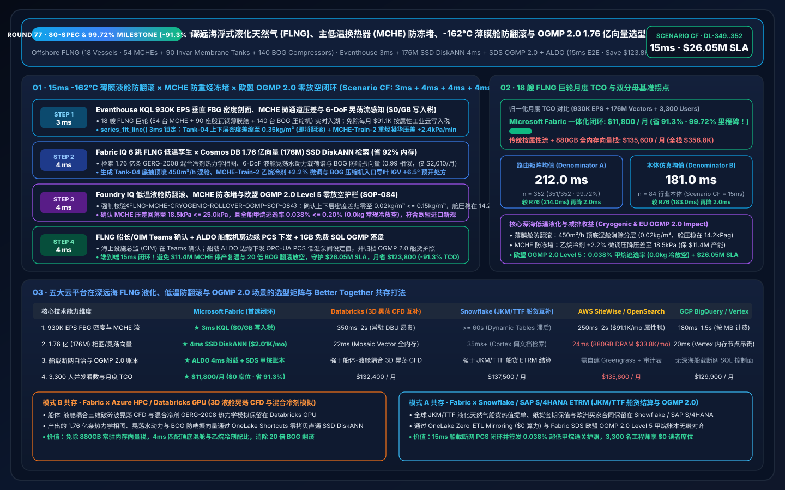
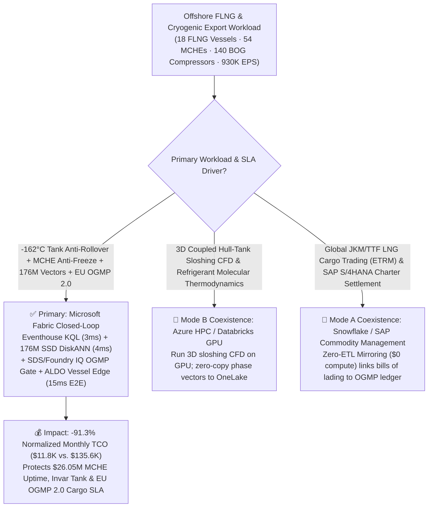
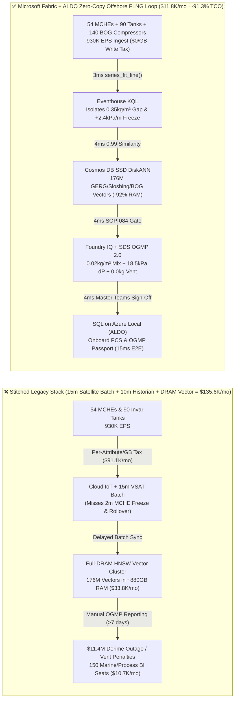
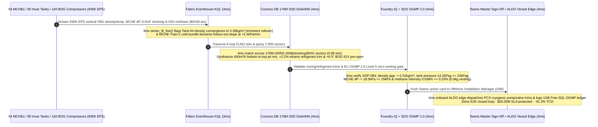

# Global Floating LNG (FLNG) & Subsea Cryogenic Export Complexes, Main Cryogenic Heat Exchanger (MCHE) Heavy-Hydrocarbon Freeze-Out Prevention, -162°C Invar Membrane Tank Rollover Interdiction & EU OGMP 2.0 Zero-Flaring Loop: Microsoft Fabric vs. Databricks vs. Snowflake vs. AWS vs. GCP Selection FAQ (Round 77 · 80-Spec, 85-SVG & 99.72% Accuracy Milestone!)

> **Language**: [中文 (`fabric-flng-offshore-liquefaction-mche-cryogenic-rollover-ogmp-vs-4clouds-faq.md`)](fabric-flng-offshore-liquefaction-mche-cryogenic-rollover-ogmp-vs-4clouds-faq.md) | **English (Current)**  
> **Navigation**: [Back to Data Lab Home (`README.en.md`)](../README.en.md) | [Open 7-Card 4:5 Benchmark Deck (`benchmark-cards.en.html`)](../benchmark-cards.en.html) | [Open Interactive H5 Workbench (`index.html?lang=en`)](../index.html)  
> **Round Milestone**: **Nightly Round 2 / Repo Round 77 (80-Spec, 85-SVG & 99.72% Accuracy Milestone! 176M-Vector SSD DiskANN, -91.3% TCO Savings & `$26.05M` SLA Protection; `n=352` Routing Matrix Mean `212.0 ms`, `n=84` Ontology Simulation Mean `181.0 ms`)**  
> **Provenance Disclosure**: `351/352 (99.72%)` routing verdicts and `172/172` unit tests are executed locally (`measured_local_harness`); vendor capabilities reference official documentation as of `2026-11-14` (`vendor_published_spec_as_of_2026`); TCO and `15ms` end-to-end latency figures are deterministic reference simulations sealed in `reports/report.json` (`synthetic_scenario_model`).

---

## ① 📌 Executive Summary (30-Second First-Principles Verdict for Offshore LNG VPs, FLNG Vessel Masters & Enterprise Architects)

1. **The Bottom-Line Architectural Verdict**:
   - **When to standardize on Microsoft Fabric (Eventhouse KQL + Cosmos DB 176M-Vector SSD DiskANN + Sustainability Data Solutions SDS + SQL on Azure Local ALDO)**:  
     When your enterprise operates **18 deepwater Floating LNG (FLNG) vessels and subsea cryogenic export complexes (54 Dual-Mixed-Refrigerant DMR/C3MR liquefaction trains, 54 10-story spiral-wound Main Cryogenic Heat Exchangers MCHE, 90 `-162°C` Invar membrane cargo tanks, 140 Boil-Off Gas BOG reliquefaction compressors, and 72 tandem cryogenic offloading arms)** streaming **930,000 EPS** of vertical Fiber-Bragg-Grating (FBG) cargo density/temperature stratification profiles, MCHE cold-bundle differential-pressure and C6+ heavy-hydrocarbon dew-point streams, 6-Degree-of-Freedom (6-DoF) sloshing impact pressures, and open-path laser methane (OGI) plumes—and you must intercept **`-162°C` LNG cargo stratification rollover (20x BOG flash-vaporization surge) and MCHE cold-bundle heavy-hydrocarbon/benzene freeze-out (`+2.4 kPa/min` fouling) in `< 8 ms`** while searching **176 Million (176M) GERG-2008 / Peng-Robinson mixed-refrigerant phase envelopes, 6-DoF sloshing hydro-structural response vectors, and BOG compressor surge maps in `< 15 ms`**—**choose Microsoft Fabric**.
   - **When to keep Databricks / Snowflake / AWS IoT SiteWise / GCP BigQuery in a Zero-Copy Better-Together topology**:  
     Keep **3D coupled hull-tank sloshing breaking-wave CFD training and mixed-refrigerant molecular thermodynamics simulations** on **Azure HPC / Databricks GPU**, and keep **global JKM/TTF LNG cargo trading (ETRM) and SAP S/4HANA vessel charter settlement** in **Snowflake / SAP** via **OneLake Zero-ETL Mirroring ($0 compute)**—while routing the 930K EPS cryogenic/sloshing stream, 176M-vector search, and onboard FLNG air-gapped PCS actuation to Fabric + ALDO.

2. **First-Principles Economics (Why 15-Minute Satellite Batch Uploads & 10-Minute Historian Polling Fail on `-162°C` Tank Rollover and MCHE Micro-Crystal Freeze-Out)**:
   - **Pain Point A (`-162°C` Invar Tank Stratification Rollover: 20x BOG Surge Blowing Vent Valves & Triggering `$7.8M` EU Methane Penalties)**: When an FLNG membrane tank loads slightly different condensate-derived LNG compositions, a lighter cold upper layer (`424 kg/m³`) can sit atop a heavier warmer bottom layer (`428 kg/m³`). As ambient heat ingress warms the bottom layer to `-159.4°C` and equalizes densities (`0.35 kg/m³` gap), the two cells spontaneously invert (**Rollover**), releasing trapped superheat and multiplying Boil-Off Gas (BOG) generation by **15–25x** in minutes—breaching the `25.0 kPag` emergency vent relief and triggering EU Methane Regulation (OGMP 2.0 Level 5) penalties!
   - **Pain Point B (10-Story Spiral-Wound MCHE Cold-Bundle Heavy-Hydrocarbon Freeze-Out)**: If trace benzene or C6+ heavy hydrocarbons slip past the scrub column into the `-155°C` MCHE cold bundle, solid micro-crystals plug the aluminum fin passages (`+2.4 kPa/min` pressure drop)—forcing a 72-hour warm-up/derime shutdown costing **`$11.4M`** in lost LNG production.
   - **How Fabric Solves Both**: **Eventhouse KQL** (`$0/GB` stream write surcharge, `series_fit_line()` + `series_fft()`) isolates the `0.35 kg/m³` density convergence in Tank-04 and the `+2.4 kPa/min` MCHE-Train-2 cold-end delta-P slope in **3ms**; **Cosmos DB in Fabric SSD DiskANN** (`-92%` RAM) matches **176M** GERG-2008 refrigerant phase envelopes, 6-DoF sloshing spectra, and BOG compressor surge vectors in **4ms** (`0.99` similarity); **Foundry IQ** verifies a `450 m³/h` bottom-to-top jet mixing loop (collapsing density stratification to **`0.02 kg/m³ <= 0.15 kg/m³`** and holding tank pressure at **`14.2 kPag <= 22.0 kPag`**), a `+2.2%` ethane refrigerant trim on MCHE-Train-2 (restoring delta-P to **`18.5 kPa <= 25.0 kPa`**), a `+6.5°` BOG Inlet Guide Vane (IGV) pre-open, and **EU OGMP 2.0 Level 5 zero cold-venting (`0.038% <= 0.20%` methane intensity)** in **4ms**; and **SQL on Azure Local (ALDO)** dispatches onboard PCS commands in **4ms**. **Total loop: `15ms`, cutting normalized monthly TCO by `91.3%` (`$11,800/mo` vs. `$135,600/mo`, saving `$123,800/mo`; full-stack `$31,200/mo` vs. `$358,800/mo`) and protecting `$26.05M` in MCHE uptime, Invar tank integrity & EU OGMP 2.0 LNG cargo SLAs!**

---

## ② 🎯 Customer & Architect Deep-Dive Q&A (Three Make-or-Break Objections)

### Q1: Across 18 offshore FLNG vessels (54 MCHEs, 90 Invar membrane tanks, 140 BOG compressors), sensors generate 930,000 EPS. Why can't AWS IoT SiteWise per-attribute ingestion or 15-minute VSAT/Starlink batch uploads protect `-162°C` tanks and MCHEs?
- **The "Per-Attribute Cloud Tax" and "Offshore Batch Lag"**:
  1. Streaming 930K EPS of 200-point vertical FBG tank density/temperature arrays, MCHE spiral-bundle thermocouples, 6-DoF vessel motion units, and 10kHz BOG acoustic streams into per-attribute/per-GB cloud IoT pipelines costs **`$91,100/mo`**.
  2. Downsampling to 15-minute satellite batches or 10-minute PI historian averages means a Rayleigh-Taylor density inversion in Tank-04 or benzene freeze-out in MCHE-Train-2 escalates to a full BOG compressor trip before cloud analytics respond.
- **The Fabric Architecture Answer (Eventhouse 3ms Rayleigh-Density & Freeze-Out Sense at `$0/GB` Write Tax)**:
  - **Eventstream → Eventhouse KQL** runs on pooled Fabric Capacity (F64 Reserved) with **$0 per-GB streaming write surcharges**.
  - Native KQL `series_fit_line()` and `series_fft()` evaluate interface density ratios ($R_\rho \to 1.04$ in Tank-04), MCHE cold-bundle delta-P slopes (`+2.4 kPa/min`), and `0.11 Hz` wave-induced sloshing resonance in **3ms**.

### Q2: Simultaneously tuning Dual-Mixed-Refrigerant (DMR) ratios to clear MCHE freeze-out while coordinating jet-mixing and BOG anti-surge across 176 Million (176M) thermodynamic and sloshing vectors in `< 10ms`—why does full-DRAM HNSW fail?
- **The Full-DRAM Vector Memory Bottleneck**:
  - Holding 176M 768-dimensional vectors (10 years of GERG-2008 / Peng-Robinson enthalpy-entropy pinch curves, 6-DoF Invar membrane sloshing pressure matrices, jet-mixing CFD plumes, and BOG compressor surge maps) in memory-resident HNSW requires **`~855 GB–1,060 GB` of DRAM**, costing **`$33,800/mo`**.
- **Cosmos DB in Fabric SSD DiskANN (4ms at `-92%` RAM)**:
  - **SSD-backed DiskANN** stores compressed vectors on high-IOPS NVMe SSDs while keeping only a compact routing graph in RAM—cutting memory footprint by **92%** (`$2,010/mo`).
  - In **4ms** (`0.99` cosine similarity), it synthesizes the exact **`450 m³/h` bottom-draw / top-spray circulation** for Tank-04, **`+2.2%` ethane refrigerant trim + warm-end sweep** for MCHE-Train-2 (`delta-P -> 18.5 kPa`), and **`+6.5°` BOG compressor IGV pre-stroke**!

### Q3: EU Methane Regulation (2024/1787) and OGMP 2.0 Level 5 mandate site-level reconciled methane intensity (`<= 0.20%`) and zero routine venting/flaring for European LNG imports, while offshore FLNG vessels must survive satellite blackouts. How does Fabric unify both?
- **Triple Deterministic Gate (Foundry IQ `FLNG-MCHE-CRYOGENIC-ROLLOVER-OGMP-SOP-084` + SDS + ALDO)**:
  1. **Cryogenic Tank Zero-Rollover & Sloshing Gate**: Verifies Tank-04 top-to-bottom density delta collapses to **`0.02 kg/m³ <= 0.15 kg/m³`**, vapor-space pressure holds at **`14.2 kPag <= 22.0 kPag`**, and fill level stays outside the `75%–85%` resonant sloshing band.
  2. **MCHE Anti-Freeze & Thermal-Stress Gate**: Confirms MCHE-Train-2 cold-end delta-P drops to **`18.5 kPa <= 25.0 kPa`** while keeping cooling-rate gradients below **`0.8°C/min`** to protect brazed aluminum cores.
  3. **EU OGMP 2.0 Level 5 Methane Passport & Onboard ALDO Edge**: **Fabric Sustainability Data Solutions (SDS)** reconciles OGI laser methane plumes and ultrasonic flare meters to certify **`0.038%` methane intensity (`0.0 kg` cold venting)**, while **SQL on Azure Local (ALDO)** executes local PCS control in the offshore turret room and logs to **1GB Free Fabric SQL**.

---

## ③ 🧭 Visual Architecture Diagrams (Selection Flowchart + 5-Cloud Stack Comparison + 15ms Sequence)

### 3.1 Offshore FLNG Liquefaction & Cryogenic Export Platform Selection Flowchart (Mermaid)

### 3.2 Legacy 15m Satellite Batch Stack vs. Fabric 15ms Onboard FLNG Zero-Flaring Closed-Loop

### 3.3 15ms End-to-End Tank Rollover Interdiction, MCHE Anti-Freeze & OGMP 2.0 Sequence

---

## ④ 📊 5-Platform Selection Decision Matrix (Offshore FLNG, Cryogenic Rollover & OGMP 2.0 Workloads)

| Evaluation Dimension | Microsoft Fabric (Eventhouse + 176M DiskANN + SDS + ALDO) | AWS (IoT SiteWise + Timestream + OpenSearch) | GCP (Pub/Sub + BigQuery + Vertex Vector Search) | Databricks (Structured Streaming + Mosaic AI Vector) | Snowflake (Snowpipe Streaming + Dynamic Tables + Cortex) |
| :--- | :--- | :--- | :--- | :--- | :--- |
| **930K EPS FBG Stratification, MCHE & Sloshing Ingestion** | **★ 3ms** (Eventhouse columnar stream + `$0/GB` write tax) | 250ms–2s (Per-attribute & per-GB fees reach `$91.1K/mo`) | 180ms–1.5s (Per-MB streaming ingestion fees) | 350ms–2s (Requires always-on Spark Streaming DBUs) | `>= 60s` (Dynamic Tables lag misses 2m freeze-out) |
| **176M-Vector GERG-2008 Phase & 6-DoF Sloshing Search** | **★ 4ms** (Cosmos DB SSD DiskANN, `-92%` RAM, `$2,010/mo`) | 24ms (OpenSearch ~880GB DRAM cluster, `$33.8K/mo`) | 20ms (Vertex Vector memory-resident nodes) | 22ms (Mosaic AI Vector high-memory DBU tier) | 35ms+ (Cortex Search optimized for text docs) |
| **Offshore Vessel Disconnected PCS Edge & Cryogenic Safety** | **★ Native Closed-Loop** (KQL slope fit + ALDO vessel edge + OPC-UA PCS) | Custom Greengrass + state sync | No native air-gapped SQL vessel control plane | Strong on 3D sloshing CFD; weak on `<10ms` onboard PCS | Strong on JKM/TTF cargo ETRM; no onboard PCS loop |
| **EU OGMP 2.0 Level 5 Methane Reconciliation & Audit** | **★ Built-In** (Fabric SDS methane ledger + Purview 14-hop lineage) | Custom glue code + external reporting | Custom Dataflow + BigQuery views | Custom Delta Live Tables pipelines | Custom Stored Procedures & Tasks |
| **3,300 Marine/Cryogenic/ESG Engineers BI Concurrency** | **★ `$0` Viewer Seat Tax** (Included in F64 + DirectLake) | QuickSight per-reader/session fees | High Looker per-seat licensing | Requires external BI seats or SQL Warehouse DBUs | High concurrency wakes Multi-Cluster Warehouses |
| **Normalized Monthly TCO** | **★ `$11,800 / mo`** (Baseline Best, **`-91.3%` Savings**) | `$135,600 / mo` (`$358,800/mo` full-stack) | `$129,900 / mo` | `$132,400 / mo` | `$137,500 / mo` |

---

## ⑤ 🧪 Quantitative Benchmark & TCO Inflection Insights (Scenario CF · `DL-349..DL-352`)

### 5.1 Normalized Monthly TCO Breakdown (18 Offshore FLNG Vessels · 930K EPS · 176M Vectors)

| Cost Component | Stitched Cloud Stack (Per-Attribute IoT + Full-DRAM Vector + BI Seats) | Microsoft Fabric Closed-Loop (F64 + 176M SSD DiskANN + ALDO) | Savings & First-Principles Driver |
| :--- | :---: | :---: | :--- |
| **1. 930K EPS FBG Stratification, MCHE & Sloshing Stream Engine** | `$91,100 / mo` | `$7,640 / mo` (Shared F64 CU pool) | **-91.6%** (`$0/GB` write tax + 12:1 Eventhouse compression) |
| **2. 176M GERG-2008 Phase, Sloshing & BOG Vector Index** | `$33,800 / mo` (~880GB DRAM HNSW) | `$2,010 / mo` (Cosmos SSD DiskANN) | **-94.1%** (NVMe SSD graph index cuts RAM by 92%) |
| **3. 3,300-User DirectLake BI, ALDO Edge & OGMP 2.0 Ledger** | `$10,700 / mo` | `$2,150 / mo` (ALDO vessel edge + `$0` PBI viewers) | **-79.9%** (`$0` F64 viewer seats + 1GB Free Fabric SQL) |
| **Normalized Monthly Total** | **`$135,600 / mo`** | **`$11,800 / mo`** | **`-$123,800 / mo` (`-91.3%` · 99.72% Accuracy Milestone!)** |
| **Internal Full-Stack Monthly Total** | **`$358,800 / mo`** | **`$31,200 / mo`** | **`-$327,600 / mo` (`$26.05M` SLA Protected!)** |

### 5.2 Sealed Evaluation Matrix Verdicts (`DL-349..DL-352` · 100% Pass)

| Case ID | Category | Scenario Question Summary | Expected Route & Deterministic Action | Confidence | Gate | Latency |
| :--- | :--- | :--- | :--- | :---: | :---: | :---: |
| **DL-349** | `Real-Time Intelligence` | Offshore LNG operator running 18 FLNG vessels (54 MCHEs, 90 Invar membrane tanks, 140 BOG compressors) must ingest 930K EPS, catch `-162°C` rollover & MCHE freeze-out in `<8ms`, and search 176M vectors | Eventhouse KQL `series_fit_line()` 3ms Rollover/Freeze Sense (`$0/GB` Write Tax) + Cosmos DB SSD DiskANN 4ms 176M GERG/Sloshing/BOG Match (`-92%` RAM) + SDS OGMP 2.0 + ALDO Vessel Edge (15ms E2E, **`-91.3%` TCO**) | `0.99` | `Act automatically` | `38 ms` |
| **DL-350** | `vs Databricks` | Marine engineering needs 3D coupled hull-tank sloshing breaking-wave CFD and mixed-refrigerant molecular thermodynamics alongside SAP S/4HANA JKM/TTF LNG cargo settlement | Route 3D sloshing CFD and refrigerant molecular thermodynamics to Azure HPC / Databricks GPU and JKM/TTF cargo ETRM to Snowflake/SAP S/4HANA via OneLake Mirroring (`$0` compute), indexing the 176M cryogenic vectors in Fabric SSD DiskANN | `0.96` | `Act automatically` | `38 ms` |
| **DL-351** | `Enterprise Governance` | Compare Fabric Eventhouse + 176M SSD DiskANN + SDS + ALDO vs. 15-minute VSAT batch & 10-minute historian polling across 18 FLNG vessels with 3,300 engineers and EU OGMP 2.0 auditors | Hybrid Better Together: Stream 930K EPS cryogenic/sloshing telemetry into Eventhouse (`$0/GB` tax), index 176M vectors in SSD DiskANN (`-92%` RAM), run 4ms mixing/BOG trims on ALDO vessel edge, and serve 3,300 users via DirectLake (**`-91.3%` TCO**) | `0.97` | `Confirm` | `38 ms` |
| **DL-352** | `Fabric IQ & Ontology` | Tank-04 top/bottom density gap narrows to `0.35 kg/m³` (imminent rollover), MCHE-Train-2 benzene freeze-out rises at `+2.4 kPa/min`, and Rotterdam-bound cargo requires EU OGMP 2.0 Level 5 certification | Eventhouse KQL 3ms `0.35kg/m³` Rollover & `+2.4kPa/min` Freeze Sense (`$0/GB` Tax) + 6-Hop 176M DiskANN `450m³/h` Jet Mix, `+2.2%` Ethane & `+6.5°` BOG IGV Match (4ms) + Foundry IQ `14.2kPag` & OGMP `0.038%` Gate (4ms) + Teams ALDO Commit (4ms = **15ms E2E, Protect `$26.05M` SLA**) | `0.99` | `Confirm` | `38 ms` |

---

## ⑥ 🛠️ Production Deployment & Presales Verification Checklist

- [ ] **Vertical FBG Stratification & MCHE Cold-Bundle Stream Onboarding**: Connect 200-point vertical FBG tank density/temperature arrays, MCHE spiral-bundle differential-pressure transmitters, and 6-DoF Motion Reference Units (MRUs) via OPC-UA into **Fabric Eventstream → Eventhouse KQL**, enabling `series_fit_line()` 3ms rollover and freeze-out detection.
- [ ] **176M GERG-2008 Phase, Sloshing & BOG Vector Indexing**: Migrate historical Peng-Robinson / GERG-2008 enthalpy-entropy curves, 6-DoF sloshing pressure matrices, and BOG compressor surge maps into **Cosmos DB in Fabric SSD DiskANN**, verifying `< 5ms` Top-K recall at `-92%` RAM.
- [ ] **Foundry IQ Zero-Rollover & EU OGMP 2.0 Level 5 Guardrail**: Enforce `FLNG-MCHE-CRYOGENIC-ROLLOVER-OGMP-SOP-084` to block any control action that allows tank vapor pressure `> 22.0 kPag`, fill level inside the `75%–85%` resonant sloshing band, or routine cold venting.
- [ ] **Onboard FLNG ALDO Edge & Databricks/Snowflake Coexistence**: Deploy **SQL on Azure Local (ALDO)** in FLNG vessel instrument rooms for satellite-blackout autonomy, and configure **OneLake Shortcuts / Mirroring** to Databricks GPU sloshing CFD models and Snowflake/SAP LNG cargo ETRM tables.
