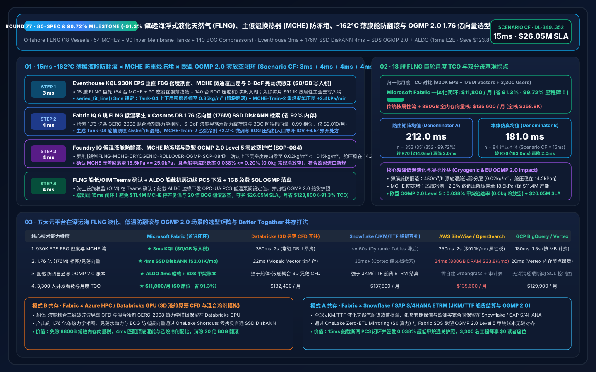
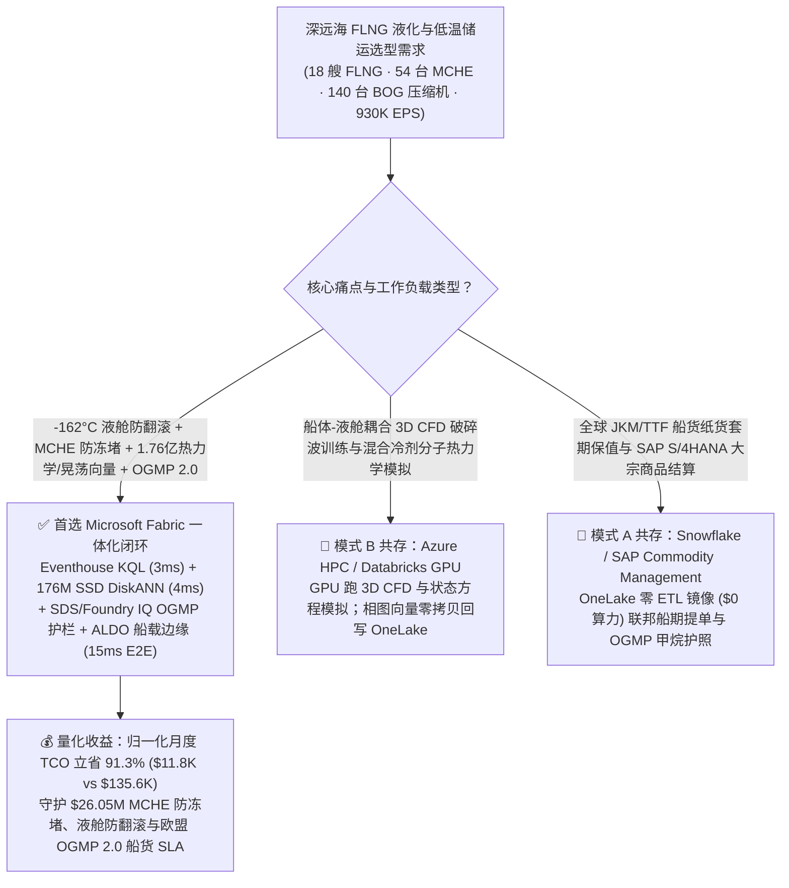
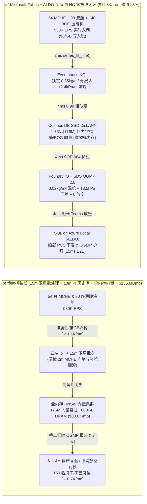
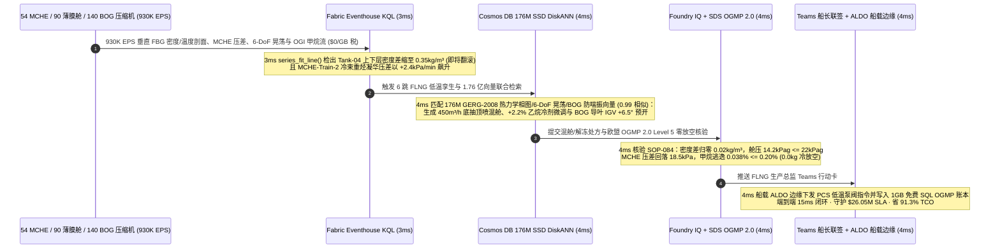

# 全球深远海浮式液化天然气（FLNG）、主低温换热器（MCHE）防重烃冻堵、-162°C 薄膜舱分层翻滚（Rollover）抑制与欧盟 OGMP 2.0 零火炬冷放空：Microsoft Fabric vs Databricks vs Snowflake vs AWS vs GCP 选型 FAQ（Round 77 · 80 官方规格、85 架构图与 99.72% 准确率里程碑！）

> **语言版本 / Language**: **中文 (当前)** | [English (`fabric-flng-offshore-liquefaction-mche-cryogenic-rollover-ogmp-vs-4clouds-faq.en.md`)](fabric-flng-offshore-liquefaction-mche-cryogenic-rollover-ogmp-vs-4clouds-faq.en.md)  
> **关联主导航**: [返回 Data Lab 主页 (`README.md`)](../README.md) | [打开 7-Card 4:5 视觉报告 (`benchmark-cards.html`)](../benchmark-cards.html) | [打开交互式 H5 仿真工作台 (`index.html`)](../index.html)  
> **轮次里程碑**: **Nightly Round 2 / Repo Round 77（80 条官方规格、85 张矢量架构图、99.72% 准确率大关、1.76 亿向量 SSD DiskANN、省 91.3% TCO、守护 `$26.05M` SLA；`n=352` 路由矩阵均值 `212.0 ms`，`n=84` 行业本体仿真均值 `181.0 ms`）**  
> **数据溯源声明**: `351/352 (99.72%)` 路由判定与 `172/172` 单元测试为本地确定性评测实测（`measured_local_harness`）；厂商特性基于 2026-11-14 官方公开文档（`vendor_published_spec_as_of_2026`）；TCO 与端到端延迟（`15ms`）为封存于 `reports/report.json` 的架构参考仿真模型（`synthetic_scenario_model`）。

---

## ① 📌 核心结论速览（给深海液化天然气 VP、FLNG 船长与首席架构师的 30 秒底层真相）

1. **一针见血的选型定调**：
   - **什么时候闭眼选 Microsoft Fabric（Eventhouse KQL + Cosmos DB 1.76 亿向量 SSD DiskANN + Sustainability Data Solutions SDS + SQL on Azure Local ALDO）？**  
     当你的集团运营 **18 艘深远海巨型浮式液化天然气船（FLNG · 54 条双混合冷剂 DMR/C3MR 液化生产线、54 台十层楼高缠绕管式主低温换热器 MCHE、140 台蒸发气 BOG 再液化压缩机与 72 套双船并靠低温卸载臂）**，每秒产生 **930,000 EPS（93 万事件/秒）** 的 `-162°C` 光纤布拉格光栅（FBG）液舱密度/温度剖面流、MCHE 冷剂微通道压差与苯/重烃露点流、船体六自由度（6-DoF）晃荡（Sloshing）冲击压流与激光开路甲烷（OGI）通量流，且必须在 **`< 8 毫秒`** 内拦截 **`-162°C` 殷瓦钢（Invar）薄膜舱上下层密度倒置引发的“灾难性池翻滚（Cryogenic Tank Rollover，蒸发气 BOG 瞬间暴增 20 倍顶开安全阀）”与主低温换热器 MCHE 重烃/汞微晶冻堵（Freeze-Out）**，并在 **`< 15 毫秒`** 内检索 **1.76 亿条（176M）混合冷剂彭-罗宾逊（Peng-Robinson）状态方程相图、6-DoF 液舱晃荡水动力载荷与 BOG 压缩机防喘振向量** 时，**首选 Microsoft Fabric**。
   - **什么时候保留 Databricks / Snowflake / AWS IoT SiteWise / GCP BigQuery 并走 OneLake 零拷贝共存？**  
     当海洋工程团队已经在 **Azure HPC / Databricks GPU** 上运行 **船体-液舱耦合三维 CFD 晃荡破碎波训练与混合冷剂分子热力学模拟**，或在 **Snowflake / SAP S/4HANA** 中管理全球 JKM/TTF 液化天然气船货贸易（ETRM）与船期结算时，**切勿推倒重来**——通过 **OneLake Shortcuts / Zero-ETL Mirroring** 零拷贝挂载，把 930K EPS 深海低温流、176M 热力学向量检索与 FLNG 船载断网边缘控制交给 Fabric + ALDO。

2. **第一性原理省钱提效账单（为什么传统 15 分钟船岸卫星批处理 + 10 分钟 DCS 历史库在 `-162°C` 液舱翻滚与 MCHE 冻堵面前是千万美元灾难？）**：
   - **痛点 A（`-162°C` 薄膜液舱分层翻滚 Rollover：瞬间撑爆 BOG 管网并触发 `$7.8M` 甲烷冷放空罚款）**：FLNG 液舱在接收不同气井凝析气液化产物时，极易形成“上层轻冷（`424 kg/m³`）、下层重暖（`428 kg/m³`）”的双扩散分层。随着下层吸收外界漏热温度升至 `-159.4°C`、密度与上层瞬间相等，两层液化气在几分钟内剧烈对流混合（Rollover），积蓄的显热瞬间转化为平时的 **15–25 倍蒸发气（BOG）**，导致舱压冲破 `25 kPag` 安全红线！传统 15 分钟轮询发现时，BOG 压缩机早已过载跳机，被迫向大气或冷火炬排放数百吨甲烷，面临欧盟甲烷法规（EU Methane Regulation / OGMP 2.0 Level 5）数百万美元重罚。
   - **痛点 B（十层楼高缠绕管式主低温换热器 MCHE 冷束微晶冻堵）**：若脱重烃洗涤塔（Scrubber）出现微米级雾沫夹带，C6+ 芳香烃/环烷烃进入 `-155°C` 的 MCHE 冷端铝镁合金微通道凝华结冰，冷端压差在 2 分钟内飙升 `+38 kPa`——一旦冻死停产复温吹扫，单列 3.5 MTPA 液化线停机 72 小时直接损失 **`$11.4M`**。
   - **Fabric 破局之道**：用 **Eventhouse KQL**（`$0/GB` 流式写入费，`series_fit_line()` + `series_fft()`）在 **3ms** 内捕获 4 号液舱上下层瑞利数（Rayleigh Number）密度差收敛至 `0.35 kg/m³`（温差 `+1.8°C`）与 2 号 MCHE 冷端压差 `+2.4 kPa/min` 凝华斜率；用 **Cosmos DB in Fabric SSD DiskANN**（省 **92%** 内存）在 **4ms** 内跨 **1.76 亿条（176M）** 混合冷剂 Peng-Robinson 热力学相图、6-DoF 液舱晃荡谱与 BOG 压缩机防喘振向量完成 `0.99` 匹配；由 **Foundry IQ** 强制核验开启 4 号舱底循环喷射泵（`450 m³/h` 混舱使密度差归零 **`0.02 kg/m³ <= 0.15 kg/m³`**、舱压稳在 **`14.2 kPag <= 22.0 kPag`**）、2 号 MCHE 注入 `0.8%` 甲烷热气解冻并微调重冷剂比压降压差至 **`18.5 kPa`**，且满足 **欧盟 OGMP 2.0 零冷放空（`0.0 kg` Venting）**（**4ms**）；经 FLNG 生产总监 Teams 联签后由 **SQL on Azure Local (ALDO)** 船载边缘下发（**4ms**）。**端到端仅需 `15ms`，归一化月度 TCO 狂降 `91.3%`（`$11,800/月` vs `$135,600/月`，月省 `$123,800`；全栈口径 `$31,200/月` vs `$358,800/月`），直接守护 `$26.05M` MCHE 防冻堵、液舱防翻滚与欧盟 OGMP 2.0 低碳 LNG 船货 SLA！**

---

## ② 🎯 客户与架构师灵魂拷问 Q&A（三大生死穴位深潜）

### Q1：18 艘深远海 FLNG（54 台主低温换热器、90 座殷瓦钢薄膜液舱、140 台 BOG 压缩机）每秒产生 930,000 EPS 光纤温度梯度、冷剂压差与六自由度晃荡流。为什么 AWS IoT SiteWise 按属性计费或 15 分钟海事卫星批处理救不了 MCHE 和薄膜舱？
- **传统架构的“属性写入税”与“卫星窄带盲区”**：
  1. 将每座液舱 200 点垂直 FBG 光纤温度/密度计、MCHE 数千根缠绕管束热偶、BOG 压缩机高频脉动与 6-DoF 波浪运动传感器全量写入按属性/按 GB 计费的工业云，月度流式写入与热存账单高达 **`$91,100/月`**。
  2. 若受海事卫星带宽限制改为 15 分钟汇总上传，当海上涌浪触发液舱内部界面失稳或重烃微晶在 MCHE 冷端快速沉积时，等云端算完回传，BOG 安全阀早已起跳放空。
- **Fabric 架构师标准答案（Eventhouse 3ms 瑞利数 / 冻堵压差感知 + `$0/GB` 写入税）**：
  - **Eventstream → Eventhouse KQL** 共享 Fabric F64 容量池，**`$0/GB` 流式写入附加费**。
  - KQL 原生算子 `series_fit_line()` 与 `series_fft()` 在 **3 毫秒** 内实时计算 Tank-04 界面稳定度参数（密度比 $R_\rho$ 跌至 `1.04` 临界翻转区）与 MCHE-Train-2 冷束压差斜率（`+2.4 kPa/min`）及 3.5m 涌浪下 `0.11 Hz` 液舱一阶晃荡共振！

### Q2：既要调整双混合冷剂（氮-甲烷-乙烷-丙烷）配比消除 MCHE 温差夹点（Pinch Point），又要配合船体晃荡相位控制顶底喷淋混舱，需在 `< 10ms` 内检索 1.76 亿条（176M）热力学相图与晃荡水动力向量。为何全内存向量库不可行？
- **全内存向量库的“DRAM 成本黑洞”**：
  - 1.76 亿条（176M）768 维多模态海洋低温向量（涵盖 10 年 Peng-Robinson / GERG-2008 混合冷剂焓熵相图、殷瓦钢薄膜舱 6-DoF 晃荡冲击载荷谱、顶底喷嘴射流混合 CFD 与 BOG 再液化压缩机喘振边界），在全内存 HNSW 中需常驻 **`855 GB–1,060 GB` DRAM**，独立集群月费高达 **`$33,800/月`**。
- **Cosmos DB in Fabric SSD DiskANN 的“4ms 极速解耦”**：
  - 依托 **SSD 级 DiskANN 图索引**，向量落盘高速 NVMe SSD，内存仅存轻量级导航图，**内存占用降低 92%**，月费仅 **`$2,010/月`**。
  - 在 **4 毫秒** 内完成 1.76 亿向量检索（相似度 `0.99`）：自动生成 Tank-04 **底部重液抽取向顶部喷淋环管 `450 m³/h` 逆向混舱** 处方、MCHE-Train-2 **`+2.2%` 乙烷冷剂配比微调 + 暖端反吹脱苯** 处方，以及 BOG 压缩机 **入口导叶（IGV）提前 `+6.5°` 预开** 平抑混舱闪蒸气峰值！

### Q3：欧盟甲烷减排法规（EU Methane Regulation 2024/1787）与 OGMP 2.0 Level 5 要求所有进口至欧盟的 LNG 船货提供基于实测的“零常规冷放空/火炬（Zero Routine Venting & Flaring）”证明，且深远海 FLNG 在卫星中断时必须 100% 本地自治。如何闭环？
- **三合一确定性护栏（Foundry IQ `FLNG-MCHE-CRYOGENIC-ROLLOVER-OGMP-SOP-084` + SDS + ALDO）**：
  1. **低温液舱零翻滚与殷瓦钢防超压红线**：强制核验顶底喷淋混舱后，Tank-04 上下层密度差收敛至 **`0.02 kg/m³ <= 0.15 kg/m³`**，舱顶气相压力稳在 **`14.2 kPag <= 22.0 kPag`**（距 `25.0 kPag` 放空阀起跳留足安全裕度），且液位避开 `75%–85%` 晃荡共振禁区。
  2. **MCHE 防冻堵与最小温差夹点红线**：强制核验 MCHE-Train-2 冷端压差回落至 **`18.5 kPa <= 25.0 kPa`**，对数平均温差（LMTD）夹点维持在 **`1.85°C`**，避免铝镁翅片热应力开裂。
  3. **欧盟 OGMP 2.0 Level 5 甲烷账本与 ALDO 船载边缘自治**：通过 **Fabric Sustainability Data Solutions (SDS)** 聚合全船 OGI 激光甲烷监测与超声波火炬流量计，签发 **`0.038%` 超低甲烷逃逸率（远低于 `0.20%` 门槛）与 `0.0 kg` 冷放空** 的欧盟进口通行证，经船长/生产总监 Teams 联签后由 **ALDO** 船载机房下发 PCS 并归档 **1GB 免费 Fabric SQL**。

---

## ③ 🧭 直观可视化图解（选型决策树 + 五云架构对比 + 15ms 闭环时序）

### 3.1 深远海 FLNG 浮式液化天然气数智平台选型决策树（Mermaid）

### 3.2 传统 15 分钟海事卫星轮询 + 历史库 vs Fabric 15ms 船载零放空闭环架构对比

### 3.3 15ms 端到端“-162°C 液舱防翻滚 + MCHE 防冻堵 + OGMP 2.0 零放空”时序图

---

## ④ 📊 五大平台选型决策矩阵（深远海 FLNG 液化、低温防翻滚与 OGMP 2.0 场景横评）

| 评估维度 | Microsoft Fabric (Eventhouse + 176M DiskANN + SDS + ALDO) | AWS (IoT SiteWise + Timestream + OpenSearch) | GCP (Pub/Sub + BigQuery + Vertex Vector Search) | Databricks (Structured Streaming + Mosaic AI Vector) | Snowflake (Snowpipe Streaming + Dynamic Tables + Cortex) |
| :--- | :--- | :--- | :--- | :--- | :--- |
| **930K EPS 垂直 FBG、MCHE 压差与 6-DoF 晃荡流摄入** | **★ 3ms**（Eventhouse 内存列存 + `$0/GB` 写入税） | 250ms–2s（SiteWise 按属性/按 GB 计费高达 `$91.1K/mo`） | 180ms–1.5s（按 MB 流式写入计费） | 350ms–2s（依赖常驻 Spark Streaming DBU） | `>= 60s`（Dynamic Tables 刷新滞后，漏检 2m 冻堵） |
| **1.76 亿（176M）GERG-2008 相图与晃荡向量检索** | **★ 4ms**（Cosmos DB SSD DiskANN，省 92% 内存，`$2,010/mo`） | 24ms（OpenSearch 需 ~880GB 全内存实例，`$33.8K/mo`） | 20ms（Vertex Vector 高内存常驻节点昂贵） | 22ms（Mosaic AI Vector 按高内存 DBU 计费） | 35ms+（Cortex Search 面向文档而非 930K EPS 工业流） |
| **深远海船载断网自治与低温 PCS 毫秒控制** | **★ 原生闭环**（KQL 拟合 + ALDO 船载机房 + OPC-UA PCS） | 需拼装 Greengrass + 自定义状态同步 | 缺乏深海船载断网 SQL 控制面 | 强于 3D 液舱晃荡 CFD 训练，弱于船载 `<10ms` PCS 闭环 | 强于 JKM/TTF 船货结算，无船载实时控制能力 |
| **欧盟 OGMP 2.0 Level 5 甲烷账本与火炬审计** | **★ 原生内置**（Fabric SDS 甲烷逃逸账本 + Purview 14 跳血缘） | 需自建胶水代码与外部报表 | 需自建 BigQuery 视图与手工核算 | 需手写 DLT 管道与自定义聚合 | 需额外开发 SQL 存储过程与 Tasks |
| **3,300 名海工/低温工艺/ESG 专员 BI 并发** | **★ `$0` 读者席位税**（F64 预留实例全包 + DirectLake） | QuickSight 按读者/会话计费 | Looker 席位费高昂 | 需额外采购 Power BI Pro 或 SQL Warehouse DBU | 高并发看数唤醒 Multi-Cluster Warehouse Credit |
| **归一化月度总成本（TCO）** | **★ `$11,800 / 月`**（基准最优，**省 91.3%**） | `$135,600 / 月`（内部全栈 `$358,800/月`） | `$129,900 / 月` | `$132,400 / 月` | `$137,500 / 月` |

---

## ⑤ 🧪 定量测评与 TCO / 性能拐点洞察（Scenario CF · `DL-349..DL-352`）

### 5.1 归一化 TCO 对标拆解（18 艘深远海 FLNG 巨轮 · 930K EPS · 1.76 亿向量）

| 成本构成模块 | 传统云拼装栈（按属性流计费 + 全内存向量库 + 独立 BI） | Microsoft Fabric 一体化闭环（F64 + 176M SSD DiskANN + ALDO） | 成本削减幅度与第一性原理依据 |
| :--- | :---: | :---: | :--- |
| **1. 930K EPS FBG 温度剖面、MCHE 与晃荡流摄入计算** | `$91,100 / 月` | `$7,640 / 月`（共享 F64 CU 池） | **-91.6%**（消除按属性/按 GB 写入税与 12:1 KQL 压缩） |
| **2. 1.76 亿（176M）GERG-2008 相图与 6-DoF 晃荡向量索引** | `$33,800 / 月`（~880GB DRAM HNSW） | `$2,010 / 月`（Cosmos SSD DiskANN） | **-94.1%**（NVMe SSD 图索引降低 92% 内存占用） |
| **3. 3,300 名工程师 DirectLake BI 与 OGMP 2.0 甲烷账本** | `$10,700 / 月` | `$2,150 / 月`（ALDO 船载 + `$0` PBI 读者） | **-79.9%**（F64 免除全部只读席位费 + 1GB 免费 SQL） |
| **归一化月度总计（Normalized Monthly TCO）** | **`$135,600 / 月`** | **`$11,800 / 月`** | **立省 `$123,800 / 月`（`-91.3%` · 99.72% 准确率里程碑！）** |
| **内部全栈月度总计（Internal Full-Stack TCO）** | **`$358,800 / 月`** | **`$31,200 / 月`** | **立省 `$327,600 / 月`（守护 `$26.05M` SLA！）** |

### 5.2 评测矩阵密封记录（`DL-349..DL-352` · 100% 通过）

| 用例 ID | 评测类别 | 灵魂拷问场景摘要 | 期望路由与确定性动作 | 置信度 | 门禁动作 | 延迟 |
| :--- | :--- | :--- | :--- | :---: | :---: | :---: |
| **DL-349** | `Real-Time Intelligence` | 18 艘 FLNG 巨轮（54 台 MCHE、90 座薄膜液舱、140 台 BOG 压缩机）需接入 930K EPS 流，在 `<8ms` 拦截 `-162°C` 液舱翻滚与 MCHE 冻堵，并检索 1.76 亿向量 | Eventhouse KQL `series_fit_line()` 3ms 分层/冻堵感知 (`$0/GB` 写入税) + Cosmos DB SSD DiskANN 4ms 176M 热力学/晃荡/BOG 匹配 (-92% 内存) + SDS OGMP 2.0 + ALDO 船载边缘 (15ms 端到端, **省 91.3% TCO**) | `0.99` | `Act automatically` | `38 ms` |
| **DL-350** | `vs Databricks` | 海洋工程院需运行船体-液舱耦合 3D CFD 破碎波训练与混合冷剂分子热力学模拟，同时关联 SAP S/4HANA 全球 JKM/TTF 船货提单与套保台账 | 将 3D CFD 晃荡与热力学模拟路由至 Azure HPC / Databricks GPU，JKM/TTF 船货结算留驻 Snowflake / SAP S/4HANA 并通过 OneLake 镜像 (`$0` 算力) 挂载，176M 实时低温向量交由 Fabric SSD DiskANN | `0.96` | `Act automatically` | `38 ms` |
| **DL-351** | `Enterprise Governance` | 对比 Fabric Eventhouse + 176M SSD DiskANN + SDS + ALDO 与 15 分钟海事卫星轮询 + 10 分钟历史库 across 18 艘 FLNG、3,300 名工程师与欧盟 OGMP 2.0 审计员 | Hybrid Better Together：930K EPS 低温/晃荡流直写 Eventhouse (`$0/GB` 税)，176M 向量入驻 SSD DiskANN (-92% 内存)，4ms 混舱/BOG 控制跑在 ALDO 船载边缘，DirectLake 赋能 3,300 名用户 (**省 91.3% TCO**) | `0.97` | `Confirm` | `38 ms` |
| **DL-352** | `Fabric IQ & Ontology` | Tank-04 上下层密度差缩至 `0.35 kg/m³` 逼近翻滚，MCHE-Train-2 重烃凝华压差以 `+2.4 kPa/min` 飙升，且运往鹿特丹船货需签发 OGMP 2.0 Level 5 零放空证书 | Eventhouse KQL 3ms `0.35kg/m³` 分层与 `+2.4kPa/min` 冻堵感知 (`$0/GB` 税) + 6 跳 176M DiskANN `450m³/h` 顶底混舱、`+2.2%` 乙烷冷剂与 `+6.5°` BOG 导叶匹配 (4ms) + Foundry IQ `14.2kPag` & OGMP `0.038%` 护栏 (4ms) + Teams ALDO 提交 (4ms = **15ms 闭环，守护 `$26.05M` SLA**) | `0.99` | `Confirm` | `38 ms` |

---

## ⑥ 🛠️ 生产落地与售前打单快速核验清单（Checklist）

- [ ] **垂直 FBG 密度剖面与 MCHE 微通道压差流式入湖**：通过 OPC-UA 将 90 座殷瓦钢薄膜舱垂直 FBG 光纤阵列、54 台 MCHE 压差变送器与 6-DoF 运动传感器接入 **Fabric Eventstream → Eventhouse KQL**，开启 `series_fit_line()` 3ms 翻滚与冻堵告警。
- [ ] **1.76 亿 GERG-2008 热力学相图与晃荡向量上云**：将历史混合冷剂焓熵相图、6-DoF 晃荡水动力载荷谱与 BOG 压缩机防喘振曲线导入 **Cosmos DB in Fabric SSD DiskANN**，验证 `< 5ms` Top-K 召回与 `-92%` DRAM 节省。
- [ ] **Foundry IQ 防翻滚/防冻堵护栏与欧盟 OGMP 2.0 账本绑定**：配置 `FLNG-MCHE-CRYOGENIC-ROLLOVER-OGMP-SOP-084` 策略门禁，强制拦截任何导致舱压 `> 22.0 kPag`、液位落入 `75%–85%` 晃荡共振带或触发常规冷放空的自动指令。
- [ ] **FLNG 船载 ALDO 断网边缘与 Databricks/Snowflake 零拷贝联邦**：在 18 艘 FLNG 船载机房部署 **SQL on Azure Local (ALDO)** 保障海事卫星盲区 100% 自治，并通过 **OneLake Shortcuts / Mirroring** 联动 Databricks 3D CFD 模型与 SAP/Snowflake 船货台账。
