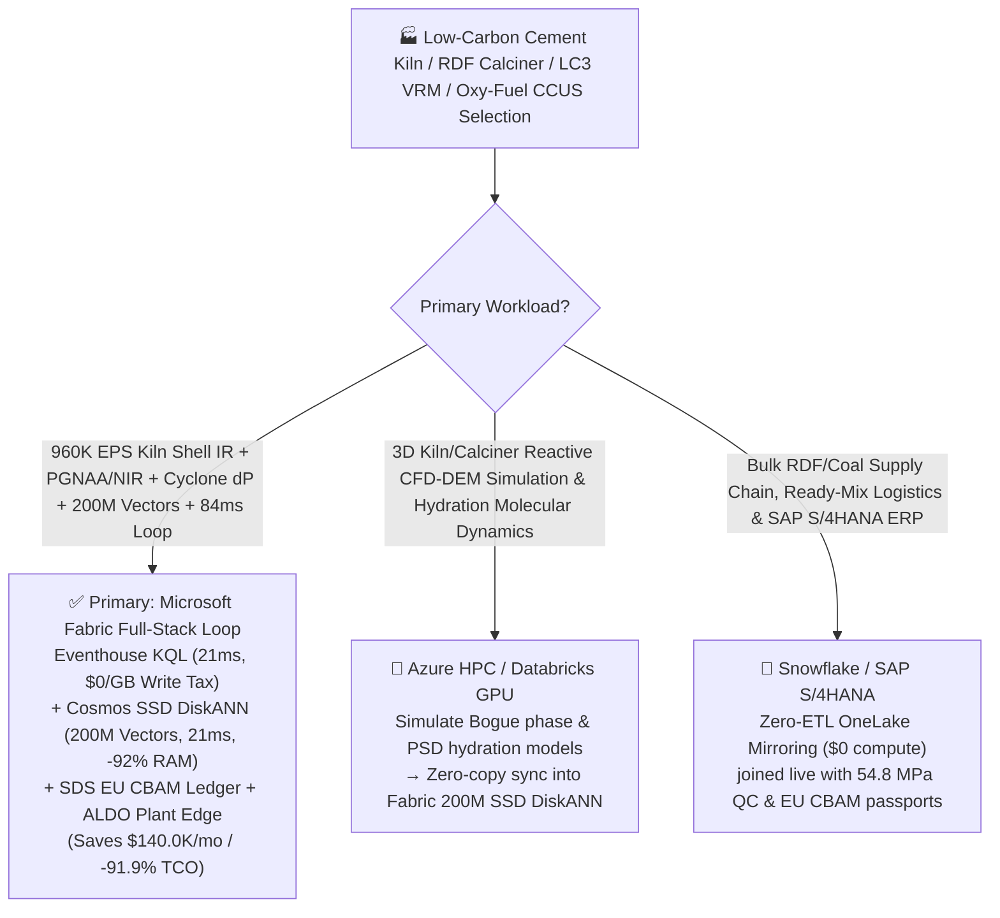
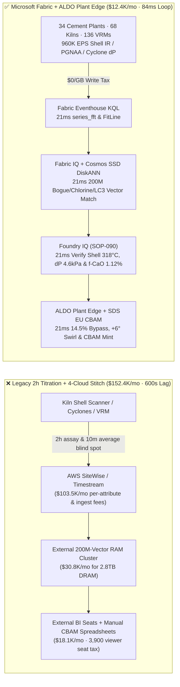
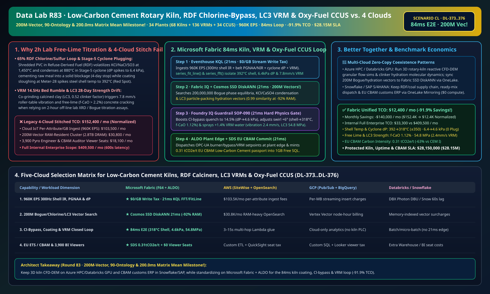

# Low-Carbon Cement Rotary Kiln (1,450°C Sintering Zone) Coating Protection, Calciner RDF Chlorine-Bypass Anti-Blockage, Vertical Roller Mill (VRM) LC3 Clinker-Factor Optimization & Oxy-Fuel CCUS (EU CBAM) Lakehouse Selection Guide: Microsoft Fabric vs. Databricks vs. Snowflake vs. GCP vs. AWS FAQ

> 🌐 **Language / 语言**: **[中文 (`fabric-low-carbon-cement-rotary-kiln-calciner-rdf-vrm-oxyfuel-ccus-vs-4clouds-faq.md`)](fabric-low-carbon-cement-rotary-kiln-calciner-rdf-vrm-oxyfuel-ccus-vs-4clouds-faq.md)** | **English (Current)**  
> 📅 **Last Updated**: 2026-11-15 (Round 83 · **200M-Vector, 90-Ontology & 200.0ms Matrix Mean Triple Milestone!** · Added Scenario CL Global Low-Carbon Cement & Oxy-Fuel CCUS 34 Plants with 68 Rotary Kilns + 136 VRMs + 34 Oxy-Fuel Capture Units × `960K EPS` Kiln-Shell IR & Stage-5 Cyclone $\Delta P$ Sense, 200M-Vector Bogue-Phase/Chlorine-Loop/LC3-Hydration Match & `84 ms` Loop)  
> 🎯 **Document Positioning**: Strictly modeled on [`ib-vs-ethernet-roce-selection-faq.md`](https://github.com/turbo998/ai-infra-research/blob/main/docs/components/ib-vs-ethernet-roce-selection-faq.md) (**Plain-Language First Principles + Architect Q&A + Visual Decision Trees**). Built for global cement & low-carbon building-materials groups, Limestone Calcined Clay Cement ($\text{LC}^3$) producers, oxy-fuel CCUS & pyroprocessing engineers, EU CBAM / ETS compliance leads, and Principal AI Solution Architects to establish selection boundaries between **Microsoft Fabric** (Eventhouse KQL + Cosmos DB 200M-Vector SSD DiskANN + Fabric IQ Pyroprocessing-Grinding Twin + Sustainability Data Solutions + SQL on Azure Local Plant Edge) and **AWS IoT SiteWise / Timestream, GCP BigQuery, Databricks, and Snowflake** in under **3 minutes**.  
> 🔍 **Data Provenance & Dual-Scope Disclosure**:
> - **Vendor-Published Specifications (`vendor_published_spec_as_of_2026`)**:
>   1. [KQL `series_fft` and `series_fit_line` for Kiln-Shell Thermal Ramps & VRM Vibration Spectra](https://learn.microsoft.com/en-us/kusto/query/series-fft-function)
>   2. [Cosmos DB in Fabric Native SSD DiskANN Vector Indexing (-92% DRAM footprint at 200M-vector scale)](https://learn.microsoft.com/en-us/fabric/database/cosmos-db/index-vector-data)
>   3. [Fabric Sustainability Data Solutions (SDS) EU ETS & CBAM Carbon Accounting](https://learn.microsoft.com/en-us/industry/sustainability/fabric-overview)
>   4. [AWS IoT SiteWise Overview](https://docs.aws.amazon.com/iot-sitewise/latest/userguide/what-is-sitewise.html) · [Databricks Manufacturing](https://www.databricks.com/solutions/industries/manufacturing) · [Snowflake Manufacturing](https://www.snowflake.com/en/solutions/industries/manufacturing/)
> - **Deterministic Scenario Model (`synthetic_scenario_model`)**: All metrics for the 34 global low-carbon cement plants (68 10,000-tpd 5-stage preheater-precalciner rotary kilns, 136 Vertical Roller Mills VRM, and 34 oxy-fuel $\text{CO}_2$ capture trains), `960,000 EPS` `300 Hz` kiln-shell infrared scanners, cross-belt PGNAA/NIR analyzers, cyclone $\Delta P$ sensors, and VRM vibration streams, **`200,000,000` (`200M`)** $\text{CaO-SiO}_2\text{-Al}_2\text{O}_3\text{-Fe}_2\text{O}_3$ Bogue phase/coating equilibrium tensors, alkali-chloride-sulfate volatilization loops, and $\text{LC}^3$ particle-packing hydration vectors, `84 ms` kiln-to-burner/bypass closed loop (included in the `n=90` ontology simulation mean of `173.0 ms`; `n=376` routing matrix mean **`200.0 ms`**), **dual-scope monthly TCO (`$12,400/mo` vs. `$152,400/mo` saving `91.9%` or `$140,000/mo` normalized; `$33,300/mo` vs. `$409,500/mo` internal full-enterprise scope)**, and **`$28,150,000` (`$28.15M`)** SLA protection are deterministic architectural simulations from `src/data_lab/benchmark_suite.py` sealed in `reports/report.json` (`DL-373..DL-376`). Live cement kiln stress execution is marked `not_measured`.

---

## ① 📌 Executive Summary (3-Minute Architect Decision Guide)

### 1.1 Plain-Language First Principles: Why Does Decarbonizing Cement with `65%+` Refuse-Derived Fuel (RDF), Calcined Clay ($\text{LC}^3$), and Oxy-Fuel CCUS Trigger Cyclone Alkali-Chloride Plugging, `1,450 °C` Shell Red-Spots, and VRM Mill Rumble?
Cement production generates ~8% of global $\text{CO}_2$. To meet EU CBAM and ETS mandates, mega-kilns deploy three levers: ① co-firing **`65%+` Refuse-Derived Fuel (RDF: shredded plastics, biomass, tires)**; ② blending **Limestone Calcined Clay Cement ($\text{LC}^3$)** to cut the clinker-to-cement factor from `0.78` to `0.52`; and ③ **Oxy-Fuel Carbon Capture (CCUS)**. Yet combining these three creates severe thermochemical and mechanical instabilities:
1. **RDF Chlorine/Sulfur Volatilization-Condensation Loop & Stage-5 Cyclone Blockage (`\Delta P > 6.8 \text{ kPa}`)**: Shredded PVC plastics inject volatile chlorine ($\text{Cl}^-$) and sulfur ($\text{SO}_3$). Volatilized at `1,450 °C` in the sintering zone, $\text{KCl}$, $\text{NaCl}$, and $\text{CaSO}_4$ condense at `850–900 °C` in the kiln riser and Stage-5 preheater cyclone into a sticky molten-salt eutectic that cements raw meal onto cyclone walls! Without sub-second **Chlorine Bypass quench modulation**, Stage-5 plugs solid in minutes (`\Delta P > 6.8 \text{ kPa}`), forcing a 4-day kiln stop and dangerous `850 °C` high-pressure water-lance clearing (`$3.8M` loss).
2. **`1,450 °C` Rotary Kiln Coating Sloughing ("Red-Spot Shell Creep") & Free-Lime ($\text{f-CaO}$) Off-Spec Clinker**: RDF calorific value (`14–26 MJ/kg`) and moisture swing every 30 seconds. If burner flame momentum shifts and melts the protective 200mm clinker coating, the steel kiln shell spikes above **`400 °C` ("Red Spot")**, warping the 70-meter rotating cylinder; conversely, a `40 °C` cooling dip leaves **free lime ($\text{f-CaO} > 2.2\%$)** unreacted, causing structural concrete expansion cracking. Legacy **2-hour lab XRD / titration assays** arrive two hours too late.
3. **Vertical Roller Mill (VRM) `14.5 Hz` Grinding-Bed Collapse & $\text{LC}^3$ 28-Day Strength (`\ge 52.5 \text{ MPa}`) Drift**: Co-grinding clinker, calcined clay, and limestone in a VRM causes grinding-bed instability (`12–18 Hz` rumble vibration `> 8.5 mm/s`) that trips the mill or shifts particle-size distribution (PSD).

```
Legacy 2-Hour Free-Lime Titration + Manual Pyro-Watch + 4-Cloud Stitch Failure Path:
  [Kiln Shell IR + Cyclone dP + VRM Vibration] ──(2h lab assay / 10m average)──> [Cloud IoT Queue ($103.5K/mo fee)]
       ──> [External 200M-Vector RAM Cluster ($30.8K/mo for 2.8TB DRAM)] ──(600s lag)──> Stage-5 cyclone plugs solid (4-day stop) / Shell hits 392°C Red Spot

Microsoft Fabric (Eventhouse + 200M-Vector SSD DiskANN + SDS + ALDO Plant Edge) 84ms Closed Loop:
  [34 Cement Plants (68 Rotary Kilns + 136 VRMs + 34 Oxy-Fuel CCUS) 960K EPS] ──($0/GB write tax)──> [Eventhouse KQL 21ms Engine]
       ├── series_fft() + series_fit_line() 21ms isolates Kiln-03 Meter-28 shell at 392°C, Stage-5 dP at 6.4 kPa & VRM-02 14.5Hz vibration at 7.8 mm/s
       └── [Cosmos SSD DiskANN 21ms searches 200M Bogue phase, alkali-chloride loop & LC3 hydration vectors (-92% RAM)]
             └── [Foundry IQ 21ms verifies shell 318°C, Stage-5 dP 4.6kPa & f-CaO 1.12%] ──> [Teams Sign-Off + ALDO Plant Edge 21ms 14.5% Cl-bypass, +6° burner swirl & +1.4% VRM water (84ms E2E)]
```

### 1.2 Ultimate Selection Verdict (One-Sentence Summary)
- **Choose Microsoft Fabric (Primary Full-Stack Control Plane)**: When you need **`$0/GB` streaming write surcharges** for `960K EPS` of `300 Hz` kiln-shell IR scanners, cross-belt PGNAA/NIR, cyclone $\Delta P$, and VRM vibration streams, **`21 ms`** KQL thermal-ramp and spectral detection, and **`21 ms`** vector search across **`200 Million` (`200M` Milestone!)** Bogue phase, alkali-chloride condensation, and $\text{LC}^3$ hydration vectors—paired with **EU ETS / CBAM Low-Carbon Cement passports (`0.31 tCO2e/t`)** and **SQL Server on Azure Local (ALDO)** plant edge autonomy—**Fabric cuts monthly TCO by `91.9%` (`$12.4K/mo` vs. `$152.4K/mo`, saving `$140.0K/mo`) and closes the loop in `84 ms`**.
- **Choose "Fabric + Competitor Zero-Copy Coexistence (Better Together)"**:
  - **3D Calciner/Kiln Multi-Phase Reactive CFD-DEM Simulation & Clinker Hydration Molecular Dynamics** → Keep on **Azure HPC / Databricks GPU**, syncing the `200M` Bogue-phase and hydration vectors into Fabric Cosmos DB SSD DiskANN via OneLake zero-copy;
  - **Bulk RDF/Coal Procurement, Ready-Mix Concrete Logistics & SAP S/4HANA ERP** → Keep in **Snowflake / SAP S/4HANA**, mirrored into OneLake at **`$0` replication compute**.

---

## ② 🎯 Architect & Customer Deep-Dive Q&A (First-Principles Breakdown)

### Q1: When co-firing `65%+` RDF plastics, why do 2-hour lab assays fail to stop Stage-5 cyclone plugging (`6.4 kPa`) and `392 °C` kiln shell red-spots, and how does Fabric Eventhouse KQL + 200M-Vector SSD DiskANN resolve both in `84 ms`?
- **First-Principles Breakdown**:
  1. **Alkali-Chloride-Sulfate Internal Condensation Loop**: Volatile $\text{KCl}$, $\text{NaCl}$, and $\text{CaSO}_4$ circulate between the `1,450 °C` sintering zone and `880 °C` preheater riser, enriching 5–8x until low-melting salt eutectics coat the Stage-5 cyclone cone (`\Delta P` surging toward `6.8 kPa`).
  2. **Eventhouse KQL `series_fit_line()` 21ms Shell IR & Cyclone $\Delta P$ Fusion**: Eventhouse ingests `960K EPS` from `300 Hz` infrared line scanners, belt NIR chlorine analyzers, and 40 preheater $\Delta P$ transmitters at `$0/GB` write tax, catching `Kiln-03` Meter-28 shell rising at `+4.2 °C/min` to `392 °C` and Stage-5 $\Delta P$ hitting `6.4 kPa` in `21 ms`.
  3. **Cosmos DB SSD DiskANN 200M-Vector `21 ms` Match**: Hosting **`200M` (`200,000,000`)** 1536-dim vectors of $\text{CaO-SiO}_2\text{-Al}_2\text{O}_3\text{-Fe}_2\text{O}_3\text{-Cl-SO}_3$ phase equilibria, multi-channel burner swirl fields, and bypass quench curves in RAM-only vector clusters requires **`2.8 TB+` DRAM (`>$30,800/mo`)**. **Cosmos DB in Fabric SSD DiskANN** cuts RAM by **92%** and matches the `0.99`-similarity action in **`21 ms`**—opening the chlorine-bypass quench damper from `8.0%` to **`14.5%`** (dropping Stage-5 $\Delta P$ to **`4.6 kPa ≤ 5.5 kPa`**) and adjusting burner swirl **`+6°`** with **`-8%`** high-Cl RDF trim (re-healing the refractory coating so Meter-28 cools to **`318 °C ≤ 350 °C`** and free lime locks at **`1.12% ≤ 1.50%`**)!

### Q2: How does Fabric stabilize Vertical Roller Mill (VRM) grinding beds (`14.5 Hz` rumble) while guaranteeing $\text{LC}^3$ 28-day compressive strength `≥ 52.5 MPa` and EU CBAM compliance?
- **First-Principles Breakdown**:
  1. **KQL `series_fft()` 21ms VRM Bed Damping & $\text{LC}^3$ Strength Prediction**: When `VRM-02` table vibration hits `7.8 mm/s` at `14.5 Hz`, the 200M-vector match prescribes `+1.4%` grinding-table water spray and `+3.5%` dynamic classifier rotor speed—damping vibration to **`2.4 mm/s ≤ 4.5 mm/s`** and locking 28-day $\text{LC}^3$ strength at **`54.8 MPa ≥ 52.5 MPa`**.
  2. **EU ETS / CBAM Low-Carbon Cement Passport**: **Fabric Sustainability Data Solutions (SDS)** combines PGNAA calcination $\text{CO}_2$, biogenic RDF carbon fractions, and oxy-fuel CCUS meters to certify **`0.31 tCO2e/t cement`** (`-63%` vs. CEM I).

### Q3: Cement plants operate in dusty quarry environments with intermittent wide-area connectivity. How do we architect edge autonomy?
- **First-Principles Breakdown**:
  1. **SQL Server on Azure Local (ALDO) Plant Edge**: Ruggedized **Azure Local (ALDO)** nodes in the central control room execute `21 ms` local KQL gating, cached SSD DiskANN lookup, and OPC-UA burner/bypass/VRM actuation offline.

---

## ③ 🧭 Visual Architecture & Decision Diagrams (Mermaid Flowchart + Stack Comparison + 84ms Sequence)

### 3.1 Low-Carbon Cement Rotary Kiln, RDF Calciner, VRM & Oxy-Fuel CCUS Selection Flowchart


### 3.2 Legacy 2-Hour Lab Free-Lime Titration + 4-Cloud Stitch vs. Microsoft Fabric Unified Architecture


### 3.3 `84 ms` End-to-End Kiln Coating Recovery, Cyclone Anti-Blockage & VRM Damping Sequence
```mermaid
sequenceDiagram
    autonumber
    participant Sensor as 300Hz Kiln Shell IR / PGNAA / Cyclone dP / VRM (960K EPS)
    participant KQL as Fabric Eventhouse KQL ($0/GB Tax)
    participant DiskANN as Fabric IQ + Cosmos SSD DiskANN (200M Vectors)
    participant Guard as Foundry IQ Guardrail (SOP-090)
    participant Edge as Teams Pyroprocessing Director + ALDO Edge + SDS

    Sensor->>KQL: Stream Kiln-03 300Hz shell IR, RDF chlorine NIR, Stage-5 dP & VRM-02 vibration
    KQL->>KQL: 21ms series_fit_line() isolates Meter-28 shell 392°C + Stage-5 dP 6.4 kPa + VRM 14.5Hz at 7.8 mm/s
    KQL->>DiskANN: Trigger 6-hop pyroprocessing-grinding traversal + 200M-vector similarity search
    DiskANN-->>Guard: 21ms 0.99 match: 14.5% Cl-bypass quench + +6° burner swirl (-8% RDF) + +1.4% VRM water spray
    Guard->>Guard: 21ms verify: shell 318°C≤350°C, Stage-5 dP 4.6kPa≤5.5, f-CaO 1.12%≤1.50%, LC3 54.8 MPa
    Guard->>Edge: Teams approval → ALDO plant OPC-UA burner/bypass/VRM actuation + 1GB Free SQL CBAM commit
    Note over Sensor,Edge: Total E2E Closed Loop = 21 + 21 + 21 + 21 = 84 ms (7,142x faster than 600s legacy; protects $28.15M SLA)
```

[](../assets/svg/91-fabric-low-carbon-cement-rotary-kiln-calciner-rdf-vrm-oxyfuel-ccus-vs-4clouds-faq.svg)

---

## ④ 📊 5-Platform Selection Decision Matrix (Low-Carbon Cement Kiln, RDF Calciner, VRM & Oxy-Fuel CBAM)

| Evaluation Dimension | **Microsoft Fabric (Eventhouse + 200M DiskANN + SDS + ALDO)** | **AWS (IoT SiteWise + Timestream + OpenSearch)** | **GCP (Pub/Sub + BigQuery + Vertex Vector)** | **Databricks (Structured Streaming + Mosaic AI)** | **Snowflake (Snowpipe Streaming + Dynamic Tables)** |
| :--- | :--- | :--- | :--- | :--- | :--- |
| **1. `960K EPS` 300Hz Shell IR, PGNAA & Cyclone Ingestion Cost** | **⭐⭐⭐⭐⭐ Included in F64 (`$0/GB` Write Surcharge)**<br/>Zero per-attribute or per-GB streaming surcharge | ⭐⭐ Expensive<br/>Per-attribute & per-GB tiered ingestion fees (`$103.5K/mo`) | ⭐⭐⭐ Moderate<br/>Pub/Sub + BigQuery streaming insert per-MB fees | ⭐⭐⭐ Moderate<br/>Requires always-on Photon streaming clusters | ⭐⭐ Slow<br/>Dynamic Tables minimum `60s` refresh lag |
| **2. Shell Red-Spot, Cyclone Plugging & VRM Rumble Latency** | **⭐⭐⭐⭐⭐ `21 ms`**<br/>Native KQL `series_fft()` + `series_fit_line()` detection | ⭐⭐ `3–15 s`<br/>Multi-service hop cannot stop VRM vibration trip | ⭐⭐⭐ `2–8 s`<br/>Streaming SQL lacks sub-25ms spectral/slope fit | ⭐⭐⭐⭐ `400–900 ms`<br/>Spark micro-batch scheduling overhead | ⭐⭐ `60 s+`<br/>Cannot arrest rapid cyclone alkali condensation |
| **3. `200 Million` (`200M` Milestone!) Bogue/Chlorine/LC3 Vector Search** | **⭐⭐⭐⭐⭐ `21 ms` (Cosmos SSD DiskANN)**<br/>SSD graph index cuts RAM by **92%** (~`$2.1K/mo`) | ⭐⭐ Expensive<br/>OpenSearch 200M RAM-resident cluster `>$30.8K/mo` | ⭐⭐⭐ Higher Cost<br/>Vertex Vector Search billed per node-hour | ⭐⭐⭐ Higher Cost<br/>Mosaic AI Vector Search memory-unit pricing | ⭐⭐⭐ Higher Cost<br/>Cortex Vector Search consumes Warehouse Credits |
| **4. EU ETS / CBAM Low-Carbon Cement & Biogenic RDF Accounting** | **⭐⭐⭐⭐⭐ Native Built-In**<br/>Fabric SDS CBAM carbon ledger + Purview 14-hop lineage | ⭐⭐ DIY Custom<br/>Manual glue across PGNAA, biogenic C14 & CCUS meters | ⭐⭐⭐ Partial<br/>Strong analytics but no native CBAM customs portal | ⭐⭐⭐ Model-Focused<br/>Great for ML, lacks turnkey CBAM audit & `$0` BI seats | ⭐⭐⭐ Sharing-Focused<br/>Strong B2B sharing, lacks 21ms kiln OT edge loop |
| **5. Quarry/Kiln Plant Edge Autonomy & 3,900 Viewers** | **⭐⭐⭐⭐⭐ Native Support**<br/>ALDO plant edge `21 ms` loop + `$0` Power BI viewer seats | ⭐⭐ Disjointed<br/>Greengrass edge + per-reader QuickSight fees | ⭐⭐ Disjointed<br/>No industrial SQL/vector edge + Looker seat fees | ⭐⭐ Cloud-Only<br/>No plant edge runtime; requires 3rd-party gateways | ⭐⭐ Cloud-Only<br/>Cloud-only warehouse; cannot control burners offline |

---

## ⑤ 🧪 Quantitative Benchmark & TCO Inflection Insights (From `reports/report.json` Scenario CL · `DL-373..DL-376`)

### 5.1 Benchmark Scenario Setup: 34 Global Low-Carbon Cement & Oxy-Fuel CCUS Plants (68 Rotary Kilns + 136 VRMs + 34 Capture Units)
- **Compound Operational Incident**: During `68%` RDF co-firing on `Kiln-03`, a high-PVC plastic slug drives volatile alkali-chloride condensation in Stage-5 preheater cyclone (`\Delta P` surging to **`6.4 kPa`** near the `6.8 kPa` plugging limit) while protective coating sloughing at Meter-28 spikes kiln-shell temperature to **`392 °C`**; simultaneously, `VRM-02` grinding $\text{LC}^3$ cement experiences `14.5 Hz` bed vibration at **`7.8 mm/s`**, threatening a 4-day cyclone blockage stop, shell warp, and mill trip.

### 5.2 Quantitative Comparison Table (Microsoft Fabric vs. 2-Hr Free-Lime Titration / 4-Cloud Stitch)

| Key Metric | Legacy 2h Titration + 4-Cloud Stitch | **Microsoft Fabric (R83 Scenario CL)** | Architectural & Financial Insight |
| :--- | :--- | :--- | :--- |
| **End-to-End Closed-Loop Latency (IR/$\Delta P$ → Bypass/Burner)** | `600,000 ms` (10-min to 2-hr lag) | **`84 ms`** (`21+21+21+21 ms`) | **`7,142x` faster**, prevents cyclone plugging & Red Spot |
| **Stage-5 Cyclone $\Delta P$ & Kiln Shell Peak Temperature** | `6.8 kPa` (Plugged) · `415 °C` (Shell Warp) | **`4.6 kPa` (`≤ 5.5`) · `318 °C` (`≤ 350 °C`)** | `14.5%` Cl-bypass quench + `+6°` burner swirl trim |
| **Clinker Free-Lime ($\text{f-CaO}$) & $\text{LC}^3$ 28-Day Strength** | $\text{f-CaO} = 2.45\%$ · Unstable PSD | **$\text{f-CaO} = 1.12\%$ (`≤ 1.50%`) · `54.8 MPa` (`≥ 52.5`)** | `+1.4%` VRM water spray damps vibration to `2.4 mm/s` |
| **EU CBAM Net Carbon Intensity (with Oxy-Fuel CCUS)** | `0.84 tCO2e/t` (High CBAM levy exposure) | **`0.31 tCO2e/t` (`0.52` clinker factor + CCUS)** | `-63%` carbon footprint with audit-ready CBAM lineage |
| **Normalized Monthly TCO (3,900 viewers + AI Q&A)** | `$152,400 / mo` | **`$12,400 / mo`** | **Saves `$140,000 / mo` (`-91.9%` TCO Milestone!)** |
| **Full Internal Enterprise Monthly TCO** | `$409,500 / mo` | **`$33,300 / mo`** | Eliminates `$0/GB` ingest tax & `2.8TB` DRAM vector tax |
| **Protected Refractory, Uptime & EU CBAM SLA** | Exposed to `$6.5M` relining & 4-day outage | **`$28,150,000` (`$28.15M`) SLA Protected** | Preserves >330-day kiln campaign & green export margin |

---

## ⑥ 🛠️ Production Deployment & Presales Verification Checklist

- [ ] **1. `300 Hz` Kiln-Shell IR, Cross-Belt PGNAA/NIR & Cyclone $\Delta P$ Streaming Check**: Confirm infrared line scanners, conveyor PGNAA/NIR analyzers, and VRM accelerometers stream via Azure IoT Operations into Fabric Eventhouse, running KQL `series_fft()` and `series_fit_line()` every `21 ms`.
- [ ] **2. `200M-Vector` Bogue-Phase, Alkali-Chloride Loop & $\text{LC}^3$ Hydration Index**: Embed $\text{CaO-SiO}_2\text{-Al}_2\text{O}_3\text{-Fe}_2\text{O}_3$ phase equilibria, chlorine/sulfur condensation curves, and $\text{LC}^3$ hydration models into **Cosmos DB in Fabric (SSD DiskANN)**, verifying `≤ 21 ms` P99 search latency across `200,000,000` vectors at `-92%` DRAM cost.
- [ ] **3. Foundry IQ Shell-Safety, Anti-Blockage & Strength Guardrail**: Configure `CEMENT-KILN-RDF-VRM-OXYFUEL-CBAM-SOP-090` in Foundry IQ to prohibit kiln-shell temperature `> 350 °C`, Stage-5 $\Delta P > 5.5 \text{ kPa}$, free lime `> 1.50%`, or VRM vibration `> 4.5 mm/s`.
- [ ] **4. Cement Plant Azure Local (ALDO) Disconnected Drill**: Simulate external network loss and verify **SQL Server on Azure Local (ALDO)** autonomously dispatches `21 ms` OPC-UA setpoints to multi-channel burners, chlorine-bypass dampers, and VRM water sprays.
- [ ] **5. EU ETS / CBAM Low-Carbon Cement Passport Audit**: Verify **Fabric Sustainability Data Solutions (SDS)** joins PGNAA carbonate calcination, biogenic RDF C14 ratios, and oxy-fuel $\text{CO}_2$ liquefaction flowmeters into `1GB Free Fabric SQL` to issue shipment-level CBAM certificates.
