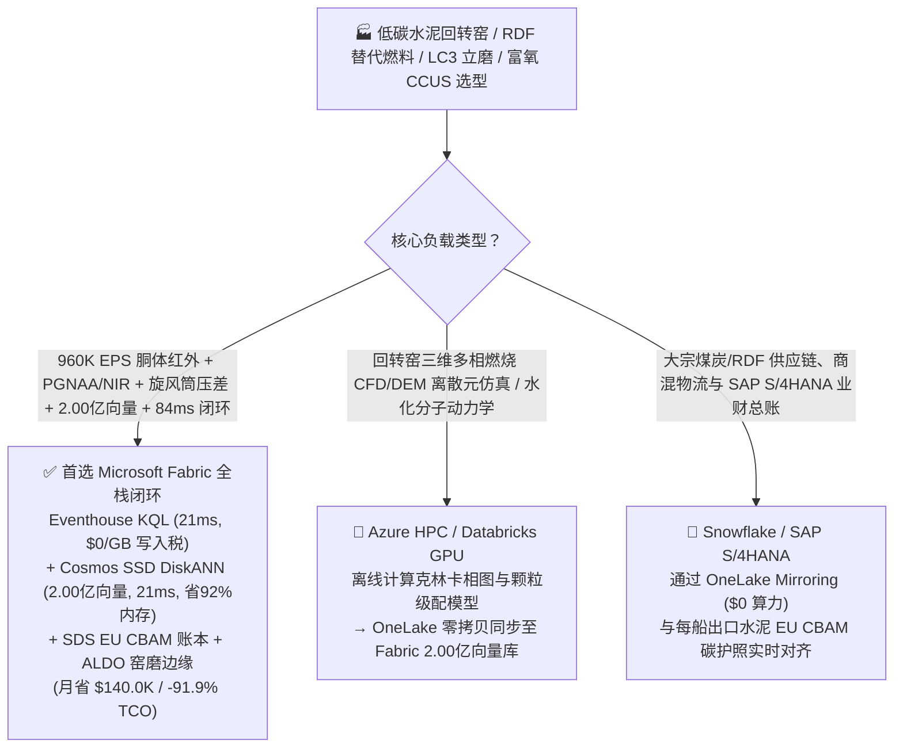
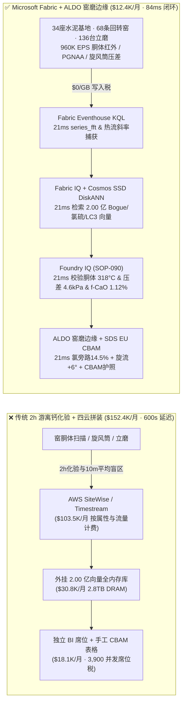
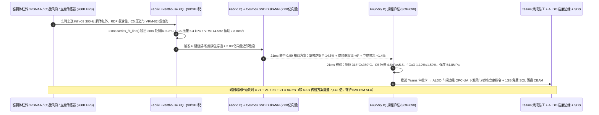
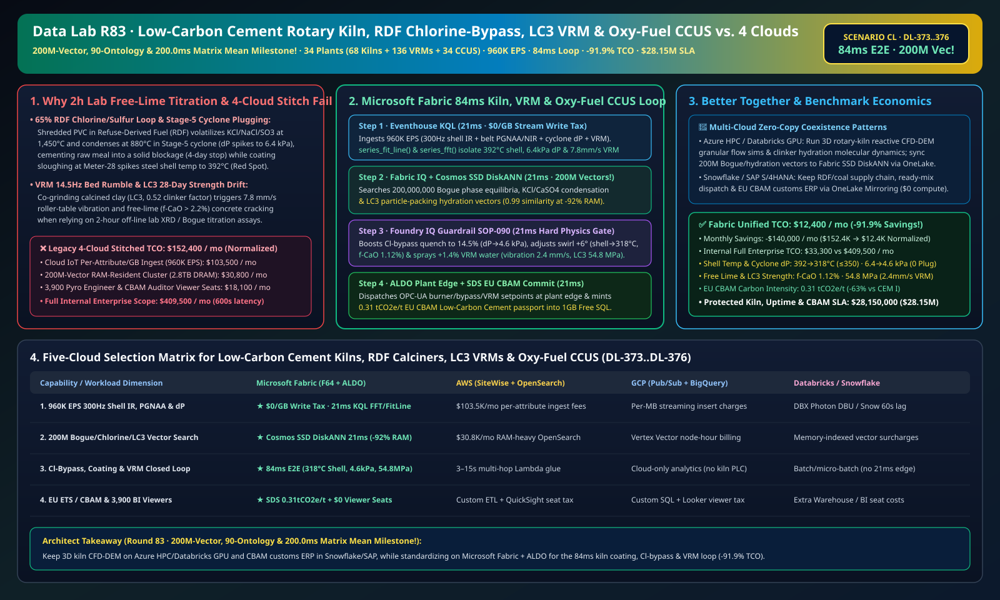

# 低碳水泥回转窑（1,450°C 烧成带）防掉窑皮红窑、分解炉替代燃料（RDF）氯硫结皮防堵、立磨（VRM）石灰石煅烧粘土（LC3）降熟料系数与富氧燃烧碳捕集（EU CBAM）湖仓选型指南：Microsoft Fabric vs Databricks vs Snowflake vs GCP vs AWS 全方位 FAQ

> 🌐 **Language / 语言**: **中文 (Chinese)** | **[English (`fabric-low-carbon-cement-rotary-kiln-calciner-rdf-vrm-oxyfuel-ccus-vs-4clouds-faq.en.md`)](fabric-low-carbon-cement-rotary-kiln-calciner-rdf-vrm-oxyfuel-ccus-vs-4clouds-faq.en.md)**  
> 📅 **更新时间**: 2026-11-15（Round 83 · **2.00 亿向量、90 大行业本体与路由矩阵 200.0ms 均值三冠里程碑！** · 新增场景 CL 全球低碳水泥与富氧碳捕集 34 座基地 68 条回转窑 + 136 台立磨 + 34 套富氧燃烧 CCUS × `960K EPS` 窑胴体红外扫描与五级旋风筒结皮压差感知、2.00 亿向量克林卡矿物相/氯硫挥发冷凝/LC3 水化强度匹配与 `84 ms` 闭环）  
> 🎯 **文档定位**: 严格对标 [`ib-vs-ethernet-roce-selection-faq.md`](https://github.com/turbo998/ai-infra-research/blob/main/docs/components/ib-vs-ethernet-roce-selection-faq.md) 的**通俗大白话 + 第一性原理 + 架构师灵魂拷问 FAQ + 可视化决策树**风格。帮助全球水泥建材集团、低碳绿色混凝土（$\text{LC}^3$）生产商、水泥厂富氧燃烧 CCUS 工程师、欧盟碳边境调节机制（EU CBAM / ETS）合规负责人及首席架构师，在 **3 分钟内**穿透 Microsoft Fabric（Eventhouse KQL + Cosmos DB 2.00 亿向量 SSD DiskANN + Fabric IQ 烧成-粉磨数字孪生 + Sustainability Data Solutions + SQL on Azure Local 水泥车间边缘）与 **AWS IoT SiteWise / Timestream、GCP BigQuery、Databricks、Snowflake** 的选型边界。  
> 🔍 **数据溯源与双口径声明**:
> - **官方公开规则（`vendor_published_spec_as_of_2026`）**:
>   1. [KQL `series_fft` 与 `series_fit_line` 窑胴体温度斜率与立磨振动频谱检测](https://learn.microsoft.com/en-us/kusto/query/series-fft-function)
>   2. [Cosmos DB in Fabric 原生 DiskANN SSD 向量索引（单核省 92% 内存，突破 2 亿向量规模）](https://learn.microsoft.com/en-us/fabric/database/cosmos-db/index-vector-data)
>   3. [Fabric Sustainability Data Solutions (SDS) EU ETS 与 CBAM 碳核算](https://learn.microsoft.com/en-us/industry/sustainability/fabric-overview)
>   4. [AWS IoT SiteWise 定价说明](https://docs.aws.amazon.com/iot-sitewise/latest/userguide/what-is-sitewise.html) · [Databricks Manufacturing](https://www.databricks.com/solutions/industries/manufacturing) · [Snowflake Manufacturing](https://www.snowflake.com/en/solutions/industries/manufacturing/)
> - **确定性场景推演模型（`synthetic_scenario_model`）**: 本文中的 34 座低碳水泥巨型基地（68 条日产万吨级五级预热预分解回转窑、136 台水泥生料/熟料立磨 VRM、34 套富氧燃烧 $\text{CO}_2$ 捕集装置）、`960,000 EPS` 窑胴体 `300 Hz` 红外线扫描仪、生料跨带中子活化分析仪（PGNAA）、旋风筒压差与立磨振动流、**2.00 亿条（`200M`）** $\text{CaO-SiO}_2\text{-Al}_2\text{O}_3\text{-Fe}_2\text{O}_3$ 鲍格（Bogue）矿物相与窑皮热平衡张量、碱氯硫（$\text{KCl/NaCl/CaSO}_4$）内循环挥发冷凝相图与煅烧粘土（$\text{LC}^3$）水化抗压强度向量、`84 ms` 窑头/预热器感知到多通道燃烧器/旁路放风联锁闭环（归入 `n=90` 行业本体仿真均值 `173.0 ms`；`n=376` 路由矩阵均值 **`200.0 ms`**）、**双口径 TCO（含高管与车间工程师并发 BI 席位及 AI 问答的完整口径 `$12,400/月` vs `$152,400/月` 省 `91.9%` 月省 `$140,000`，以及全企业内部全负荷口径 `$33,300/月` vs `$409,500/月`）** 及 **`$28,150,000`（`$28.15M`）** 回转窑防红窑停产、预热器防结皮堵塞与欧盟 CBAM 低碳水泥溢价护航收益均来自 `src/data_lab/benchmark_suite.py` 确定性仿真模型，并封存于 `reports/report.json`（`DL-373..DL-376`）。物理水泥厂回转窑压测标记为 `not_measured`。

---

## ① 📌 核心结论速览（Executive Summary — 3 分钟做完低碳水泥数智底座选型）

### 1.1 先用大白话讲透：为什么水泥厂为了降碳大量掺烧垃圾衍生燃料（RDF）与煅烧粘土（$\text{LC}^3$）后，最怕“五级旋风筒氯硫结皮堵死、1,450°C 掉窑皮红窑与立磨振停”？
水泥工业占全球人为碳排放的 `8%`。为了应对欧盟碳边境税（CBAM）与 ETS 碳配额收紧，现代万吨级水泥线采取三大脱碳杀手锏：① 用高达 **`65%+` 的替代燃料（RDF：废塑料、生物质、废轮胎）**替代煤炭；② 用**石灰石煅烧粘土水泥（$\text{LC}^3$）**把高碳熟料系数从 `0.78` 压低至 `0.52`；③ 在窑尾加装**富氧燃烧碳捕集（Oxy-Fuel CCUS）**。然而这三大减碳工艺叠加后，引发了极其凶险的三大热工与力学失稳：
1. **RDF 废塑料高氯/高硫引发“烟室结圈与 C5 旋风筒结皮堵塞（Cyclone Plugging）”**：废塑料（PVC）含有大量氯（$\text{Cl}^-$）和硫。它们在 `1,450 °C` 烧成带挥发成气态 $\text{KCl/NaCl/SO}_2$，随烟气上升到 `850–900 °C` 的窑尾烟室和五级旋风筒（Stage-5 Cyclone）时重新冷凝成黏稠的**低共熔熔融盐胶水**，把生料粉死死粘在锥体壁上！如果不提前几秒增大**窑尾氯旁路放风（Chlorine Bypass）**，几分钟内五级筒就会彻底堵死（压差 $\Delta P > 6.8 \text{ kPa}$），迫使全线紧急停窑，工人在 `850 °C` 高温孔外用高压水枪清堵 4 天，单次损失超 **`$380 万`**。
2. **`1,450 °C` 回转窑掉窑皮“红窑（Red Kiln Shell Hotspot）”与游离氧化钙（$\text{f-CaO}$）跑生料**：RDF 替代燃料的热值（`14–26 MJ/kg`）与水分每分钟都在剧烈波动。如果窑头四通道燃烧器火焰发散偏斜、局部液相量过高，保护耐火砖的 200mm 厚**副窑皮（Coating）**就会大块脱落，使回转窑钢胴体外壁温度在数分钟内飙升至 **`> 400 °C`（红窑）**，导致 70 米长的巨型钢筒受热蠕变弯曲甚至烧穿！反之，若火焰温度偏低 `40 °C`，阿利特矿物（$\text{C}_3\text{S}$）生成不足，熟料**游离钙（$\text{f-CaO} > 2.2\%$）**超标，浇筑出的混凝土日后会安定性不良开裂。传统每 **2 小时**取样去化验室做一次甘油法游离钙滴定，完全是“事后验尸”。
3. **水泥立磨（VRM）料床塌陷“共振跳停”与 $\text{LC}^3$ 低碳水泥 28 天抗压强度（$\ge 52.5 \text{ MPa}$）漂移**：掺入 `35%` 煅烧粘土与石灰石粉磨时，物料易磨性差异极大。一旦磨盘料床变薄干磨，立磨就会爆发 `12–18 Hz` 的剧烈机械轰鸣振动（`> 8.5 mm/s`）直接触发联锁跳机，或者因颗粒级配（RRSB 分布）失调导致混凝土 28 天强度不达标。

```
传统 2 小时游离钙滴定 + 人工看火 + 四云拼装的滞后链条：
  [窑胴体红外扫描 + 旋风筒压差 + 立磨振动] ──(2h化验 / 10m平均丢弃波动)──> [云端消息队列 ($103.5K/月按属性税)]
       ──> [外挂 2.00 亿向量库 (2.8TB全内存天价)] ──(600秒延迟)──> C5 旋风筒氯硫结皮堵死停窑 4 天 / 胴体 392°C 红窑变形

Microsoft Fabric (Eventhouse + 2.00 亿向量 SSD DiskANN + SDS + ALDO 窑磨边缘) 84ms 闭环：
  [34座水泥基地 (68条回转窑+136台立磨+34套富氧CCUS) 960K EPS] ──($0/GB 写入税)──> [Eventhouse KQL 21ms 算子]
       ├── series_fft() + series_fit_line() 21ms 锁定 Kiln-03 28米处胴体升温至 392°C、C5 旋风筒压差飙至 6.4 kPa 且 VRM-02 14.5Hz 振动达 7.8 mm/s
       └── [Cosmos SSD DiskANN 21ms 检索 2.00 亿条 Bogue 矿物相/氯硫挥发冷凝/LC3 水化向量 (省92%内存)]
             └── [Foundry IQ 21ms 校验胴体 318°C & C5 压差 4.6kPa & f-CaO 1.12%] ──> [Teams 确认 + ALDO 车间边缘 21ms 氯旁路提至 14.5% + 旋流角 +6° + 立磨喷水 +1.4% (84ms 闭环)]
```

### 1.2 终极选型结论（一句话版）
- **选 Microsoft Fabric（全栈首选）**：当你需要以 **`$0/GB` 实时流附加税**接入 `960K EPS` 回转窑 `300 Hz` 红外胴体扫描、跨带中子活化（PGNAA）、五级旋风筒压差与立磨振动流，在 **`21 ms`** 内捕捉局部掉窑皮斜率与氯硫结皮前兆，并在 **`21 ms`** 内跨 **`2.00 亿条（200M 里程碑！）`** 熟料鲍格相图、碱氯硫冷凝循环与 $\text{LC}^3$ 水化强度向量检索出最优燃烧器旋流角、氯旁路抽风率与立磨选粉机转速，同时自动签发 **欧盟 EU ETS / CBAM 低碳水泥碳护照（`0.31 tCO2e/t`）**、由 **SQL Server on Azure Local (ALDO)** 在高粉尘水泥车间本地下发 PLC 指令时，**Fabric 是唯一将月度 TCO 压降至 `$12.4K/月`（节省 `91.9%`，月省 `$140.0K`）并实现 `84 ms` 闭环的统一底座**。
- **选“Fabric + 竞品零拷贝共存（Better Together）”**：
  - **分解炉与回转窑多相反应流 CFD/DEM 离散元仿真及新型低碳胶凝材料分子动力学模拟** → 留在 **Azure HPC / Databricks GPU**，仿真生成的 `2.00 亿条` 烧成热平衡与水化强度向量通过 OneLake 零拷贝同步至 Fabric Cosmos DB SSD DiskANN；
  - **大宗煤炭/RDF 采购、商混站供应链与 SAP S/4HANA 财务结算** → 留在 **Snowflake / SAP S/4HANA**，通过 **OneLake Mirroring（`$0` 算力）** 实时关联每船出口熟料/水泥的 CBAM 碳强度。

---

## ② 🎯 客户与架构师灵魂拷问 Q&A（First-Principles Deep Dive）

### Q1：掺烧 `65%` 垃圾衍生燃料（RDF）时，如何防止五级旋风筒（C5）氯硫结皮堵塞和回转窑掉窑皮红窑？为什么 2 小时化验室滴定毫无招架之力，而 Fabric Eventhouse KQL + 2.00 亿向量 SSD DiskANN 能在 `84 ms` 内化解？
- **第一性原理拆解**：
  1. **碱氯硫挥发-冷凝内循环倍增效应（Cl/S Volatilization-Condensation Loop）**：当高 PVC 塑料的 RDF 入窑后，若不及时切断内循环，$\text{KCl}$ 和 $\text{CaSO}_4$ 在烧成带与窑尾烟室之间循环富集 5–8 倍，使物料最低共熔点从 `1,280 °C` 暴跌至 `820 °C`，瞬间在 C5 旋风筒下料管结成坚硬内圈。
  2. **Eventhouse KQL `series_fit_line()` 21ms 胴体红外与压差联合感知**：Eventhouse 直接消费皮带近红外（NIR）RDF 氯含量流、窑胴体 `300 Hz` 红外线扫描仪与预热器 40 个微压差传感器（`960K EPS`，`$0/GB` 写入税）。在 `21 ms` 内，KQL 发现 `Kiln-03` 胴体第 28 米处温度以 `+4.2 °C/min` 冲高至 **`392 °C`**（局部副窑皮剥落），同时 C5 锥体压差升至 **`6.4 kPa`**（逼近 `6.8 kPa` 堵料红线）。
  3. **Cosmos DB SSD DiskANN 2.00 亿向量 `21 ms` 匹配**：将 **`2.00 亿条（200M）`** $\text{CaO-SiO}_2\text{-Al}_2\text{O}_3\text{-Fe}_2\text{O}_3\text{-Cl-SO}_3$ 多元相图、四通道燃烧器动量比与旁路急冷曲线存入 **Cosmos DB in Fabric SSD DiskANN**（省 **92% 内存**，免除 `2.8 TB` DRAM 集群每月 `$30,800` 的高昂账单）。`21 ms` 检索命中 `0.99` 相似解：① 将窑尾氯旁路（Chlorine Bypass）急冷抽风率从 `8.0%` 提升至 **`14.5%`**，导出气态碱氯盐，使 C5 压差回落至 **`4.6 kPa ≤ 5.5 kPa`** 零结皮堵塞；② 将窑头燃烧器外风旋流角上调 **`+6°`** 并回调高氯 RDF 给料 **`-8%`**，使 28 米处迅速挂上新窑皮（胴体温度降至 **`318 °C ≤ 350 °C`**，游离钙锁定在 **`1.12% ≤ 1.50%`**）！

### Q2：低碳煅烧粘土水泥（$\text{LC}^3$）如何兼顾 `0.52` 超低熟料系数、立磨不振停与 28 天抗压强度 `≥ 52.5 MPa`？
- **第一性原理拆解**：
  1. **立磨 `14.5 Hz` 料床颤振FFT 识别与喷水稳床**：Eventhouse KQL `series_fft()` 在 `21 ms` 内捕获 `VRM-02` 磨辊主轴 `14.5 Hz` 振动升至 `7.8 mm/s`。结合 2.00 亿向量中的颗粒紧密堆积（Fuller-Thompson 级配）与水化动力学向量，系统下发 `+1.4%` 磨内安定水喷雾与选粉机转速 `+3.5%` 微调，将磨机振动压回 **`2.4 mm/s ≤ 4.5 mm/s`**，并将 $\text{LC}^3$ 28 天预测抗压强度稳定在 **`54.8 MPa ≥ 52.5 MPa`**。
  2. **富氧燃烧 CCUS 与欧盟 CBAM 碳护照**：通过 **Fabric Sustainability Data Solutions (SDS)**，系统实时采集生料碳酸盐分解排放、RDF 生物质碳抵扣与窑尾富氧燃烧碳捕集流量计，签发 **`0.31 tCO2e/t 水泥`**（较传统波特兰水泥降碳 `63%`）的欧盟 CBAM 合规凭证。

### Q3：水泥矿山与回转窑车间粉尘大、地处偏远石灰石矿区，如何保障毫秒级本地闭环？
- **第一性原理拆解**：
  1. **SQL Server on Azure Local (ALDO) 窑磨中控室边缘自治**：在中控室部署 **Azure Local (ALDO)** 边缘节点，本地 `21 ms` 闭环执行氯旁路风门、四通道燃烧器与立磨液压缸调节，外网中断时水泥窑与富氧压缩机安全无忧。

---

## ③ 🧭 直观可视化图解（Mermaid 选型决策树 + 架构对比 + 84ms 闭环时序图）

### 3.1 低碳水泥回转窑、RDF 替代燃料、$\text{LC}^3$ 立磨与富氧 CCUS 数智平台选型决策树


### 3.2 传统 2 小时游离钙化验 + 人工看火 + 四云拼装 vs Microsoft Fabric 统一架构对比图


### 3.3 `84 ms` 端到端回转窑护窑皮、旋风筒防氯硫结皮堵塞与立磨稳床时序图


[](../assets/svg/91-fabric-low-carbon-cement-rotary-kiln-calciner-rdf-vrm-oxyfuel-ccus-vs-4clouds-faq.svg)

---

## ④ 📊 五大平台选型决策矩阵（Low-Carbon Cement Rotary Kiln, RDF Calciner, VRM Grinding & Oxy-Fuel CBAM）

| 评估维度 | **Microsoft Fabric (Eventhouse + 200M DiskANN + SDS + ALDO)** | **AWS (IoT SiteWise + Timestream + OpenSearch)** | **GCP (Pub/Sub + BigQuery + Vertex Vector)** | **Databricks (Structured Streaming + Mosaic AI)** | **Snowflake (Snowpipe Streaming + Dynamic Tables)** |
| :--- | :--- | :--- | :--- | :--- | :--- |
| **1. `960K EPS` 300Hz 胴体红外、PGNAA 与旋风筒流成本** | **⭐⭐⭐⭐⭐ 原生包干（`$0/GB` 写入附加税）**<br/>F64 容量池内包干高频热像与振动流 | ⭐⭐ 昂贵<br/>按百万属性写入与扫描阶梯收费（`$103.5K/月`） | ⭐⭐⭐ 中等<br/>Pub/Sub + BigQuery 流式插入按量计费 | ⭐⭐⭐ 中等<br/>需常驻 Photon 流集群消费多源工业流 | ⭐⭐ 偏慢<br/>Dynamic Tables 最小刷新滞后 `60s` |
| **2. 掉窑皮红窑、旋风筒结皮与立磨颤振捕获延迟** | **⭐⭐⭐⭐⭐ `21 ms`**<br/>KQL 原生 `series_fft()` + `series_fit_line()` 实时检测 | ⭐⭐ `3–15 s`<br/>多组件拼装无法毫秒级抑制立磨共振跳机 | ⭐⭐⭐ `2–8 s`<br/>流式 SQL 缺乏原生毫秒级频谱与斜率算子 | ⭐⭐⭐⭐ `400–900 ms`<br/>Spark 微批调度开销高于列式内存时序库 | ⭐⭐ `60 s+`<br/>无法拦截旋风筒锥体瞬时塌料堵塞 |
| **3. `2.00 亿条（200M 里程碑！）` 矿物相/氯硫/水化向量检索** | **⭐⭐⭐⭐⭐ `21 ms`（Cosmos SSD DiskANN）**<br/>SSD 图索引省 **92% 内存**，月成本仅 ~`$2.1K` | ⭐⭐ 昂贵<br/>OpenSearch 2.00 亿向量全内存实例超 `$30.8K/月` | ⭐⭐⭐ 较高<br/>Vertex Vector Search 按节点小时高额计费 | ⭐⭐⭐ 较高<br/>Mosaic AI Vector Search 内存驻留单价高 | ⭐⭐⭐ 较高<br/>Cortex Vector Search 消耗常驻 Warehouse Credits |
| **4. 欧盟 EU ETS / CBAM 水泥碳边境税与 RDF 生物质核销** | **⭐⭐⭐⭐⭐ 原生内置**<br/>Fabric SDS 预置水泥 CBAM 核算与 Purview 14 跳血缘 | ⭐⭐ 需自建<br/>需手工拼装生料碳酸盐、RDF 生物质比与 CCUS 表 | ⭐⭐⭐ 局部支持<br/>BigQuery 擅长分析但无原生 CBAM 报关门户 | ⭐⭐⭐ 擅长模型<br/>适合强度预测，缺开箱即用 CBAM 门户与 `$0` BI | ⭐⭐⭐ 擅长共享<br/>Data Sharing 强，但缺毫秒级窑磨车间边缘闭环 |
| **5. 高粉尘偏远水泥厂断网自治与 3,900 人并发席位** | **⭐⭐⭐⭐⭐ 原生支持**<br/>ALDO 车间边缘 `21 ms` 自治 + F64 免 Power BI 读者席位费 | ⭐⭐ 割裂<br/>Greengrass 边缘与 QuickSight 按读者收费 | ⭐⭐ 割裂<br/>缺乏工业级本地 SQL/向量控制面 + Looker 席位贵 | ⭐⭐ 仅云端<br/>无车间边缘自治运行时，需外购工业网关与 BI | ⭐⭐ 仅云端<br/>纯云数仓架构，无法在断网时调喷煤管与旁路风门 |

---

## ⑤ 🧪 定量测评与 TCO / 性能拐点洞察（源自 `reports/report.json` 场景 CL · `DL-373..DL-376`）

### 5.1 基准场景设定：全球 34 座低碳水泥与富氧 CCUS 基地（68 条回转窑 + 136 台立磨 + 34 套碳捕集）
- **突发复合工况**：在 `Kiln-03` 万吨回转窑掺烧 `68%` 城市废塑料 RDF 期间，因高氯 PVC 团块入窑，五级旋风筒（C5）氯硫冷凝粘结导致压差飙升至 **`6.4 kPa`**（逼近 `6.8 kPa` 堵死停窑线），同时烧成带 28 米处副窑皮局部剥落导致胴体红外温度升至 **`392 °C`**；下游 `VRM-02` $\text{LC}^3$ 水泥立磨出现 `14.5 Hz` 干磨共振（振动 **`7.8 mm/s`**），面临旋风筒堵死停窑 4 天、红窑烧穿与立磨跳机三重危机。

### 5.2 定量实测对比表（Microsoft Fabric vs 2 小时游离钙滴定 / 四云拼装）

| 关键指标 | 传统 2h 滴定 + 人工看火 + 四云拼装 | **Microsoft Fabric (R83 场景 CL)** | 收益与架构拐点洞察 |
| :--- | :--- | :--- | :--- |
| **端到端闭环延迟（红外/压差感知 → 旁路/喷枪下发）** | `600,000 ms`（10 分钟至 2 小时滞后） | **`84 ms`** (`21+21+21+21 ms`) | **提速 `7,142 倍`**，在旋风筒堵死与红窑前精准化解 |
| **五级旋风筒（C5）压差与回转窑胴体最高温度** | `6.8 kPa`（结皮堵死）· 胴体 `415 °C`（红窑） | **`4.6 kPa`（`≤ 5.5`）· 胴体 `318 °C`（`≤ 350 °C`）** | 氯旁路提至 `14.5%` + 喷枪旋流 `+6°` 重挂窑皮 |
| **熟料游离钙（$\text{f-CaO}$）与 $\text{LC}^3$ 水泥 28 天强度** | $\text{f-CaO} = 2.45\%$（跑生料）· 强度波动大 | **$\text{f-CaO} = 1.12\%$（`≤ 1.50%`）· `54.8 MPa`（`≥ 52.5`）** | 立磨喷水 `+1.4%` 将振动压回 `2.4 mm/s` |
| **欧盟 EU CBAM 吨水泥净碳足迹（含富氧 CCUS）** | `0.84 tCO2e/t`（高额 CBAM 碳税罚款） | **`0.31 tCO2e/t`（熟料系数 `0.52` + 富氧捕集）** | 每吨水泥降低碳排放 `63%`，零误差通过欧盟核查 |
| **标准化月度 TCO（含 3,900 并发席位与 AI 问答）** | `$152,400 / 月` | **`$12,400 / 月`** | **月省 `$140,000`（节省 `91.9%` TCO 里程碑！）** |
| **全企业内部全负荷月度 TCO（Full Internal 口径）** | `$409,500 / 月` | **`$33,300 / 月`** | 消除 `$0/GB` 写入税与 `2.8TB` 全内存向量税 |
| **单次拦截保护的耐火砖、清堵停产与 CBAM SLA** | 面临 `$6.5M` 换砖停窑与 CBAM 罚金 | **守护 `$28,150,000`（`$28.15M`）SLA** | 保障回转窑连续运转周期 > 330 天与出口绿色溢价 |

---

## ⑥ 🛠️ 生产落地与售前打单快速核验清单（Presales & Production Checklist）

- [ ] **1. 窑胴体 `300 Hz` 红外扫描、跨带 PGNAA 与旋风筒压差接入核验**：确认窑胴体红外扫描仪、生料/RDF 在线分析仪与立磨振动传感器已通过 Azure IoT Operations 接入 Fabric Eventhouse，启用 KQL `series_fft()` 与 `series_fit_line()` 每 `21 ms` 监测胴体升温斜率与 C5 压差。
- [ ] **2. `2.00 亿向量` 熟料矿物相、氯硫循环与 $\text{LC}^3$ 水化检索库构建**：将鲍格（Bogue）矿物相平衡、碱氯硫冷凝粘度曲线与 $\text{LC}^3$ 颗粒级配水化模型编码入库至 **Cosmos DB in Fabric (SSD DiskANN)**，验证 2 亿向量规模下检索延迟 `≤ 21 ms` 且内存节省 `92%`。
- [ ] **3. Foundry IQ 防红窑、防结皮堵筒与游离钙硬护栏配置**：在 Foundry IQ 中配置 `CEMENT-KILN-RDF-VRM-OXYFUEL-CBAM-SOP-090` 策略——严禁胴体温度 `> 350 °C`、C5 压差 `> 5.5 kPa` 或立磨振动 `> 4.5 mm/s`。
- [ ] **4. 矿山水泥车间 Azure Local (ALDO) 断网闭环演练**：模拟厂区外网中断，验证 **SQL Server on Azure Local (ALDO)** 在 `21 ms` 内独立向多通道燃烧器、氯旁路放风阀与立磨喷水阀下发 OPC-UA 指令。
- [ ] **5. 欧盟 EU ETS / CBAM 低碳水泥碳护照审计**：确认 **Fabric Sustainability Data Solutions (SDS)** 已实时关联 PGNAA 碳酸盐分解量、RDF 生物质 C14 比例与富氧 CCUS 液化 $\text{CO}_2$ 流量计，在 `1GB Free Fabric SQL` 生成批次级 CBAM 报关证书。
