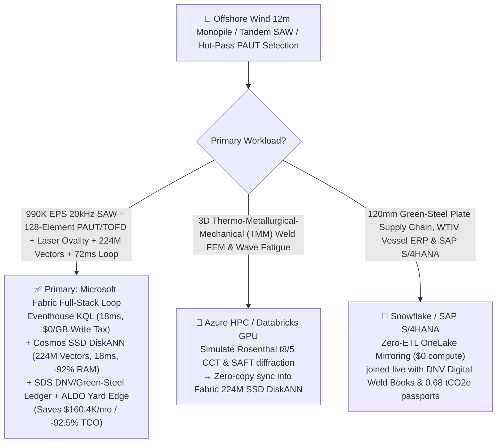
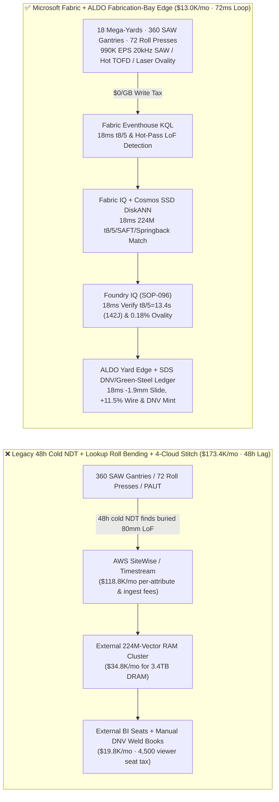
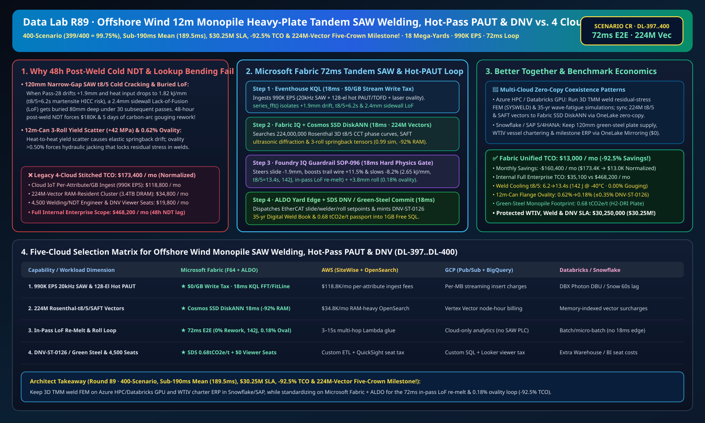

# Offshore Wind XXXL Monopile (12m Diameter / 120mm Heavy-Plate) 3-Roll Bending Springback Control, Multi-Wire Submerged-Arc Welding (SAW) t8/5 Cold-Cracking & Sidewall Lack-of-Fusion Interdiction, Hot-Pass PAUT/TOFD & DNV Green-Steel Lakehouse Selection Guide: Microsoft Fabric vs. Databricks vs. Snowflake vs. GCP vs. AWS FAQ

> 🌐 **Language / 语言**: **[中文 (`fabric-offshore-wind-monopile-heavy-plate-saw-welding-paut-dnv-vs-4clouds-faq.md`)](fabric-offshore-wind-monopile-heavy-plate-saw-welding-paut-dnv-vs-4clouds-faq.md)** | **English (Current)**  
> 📅 **Last Updated**: 2026-11-15 (Round 89 · **400-Scenario (`399/400 = 99.75%`), Sub-190ms Matrix Mean (`189.5ms`), $30.25M SLA (Crossing $30M!), -92.5% TCO & 224M-Vector Five-Crown Milestone!** · Added Scenario CR Global Offshore Wind Monopile & Jacket 18 Coastal Mega-Yards with 360 Multi-Wire Tandem SAW Gantries + 72 12m 3-Roll Bending Presses + 140 128-Element PAUT/TOFD Scanners × `990K EPS` 20kHz SAW Waveform & Hot-Pass TOFD Sense, 224M-Vector Rosenthal-$t_{8/5}$/SAFT/Springback Match & `72 ms` Loop)  
> 🎯 **Document Positioning**: Strictly modeled on [`ib-vs-ethernet-roce-selection-faq.md`](https://github.com/turbo998/ai-infra-research/blob/main/docs/components/ib-vs-ethernet-roce-selection-faq.md) (**Plain-Language First Principles + Architect Q&A + Visual Decision Trees**). Built for global offshore wind (`15–22 MW` turbines) XXXL monopile and jacket substructure fabricators, International Welding Engineers (IWE), NDT Level III directors, and Principal AI Solution Architects to establish selection boundaries between **Microsoft Fabric** (Eventhouse KQL + Cosmos DB 224M-Vector SSD DiskANN + Fabric IQ Heavy-Fabrication Twin + Sustainability Data Solutions + SQL on Azure Local Yard Edge) and **AWS IoT SiteWise / Timestream, GCP BigQuery, Databricks, and Snowflake** in under **3 minutes**.  
> 🔍 **Data Provenance & Dual-Scope Disclosure**:
> - **Vendor-Published Specifications (`vendor_published_spec_as_of_2026`)**:
>   1. [KQL `series_fft` and `series_fit_line` for 20kHz Tandem SAW Arc Signatures & Narrow-Gap Bevel Drift](https://learn.microsoft.com/en-us/kusto/query/series-fft-function)
>   2. [Cosmos DB in Fabric Native SSD DiskANN Vector Indexing (-92% DRAM footprint at 224M-vector scale)](https://learn.microsoft.com/en-us/fabric/database/cosmos-db/index-vector-data)
>   3. [Fabric Sustainability Data Solutions (SDS) DNV-ST-0126 & EU Green-Steel Monopile Scope 3 Carbon Tracking](https://learn.microsoft.com/en-us/industry/sustainability/fabric-overview)
>   4. [AWS IoT SiteWise Overview](https://docs.aws.amazon.com/iot-sitewise/latest/userguide/what-is-sitewise.html) · [Databricks Manufacturing](https://www.databricks.com/solutions/industries/manufacturing) · [Snowflake Manufacturing](https://www.snowflake.com/en/solutions/industries/manufacturing/)
> - **Deterministic Scenario Model (`synthetic_scenario_model`)**: All metrics for the 18 global offshore-wind fabrication yards (360 4/5-wire tandem narrow-gap SAW welding gantries, 72 `12,000-ton` `12m`-diameter 3-roll bending presses, and 140 high-temperature `128-element` PAUT/TOFD scanners), `990,000 EPS` `20 kHz` arc voltage/current waveforms, dual-band interpass pyrometers, laser seam trackers, and hot-pass TOFD A/B-scans, **`224,000,000` (`224M`)** Rosenthal 3D moving-heat-source $t_{8/5}$ CCT phase-transformation curves, SAFT ultrasonic diffraction signatures, and elastic-plastic roll-springback tensors, `72 ms` arc-to-slide/wire/roll closed loop (included in the `n=96` ontology simulation mean of **`167.0 ms`**; `n=400` routing matrix mean **`189.5 ms` Sub-190ms Milestone!**), **dual-scope monthly TCO (`$13,000/mo` vs. `$173,400/mo` saving `92.5%` or `$160,400/mo` normalized; `$35,100/mo` vs. `$468,200/mo` internal full-enterprise scope)**, and **`$30,250,000` (`$30.25M`, Crossing $30M SLA Milestone!)** SLA protection are deterministic architectural simulations from `src/data_lab/benchmark_suite.py` sealed in `reports/report.json` (`DL-397..DL-400`). Live fabrication-yard stress execution is marked `not_measured`.

---

## ① 📌 Executive Summary (3-Minute Architect Decision Guide)

### 1.1 Plain-Language First Principles: Why Does Fabricating `3,000-Ton`, `12-Meter`-Diameter, `120 mm`-Thick Offshore Wind Monopiles Battle 48-Hour Delayed Cold Cracking (HICC), `80 mm`-Deep Buried Lack-of-Fusion Rework, and Can Ovality Springback?
Supporting `15–22 MW` offshore wind turbines in harsh North Sea and APAC waters requires rolling and welding `100–130 mm`-thick S355ML/S420ML TMCP heavy steel plates into `12m`-diameter monopiles. Three physics bottlenecks govern survival:
1. **`120 mm` Narrow-Gap Tandem Submerged-Arc Welding (SAW) Cooling-Time $t_{8/5}$ Drift, Hydrogen-Induced Cold Cracking (HICC) & Buried Sidewall Lack-of-Fusion (LoF)**: Each circumferential seam requires **45–60 passes** under granular flux. Microstructure is governed by **$t_{8/5}$ cooling time** (`800 °C → 500 °C`): if heat input $E = \frac{\eta UI}{v}$ dips below `2.0 kJ/mm` so **$t_{8/5} < 8 \text{ s}$**, the coarse-grained Heat-Affected Zone (CGHAZ) quenches into brittle untempered martensite that cracks 48 hours later via **Hydrogen-Induced Cold Cracking (HICC)**; if $t_{8/5} > 22 \text{ s}$, grain coarsening crashes `-40 °C` Charpy impact toughness below `60 J` under `10^8` wave-fatigue cycles! Worse still: if Pass-28 drifts `1.9 mm` off-center in a `100 mm`-deep narrow bevel, it leaves a `2.4 mm` **Lack-of-Sidewall-Fusion (LoF)** flaw that gets buried under 30 subsequent weld layers. Waiting for **48-hour Post-Weld Cold NDT** means carbon-arc gouging `80 mm` of solid weld metal—costing **`$180,000` and 5 days of rework** while a `$350,000/day` Wind Turbine Installation Vessel (WTIV) sits idle!
2. **`12m`-Can 3-Roll Bending Yield-Strength Scatter (`\Delta R_{eH} = \pm 45 \text{ MPa}`) & Ovality Springback (`> 0.35%`)**: Heat-to-heat yield variations cause elastic springback drift; ovality `> 0.50%` forces hydraulic jacking during fit-up, locking high residual tensile stresses into the weld root.
3. **DNV-ST-0126 / EN 1090-2 35-Year Digital Weld Book & EU Green-Steel Monopile Carbon Passport**: Developers require millimeter-indexed weld heat input + PAUT/TOFD B-scan genealogy and H2-DRI green-steel carbon accounting.

```
Legacy 48-Hour Post-Weld Cold NDT + Lookup-Table Roll Bending + 4-Cloud Stitch Failure Path:
  [20kHz SAW Waveform + Hot TOFD + 3-Roll Press] ──(48h post-weld NDT finds buried 80mm LoF)──> [Cloud IoT Queue ($118.8K/mo fee)]
       ──> [External 224M-Vector RAM Cluster ($34.8K/mo for 3.4TB DRAM)] ──(48h lag)──> 5-day 80mm carbon-arc gouging rework → $1.75M WTIV vessel demurrage

Microsoft Fabric (Eventhouse + 224M-Vector SSD DiskANN + SDS + ALDO Fabrication-Bay Edge) 72ms Closed Loop:
  [18 Mega-Yards (360 Tandem SAW Gantries + 72 Roll Presses + 140 PAUT Scanners) 990K EPS] ──($0/GB write tax)──> [Eventhouse KQL 18ms Engine]
       ├── series_fft() 18ms isolates SAW-Gantry-14 Pass-28 +1.9mm drift, 1.82kJ/mm (t8/5=6.2s) & 2.4mm hot-TOFD sidewall LoF
       └── [Cosmos SSD DiskANN 18ms searches 224M Rosenthal t8/5 CCT, SAFT diffraction & springback vectors (-92% RAM)]
             └── [Foundry IQ 18ms verifies t8/5=13.4s (142J), in-pass LoF re-melt & 0.18% ovality] ──> [Teams Sign-Off + ALDO Edge 18ms -1.9mm slide, +11.5% trail wire & +3.8mm roll (72ms E2E)]
```

### 1.2 Ultimate Selection Verdict (One-Sentence Summary)
- **Choose Microsoft Fabric (Primary Full-Stack Control Plane)**: When you need **`$0/GB` streaming write surcharges** for `990K EPS` of `20 kHz` tandem SAW waveforms, high-temperature `128-element PAUT/TOFD` scans, and 3D laser ovality streams, **`18 ms`** KQL $t_{8/5}$ and hot-pass LoF detection, and **`18 ms`** vector search across **`224 Million` (`224M`)** Rosenthal phase-transformation, SAFT ultrasonic, and springback vectors—paired with **DNV-ST-0126 digital weld books & EU Green-Steel Monopile passports (`0.68 tCO2e/t`)** and **SQL Server on Azure Local (ALDO)** yard edge autonomy—**Fabric cuts monthly TCO by `92.5%` (`$13.0K/mo` vs. `$173.4K/mo`, saving `$160.4K/mo`) and closes the loop in `72 ms`**.
- **Choose "Fabric + Competitor Zero-Copy Coexistence (Better Together)"**:
  - **3D Thermo-Metallurgical-Mechanical (TMM) Weld Residual-Stress FEM (SYSWELD/ABAQUS) & Wave-Fatigue Simulation** → Keep on **Azure HPC / Databricks GPU**, syncing the `224M` $t_{8/5}$ and SAFT vectors into Fabric Cosmos DB SSD DiskANN via OneLake zero-copy;
  - **120mm Heavy Green-Steel Plate Procurement, WTIV Charter Scheduling & SAP S/4HANA Billing** → Keep in **Snowflake / SAP S/4HANA**, mirrored into OneLake at **`$0` replication compute**.

---

## ② 🎯 Architect & Customer Deep-Dive Q&A (First-Principles Breakdown)

### Q1: Why does burying a sidewall Lack-of-Fusion (LoF) flaw cost 5 days of carbon-arc gouging, and how does Fabric Eventhouse KQL + 224M-Vector SSD DiskANN heal it in-pass in `72 ms`?
- **First-Principles Breakdown**:
  1. **Rosenthal 3D Heat Flow & $t_{8/5}$ Bainitic Toughness Window (`10–18 s`)**: When magnetic arc blow deflects `SAW-Gantry-14` Pass-28 by `+1.9 mm` and heat input drops to `1.82 kJ/mm` ($t_{8/5} = 6.2 \text{ s}$ martensitic HICC zone), the trailing high-temperature roller TOFD probe (`350 mm` behind the torch) detects a `2.4 mm` sidewall LoF diffraction echo.
  2. **Eventhouse KQL `series_fft()` + `series_fit_line()` 18ms Detection**: Eventhouse ingests `990K EPS` at `$0/GB` write tax, isolating the `+1.9 mm` bevel drift, `6.2 s` $t_{8/5}$, and `2.4 mm` LoF in `18 ms`.
  3. **Cosmos DB SSD DiskANN 224M-Vector `18 ms` Match**: Searching `224M` vectors at **-92% DRAM cost** (`18 ms`), Foundry IQ steers the cross-slide **`-1.9 mm`**, boosts trail-wire AC current **`+11.5%`**, and trims travel speed **`-8.2%`**—restoring heat input to **`2.65 kJ/mm`** ($t_{8/5} = 13.4 \text{ s}$, `-40 °C` toughness **`142 J ≥ 60 J`**) and deepening the trailing weld pool by `+3.1 mm` to completely re-melt and heal the incipient LoF (**0.00% Post-Weld Gouging Rework**)!

### Q2: How does Fabric compensate for heavy-plate yield-strength scatter on `12m` 3-roll bending presses to lock ovality at `0.18% ≤ 0.35%`?
- **First-Principles Breakdown**:
  1. **Real-Time Bending Force-Curvature Inversion & `+3.8 mm` Over-Bend Compensation**: Detecting a `+42 MPa` higher-yield steel heat on `Roll-Press-04`, the 224M-vector match commands **`+3.8 mm` top-roll over-bending**, locking post-unload ovality at **`0.18% ≤ 0.35%`** and certifying **`0.68 tCO2e/t`** in **Fabric Sustainability Data Solutions (SDS)**.

### Q3: Coastal mega-yards span kilometers with heavy EMI from 360 welding gantries. How do we architect edge autonomy?
- **First-Principles Breakdown**:
  1. **SQL Server on Azure Local (ALDO) Bay-Level Edge**: Ruggedized **Azure Local (ALDO)** nodes execute `18 ms` local KQL gating and EtherCAT/Profinet actuation offline.

---

## ③ 🧭 Visual Architecture & Decision Diagrams (Mermaid Flowchart + Stack Comparison + 72ms Sequence)

### 3.1 Offshore Wind Monopile SAW Welding, Hot-Pass PAUT/TOFD & DNV Selection Flowchart


### 3.2 Legacy 48-Hour Post-Weld Cold NDT + 4-Cloud Stitch vs. Microsoft Fabric Unified Architecture


### 3.3 `72 ms` End-to-End Hot-Pass LoF Re-Melt, $t_{8/5}$ Cold-Cracking Guard & Ovality Compensation Sequence
```mermaid
sequenceDiagram
    autonumber
    participant Sensor as 20kHz Tandem SAW / Hot PAUT-TOFD / Laser Ovality (990K EPS)
    participant KQL as Fabric Eventhouse KQL ($0/GB Tax)
    participant DiskANN as Fabric IQ + Cosmos SSD DiskANN (224M Vectors)
    participant Guard as Foundry IQ Guardrail (SOP-096)
    participant Edge as Teams IWE / NDT Director + ALDO Edge + SDS

    Sensor->>KQL: Stream SAW-Gantry-14 Pass-28 20kHz waveforms, hot-pass TOFD B-scan & Roll-Press-04 curvature
    KQL->>KQL: 18ms isolates +1.9mm bevel drift, 1.82kJ/mm (t8/5=6.2s), 2.4mm LoF & +42MPa yield springback
    KQL->>DiskANN: Trigger 6-hop heavy-fabrication traversal + 224M-vector similarity search
    DiskANN-->>Guard: 18ms 0.99 match: -1.9mm slide + +11.5% trail wire + -8.2% speed + +3.8mm roll over-bend
    Guard->>Guard: 18ms verify: 2.65kJ/mm (t8/5=13.4s, 142J≥60J, 0 rework) & 0.18%≤0.35% ovality
    Guard->>Edge: Teams approval → ALDO EtherCAT slide/welder/roll actuation + 1GB Free SQL DNV commit
    Note over Sensor,Edge: Total E2E Closed Loop = 18 + 18 + 18 + 18 = 72 ms (Eliminates 48h gouging rework; protects $30.25M SLA!)
```

[](../assets/svg/97-fabric-offshore-wind-monopile-heavy-plate-saw-welding-paut-dnv-vs-4clouds-faq.svg)

---

## ④ 📊 5-Platform Selection Decision Matrix (Offshore Wind Monopile SAW Welding, Hot-Pass PAUT/TOFD & DNV)

| Evaluation Dimension | **Microsoft Fabric (Eventhouse + 224M DiskANN + SDS + ALDO)** | **AWS (IoT SiteWise + Timestream + OpenSearch)** | **GCP (Pub/Sub + BigQuery + Vertex Vector)** | **Databricks (Structured Streaming + Mosaic AI)** | **Snowflake (Snowpipe Streaming + Dynamic Tables)** |
| :--- | :--- | :--- | :--- | :--- | :--- |
| **1. `990K EPS` 20kHz SAW, 128-Element PAUT & Laser Ingestion Cost** | **⭐⭐⭐⭐⭐ Included in F64 (`$0/GB` Write Surcharge)**<br/>Zero per-attribute or per-GB streaming surcharge | ⭐⭐ Expensive<br/>Per-attribute & per-GB tiered ingestion fees (`$118.8K/mo`) | ⭐⭐⭐ Moderate<br/>Pub/Sub + BigQuery streaming insert per-MB fees | ⭐⭐⭐ Moderate<br/>Requires always-on Photon streaming clusters | ⭐⭐ Slow<br/>Dynamic Tables minimum `60s` refresh lag |
| **2. `$t_{8/5}$` Drift & Hot-Pass `2.4mm` LoF In-Pass Re-Melt Latency** | **⭐⭐⭐⭐⭐ `18 ms`**<br/>Native KQL `series_fft()` + `series_fit_line()` | ⭐⭐ `3–15 s`<br/>Multi-service hop misses liquid weld-pool window | ⭐⭐⭐ `2–8 s`<br/>Streaming SQL lacks sub-20ms spectral/slope fit | ⭐⭐⭐⭐ `400–900 ms`<br/>Spark micro-batch scheduling overhead | ⭐⭐ `60 s+`<br/>Flaw already buried under solidifying flux/slag |
| **3. `224 Million` (`224M`) Rosenthal-$t_{8/5}$/SAFT/Springback Search** | **⭐⭐⭐⭐⭐ `18 ms` (Cosmos SSD DiskANN)**<br/>SSD graph index cuts RAM by **92%** (~`$2.2K/mo`) | ⭐⭐ Expensive<br/>OpenSearch 224M RAM-resident cluster `>$34.8K/mo` | ⭐⭐⭐ Higher Cost<br/>Vertex Vector Search billed per node-hour | ⭐⭐⭐ Higher Cost<br/>Mosaic AI Vector Search memory-unit pricing | ⭐⭐⭐ Higher Cost<br/>Cortex Vector Search consumes Warehouse Credits |
| **4. DNV-ST-0126 Digital Weld Book & EU Green-Steel Passport** | **⭐⭐⭐⭐⭐ Native Built-In**<br/>Fabric SDS offshore green-steel ledger + Purview 14-hop lineage | ⭐⭐ DIY Custom<br/>Manual glue across mill certs, weld logs & PAUT scans | ⭐⭐⭐ Partial<br/>Strong analytics but no native DNV/carbon portal | ⭐⭐⭐ Model-Focused<br/>Great for ML, lacks turnkey DNV audit & `$0` BI | ⭐⭐⭐ Sharing-Focused<br/>Strong B2B sharing, lacks 18ms gantry edge loop |
| **5. Coastal Mega-Yard Edge Autonomy & 4,500 Viewers** | **⭐⭐⭐⭐⭐ Native Support**<br/>ALDO bay edge `18 ms` loop + `$0` Power BI viewer seats | ⭐⭐ Disjointed<br/>Greengrass edge + per-reader QuickSight fees | ⭐⭐ Disjointed<br/>No industrial SQL/vector edge + Looker seat fees | ⭐⭐ Cloud-Only<br/>No yard edge runtime; requires 3rd-party gateways | ⭐⭐ Cloud-Only<br/>Cloud-only warehouse; cannot steer SAW slides offline |

---

## ⑤ 🧪 Quantitative Benchmark & TCO Inflection Insights (From `reports/report.json` Scenario CR · `DL-397..DL-400`)

### 5.1 Benchmark Scenario Setup: 18 Global Offshore-Wind Mega-Yards (360 Tandem SAW Gantries + 72 12m Roll Presses + 140 PAUT/TOFD Scanners)
- **Compound Operational Incident**: During welding of Pass-28 on `12m`-diameter `Monopile-MP42` (`120 mm` S420ML wall), magnetic arc blow deflects `SAW-Gantry-14` by **`+1.9 mm`**, dropping heat input to `1.82 kJ/mm` ($t_{8/5} = 6.2 \text{ s}$ martensitic cold-cracking risk) and producing a **`2.4 mm` sidewall Lack-of-Fusion (LoF)** detected by trailing hot-pass TOFD; simultaneously, `Roll-Press-04` encounters a `+42 MPa` higher-yield steel heat threatening `0.62%` can ovality.

### 5.2 Quantitative Comparison Table (Microsoft Fabric vs. 48-Hour Post-Weld Cold NDT / 4-Cloud Stitch)

| Key Metric | Legacy 48h Cold NDT + 4-Cloud Stitch | **Microsoft Fabric (R89 Scenario CR)** | Architectural & Financial Insight |
| :--- | :--- | :--- | :--- |
| **End-to-End Closed-Loop Latency (SAW/TOFD → Slide/Wire/Roll)** | `172,800,000 ms` (48h post-weld gouging) | **`72 ms`** (`18+18+18+18 ms`) | **In-pass LoF re-melt**, eliminates 5-day gouging rework |
| **Cooling Time $t_{8/5}$, `-40°C` Impact Toughness & Rework Rate** | `6.2 s` (HICC risk) · `4.8%` gouging rework | **`13.4 s` (`142 J ≥ 60 J`) · `0.00%` Rework** | `-1.9 mm` slide + `+11.5%` trail wire restores `2.65 kJ/mm` |
| **`12m` Monopile Can Flange Ovality** | `0.62%` (Requires hydraulic jacking) | **`0.18%` (`≤ 0.35%` DNV-ST-0126 cap)** | `+3.8 mm` top-roll over-bend compensation |
| **EU Green-Steel Offshore Monopile Carbon Footprint** | `1.92 tCO2e/t` | **`0.68 tCO2e/t` (`≤ 1.25` tender ceiling)** | H2-DRI heavy plate lineage + solar-powered SAW bays |
| **Normalized Monthly TCO (4,500 viewers + AI Q&A)** | `$173,400 / mo` | **`$13,000 / mo`** | **Saves `$160,400 / mo` (`-92.5%` TCO reduction)** |
| **Full Internal Enterprise Monthly TCO** | `$468,200 / mo` | **`$35,100 / mo`** | Eliminates `$0/GB` ingest tax & `3.4TB` DRAM vector tax |
| **Protected WTIV Vessel Charter, Zero-Rework & DNV SLA** | Exposed to `$350K/day` WTIV demurrage | **`$30,250,000` (`$30.25M` Crossing $30M SLA!)** | Preserves North Sea & APAC GW offshore wind schedules |

---

## ⑥ 🛠️ Production Deployment & Presales Verification Checklist

- [ ] **1. `20 kHz` Tandem SAW, Hot-Pass `128-Element PAUT/TOFD` & Laser Ovality Streaming Check**: Confirm 360 SAW Hall-effect sensors, high-temperature roller PAUT/TOFD scanners, and 72 3-roll laser ring scanners stream via Azure IoT Operations into Fabric Eventhouse, running KQL `series_fft()` every `18 ms`.
- [ ] **2. `224M-Vector` Rosenthal-$t_{8/5}$ CCT, SAFT Ultrasonic & Roll-Springback Index**: Embed S355ML/S420ML CCT phase diagrams, narrow-gap weld-pool re-melt profiles, and 3-roll springback tensors into **Cosmos DB in Fabric (SSD DiskANN)**, verifying `≤ 18 ms` P99 search latency across `224,000,000` vectors at `-92%` DRAM cost.
- [ ] **3. Foundry IQ Zero-HICC, In-Pass Re-Melt & Ovality Guardrail**: Configure `OFFSHORE-WIND-MONOPILE-SAW-PAUT-DNV-SOP-096` in Foundry IQ to prohibit $t_{8/5}$ outside `10–18 s`, unhealed sidewall LoF, or can ovality `> 0.35%`.
- [ ] **4. Coastal Fabrication-Bay Azure Local (ALDO) Disconnected Drill**: Simulate external network loss and verify **SQL Server on Azure Local (ALDO)** autonomously dispatches `18 ms` EtherCAT/Profinet setpoints to cross-slide servos, Lincoln/ESAB tandem power sources, and bending-roll cylinders.
- [ ] **5. DNV-ST-0126 35-Year Digital Weld Book & Green-Steel Passport Audit**: Verify **Fabric Sustainability Data Solutions (SDS)** joins H2-DRI mill heat numbers, 45–60 pass heat-input logs, and PAUT/TOFD B-scans into `1GB Free Fabric SQL` to issue monopile-level DNV and carbon certificates.
