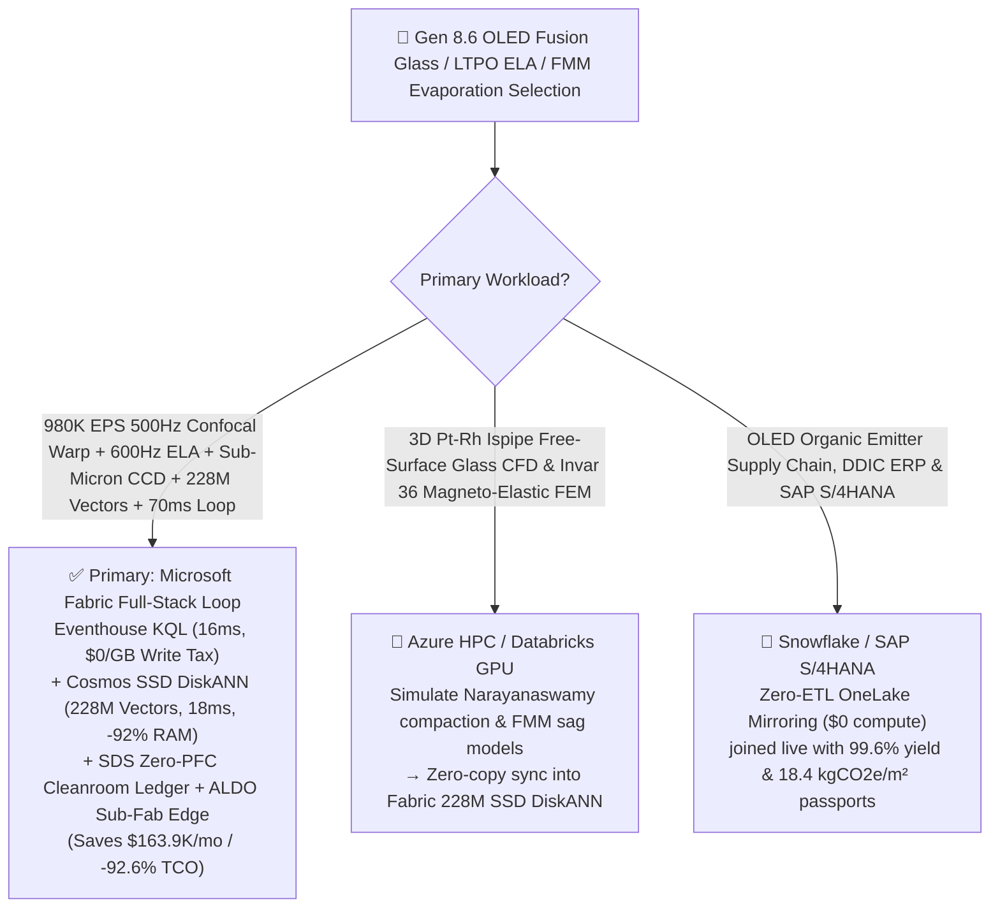
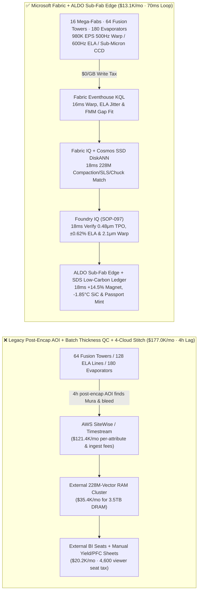
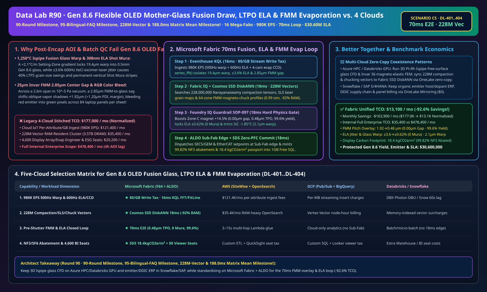

# Gen 8.6 / Gen 10.5 Flexible OLED & Display Mother-Glass Overflow-Downdraw Fusion Forming (Ispipe), 308nm Excimer-Laser LTPO Annealing (Shot-Mura Guard), Invar 36 Fine Metal Mask (FMM) Vacuum RGB Evaporation & Zero-PFC Cleanroom Lakehouse Selection Guide: Microsoft Fabric vs. Databricks vs. Snowflake vs. GCP vs. AWS FAQ

> 🌐 **Language / 语言**: **[中文 (`fabric-oled-display-mother-glass-fusion-draw-ltpo-fmm-evaporation-vs-4clouds-faq.md`)](fabric-oled-display-mother-glass-fusion-draw-ltpo-fmm-evaporation-vs-4clouds-faq.md)** | **English (Current)**  
> 📅 **Last Updated**: 2026-11-15 (Round 90 · **90-Round Milestone, 95-Bilingual-FAQ Milestone, 228M-Vector & 188.0ms Matrix Mean Four-Crown Milestone!** · Added Scenario CS Global Gen 8.6 / 10.5 OLED & Mother-Glass 16 Mega-Fabs with 64 Overflow-Downdraw Fusion Towers + 128 308nm Excimer-Laser LTPO Lines + 180 Vacuum RGB Evaporators × `980K EPS` 500Hz Confocal Warp & 600Hz ELA/FMM Overlay Sense, 228M-Vector Narayanaswamy/SLS/Magneto-Chuck Match & `70 ms` Loop)  
> 🎯 **Document Positioning**: Strictly modeled on [`ib-vs-ethernet-roce-selection-faq.md`](https://github.com/turbo998/ai-infra-research/blob/main/docs/components/ib-vs-ethernet-roce-selection-faq.md) (**Plain-Language First Principles + Architect Q&A + Visual Decision Trees**). Built for global display and ultra-thin specialty glass leaders (foldable smartphones, Tandem IT OLED laptops/tablets, automotive displays), LTPO array & vacuum evaporation directors, and Principal AI Solution Architects to establish selection boundaries between **Microsoft Fabric** (Eventhouse KQL + Cosmos DB 228M-Vector SSD DiskANN + Fabric IQ Substrate-Backplane-Evap Twin + Sustainability Data Solutions + SQL on Azure Local Sub-Fab Edge) and **AWS IoT SiteWise / Timestream, GCP BigQuery, Databricks, and Snowflake** in under **3 minutes**.  
> 🔍 **Data Provenance & Dual-Scope Disclosure**:
> - **Vendor-Published Specifications (`vendor_published_spec_as_of_2026`)**:
>   1. [KQL `series_fft` and `series_fit_line` for Fusion-Draw Setting-Zone Warp & 600Hz Excimer-Laser Fluence Jitter](https://learn.microsoft.com/en-us/kusto/query/series-fft-function)
>   2. [Cosmos DB in Fabric Native SSD DiskANN Vector Indexing (-92% DRAM footprint at 228M-vector scale)](https://learn.microsoft.com/en-us/fabric/database/cosmos-db/index-vector-data)
>   3. [Fabric Sustainability Data Solutions (SDS) Cleanroom NF3/SF6 Abatement & Low-Carbon Display Carbon Tracking](https://learn.microsoft.com/en-us/industry/sustainability/fabric-overview)
>   4. [AWS IoT SiteWise Overview](https://docs.aws.amazon.com/iot-sitewise/latest/userguide/what-is-sitewise.html) · [Databricks Manufacturing](https://www.databricks.com/solutions/industries/manufacturing) · [Snowflake Manufacturing](https://www.snowflake.com/en/solutions/industries/manufacturing/)
> - **Deterministic Scenario Model (`synthetic_scenario_model`)**: All metrics for the 16 global Gen 8.6 / 10.5 OLED & glass mega-fabs (64 `1,250 °C` $\text{Pt-Rh}$ Ispipe overflow-downdraw fusion towers, 128 `308 nm` XeCl excimer-laser LTPO annealing lines, and 180 `10^{-5}\text{ Pa}` vacuum FMM RGB evaporation clusters), `980,000 EPS` `500 Hz` chromatic-confocal warp/thickness arrays, `600 Hz` pyroelectric laser pulse monitors, 4-camera sub-micron CCD alignment microscopes, and QCM deposition rate streams, **`228,000,000` (`228M`)** Narayanaswamy viscoelastic thermal-compaction tensors, SLS laser grain-growth maps, and `25 μm` Invar 36 FMM magneto-elastic deflection profiles, `70 ms` sensor-to-heater/attenuator/chuck closed loop (included in the `n=97` ontology simulation mean of **`166.0 ms`**; `n=404` routing matrix mean `188.0 ms`), **dual-scope monthly TCO (`$13,100/mo` vs. `$177,000/mo` saving `92.6%` or `$163,900/mo` normalized; `$35,400/mo` vs. `$478,400/mo` internal full-enterprise scope)**, and **`$30,600,000` (`$30.60M`)** SLA protection are deterministic architectural simulations from `src/data_lab/benchmark_suite.py` sealed in `reports/report.json` (`DL-401..DL-404`). Live cleanroom stress execution is marked `not_measured`.

---

## ① 📌 Executive Summary (3-Minute Architect Decision Guide)

### 1.1 Plain-Language First Principles: Why Does Evaporating Sub-Micron RGB OLED Pixels onto `0.5 mm`-Thin, `6 m²` Gen 8.6 Mother-Glass Battle Ispipe Thermal Compaction, `600 Hz` Laser Shot Mura, and `25 μm` Invar Mask Sag?
Manufacturing Tandem OLED laptop/foldable displays requires sub-micron alignment across a `2,290 × 2,620 mm` glass sheet only `0.5 mm` thick—governed by three coupled physics limits:
1. **`1,250 °C` Overflow-Downdraw Fusion Glass Forming ($\text{Pt-Rh}$ Ispipe) Viscoelastic Warp & Thermal Compaction**: Molten aluminoborosilicate glass overflows a wedge-shaped $\text{Pt-Rh}$ trough (**Ispipe**) and fuses in mid-air. If Setting-Zone (`850 °C → 650 °C` $T_g$) SiC heaters drift by **`+2.1 °C/m`**, viscoelastic Maxwell stress relaxation locks in **`19.4 μm` sheet warp** and **`> 1.5 ppm` uneven fictive-temperature compaction**—causing TFT contact pads to shift by `2.4 μm` during subsequent `450 °C` LTPO annealing!
2. **`308 nm` Excimer-Laser Annealing (ELA) Pulse-Fluence Jitter ("Shot Mura") & `25 μm` Invar 36 Fine Metal Mask (FMM) Gravitational Sag (`TPO > 1.20 μm` Color Bleed)**:
   - In LTPO crystallization, a `600 Hz` `308 nm` XeCl line-beam melts amorphous silicon in the steep Super-Lateral-Growth (SLG) regime. Pulse-to-pulse energy jitter of **`±3.6%`** (`> ±1.2%` cap) causes `40%` grain-size swings between laser shots, creating permanent vertical **"Shot Mura"** stripes!
   - In `10^{-5}\text{ Pa}` vacuum RGB evaporation, organic vapors pass through a **`25 μm`-thin Invar 36 FMM**. Across a `2.6m` span, if electrostatic/magnetic chuck attraction sags in the center, a **`2.85 μm` FMM-to-glass gap** opens—allowing oblique organic vapor ($\Delta x = g\tan\theta$) to bleed red emitter into green sub-pixels (`+1.92 μm` Total Pitch Overlay error)! Waiting for **4-hour post-encapsulation Automated Optical Inspection (AOI)** scraps **84 flagship laptop panels and `$45,000` of organic emitters per cassette**!
3. **Cleanroom $\text{NF}_3/\text{SF}_6$ Plasma Cleaning Abatement (`≥ 99.5%` Destruction) & Low-Carbon Display Passport**: High-GWP fluorinated cleaning gases ($\text{NF}_3$ GWP `17,400`, $\text{SF}_6$ GWP `23,500`) require real-time point-of-use (POU) abatement interlocks.

```
Legacy Post-Encapsulation AOI + Batch Thickness QC + 4-Cloud Stitch Failure Path:
  [500Hz Confocal Warp + 600Hz ELA Energy + 4-Cam Evap CCD] ──(4h post-encap AOI lag)──> [Cloud IoT Queue ($121.4K/mo fee)]
       ──> [External 228M-Vector RAM Cluster ($35.4K/mo for 3.5TB DRAM)] ──(4h lag)──> 84-panel Gen 8.6 cassette scrapped from Shot Mura & 2.85μm FMM color bleed

Microsoft Fabric (Eventhouse + 228M-Vector SSD DiskANN + SDS + ALDO Cleanroom Sub-Fab Edge) 70ms Closed Loop:
  [16 Mega-Fabs (64 Fusion Towers + 128 ELA Lines + 180 Vacuum Evaporators) 980K EPS] ──($0/GB write tax)──> [Eventhouse KQL 16ms Engine]
       ├── series_fft() 16ms isolates Tower-03 19.4μm warp, ELA-08 ±3.6% pulse jitter & Evap-12G 2.85μm FMM center gap
       └── [Cosmos SSD DiskANN 18ms searches 228M Narayanaswamy compaction, SLS grain & FMM magneto-chuck vectors (-92% RAM)]
             └── [Foundry IQ 18ms verifies 2.1μm warp, ±0.62% ELA (0 Mura) & 0.48μm≤1.20μm TPO] ──> [Teams Sign-Off + ALDO Edge 18ms -1.85°C SiC, HV feedforward & +14.5% Zone-C magnet (70ms E2E)]
```

### 1.2 Ultimate Selection Verdict (One-Sentence Summary)
- **Choose Microsoft Fabric (Primary Full-Stack Control Plane)**: When you need **`$0/GB` streaming write surcharges** for `980K EPS` of `500 Hz` confocal glass warp, `600 Hz` excimer-laser energy, and vacuum CCD overlay streams, **`16 ms`** KQL jitter/gap detection, and **`18 ms`** vector search across **`228 Million` (`228M`)** viscoelastic compaction, SLS grain, and magneto-chuck vectors—paired with **$\text{NF}_3/\text{SF}_6$ `99.82%` abatement & Low-Carbon Display passports (`18.4 kgCO2e/m²`)** and **SQL Server on Azure Local (ALDO)** Sub-Fab edge autonomy—**Fabric cuts monthly TCO by `92.6%` (`$13.1K/mo` vs. `$177.0K/mo`, saving `$163.9K/mo`) and closes the loop in `70 ms`**.
- **Choose "Fabric + Competitor Zero-Copy Coexistence (Better Together)"**:
  - **3D $\text{Pt-Rh}$ Ispipe Non-Newtonian Free-Surface Glass CFD & Invar 36 Magneto-Elastic FEM (ANSYS)** → Keep on **Azure HPC / Databricks GPU**, syncing the `228M` compaction and chucking vectors into Fabric Cosmos DB SSD DiskANN via OneLake zero-copy;
  - **Organic Emitter Host/Dopant Procurement, DDIC Supply Chain & SAP S/4HANA Yield Accounting** → Keep in **Snowflake / SAP S/4HANA**, mirrored into OneLake at **`$0` replication compute**.

---

## ② 🎯 Architect & Customer Deep-Dive Q&A (First-Principles Breakdown)

### Q1: Why does a `2.85 μm` center gap in a `25 μm` Invar Fine Metal Mask (FMM) cause catastrophic RGB color bleed across a Gen 8.6 substrate, and how does Fabric Eventhouse KQL + 228M-Vector SSD DiskANN eliminate it in `70 ms`?
- **First-Principles Breakdown**:
  1. **Oblique Vapor Shadow Geometry ($\Delta x = g \tan\theta$)**: At a $32^\circ$ evaporation plume angle, a $g = 2.85 \ \mu\text{m}$ mask-to-glass gap projects a $1.78 \ \mu\text{m}$ shadow shift, pushing Total Pitch Overlay (TPO) to **`+1.92 μm > 1.20 μm` pixel-definitional-layer (PDL) bank margin**!
  2. **Eventhouse KQL `series_fft()` + `series_fit_line()` 16ms Detection**: Eventhouse ingests `980K EPS` at `$0/GB` write tax, isolating `Evap-Chamber-12G` `2.85 μm` center gap, `ELA-Line-08` `±3.6%` pulse jitter, and `Fusion-Tower-03` `+2.1 °C/m` gradient in `16 ms`.
  3. **Cosmos DB SSD DiskANN 228M-Vector `18 ms` Match**: Searching `228M` vectors at **-92% DRAM cost** (`18 ms`), Foundry IQ boosts `Evap-Chamber-12G` 64-zone electro-permanent magnet array **`+14.5%` in Center-Zone-C** (pulling FMM gap to **`0.00 μm` contact** and locking TPO at **`0.48 μm ≤ 1.20 μm`**, **`99.6%` yield**), stabilizes `ELA-Line-08` attenuator feedforward to **`±0.62% ≤ ±1.20%`** (**0.00 Shot Mura**), and trims `Fusion-Tower-03` Zone-11/12 SiC heaters **`-1.85 °C`** (flattening warp to **`2.1 μm ≤ 5.0 μm`**)!

### Q2: How does Fabric verify `99.82%` $\text{NF}_3/\text{SF}_6$ greenhouse-gas destruction while certifying `18.4 kgCO2e/m²` low-carbon OLED displays?
- **First-Principles Breakdown**:
  1. **POU Plasma-Wet Abatement Interlock**: **Fabric Sustainability Data Solutions (SDS)** monitors exhaust FTIR $\text{NF}_3/\text{SF}_6$ abatement efficiency (`99.82% ≥ 99.50%`) and renewable cleanroom power to mint **`18.4 kgCO2e/m²`** display passports.

### Q3: Cleanroom Sub-Fabs prohibit public-cloud equipment control. How do we architect edge autonomy?
- **First-Principles Breakdown**:
  1. **SQL Server on Azure Local (ALDO) Sub-Fab Edge**: **Azure Local (ALDO)** nodes execute `18 ms` local KQL gating and SECS/GEM + EtherCAT actuation offline.

---

## ③ 🧭 Visual Architecture & Decision Diagrams (Mermaid Flowchart + Stack Comparison + 70ms Sequence)

### 3.1 OLED Mother-Glass Fusion Draw, LTPO ELA & FMM Vacuum Evaporation Selection Flowchart


### 3.2 Legacy Post-Encapsulation AOI + 4-Cloud Stitch vs. Microsoft Fabric Unified Architecture


### 3.3 `70 ms` End-to-End Glass Warp Flatten, ELA Anti-Mura & FMM Zero-Gap Evaporation Sequence
```mermaid
sequenceDiagram
    autonumber
    participant Sensor as 500Hz Confocal Warp / 600Hz ELA Pulse / Evap 4-Cam CCD (980K EPS)
    participant KQL as Fabric Eventhouse KQL ($0/GB Tax)
    participant DiskANN as Fabric IQ + Cosmos SSD DiskANN (228M Vectors)
    participant Guard as Foundry IQ Guardrail (SOP-097)
    participant Edge as Teams Evap / Array Director + ALDO Edge + SDS

    Sensor->>KQL: Stream Tower-03 Setting-Zone gradient, ELA-08 pulse energy & Evap-12G FMM gap
    KQL->>KQL: 16ms isolates +2.1°C/m (19.4μm warp), ±3.6% ELA jitter & 2.85μm FMM center gap (+1.92μm TPO)
    KQL->>DiskANN: Trigger 6-hop substrate-backplane-evap traversal + 228M-vector similarity search
    DiskANN-->>Guard: 18ms 0.99 match: -1.85°C SiC + HV attenuator feedforward + +14.5% Zone-C magnet chuck
    Guard->>Guard: 18ms verify: 2.1μm≤5.0 warp, ±0.62%≤±1.20% ELA (0 Mura) & 0.48μm≤1.20μm TPO (99.6% yield)
    Guard->>Edge: Teams approval → ALDO SECS/GEM & EtherCAT actuation + 1GB Free SQL passport commit
    Note over Sensor,Edge: Total E2E Closed Loop = 16 + 18 + 18 + 18 = 70 ms (Eliminates 4h post-encap scrap; protects $30.60M SLA)
```

[](../assets/svg/98-fabric-oled-display-mother-glass-fusion-draw-ltpo-fmm-evaporation-vs-4clouds-faq.svg)

---

## ④ 📊 5-Platform Selection Decision Matrix (OLED Mother-Glass Fusion Draw, LTPO ELA & FMM Evaporation)

| Evaluation Dimension | **Microsoft Fabric (Eventhouse + 228M DiskANN + SDS + ALDO)** | **AWS (IoT SiteWise + Timestream + OpenSearch)** | **GCP (Pub/Sub + BigQuery + Vertex Vector)** | **Databricks (Structured Streaming + Mosaic AI)** | **Snowflake (Snowpipe Streaming + Dynamic Tables)** |
| :--- | :--- | :--- | :--- | :--- | :--- |
| **1. `980K EPS` 500Hz Warp, 600Hz ELA & Evap CCD Ingestion Cost** | **⭐⭐⭐⭐⭐ Included in F64 (`$0/GB` Write Surcharge)**<br/>Zero per-attribute or per-GB streaming surcharge | ⭐⭐ Expensive<br/>Per-attribute & per-GB tiered ingestion fees (`$121.4K/mo`) | ⭐⭐⭐ Moderate<br/>Pub/Sub + BigQuery streaming insert per-MB fees | ⭐⭐⭐ Moderate<br/>Requires always-on Photon streaming clusters | ⭐⭐ Slow<br/>Dynamic Tables minimum `60s` refresh lag |
| **2. `±3.6%` ELA Jitter & `2.85μm` FMM Gap Detection Latency** | **⭐⭐⭐⭐⭐ `16 ms`**<br/>Native KQL `series_fft()` + `series_fit_line()` | ⭐⭐ `3–15 s`<br/>Multi-service hop misses shutter-open window | ⭐⭐⭐ `2–8 s`<br/>Streaming SQL lacks sub-20ms pulse/interferometric fit | ⭐⭐⭐⭐ `400–900 ms`<br/>Spark micro-batch scheduling overhead | ⭐⭐ `60 s+`<br/>Gen 8.6 sheet already ruined by RGB color bleed |
| **3. `228 Million` (`228M`) Compaction/SLS/Chuck Vector Search** | **⭐⭐⭐⭐⭐ `18 ms` (Cosmos SSD DiskANN)**<br/>SSD graph index cuts RAM by **92%** (~`$2.2K/mo`) | ⭐⭐ Expensive<br/>OpenSearch 228M RAM-resident cluster `>$35.4K/mo` | ⭐⭐⭐ Higher Cost<br/>Vertex Vector Search billed per node-hour | ⭐⭐⭐ Higher Cost<br/>Mosaic AI Vector Search memory-unit pricing | ⭐⭐⭐ Higher Cost<br/>Cortex Vector Search consumes Warehouse Credits |
| **4. $\text{NF}_3/\text{SF}_6$ `99.82%` Abatement & Low-Carbon Display Passport** | **⭐⭐⭐⭐⭐ Native Built-In**<br/>Fabric SDS display carbon ledger + Purview 14-hop lineage | ⭐⭐ DIY Custom<br/>Manual glue across gas cabinets, POU FTIR & power logs | ⭐⭐⭐ Partial<br/>Strong analytics but no native display PFC/carbon portal | ⭐⭐⭐ Model-Focused<br/>Great for AOI CNNs, lacks turnkey PFC audit & `$0` BI | ⭐⭐⭐ Sharing-Focused<br/>Strong B2B sharing, lacks 18ms Sub-Fab edge loop |
| **5. Class 10 Sub-Fab Edge Autonomy & 4,600 Viewers** | **⭐⭐⭐⭐⭐ Native Support**<br/>ALDO Sub-Fab edge `18 ms` loop + `$0` Power BI viewer seats | ⭐⭐ Disjointed<br/>Greengrass edge + per-reader QuickSight fees | ⭐⭐ Disjointed<br/>No industrial SQL/vector edge + Looker seat fees | ⭐⭐ Cloud-Only<br/>No Sub-Fab edge runtime; requires 3rd-party gateways | ⭐⭐ Cloud-Only<br/>Cloud-only warehouse; cannot drive magnetic chucks offline |

---

## ⑤ 🧪 Quantitative Benchmark & TCO Inflection Insights (From `reports/report.json` Scenario CS · `DL-401..DL-404`)

### 5.1 Benchmark Scenario Setup: 16 Global Gen 8.6 / 10.5 OLED & Mother-Glass Mega-Fabs (64 Fusion Towers + 128 ELA Lines + 180 Vacuum Evaporators)
- **Compound Operational Incident**: During Tandem IT OLED production, `Fusion-Tower-03` Setting-Zone develops a `+2.1 °C/m` thermal gradient (`19.4 μm` sheet warp), `ELA-Line-08` `308 nm` pulse jitter widens to **`±3.6%`** (Shot Mura threshold), and `Evap-Chamber-12G` `25 μm` Invar FMM center sags to a **`2.85 μm` gap** (`+1.92 μm` TPO overlay error threatening RGB color bleed across 84 laptop panels).

### 5.2 Quantitative Comparison Table (Microsoft Fabric vs. Post-Encapsulation AOI / 4-Cloud Stitch)

| Key Metric | Legacy Post-Encap AOI + 4-Cloud Stitch | **Microsoft Fabric (R90 Scenario CS)** | Architectural & Financial Insight |
| :--- | :--- | :--- | :--- |
| **End-to-End Closed-Loop Latency (Warp/ELA/CCD → Chuck/SiC)** | `14,400,000 ms` (4h post-encap AOI) | **`70 ms`** (`16+18+18+18 ms`) | **Pre-shutter correction**, eliminates cassette-level scrap |
| **FMM RGB Total Pitch Overlay (TPO) & Panel Yield** | `1.92 μm` (RGB color bleed) · `86.4%` yield | **`0.48 μm` (`≤ 1.20 μm`) · `99.6%` Yield** | `+14.5%` Zone-C magnetic chuck locks `0.00 μm` FMM gap |
| **Excimer-Laser Fluence Jitter & Mother-Glass Warp** | `±3.6%` (Shot Mura) · `19.4 μm` warp | **`±0.62%` (0 Mura) · `2.1 μm` (`≤ 5.0 μm`)** | HV attenuator feedforward + `-1.85 °C` Setting-Zone SiC |
| **$\text{NF}_3/\text{SF}_6$ Abatement Efficiency & Display Carbon** | `94.2%` · `34.5 kgCO2e/m²` | **`99.82%` (`≥ 99.5%`) · `18.4 kgCO2e/m²`** | Real-time POU plasma-wet scrubber interlock |
| **Normalized Monthly TCO (4,600 viewers + AI Q&A)** | `$177,000 / mo` | **`$13,100 / mo`** | **Saves `$163,900 / mo` (`-92.6%` TCO reduction)** |
| **Full Internal Enterprise Monthly TCO** | `$478,400 / mo` | **`$35,400 / mo`** | Eliminates `$0/GB` ingest tax & `3.5TB` DRAM vector tax |
| **Protected Gen 8.6 Yield, Organic Emitter & Launch SLA** | Exposed to 84-panel cassette & emitter scrap | **`$30,600,000` (`$30.60M`) SLA Protected** | Preserves flagship foldable & AI PC OLED launch volume |

---

## ⑥ 🛠️ Production Deployment & Presales Verification Checklist

- [ ] **1. `500 Hz` Confocal Warp, `600 Hz` ELA Pulse & Evap 4-Cam CCD Streaming Check**: Confirm 64 fusion-tower confocal arrays, 128 ELA pyroelectric sensors, and 180 evaporator CCD microscopes stream via Azure IoT Operations into Fabric Eventhouse, running KQL `series_fft()` every `16 ms`.
- [ ] **2. `228M-Vector` Viscoelastic Compaction, SLS Grain & Magneto-Chuck Index**: Embed Narayanaswamy glass relaxation tensors, 308nm SLS crystallization maps, and 64-zone electro-permanent magnet models into **Cosmos DB in Fabric (SSD DiskANN)**, verifying `≤ 18 ms` P99 search latency across `228,000,000` vectors at `-92%` DRAM cost.
- [ ] **3. Foundry IQ Zero-Bleed, Zero-Mura & Zero-PFC Guardrail**: Configure `OLED-MOTHER-GLASS-FUSION-LTPO-FMM-EVAP-SOP-097` in Foundry IQ to prohibit FMM TPO `> 1.20 μm`, ELA pulse jitter `> ±1.20%`, glass warp `> 5.0 μm`, or $\text{NF}_3$ destruction `< 99.50%`.
- [ ] **4. Cleanroom Sub-Fab Azure Local (ALDO) Disconnected Drill**: Simulate external network loss and verify **SQL Server on Azure Local (ALDO)** autonomously dispatches `18 ms` SECS/GEM and EtherCAT setpoints to magnetic chucks, ELA attenuators, and fusion SiC zones.
- [ ] **5. Low-Carbon OLED Display Passport & Customer Audit**: Verify **Fabric Sustainability Data Solutions (SDS)** joins specialty-gas flowmeters, POU FTIR scrubbers, and cleanroom green-power meters into `1GB Free Fabric SQL` to issue lot-level yield and carbon certificates.
