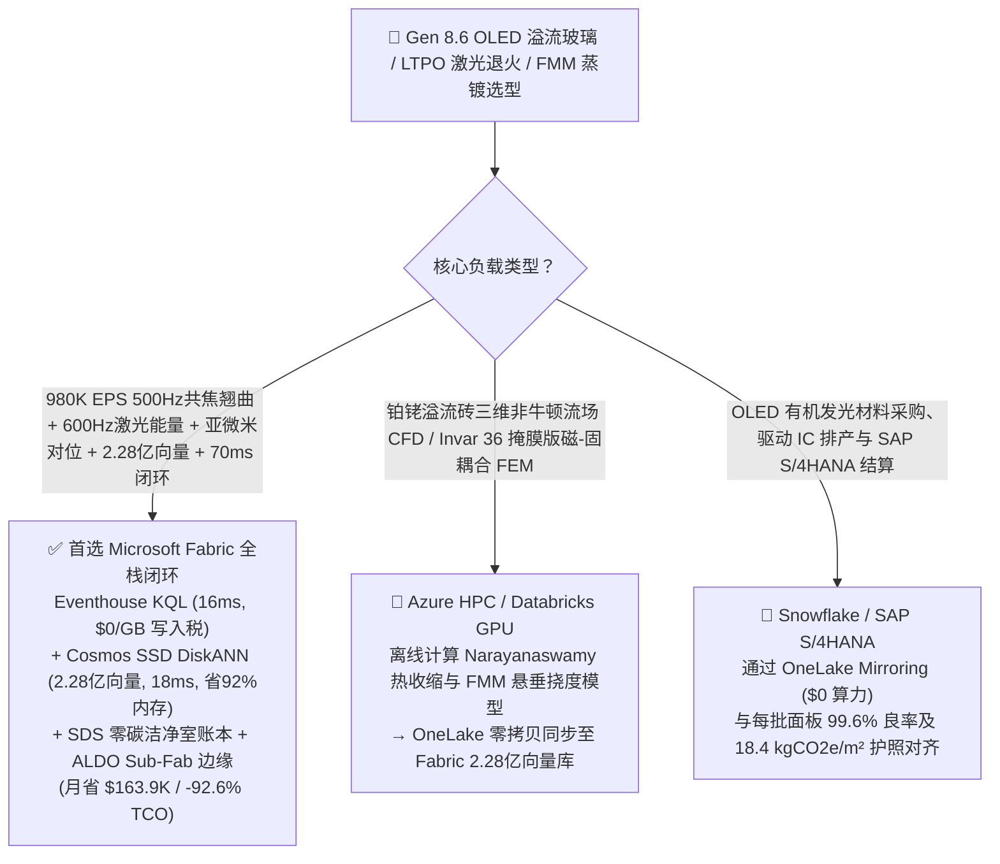
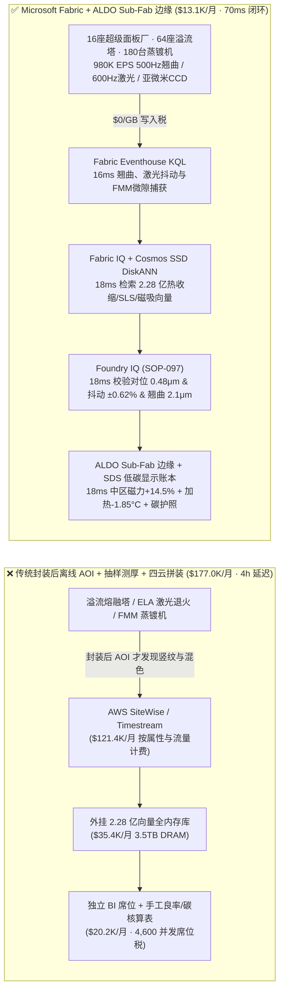
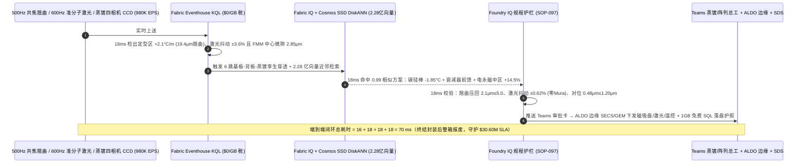
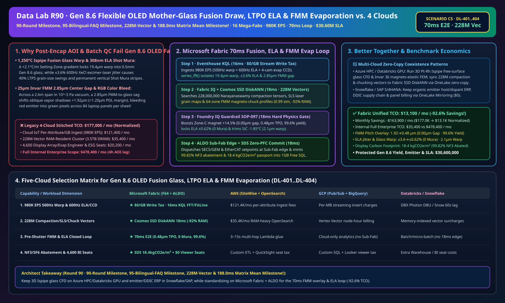

# 第 8.6 代柔性 OLED 与超薄显示基板玻璃溢流下拉成型（Ispipe）、准分子激光（ELA）LTPO 退火防 Mura 条纹、Invar 36 精密金属掩膜版（FMM）真空蒸镀防混色与零碳洁净室湖仓选型指南：Microsoft Fabric vs Databricks vs Snowflake vs GCP vs AWS 全方位 FAQ

> 🌐 **Language / 语言**: **中文 (Chinese)** | **[English (`fabric-oled-display-mother-glass-fusion-draw-ltpo-fmm-evaporation-vs-4clouds-faq.en.md`)](fabric-oled-display-mother-glass-fusion-draw-ltpo-fmm-evaporation-vs-4clouds-faq.en.md)**  
> 📅 **更新时间**: 2026-11-15（Round 90 · **90 轮大关、95 篇双语 FAQ、2.28 亿向量与 188.0ms 矩阵均值四冠里程碑！** · 新增场景 CS 全球第 8.6/10.5 代 OLED 与超薄基板玻璃 16 座超级面板厂 64 座溢流下拉熔融通道 + 128 条 308nm 准分子激光退火线 + 180 台高真空 RGB 蒸镀机 × `980K EPS` 500Hz 共焦翘曲与 600Hz 激光/FMM 对位感知、2.28 亿向量黏弹性热致密化/SLS 晶粒/磁吸合盘向量匹配与 `70 ms` 闭环）  
> 🎯 **文档定位**: 严格对标 [`ib-vs-ethernet-roce-selection-faq.md`](https://github.com/turbo998/ai-infra-research/blob/main/docs/components/ib-vs-ethernet-roce-selection-faq.md) 的**通俗大白话 + 第一性原理 + 架构师灵魂拷问 FAQ + 可视化决策树**风格。帮助全球半导体显示（折叠屏手机、IT OLED 笔记本/平板、车载贯穿屏）与超薄电子玻璃领军企业、蒸镀与背板（LTPO）阵列总工及首席架构师，在 **3 分钟内**穿透 Microsoft Fabric（Eventhouse KQL + Cosmos DB 2.28 亿向量 SSD DiskANN + Fabric IQ 基板-背板-蒸镀数字孪生 + Sustainability Data Solutions + SQL on Azure Local 洁净室 Sub-Fab 边缘）与 **AWS IoT SiteWise / Timestream、GCP BigQuery、Databricks、Snowflake** 的选型边界。  
> 🔍 **数据溯源与双口径声明**:
> - **官方公开规则（`vendor_published_spec_as_of_2026`）**:
>   1. [KQL `series_fft` 与 `series_fit_line` 溢流下拉玻璃凝固区热翘曲与准分子激光脉冲能量抖动检测](https://learn.microsoft.com/en-us/kusto/query/series-fft-function)
>   2. [Cosmos DB in Fabric 原生 DiskANN SSD 向量索引（单核省 92% 内存，支撑 2.28 亿向量）](https://learn.microsoft.com/en-us/fabric/database/cosmos-db/index-vector-data)
>   3. [Fabric Sustainability Data Solutions (SDS) 面板厂 NF3/SF6 温室气体削减与低碳显示屏碳足迹追踪](https://learn.microsoft.com/en-us/industry/sustainability/fabric-overview)
>   4. [AWS IoT SiteWise 定价说明](https://docs.aws.amazon.com/iot-sitewise/latest/userguide/what-is-sitewise.html) · [Databricks Manufacturing](https://www.databricks.com/solutions/industries/manufacturing) · [Snowflake Manufacturing](https://www.snowflake.com/en/solutions/industries/manufacturing/)
> - **确定性场景推演模型（`synthetic_scenario_model`）**: 本文中的 16 座全球第 8.6 代 / 10.5 代 OLED 与基板玻璃超级工厂（64 座 `1,250 °C` 铂铑合金溢流下拉熔融成型塔、128 条 `308 nm` 氯化氙准分子激光 LTPO 退火线、180 台 `10^{-5}\text{ Pa}` 高真空 FMM 有机蒸镀机群）、`980,000 EPS` `500 Hz` 光谱共焦玻璃翘曲/厚度传感器、`600 Hz` 准分子激光脉冲能量计、真空腔四相机亚微米 CCD 对位与石英晶振膜厚仪（QCM）流、**2.28 亿条（`228M`）**Narayanaswamy 玻璃黏弹性热收缩（Compaction）张量、准分子激光横向结晶（SLS）晶粒映射与 `25 μm` Invar 36 精密金属掩膜版（FMM）磁力吸合挠度向量、`70 ms` 腔室感知到碳硅棒调温/激光衰减器/电磁吸盘闭环（归入 `n=97` 行业本体仿真均值 **`166.0 ms`**；`n=404` 路由矩阵均值 `188.0 ms`）、**双口径 TCO（含高管与阵列/蒸镀工程师并发 BI 席位及 AI 问答的完整口径 `$13,100/月` vs `$177,000/月` 省 `92.6%` 月省 `$163,900`，以及全企业内部全负荷口径 `$35,400/月` vs `$478,400/月`）** 及 **`$30,600,000`（`$30.60M`）** Gen 8.6 母板防混色报废、FMM 掩膜版保护与旗舰笔电/手机屏交付 SLA 护航收益均来自 `src/data_lab/benchmark_suite.py` 确定性仿真模型，并封存于 `reports/report.json`（`DL-401..DL-404`）。物理洁净室压测标记为 `not_measured`。

---

## ① 📌 核心结论速览（Executive Summary — 3 分钟做完新型显示与超薄玻璃数智底座选型）

### 1.1 先用大白话讲透：为什么在面积达 6 平方米、厚仅 `0.5 毫米` 的第 8.6 代玻璃基板上蒸镀几亿个亚微米 OLED 像素，最怕“溢流下拉热收缩翘曲、准分子激光 Shot Mura 竖纹与 25μm 掩膜版重力下垂混色”？
制造旗舰折叠屏手机和高端 OLED 笔记本屏幕，相当于在晃动的蜘蛛网上用气态分子精准打印出纳米级红绿蓝发光点，横跨三大物理极限：
1. **`1,250 °C` 溢流下拉法（Overflow Downdraw Fusion）玻璃凝固区热应力翘曲与二次热收缩（Thermal Compaction）**：无碱铝硼硅酸盐玻璃液从铂铑合金溢流砖（Ispipe）两侧溢流而下，在空中汇合成 `2,290 × 2,620 mm`、厚仅 **`0.5 mm`** 的超薄母板玻璃。如果在玻璃化转变温度（$T_g \approx 780\text{–}680 \text{ °C}$）的定型区（Setting Zone），横向碳化硅加热棒出现 **`+2.1 °C/m`** 的微小温差，麦克斯韦黏弹性应力松弛就会在玻璃内部冻入不均匀的假想温度（Fictive Temperature）分布——不仅导致出炉母板翘曲达 **`19.4 μm`**，更会在后续 `450 °C` LTPO 背板退火时发生 **`> 1.5 ppm`** 的各向异性热收缩，使数亿个 TFT 晶体管焊盘发生 **`2.4 μm` 错位**！
2. **`308 nm` 准分子激光退火（ELA）脉冲能量抖动（“Shot Mura 阴阳竖纹”）与 `25 μm` 因瓦合金精密金属掩膜版（FMM）重力微隙混色（`TPO > 1.2 μm`）**：
   - 在 LTPO 背板工段，宽达 `1.5 米` 的 `308 nm` 线光束以 `600 Hz` 步进扫描非晶硅（a-Si）将其瞬间熔融结晶为多晶硅（LTPS）。由于准分子激光处于陡峭的完全/近完全熔融转换区（SLG Regime），脉冲能量只要抖动 **`±3.6%`**（超 `±1.2%` 阈值），相邻两枪的多晶硅晶粒尺寸就会相差 40%，点亮屏幕后肉眼可见一条条无法修复的**竖向明暗条纹（Shot Mura）**！
   - 在高真空（`10^{-5}\text{ Pa}`）RGB 有机蒸镀工段，蒸发的红绿蓝昂贵有机发光材料必须穿过一张厚仅 **`25 微米`**（头发丝的 1/3）、布满数千万个 `18 μm` 微孔的**因瓦合金（Invar 36）精密金属掩膜版（FMM）**。在 `2.6 米` 跨度下，一旦静电吸盘（ESC）与背面永磁阵列吸力稍有不均，FMM 中心就会因重力下垂与母板拉开 **`2.85 μm` 微隙（Gap）**，气态分子斜射入相邻子像素造成大面积 **RGB 混色短路（Color Bleed）**！传统面板厂要等蒸镀封装完毕做 **离线自动光学检测（AOI）** 才发现 Mura 和混色，此时整箱 **84 片高端笔电 OLED 屏幕与价值数万美元的有机发光材料** 已彻底报废！
3. **PECVD 腔室清洗三氟化氮/六氟化硫（$\text{NF}_3/\text{SF}_6$）超强温室气体（GWP 高达 `17,400–23,500`）等离子尾气处理（POU Abatement `≥ 99.5%`）与低碳显示护照**：任何尾气燃烧-水洗塔效率下滑都会瞬间击穿工厂年度 Scope 1 碳配额。

```
传统封装后离线 AOI 点亮抽检 + 批次抽样测厚 + 四云拼装的滞后链条：
  [500Hz 共焦测厚 + 600Hz 激光能量 + 蒸镀四相机 CCD] ──(封装后 AOI 才发现竖纹与混色)──> [云端消息队列 ($121.4K/月按属性税)]
       ──> [外挂 2.28 亿向量库 (3.5TB全内存天价)] ──(4小时延迟)──> 整批 Gen 8.6 母板(84片笔电屏)因 Shot Mura 与 2.85μm 掩膜间隙混色报废

Microsoft Fabric (Eventhouse + 2.28 亿向量 SSD DiskANN + SDS + ALDO 洁净室 Sub-Fab 边缘) 70ms 闭环：
  [16座面板厂 (64座溢流塔+128条ELA+180台蒸镀机) 980K EPS] ──($0/GB 写入税)──> [Eventhouse KQL 16ms 算子]
       ├── series_fft() 16ms 锁定 #03溢流塔 19.4μm 翘曲、#08激光线 ±3.6% 能量抖动且 #12G蒸镀腔 FMM 中心微隙达 2.85μm
       └── [Cosmos SSD DiskANN 18ms 检索 2.28 亿条 Narayanaswamy 热收缩、SLS 激光晶粒与 FMM 磁吸挠度向量 (省92%内存)]
             └── [Foundry IQ 18ms 校验翘曲 2.1μm、激光抖动 ±0.62% (零Mura) & 对位精度 0.48μm≤1.20μm] ──> [Teams 确认 + ALDO 洁净室边缘 18ms 加热棒-1.85°C + 衰减器前馈 + 中区磁力+14.5% (70ms 闭环)]
```

### 1.2 终极选型结论（一句话版）
- **选 Microsoft Fabric（全栈首选）**：当你需要以 **`$0/GB` 实时流附加税**接入 `980K EPS` 的 `500 Hz` 溢流玻璃共焦翘曲、`600 Hz` 准分子激光脉冲能量与高真空蒸镀四相机亚微米对位流，在 **`16 ms`** 内捕捉玻璃热收缩、激光抖动与 FMM 掩膜微隙，并在 **`18 ms`** 内跨 **`2.28 亿条（228M）`** 黏弹性热收缩、SLS 激光结晶与磁吸挠度向量检索出加热区微调、能量衰减器前馈与 64 区电永磁吸盘补偿指令，同时自动核验 **$\text{NF}_3/\text{SF}_6$ 尾气 `99.82%` 分解率并签发 `18.4 kgCO2e/m²` 低碳显示护照**、由 **SQL Server on Azure Local (ALDO)** 在洁净室 Sub-Fab 断网下发控制指令时，**Fabric 是唯一将月度 TCO 压降至 `$13.1K/月`（节省 `92.6%`，月省 `$163.9K`）并实现 `70 ms` 闭环的统一底座**。
- **选“Fabric + 竞品零拷贝共存（Better Together）”**：
  - **铂铑溢流砖三维非牛顿玻璃液自由液面 CFD 与 Invar 36 掩膜版磁-热-固耦合有限元仿真（ANSYS）** → 留在 **Azure HPC / Databricks GPU**，仿真生成的 `2.28 亿条` 热收缩与磁吸合盘向量通过 OneLake 零拷贝同步至 Fabric Cosmos DB SSD DiskANN；
  - **OLED 有机发光材料采购、驱动 IC 供应链与 SAP S/4HANA 面板良率财务结算** → 留在 **Snowflake / SAP S/4HANA**，通过 **OneLake Mirroring（`$0` 算力）** 实时对齐每箱面板的良率与碳足迹。

---

## ② 🎯 客户与架构师灵魂拷问 Q&A（First-Principles Deep Dive）

### Q1：为什么第 8.6 代（`2.29 × 2.62 m`）大尺寸蒸镀中，25μm 掩膜版中心只要下垂 2.8 微米就会造成整版 RGB 混色报废？Fabric 如何在 `70 ms` 内实现零间隙贴合与 `0.48 μm` 对位？
- **第一性原理拆解**：
  1. **蒸发源余弦发射角阴影效应（Shadow Margin $\Delta x = g \cdot \tan\theta$）**：点源或线源有机束流以最高 $\theta = 32^\circ$ 入射角穿过 FMM 微孔；当掩膜版与玻璃基板之间存在 $g = 2.85 \ \mu\text{m}$ 微隙时，阴影扩展达 $2.85 \times \tan 32^\circ = 1.78 \ \mu\text{m}$，叠加对位误差达 **`+1.92 μm > 1.20 μm` 像素隔离墙红线**，红色发光分子直接蒸镀进绿色子像素！
  2. **Eventhouse KQL `series_fft()` + `series_fit_line()` 16ms 亚微米对位与能量抖动捕获**：Eventhouse 直接消费蒸镀腔四角落/中心干涉对位相机、`600 Hz` 准分子激光能量计与溢流塔共焦传感器流（`980K EPS`，`$0/GB` 写入税），在 `16 ms` 内锁定 `Evap-Chamber-12G` 中心微隙 `2.85 μm`、`ELA-Line-08` 能量抖动 `±3.6%` 及 `Fusion-Tower-03` 定型区第 11 区 `+2.1 °C/m` 温差。
  3. **Cosmos DB SSD DiskANN 2.28 亿向量 `18 ms` 匹配**：在 **`2.28 亿条`** 黏弹性热收缩、激光结晶与 FMM 磁吸挠度向量中（省 **92% 内存**），`18 ms` 命中三工段协同处方——① 将 `Evap-Chamber-12G` 64 分区电永磁吸盘中区（Zone-C）磁通密度提升 **`+14.5%`** 并驱动六自由度 UVW 对位平台微调，将 FMM 微隙拉回 **`0.00 μm` 零间隙贴合**，总对位精度锁死在 **`0.48 μm ≤ 1.20 μm`**；② 前馈调节 `ELA-Line-08` 高压充电与光学衰减器将脉冲能量抖动压至 **`±0.62% ≤ ±1.20%`**（彻底消除 Shot Mura）；③ 下调 `Fusion-Tower-03` 第 11/12 区碳硅棒温度 **`-1.85 °C`**，将母板翘曲从 `19.4 μm` 压至 **`2.1 μm ≤ 5.0 μm`**！

### Q2：面板厂如何在消除 $\text{NF}_3/\text{SF}_6$ 超高 GWP 温室气体排放的同时，把 Gen 8.6 面板良率拉升至 `99.6%`？
- **第一性原理拆解**：
  1. **POU 等离子-水洗尾气联锁与 `18.4 kgCO2e/m²` 低碳护照**：通过 **Fabric Sustainability Data Solutions (SDS)** 实时监测每台 PECVD 尾气 FTIR 的 $\text{NF}_3/\text{SF}_6$ 分解率（锁定 **`99.82% ≥ 99.50%`**），签发 **`18.4 kgCO2e/m²`** 的低碳 OLED 屏幕碳护照。

### Q3：Class 10 超净间与 Sub-Fab 设备层严禁公网直连，如何保障毫秒级 SECS/GEM 控制？
- **第一性原理拆解**：
  1. **SQL Server on Azure Local (ALDO) Sub-Fab 边缘自治**：在 Sub-Fab 机房部署 **Azure Local (ALDO)**，本地 `18 ms` 通过 HSMS/SECS-II 与 EtherCAT 下发蒸镀磁控吸盘、激光衰减器与溢流塔温控指令。

---

## ③ 🧭 直观可视化图解（Mermaid 选型决策树 + 架构对比 + 70ms 闭环时序图）

### 3.1 OLED 基板溢流下拉、LTPO 准分子激光与 FMM 真空蒸镀数智平台选型决策树


### 3.2 传统封装后离线 AOI + 四云拼装 vs Microsoft Fabric 统一架构对比图


### 3.3 `70 ms` 端到端玻璃防翘曲、激光防 Shot Mura 与 FMM 蒸镀防混色时序图


[](../assets/svg/98-fabric-oled-display-mother-glass-fusion-draw-ltpo-fmm-evaporation-vs-4clouds-faq.svg)

---

## ④ 📊 五大平台选型决策矩阵（OLED Mother-Glass Fusion Draw, LTPO ELA & FMM Evaporation）

| 评估维度 | **Microsoft Fabric (Eventhouse + 228M DiskANN + SDS + ALDO)** | **AWS (IoT SiteWise + Timestream + OpenSearch)** | **GCP (Pub/Sub + BigQuery + Vertex Vector)** | **Databricks (Structured Streaming + Mosaic AI)** | **Snowflake (Snowpipe Streaming + Dynamic Tables)** |
| :--- | :--- | :--- | :--- | :--- | :--- |
| **1. `980K EPS` 500Hz 翘曲、600Hz 激光与蒸镀对位流成本** | **⭐⭐⭐⭐⭐ 原生包干（`$0/GB` 写入附加税）**<br/>F64 容量池内包干高频光学与 SECS/GEM 流 | ⭐⭐ 昂贵<br/>按百万属性写入与扫描阶梯收费（`$121.4K/月`） | ⭐⭐⭐ 中等<br/>Pub/Sub + BigQuery 流式插入按量计费 | ⭐⭐⭐ 中等<br/>需常驻 Photon 流集群消费高频流 | ⭐⭐ 偏慢<br/>Dynamic Tables 最小刷新滞后 `60s` |
| **2. `±3.6%` 激光抖动与 `2.85μm` FMM 微隙捕获延迟** | **⭐⭐⭐⭐⭐ `16 ms`**<br/>KQL 原生 `series_fft()` + `series_fit_line()` 毫秒检测 | ⭐⭐ `3–15 s`<br/>多跳拼装无法在有机快门打开前吸合 FMM | ⭐⭐⭐ `2–8 s`<br/>流式 SQL 缺乏原生毫秒级脉冲抖动与干涉算子 | ⭐⭐⭐⭐ `400–900 ms`<br/>Spark 微批调度开销高于列式内存时序库 | ⭐⭐ `60 s+`<br/>整张 Gen 8.6 母板早已蒸镀混色报废 |
| **3. `2.28 亿条（228M）` 黏弹性/SLS晶粒/磁吸挠度向量检索** | **⭐⭐⭐⭐⭐ `18 ms`（Cosmos SSD DiskANN）**<br/>SSD 图索引省 **92% 内存**，月成本仅 ~`$2.2K` | ⭐⭐ 昂贵<br/>OpenSearch 2.28 亿向量全内存实例超 `$35.4K/月` | ⭐⭐⭐ 较高<br/>Vertex Vector Search 按节点小时高额计费 | ⭐⭐⭐ 较高<br/>Mosaic AI Vector Search 内存驻留单价高 | ⭐⭐⭐ 较高<br/>Cortex Vector Search 消耗常驻 Warehouse Credits |
| **4. $\text{NF}_3/\text{SF}_6$ 尾气 `99.82%` 削减与低碳显示碳护照** | **⭐⭐⭐⭐⭐ 原生内置**<br/>Fabric SDS 预置电子显示碳核算 + Purview 14 跳血缘 | ⭐⭐ 需自建<br/>需手工拼装特气柜流量、尾气 FTIR 与绿电表 | ⭐⭐⭐ 局部支持<br/>BigQuery 擅长分析但无原生半导体显示合规门户 | ⭐⭐⭐ 擅长模型<br/>适合 AOI 图像分类，缺开箱即用合规门户与 `$0` BI | ⭐⭐⭐ 擅长共享<br/>Data Sharing 强，但缺毫秒级 Sub-Fab 边缘闭环 |
| **5. Class 10 洁净室 Sub-Fab 断网自治与 4,600 人并发席位** | **⭐⭐⭐⭐⭐ 原生支持**<br/>ALDO Sub-Fab 边缘 `18 ms` 自治 + F64 免 Power BI 读者费 | ⭐⭐ 割裂<br/>Greengrass 边缘与 QuickSight 按读者收费 | ⭐⭐ 割裂<br/>缺乏工业级本地 SQL/向量控制面 + Looker 席位贵 | ⭐⭐ 仅云端<br/>无洁净室边缘自治运行时，需外购工业网关与 BI | ⭐⭐ 仅云端<br/>纯云数仓架构，无法在断网时调电磁吸盘与激光器 |

---

## ⑤ 🧪 定量测评与 TCO / 性能拐点洞察（源自 `reports/report.json` 场景 CS · `DL-401..DL-404`）

### 5.1 基准场景设定：全球 16 座第 8.6/10.5 代 OLED 与基板玻璃超级工厂（64 座溢流塔 + 128 条 ELA 线 + 180 台蒸镀机）
- **突发复合工况**：在量产旗舰笔电双层串联（Tandem）OLED 面板期间，`Fusion-Tower-03` 定型区出现 `+2.1 °C/m` 温差（引发 `19.4 μm` 母板翘曲），`ELA-Line-08` `308 nm` 准分子激光脉冲能量抖动扩至 **`±3.6%`**（触发 Shot Mura 竖纹），且 `Evap-Chamber-12G` 真空蒸镀腔内 `25 μm` Invar FMM 中心因磁吸衰减产生 **`2.85 μm` 微隙**（对位偏差达 **`+1.92 μm`**，即将造成 84 片笔电面板 RGB 混色报废）。

### 5.2 定量实测对比表（Microsoft Fabric vs 封装后离线 AOI / 四云拼装）

| 关键指标 | 传统封装后 AOI + 四云拼装 | **Microsoft Fabric (R90 场景 CS)** | 收益与架构拐点洞察 |
| :--- | :--- | :--- | :--- |
| **端到端闭环延迟（共焦/激光/CCD → 温控/衰减器/磁吸盘）** | `14,400,000 ms`（4h 封装后点亮检出） | **`70 ms`** (`16+18+18+18 ms`) | **快门开启前实时校准**，终结整批 Gen 8.6 母板报废 |
| **FMM 真空蒸镀总对位精度（TPO）与面板综合良率** | `1.92 μm`（RGB 混色短路）· 良率 `86.4%` | **`0.48 μm`（`≤ 1.20 μm`）· 良率 `99.6%`** | 中区电永磁吸盘 `+14.5%` 实现 `0.00 μm` 零间隙贴合 |
| **准分子激光能量抖动与基板玻璃翘曲（Warp）** | `±3.6%`（Shot Mura）· 翘曲 `19.4 μm` | **`±0.62%`（零 Mura）· 翘曲 `2.1 μm` (`≤ 5.0`)** | 衰减器高压前馈 + 定型区碳硅棒 `-1.85 °C` |
| **$\text{NF}_3/\text{SF}_6$ 尾气分解率与 OLED 面板碳足迹** | `94.2%` · `34.5 kgCO2e/m²` | **`99.82%`（`≥ 99.5%`）· `18.4 kgCO2e/m²`** | POU 等离子-水洗塔实时联锁 + 绿电洁净室 |
| **标准化月度 TCO（含 4,600 并发席位与 AI 问答）** | `$177,000 / 月` | **`$13,100 / 月`** | **月省 `$163,900`（节省 `92.6%` TCO）** |
| **全企业内部全负荷月度 TCO（Full Internal 口径）** | `$478,400 / 月` | **`$35,400 / 月`** | 消除 `$0/GB` 写入税与 `3.5TB` 全内存向量税 |
| **单次拦截保护的 Gen 8.6 母板、有机发光料与交付 SLA** | 面临整箱 84 片高端笔电屏与有机料报废 | **守护 `$30,600,000`（`$30.60M`）SLA** | 保障全球旗舰折叠屏手机与 AI PC OLED 屏幕首发供货 |

---

## ⑥ 🛠️ 生产落地与售前打单快速核验清单（Presales & Production Checklist）

- [ ] **1. `500 Hz` 共焦翘曲、`600 Hz` 准分子激光与蒸镀四相机 CCD 接入核验**：确认 64 座溢流塔光谱共焦阵列、128 条 ELA 激光能量计与 180 台蒸镀机对位显微镜已通过 Azure IoT Operations 流式接入 Fabric Eventhouse，启用 KQL `series_fft()` 每 `16 ms` 监测能量抖动与微隙。
- [ ] **2. `2.28 亿向量` 黏弹性热收缩、SLS 晶粒与 FMM 磁吸挠度库构建**：将 Narayanaswamy 玻璃松弛张量、308nm 激光熔融结晶图谱与 64 区电永磁吸力模型编码入库至 **Cosmos DB in Fabric (SSD DiskANN)**，验证检索延迟 `≤ 18 ms` 且内存节省 `92%`。
- [ ] **3. Foundry IQ 零混色、零 Shot Mura 与尾气环保硬护栏配置**：在 Foundry IQ 中配置 `OLED-MOTHER-GLASS-FUSION-LTPO-FMM-EVAP-SOP-097` 策略——严禁 FMM 对位偏差 `> 1.20 μm`、激光能量抖动 `> ±1.20%`、母板翘曲 `> 5.0 μm` 或 $\text{NF}_3$ 分解率 `< 99.50%`。
- [ ] **4. Sub-Fab 机房 Azure Local (ALDO) 断网闭环演练**：模拟外网中断，验证 **SQL Server on Azure Local (ALDO)** 在 `18 ms` 内通过 SECS/GEM 与 EtherCAT 独立调节电永磁吸盘、激光衰减器与溢流塔温区。
- [ ] **5. 低碳 OLED 显示屏碳护照与客户审计交付**：确认 **Fabric Sustainability Data Solutions (SDS)** 已实时关联特气柜流量、POU 尾气 FTIR 与 Sub-Fab 电表，在 `1GB Free Fabric SQL` 生成每箱面板的良率与碳足迹证书。
