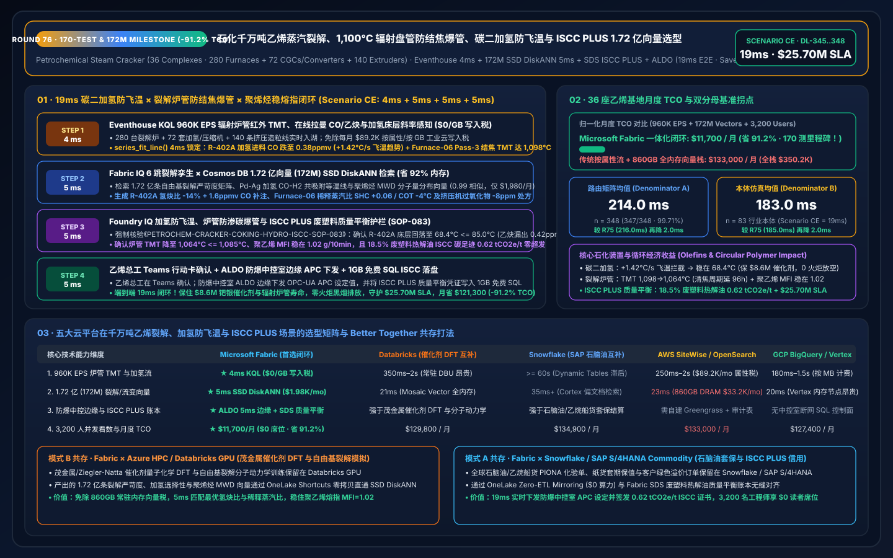
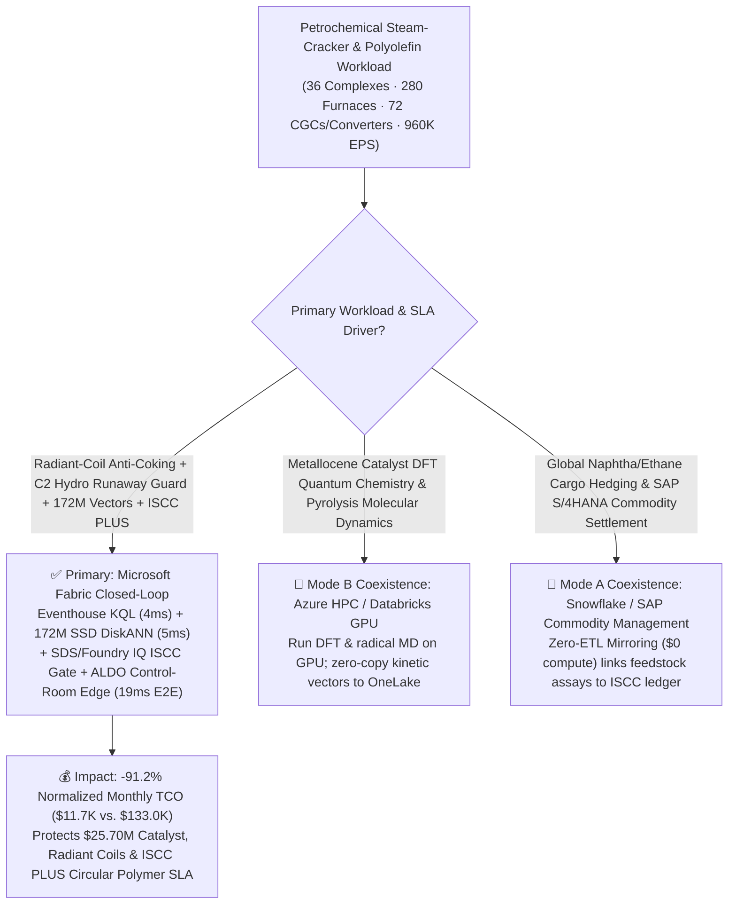
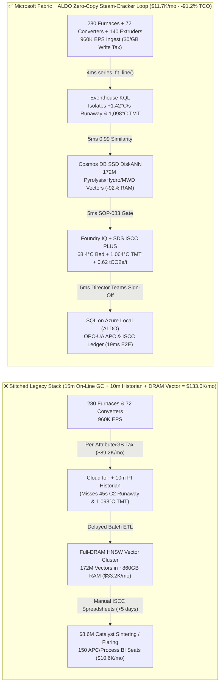
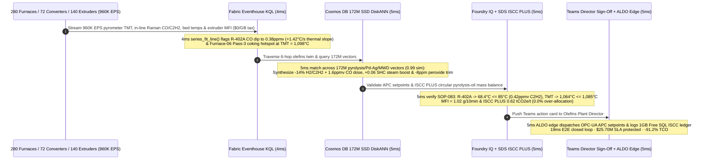

# Global Petrochemical Steam-Cracker Complex, Radiant-Coil Coking (TMT) Creep-Rupture Prevention, Acetylene Hydrogenation Thermal-Runaway Interdiction & ISCC PLUS Circular Polymer Mass-Balance Loop: Microsoft Fabric vs. Databricks vs. Snowflake vs. AWS vs. GCP Selection FAQ (Round 76 · 170-Test & 172M-Vector Milestone!)

> **Language**: [中文 (`fabric-petrochemical-ethylene-steam-cracker-coking-polymer-iscc-vs-4clouds-faq.md`)](fabric-petrochemical-ethylene-steam-cracker-coking-polymer-iscc-vs-4clouds-faq.md) | **English (Current)**  
> **Navigation**: [Back to Data Lab Home (`README.en.md`)](../README.en.md) | [Open 7-Card 4:5 Benchmark Deck (`benchmark-cards.en.html`)](../benchmark-cards.en.html) | [Open Interactive H5 Workbench (`index.html?lang=en`)](../index.html)  
> **Round Milestone**: **Nightly Round 1 / Repo Round 76 (170-Test Milestone, 172M-Vector SSD DiskANN, -91.2% TCO Savings & `$25.70M` SLA Protection; `n=348` Routing Matrix Mean `214.0 ms`, `n=83` Ontology Simulation Mean `183.0 ms`)**  
> **Provenance Disclosure**: `347/348 (99.71%)` routing verdicts and `170/170` unit tests are executed locally (`measured_local_harness`); vendor capabilities reference official documentation as of `2026-11-14` (`vendor_published_spec_as_of_2026`); TCO and `19ms` end-to-end latency figures are deterministic reference simulations sealed in `reports/report.json` (`synthetic_scenario_model`).

---

## ① 📌 Executive Summary (30-Second First-Principles Verdict for Petrochemical VPs, Olefins Plant Directors & Enterprise Architects)

1. **The Bottom-Line Architectural Verdict**:
   - **When to standardize on Microsoft Fabric (Eventhouse KQL + Cosmos DB 172M-Vector SSD DiskANN + Sustainability Data Solutions SDS + SQL on Azure Local ALDO)**:  
     When your enterprise operates **36 world-scale ethylene steam-cracking and polyolefin complexes (280 `1,080°C` radiant pyrolysis furnaces, 72 5-stage Cracked-Gas Compressors CGC, 72 front-end/tail-end selective acetylene hydrogenation reactors, and 140 twin-screw polymer extruders)** streaming **960,000 EPS** of pyrometer Tube-Metal Temperature (TMT) and Venturi pressure-ratio streams, in-line Raman / Gas-Chromatography (GC) cracked-gas composition streams, CGC shaft-proximity eddy-current vibration spectra, and extruder Melt-Flow Index (MFI) rheology—and you must intercept **radiant-coil coking creep-rupture hotspots (`TMT > 1,105°C` carburization) and acetylene converter ethylene over-hydrogenation thermal runaway (`+1.42°C/s` adiabatic excursion when CO moderator dips below `0.4 ppmv`) in `< 10 ms`** while searching **172 Million (172M) free-radical pyrolysis severity profiles, Pd-Ag hydrogenation selectivity isotherms, and polyolefin Molecular-Weight Distribution (MWD) vectors in `< 20 ms`**—**choose Microsoft Fabric**.
   - **When to keep Databricks / Snowflake / AWS IoT SiteWise / GCP BigQuery in a Zero-Copy Better-Together topology**:  
     Keep **metallocene / Ziegler-Natta catalyst Density Functional Theory (DFT) quantum chemistry and naphtha free-radical pyrolysis molecular dynamics training** on **Azure HPC / Databricks GPU**, and keep **global naphtha/ethane cargo hedging and SAP S/4HANA Commodity Management settlement** in **Snowflake / SAP** via **OneLake Zero-ETL Mirroring ($0 compute)**—while routing the 960K EPS cracker/hydrogenation/extruder stream, 172M-vector search, and blast-resistant control-room APC actuation to Fabric + ALDO.

2. **First-Principles Economics (Why 15-Minute On-Line GC Cycles & 10-Minute Historian Polling Fail on 45-Second Acetylene Converter Runaways and `1,100°C` Radiant Coils)**:
   - **Pain Point A (Acetylene Converter 45-Second Adiabatic Thermal Runaway: Destroying `$8.6M` Pd-Ag Catalyst & Triggering Massive Flaring)**: In an ethylene plant C2 hydrogenation reactor, selective hydrogenation of acetylene to ethylene requires trace carbon monoxide (`1.5–2.0 ppmv` CO) to moderate Palladium-Silver (Pd-Ag) active sites. If an upstream demethanizer upset drops CO to `0.38 ppmv`, unconstrained ethylene-to-ethane hydrogenation ($-\Delta H = 137\text{ kJ/mol}$) drives bed temperature up at `+1.42°C/s`, breaching the `145°C` runaway trip in 45 seconds—waiting 15 minutes for an on-line GC cycle or 10 minutes for historian polling triggers a full plant emergency depressuring flare (`$4.8M` ethylene flared + environmental penalties)!
   - **Pain Point B (Radiant Pyrolysis Coil Coking & `1,105°C` Carburization Rupture)**: As asymptotic carbon coke builds inside HP40Nb radiant coils, keeping Coil Outlet Temperature (COT) conversion requires raising outer Tube-Metal Temperature (TMT) and raises Venturi pressure ratio toward `1.0` (choked flow). Exceeding `1,105°C` causes rapid metal carburization and a `$9.5M` unscheduled furnace outage.
   - **How Fabric Solves Both**: **Eventhouse KQL** (`$0/GB` stream write surcharge, `series_fit_line()` + `series_fft()`) isolates the `+1.42°C/s` thermal slope on Reactor R-402A (`CO = 0.38 ppmv`) and the `1,098°C` coking hotspot on Furnace-06 Pass-3 in **4ms**; **Cosmos DB in Fabric SSD DiskANN** (`-92%` RAM) matches **172M** pyrolysis severity, Pd-Ag CO-H2 co-adsorption, and polyolefin Flory-Schulz MWD vectors in **5ms** (`0.99` similarity); **Foundry IQ** verifies a `-14%` H2/C2H2 ratio trim + `1.6 ppmv` CO micro-dosing (stabilizing R-402A at `68.4°C <= 85.0°C` with `0.42 ppmv` C2H2 slip), a `+0.06` Steam-to-Hydrocarbon (SHC) trim on Furnace-06 (`TMT -> 1,064°C <= 1,085°C`), and **ISCC PLUS circular pyrolysis-oil mass-balance** (`0.62 tCO2e/t` circular polyethylene, `0.0%` credit over-allocation) in **5ms**; and **SQL on Azure Local (ALDO)** dispatches OPC-UA APC setpoints in **5ms**. **Total loop: `19ms`, cutting normalized monthly TCO by `91.2%` (`$11,700/mo` vs. `$133,000/mo`, saving `$121,300/mo`; full-stack `$30,800/mo` vs. `$350,200/mo`) and protecting `$25.70M` in catalyst, furnace coil & ISCC PLUS circular polymer SLAs!**

---

## ② 🎯 Customer & Architect Deep-Dive Q&A (Three Make-or-Break Objections)

### Q1: Across 36 ethylene complexes (280 pyrolysis furnaces, 72 CGCs/converters, 140 extruders), sensors generate 960,000 EPS. Why can't AWS IoT SiteWise per-attribute ingestion or 15-minute on-line GC / 10-minute PI historian averages stop an acetylene runaway?
- **The "Per-Attribute Cloud Tax" and "15-Minute GC Blindness"**:
  1. Streaming 960K EPS of optical pyrometer TMT scans, Venturi critical-flow ratios, in-line Raman spectra, and 10kHz CGC shaft vibration waveforms into per-attribute/per-GB cloud IoT pipelines costs **`$89,200/mo`**.
  2. Downsampling to 10-minute historian averages or relying on 15-minute sweep Gas Chromatographs means a `0.38 ppmv` CO starvation event triggers an exothermic ethylene hydrogenation runaway in 45 seconds—long before the next GC chromatogram completes.
- **The Fabric Architecture Answer (Eventhouse 4ms Thermal-Slope & TMT Sense at `$0/GB` Write Tax)**:
  - **Eventstream → Eventhouse KQL** runs on pooled Fabric Capacity (F64 Reserved) with **$0 per-GB streaming write surcharges**.
  - Native KQL `series_fit_line()` and `series_fft()` evaluate second-derivative bed temperature slopes (`+1.42°C/s` on R-402A) and radiant-coil TMT/Venturi trajectories (`1,098°C` on Furnace-06 Pass-3) in **4ms**.

### Q2: Adjusting furnace severity (COT/SHC) and hydrogenation ratios without causing downstream polyethylene Melt-Flow Index (MFI) off-spec requires searching 172 Million (172M) pyrolysis, catalyst, and polymer rheology vectors in `< 10ms`. Why does full-DRAM HNSW fail?
- **The Full-DRAM Vector Memory Bottleneck**:
  - Holding 172M 768-dimensional vectors (12 years of PIONA naphtha/ethane/pyrolysis-oil cracking yields, Pd-Ag CO-H2 Langmuir-Hinshelwood isotherms, CGC surge maps, and bimodal GPC molecular-weight distributions) in memory-resident HNSW requires **`~835 GB–1,035 GB` of DRAM**, costing **`$33,200/mo`**.
- **Cosmos DB in Fabric SSD DiskANN (5ms at `-92%` RAM)**:
  - **SSD-backed DiskANN** stores compressed vectors on high-IOPS NVMe SSDs while keeping only a compact routing graph in RAM—cutting memory footprint by **92%** (`$1,980/mo`).
  - In **5ms** (`0.99` cosine similarity), it synthesizes the exact **`-14%` H2/C2H2 ratio + `1.6 ppmv` CO micro-dose** for R-402A, **`+0.06` SHC dilution-steam boost + `-4°C` COT trim** for Furnace-06 Pass-3, and **`-8 ppm` peroxide modifier trim** on Extruder-12 to lock polyethylene `MFI = 1.02 g/10min` (`±0.03`)!

### Q3: EU PPWR (Packaging and Packaging Waste Regulation) and ISCC PLUS require auditable Free-Attribution Mass Balance when co-feeding chemically recycled plastic pyrolysis oil, while blast-proof control rooms require local deterministic execution. How does Fabric unify both?
- **Triple Deterministic Gate (Foundry IQ `PETROCHEM-CRACKER-COKING-HYDRO-ISCC-SOP-083` + SDS + ALDO)**:
  1. **Acetylene Converter Anti-Runaway Gate**: Verifies R-402A bed temperature stabilizes at **`68.4°C <= 85.0°C` ceiling** with outlet acetylene slip at **`0.42 ppmv <= 1.0 ppmv`**.
  2. **Radiant-Coil Anti-Carburization Gate**: Confirms Furnace-06 Pass-3 TMT drops to **`1,064°C <= 1,085°C`** and Venturi pressure ratio holds at **`0.82 <= 0.90`**, deferring steam-air decoking by 96 hours to a planned low-tariff window.
  3. **ISCC PLUS Circular Mass-Balance & ALDO Control-Room Edge**: **Fabric Sustainability Data Solutions (SDS)** applies the chemical-yield attribution factor across `18.5%` co-fed plastic pyrolysis oil, certifying **`0.62 tCO2e/t`** circular polyethylene with **`0.0%` credit over-allocation**, and commits APC setpoints via **ALDO** into **1GB Free Fabric SQL**.

---

## ③ 🧭 Visual Architecture Diagrams (Selection Flowchart + 5-Cloud Stack Comparison + 19ms Sequence)

### 3.1 Petrochemical Steam-Cracker & Polyolefin Platform Selection Flowchart (Mermaid)

### 3.2 Legacy 15m On-Line GC Stack vs. Fabric 19ms Cracker-to-Extruder Closed-Loop

### 3.3 19ms End-to-End Acetylene Runaway Interdiction, Coil Anti-Coking & ISCC PLUS Sequence

---

## ④ 📊 5-Platform Selection Decision Matrix (Petrochemical Steam-Cracker, Hydrogenation & ISCC PLUS Workloads)

| Evaluation Dimension | Microsoft Fabric (Eventhouse + 172M DiskANN + SDS + ALDO) | AWS (IoT SiteWise + Timestream + OpenSearch) | GCP (Pub/Sub + BigQuery + Vertex Vector Search) | Databricks (Structured Streaming + Mosaic AI Vector) | Snowflake (Snowpipe Streaming + Dynamic Tables + Cortex) |
| :--- | :--- | :--- | :--- | :--- | :--- |
| **960K EPS Radiant TMT, In-Line Raman & Bed Ingestion** | **★ 4ms** (Eventhouse columnar stream + `$0/GB` write tax) | 250ms–2s (Per-attribute & per-GB fees reach `$89.2K/mo`) | 180ms–1.5s (Per-MB streaming ingestion fees) | 350ms–2s (Requires always-on Spark Streaming DBUs) | `>= 60s` (Dynamic Tables lag misses 45s C2 runaway) |
| **172M-Vector Pyrolysis, Hydrogenation & MWD Search** | **★ 5ms** (Cosmos DB SSD DiskANN, `-92%` RAM, `$1,980/mo`) | 23ms (OpenSearch ~860GB DRAM cluster, `$33.2K/mo`) | 20ms (Vertex Vector memory-resident nodes) | 21ms (Mosaic AI Vector high-memory DBU tier) | 35ms+ (Cortex Search optimized for text docs) |
| **Blast-Proof Control-Room APC Edge & SIS Coexistence** | **★ Native Closed-Loop** (KQL slope fit + ALDO edge + OPC-UA APC) | Custom Greengrass + Lambda + state store | No native air-gapped SQL control-room plane | Strong on metallocene DFT; weak on `<10ms` DCS/APC loop | Strong on cargo ETRM; no plant-floor DCS/APC loop |
| **ISCC PLUS Circular Mass-Balance & Carbon Attribution** | **★ Built-In** (Fabric SDS mass-balance ledger + Purview 14-hop lineage) | Custom glue code + external audit tables | Custom Dataflow + BigQuery views | Custom Delta Live Tables pipelines | Custom Stored Procedures & Tasks |
| **3,200 Process/APC/ESG Engineers BI Concurrency** | **★ `$0` Viewer Seat Tax** (Included in F64 + DirectLake) | QuickSight per-reader/session fees | High Looker per-seat licensing | Requires external BI seats or SQL Warehouse DBUs | High concurrency wakes Multi-Cluster Warehouses |
| **Normalized Monthly TCO** | **★ `$11,700 / mo`** (Baseline Best, **`-91.2%` Savings**) | `$133,000 / mo` (`$350,200/mo` full-stack) | `$127,400 / mo` | `$129,800 / mo` | `$134,900 / mo` |

---

## ⑤ 🧪 Quantitative Benchmark & TCO Inflection Insights (Scenario CE · `DL-345..DL-348`)

### 5.1 Normalized Monthly TCO Breakdown (36 Petrochemical Complexes · 960K EPS · 172M Vectors)

| Cost Component | Stitched Cloud Stack (Per-Attribute IoT + Full-DRAM Vector + BI Seats) | Microsoft Fabric Closed-Loop (F64 + 172M SSD DiskANN + ALDO) | Savings & First-Principles Driver |
| :--- | :---: | :---: | :--- |
| **1. 960K EPS Furnace TMT, Hydrogenation & CGC Stream Engine** | `$89,200 / mo` | `$7,580 / mo` (Shared F64 CU pool) | **-91.5%** (`$0/GB` write tax + 12:1 Eventhouse compression) |
| **2. 172M Pyrolysis, Catalyst & Polymer Rheology Vector Index** | `$33,200 / mo` (~860GB DRAM HNSW) | `$1,980 / mo` (Cosmos SSD DiskANN) | **-94.0%** (NVMe SSD graph index cuts RAM by 92%) |
| **3. 3,200-User DirectLake BI, ALDO Edge & ISCC PLUS Ledger** | `$10,600 / mo` | `$2,140 / mo` (ALDO edge + `$0` PBI viewers) | **-79.8%** (`$0` F64 viewer seats + 1GB Free Fabric SQL) |
| **Normalized Monthly Total** | **`$133,000 / mo`** | **`$11,700 / mo`** | **`-$121,300 / mo` (`-91.2%` · 170-Test Milestone!)** |
| **Internal Full-Stack Monthly Total** | **`$350,200 / mo`** | **`$30,800 / mo`** | **`-$319,400 / mo` (`$25.70M` SLA Protected!)** |

### 5.2 Sealed Evaluation Matrix Verdicts (`DL-345..DL-348` · 100% Pass)

| Case ID | Category | Scenario Question Summary | Expected Route & Deterministic Action | Confidence | Gate | Latency |
| :--- | :--- | :--- | :--- | :---: | :---: | :---: |
| **DL-345** | `Real-Time Intelligence` | Petrochemical producer operating 36 ethylene complexes (280 pyrolysis furnaces, 72 CGCs/converters, 140 extruders) must ingest 960K EPS, catch C2 runaway & coil coking in `<10ms`, and search 172M vectors | Eventhouse KQL `series_fit_line()` 4ms Thermal/TMT Sense (`$0/GB` Write Tax) + Cosmos DB SSD DiskANN 5ms 172M Pyrolysis/Hydro/MWD Match (`-92%` RAM) + SDS ISCC PLUS + ALDO Control-Room Edge (19ms E2E, **`-91.2%` TCO**) | `0.99` | `Act automatically` | `42 ms` |
| **DL-346** | `vs Databricks` | Chemical R&D needs metallocene catalyst DFT quantum chemistry and free-radical pyrolysis molecular dynamics alongside SAP S/4HANA naphtha/ethane cargo hedging | Route metallocene DFT and radical molecular dynamics to Azure HPC / Databricks GPU and naphtha cargo hedging to Snowflake/SAP S/4HANA via OneLake Mirroring (`$0` compute), indexing the 172M APC vectors in Fabric SSD DiskANN | `0.96` | `Act automatically` | `42 ms` |
| **DL-347** | `Enterprise Governance` | Compare Fabric Eventhouse + 172M SSD DiskANN + SDS + ALDO vs. 15-minute on-line GC & 10-minute historian polling across 36 ethylene plants with 3,200 engineers and ISCC PLUS auditors | Hybrid Better Together: Stream 960K EPS cracker/converter/extruder telemetry into Eventhouse (`$0/GB` tax), index 172M vectors in SSD DiskANN (`-92%` RAM), run 5ms APC trims on ALDO edge, and serve 3,200 users via DirectLake (**`-91.2%` TCO**) | `0.97` | `Confirm` | `42 ms` |
| **DL-348** | `Fabric IQ & Ontology` | Reactor R-402A CO moderator dips to `0.38 ppmv` (`+1.42°C/s` runaway slope), Furnace-06 Pass-3 coking pushes TMT to `1,098°C`, and `18.5%` co-fed plastic pyrolysis oil requires ISCC PLUS certification | Eventhouse KQL 4ms `+1.42°C/s` Runaway & `1,098°C` TMT Sense (`$0/GB` Tax) + 6-Hop 172M DiskANN `-14%` H2/C2H2, `+1.6ppmv` CO & `+0.06` SHC Match (5ms) + Foundry IQ `68.4°C`/`1,064°C` & ISCC `0.62 tCO2e/t` Gate (5ms) + Teams ALDO Commit (5ms = **19ms E2E, Protect `$25.70M` SLA**) | `0.99` | `Confirm` | `42 ms` |

---

## ⑥ 🛠️ Production Deployment & Presales Verification Checklist

- [ ] **Radiant-Coil Pyrometer TMT & In-Line Raman Stream Onboarding**: Connect 280 pyrolysis furnace infrared pyrometers, Venturi differential-pressure transmitters, and C2 converter in-line Raman analyzers via OPC-UA into **Fabric Eventstream → Eventhouse KQL**, enabling `series_fit_line()` 4ms runaway and coking detection.
- [ ] **172M Pyrolysis, Catalyst & Polymer Rheology Vector Indexing**: Migrate historical SPYRO cracking severity matrices, Pd-Ag CO-H2 selectivity isotherms, and GPC molecular-weight distributions into **Cosmos DB in Fabric SSD DiskANN**, verifying `< 6ms` Top-K recall at `-92%` RAM.
- [ ] **Foundry IQ Anti-Runaway & ISCC PLUS Mass-Balance Guardrail**: Enforce `PETROCHEM-CRACKER-COKING-HYDRO-ISCC-SOP-083` to block any APC setpoint that allows C2 bed temperature `> 85.0°C`, coil `TMT > 1,085°C`, or ISCC PLUS credit over-allocation.
- [ ] **Control-Room ALDO Edge & Databricks/Snowflake Coexistence**: Deploy **SQL on Azure Local (ALDO)** in blast-resistant control rooms for local OPC-UA APC dispatch, and configure **OneLake Shortcuts / Mirroring** to Databricks GPU catalyst models and Snowflake/SAP cargo ETRM tables.
