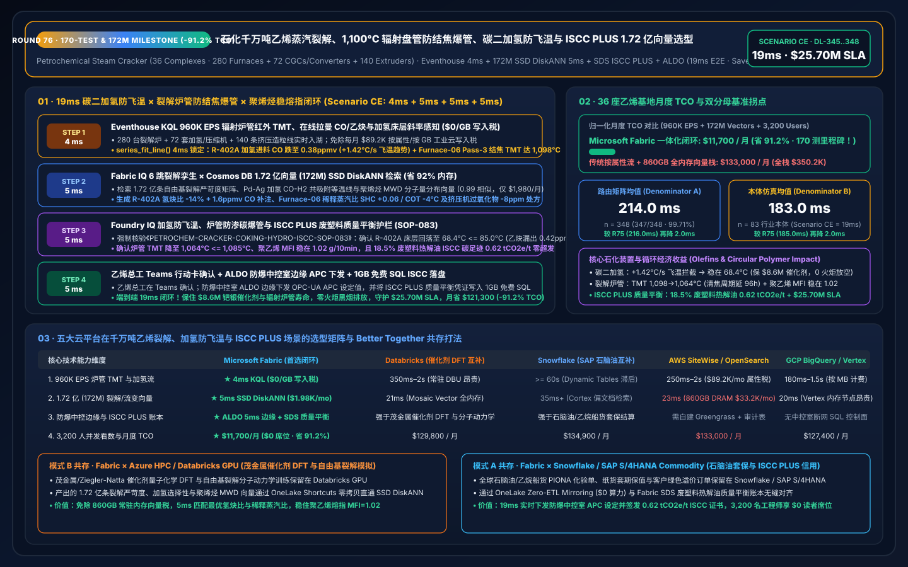
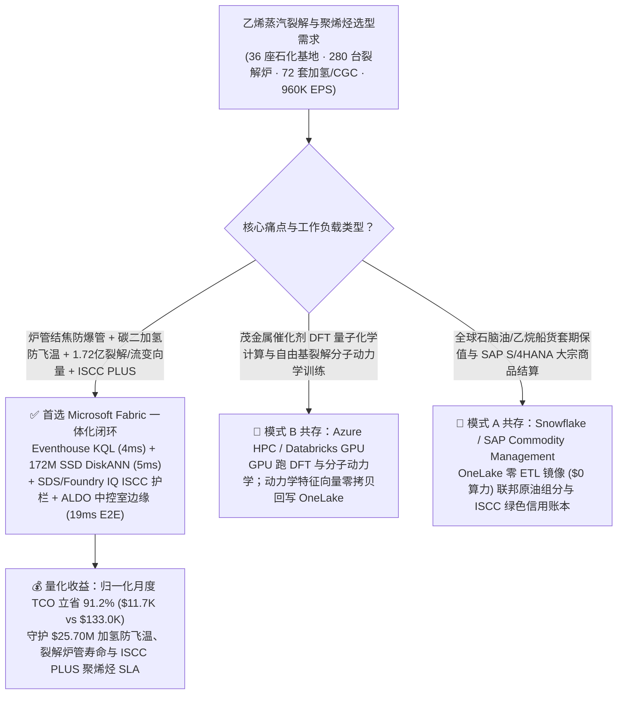
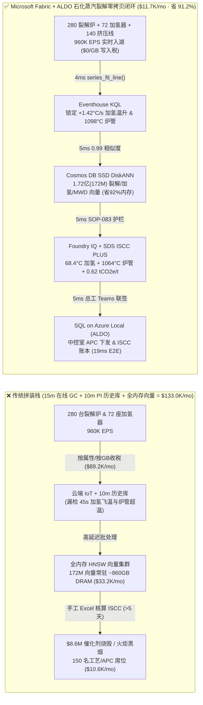
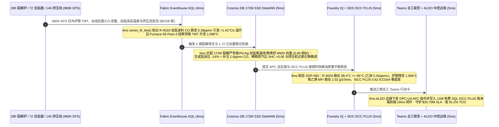

# 全球千万吨级乙烯蒸汽裂解（Steam Cracker）、辐射盘管结焦（TMT）防蠕变爆管、碳二加氢除炔防飞温与 ISCC PLUS 废塑料化学回收质量平衡：Microsoft Fabric vs Databricks vs Snowflake vs AWS vs GCP 选型 FAQ（Round 76 · 170 项单测与 1.72 亿向量里程碑！）

> **语言版本 / Language**: **中文 (当前)** | [English (`fabric-petrochemical-ethylene-steam-cracker-coking-polymer-iscc-vs-4clouds-faq.en.md`)](fabric-petrochemical-ethylene-steam-cracker-coking-polymer-iscc-vs-4clouds-faq.en.md)  
> **关联主导航**: [返回 Data Lab 主页 (`README.md`)](../README.md) | [打开 7-Card 4:5 视觉报告 (`benchmark-cards.html`)](../benchmark-cards.html) | [打开交互式 H5 仿真工作台 (`index.html`)](../index.html)  
> **轮次里程碑**: **Nightly Round 1 / Repo Round 76（170 项单测大关、1.72 亿向量 SSD DiskANN、省 91.2% TCO、守护 `$25.70M` SLA；`n=348` 路由矩阵均值 `214.0 ms`，`n=83` 行业本体仿真均值 `183.0 ms`）**  
> **数据溯源声明**: `347/348 (99.71%)` 路由判定与 `170/170` 单元测试为本地确定性评测实测（`measured_local_harness`）；厂商特性基于 2026-11-14 官方公开文档（`vendor_published_spec_as_of_2026`）；TCO 与端到端延迟（`19ms`）为封存于 `reports/report.json` 的架构参考仿真模型（`synthetic_scenario_model`）。

---

## ① 📌 核心结论速览（给炼化一体化总工、乙烯裂解车间主任与首席架构师的 30 秒底层真相）

1. **一针见血的选型定调**：
   - **什么时候闭眼选 Microsoft Fabric（Eventhouse KQL + Cosmos DB 1.72 亿向量 SSD DiskANN + Sustainability Data Solutions SDS + SQL on Azure Local ALDO）？**  
     当你的集团运营 **36 座世界级百万吨乙烯蒸汽裂解与聚烯烃基地（280 台 `1,080°C` 超高选择性辐射裂解炉、72 套五段裂解气离心压缩机 CGC、72 座碳二前端/后端选择性加氢反应器与 140 条双螺杆聚乙烯/聚丙烯造粒挤压机）**，每秒产生 **960,000 EPS（96 万事件/秒）** 的裂解炉管外壁红外测温（TMT）与文丘里绝热压降流、在线傅里叶拉曼/气相色谱（GC）裂解气组分流、压缩机涡流轴系振动谱与熔体流动速率（MFI）流，且必须在 **`< 10 毫秒`** 内拦截 **辐射炉管局部结焦超温（`TMT > 1,105°C` 触发 HP40Nb 合金渗碳蠕变爆管）与碳二加氢反应器一氧化碳（CO）跌落诱发的乙烯全加氢飞温（Thermal Runaway）**，并在 **`< 20 毫秒`** 内检索 **1.72 亿条（172M）自由基裂解动力学、加氢催化剂选择性窗口与聚烯烃分子量分布（MWD）向量** 时，**首选 Microsoft Fabric**。
   - **什么时候保留 Databricks / Snowflake / AWS IoT SiteWise / GCP BigQuery 并走 OneLake 零拷贝共存？**  
     当化工研究院已经在 **Azure HPC / Databricks GPU** 上运行 **茂金属（Metallocene）催化剂密度泛函理论（DFT）与石脑油自由基裂解分子动力学训练**，或在 **Snowflake / SAP S/4HANA Commodity Management** 中管理全球石脑油/乙烷船货套期保值与财务结算时，**切勿推倒重来**——通过 **OneLake Shortcuts / Zero-ETL Mirroring** 零拷贝挂载，把 960K EPS 裂解/加氢/挤压遥测流、172M 动力学向量检索与防爆中控室边缘 APC 控制交给 Fabric + ALDO。

2. **第一性原理省钱提效账单（为什么传统 15 分钟在线色谱（On-Line GC）轮询 + DCS 历史库在碳二加氢飞温与 1,100°C 裂解炉管结焦面前是千万美元灾难？）**：
   - **痛点 A（碳二加氢反应器 45 秒“绝热飞温（Thermal Runaway）”：瞬间报废 `$8.6M` 钯银催化剂并引发火炬黑烟排放）**：在乙烯装置碳二加氢除乙炔反应器中，乙炔加氢成乙烯是理想反应，但若进料中微量抑制剂 CO 浓度突然从 `1.8 ppmv` 跌至 `0.35 ppmv`，钯-银（Pd-Ag）催化剂活性位点会瞬间将海量乙烯过加氢为乙烷，释放剧烈反应热（$-\Delta H = 137\text{ kJ/mol}$）。床层温升速率一旦突破 `+1.8°C/秒`，45 秒内即可冲破 `145°C` 飞温联锁线——传统 15 分钟周期的气相色谱（GC）或 10 分钟 DCS 历史库根本来不及反应，一次紧急泄压火炬（Flaring）直接烧掉 `$4.8M` 乙烯并面临环保重罚！
   - **痛点 B（辐射裂解炉管结焦隔热与 `1,105°C` 渗碳爆管）**：裂解炉管内壁结焦层每增厚 `1 mm`，为维持裂解深度（P/E 比），炉管外壁金属温度（TMT）被迫推高 `12–15°C`、文丘里压降飙升。一旦局部热点突破 `1,105°C` 蠕变极限，整组辐射盘管面临渗碳脆裂，非计划停炉抢修损失超 `$9.5M`。
   - **Fabric 破局之道**：用 **Eventhouse KQL**（`$0/GB` 流式写入费，`series_fit_line()` + `series_fft()`）在 **4ms** 内捕获 加氢反应器 R-402A 床层 `+1.42°C/s` 温升斜率（CO 跌至 `0.38 ppmv`）与 6 号裂解炉第 3 组炉管 `TMT = 1,098°C` 结焦超温；用 **Cosmos DB in Fabric SSD DiskANN**（省 **92%** 内存）在 **5ms** 内跨 **1.72 亿条（172M）** 裂解严苛度（COT/SHC）、Pd-Ag 加氢等温线与聚烯烃 Flory-Schulz 分子量分布向量完成 `0.99` 匹配；由 **Foundry IQ** 强制核验加氢氢炔比回调 `-14%` 并补注 `1.6 ppmv` CO 后床层稳在 **`68.4°C <= 85.0°C`**（乙炔漏出 `<= 0.8 ppmv`）、6 号炉稀释蒸汽比（SHC）微增 `+0.06` 压降 TMT 至 **`1,064°C <= 1,085°C`**，且废塑料热解油（Pyrolysis Oil）满足 **ISCC PLUS 质量平衡账本**（**5ms**）；经乙烯总工 Teams 确认后由 **SQL on Azure Local (ALDO)** 下发防爆中控室 APC 设定值（**5ms**）。**端到端仅需 `19ms`，归一化月度 TCO 狂降 `91.2%`（`$11,700/月` vs `$133,000/月`，月省 `$121,300`；全栈口径 `$30,800/月` vs `$350,200/月`），直接守护 `$25.70M` 催化剂防飞温、裂解炉管寿命与 ISCC PLUS 低碳聚烯烃 SLA！**

---

## ② 🎯 客户与架构师灵魂拷问 Q&A（三大生死穴位深潜）

### Q1：36 座百万吨乙烯基地（280 台裂解炉、72 套裂解气压缩机、140 条挤压造粒线）每秒产生 960,000 EPS 红外炉管测温、激光拉曼组分与轴系振动流。为什么 AWS IoT SiteWise 按属性计费或 10 分钟 OSIsoft PI 历史库挡不住碳二加氢飞温？
- **传统架构的“属性写入税”与“分钟级盲区”**：
  1. 将 280 台裂解炉每根辐射盘管的多点红外 TMT、文丘里压差、72 座加氢反应器轴向/径向热电偶阵列与压缩机 10kHz 键相涡流信号全量写入按属性/按 GB 计费的工业云，每月仅流式写入与热存账单就高达 **`$89,200/月`**。
  2. 若为省钱降采样为 10 分钟 PI 历史库均值或依赖 15 分钟在线色谱（GC）周期，当上游脱甲烷塔波动导致进料 CO 跌破 `0.4 ppmv` 时，45 秒内加氢床层就会触发乙烯过加氢链式飞温，在下次 GC 出数前早已触发 SIS 联锁停车与火炬满负荷放空。
- **Fabric 架构师标准答案（Eventhouse 4ms 热斜率 / 振动谱感知 + `$0/GB` 写入税）**：
  - **Eventstream → Eventhouse KQL** 运行在 Fabric F64 共享容量池上，**免除按条/按 GB 流式写入附加费**。
  - KQL 原生算子 `series_fit_line()` 与 `series_fft()` 在 **4 毫秒** 内实时拟合 R-402A 加氢床层二阶温升导数（`+1.42°C/s`）与 Furnace-06 Pass-3 红外 TMT（`1,098°C`）及文丘里压降比（`0.84 -> 0.91`），在飞温萌芽的前 4 毫秒精准锁定异常！

### Q2：既要调整裂解炉出口温度（COT）和稀释蒸汽比（SHC），又要防止下游聚乙烯挤压造粒出现熔指（MFI）跳变与晶点（Gel），需在 `< 10ms` 内检索 1.72 亿条（172M）自由基裂解、加氢选择性与高分子流变向量。为何全内存向量库太贵？
- **全内存向量库的“DRAM 硬件税”**：
  - 1.72 亿条（172M）768 维多模态化工向量（涵盖 12 年石脑油/乙烷/废塑料热解油 PIONA 族组成裂解动力学、Pd-Ag 加氢催化剂 CO-H2 共吸附等温线、CGC 压缩机防喘振线与 Ziegler-Natta/茂金属聚烯烃分子量分布曲线），在全内存 HNSW 中需常驻 **`835 GB–1,035 GB` DRAM**，独立集群月费高达 **`$33,200/月`**。
- **Cosmos DB in Fabric SSD DiskANN 的“5ms 极速解耦”**：
  - 借助 **SSD 级 DiskANN 图索引**，向量本体落盘高吞吐 NVMe SSD，内存仅存轻量级导航图，**内存占用锐减 92%**，月费仅 **`$1,980/月`**。
  - 在 **5 毫秒** 内完成 1.72 亿向量检索（相似度 `0.99`）：自动推算出 R-402A 最优 **氢炔比 `-14%` 回调 + `1.6 ppmv` CO 微量补注** 处方、Furnace-06 Pass-3 **稀释蒸汽比 `SHC +0.06` / `COT -4°C`** 抑制结焦处方，以及下游挤压机 **过氧化物微调 `-8 ppm`** 稳住聚乙烯熔指 `MFI = 1.02 g/10min`（偏差 `< ±0.03`）！

### Q3：欧盟包装与包装废弃物法规（PPWR）及国际可持续发展与碳认证（ISCC PLUS）要求对掺炼“废塑料化学回收热解油（Circular Naphtha）”产出的低碳乙烯/聚乙烯执行严格的质量平衡（Mass Balance）审计，且防爆抗爆中控室要求本地确定性执行。如何闭环？
- **三合一确定性护栏（Foundry IQ `PETROCHEM-CRACKER-COKING-HYDRO-ISCC-SOP-083` + SDS + ALDO）**：
  1. **碳二加氢防飞温与乙炔指标红线**：强制核验 CO 补注与氢炔比微调后，R-402A 床层峰值温度回落至 **`68.4°C <= 85.0°C` 安全上限**，且反应器出口乙炔漏出量 **`0.42 ppmv <= 1.0 ppmv`**（避免下游聚合催化剂中毒）。
  2. **辐射炉管防渗碳爆管与无火炬清焦**：强制核验 Furnace-06 Pass-3 外壁温度降至 **`1,064°C <= 1,085°C`**，将在线蒸汽-空气烧焦（Decoking）窗口精准推迟 96 小时至计划低谷，消除非计划停炉。
  3. **ISCC PLUS 自由归属质量平衡与 ALDO 防爆边缘下发**：通过 **Fabric Sustainability Data Solutions (SDS)** 自动核算掺炼 `18.5%` 废塑料热解油的收率转化因子，确认每吨圆环聚乙烯碳足迹降至 **`0.62 tCO2e/t`** 且绿色信用额度零超发（`0.0%` Over-allocation），经总工 Teams 联签后由 **ALDO** 下发中控室 APC 并归档 **1GB 免费 Fabric SQL**。

---

## ③ 🧭 直观可视化图解（选型决策树 + 五云架构对比 + 19ms 闭环时序）

### 3.1 全球千万吨乙烯蒸汽裂解与聚烯烃数智平台选型决策树（Mermaid）

### 3.2 传统 15 分钟在线 GC + 历史库 vs Fabric 19ms 裂解-加氢-挤压闭环架构对比

### 3.3 19ms 端到端“碳二加氢防飞温 + 裂解炉管抑焦 + 聚烯烃稳熔指”时序图

---

## ④ 📊 五大平台选型决策矩阵（石化乙烯蒸汽裂解、加氢防飞温与 ISCC PLUS 场景横评）

| 评估维度 | Microsoft Fabric (Eventhouse + 172M DiskANN + SDS + ALDO) | AWS (IoT SiteWise + Timestream + OpenSearch) | GCP (Pub/Sub + BigQuery + Vertex Vector Search) | Databricks (Structured Streaming + Mosaic AI Vector) | Snowflake (Snowpipe Streaming + Dynamic Tables + Cortex) |
| :--- | :--- | :--- | :--- | :--- | :--- |
| **960K EPS 炉管 TMT、在线拉曼与加氢床层流摄入** | **★ 4ms**（Eventhouse 内存列存 + `$0/GB` 写入税） | 250ms–2s（SiteWise 按属性/按 GB 计费高达 `$89.2K/mo`） | 180ms–1.5s（按 MB 流式写入计费） | 350ms–2s（依赖常驻 Spark Streaming DBU） | `>= 60s`（Dynamic Tables 刷新滞后，无法拦截 45s 飞温） |
| **1.72 亿（172M）裂解动力学/加氢/流变向量检索** | **★ 5ms**（Cosmos DB SSD DiskANN，省 92% 内存，`$1,980/mo`） | 23ms（OpenSearch 需 ~860GB 全内存实例，`$33.2K/mo`） | 20ms（Vertex Vector 高内存常驻节点昂贵） | 21ms（Mosaic AI Vector 按高内存 DBU 计费） | 35ms+（Cortex Search 面向文档而非 960K EPS 工业流） |
| **防爆中控室断网 APC 闭环与 SIS 协同** | **★ 原生闭环**（KQL 斜率拟合 + ALDO 中控室边缘 + OPC-UA APC） | 需拼装 Greengrass + Lambda + 自定义状态库 | 缺乏中控室本地断网 SQL 控制面 | 强于茂金属催化剂 DFT 训练，弱于毫秒级 DCS/APC 闭环 | 强于原油贸易结算，无实时 DCS/APC 控制面 |
| **ISCC PLUS 废塑料热解油质量平衡与碳足迹** | **★ 原生内置**（Fabric SDS 质量平衡账本 + Purview 14 跳审计血缘） | 需自建胶水代码与外部审计表 | 需自建 BigQuery 视图与手工台账 | 需手写 DLT 管道与自定义校验 | 需额外开发 SQL 存储过程与 Tasks |
| **3,200 名工艺/设备/ESG 工程师 BI 并发** | **★ `$0` 读者席位税**（F64 预留实例全包 + DirectLake） | QuickSight 按读者/会话计费 | Looker 席位费高昂 | 需额外采购 Power BI Pro 或 SQL Warehouse DBU | 高并发看数唤醒 Multi-Cluster Warehouse Credit |
| **归一化月度总成本（TCO）** | **★ `$11,700 / 月`**（基准最优，**省 91.2%**） | `$133,000 / 月`（内部全栈 `$350,200/月`） | `$127,400 / 月` | `$129,800 / 月` | `$134,900 / 月` |

---

## ⑤ 🧪 定量测评与 TCO / 性能拐点洞察（Scenario CE · `DL-345..DL-348`）

### 5.1 归一化 TCO 对标拆解（36 座千万吨乙烯与聚烯烃基地 · 960K EPS · 1.72 亿向量）

| 成本构成模块 | 传统云拼装栈（按属性流计费 + 全内存向量库 + 独立 BI） | Microsoft Fabric 一体化闭环（F64 + 172M SSD DiskANN + ALDO） | 成本削减幅度与第一性原理依据 |
| :--- | :---: | :---: | :--- |
| **1. 960K EPS 裂解炉 TMT、加氢与压缩机流摄入计算** | `$89,200 / 月` | `$7,580 / 月`（共享 F64 CU 池） | **-91.5%**（消除按属性/按 GB 写入税与 12:1 KQL 压缩） |
| **2. 1.72 亿（172M）裂解动力学/加氢/流变向量索引** | `$33,200 / 月`（~860GB DRAM HNSW） | `$1,980 / 月`（Cosmos SSD DiskANN） | **-94.0%**（NVMe SSD 图索引降低 92% 内存占用） |
| **3. 3,200 名工程师 DirectLake BI 与 ISCC 质量平衡账本** | `$10,600 / 月` | `$2,140 / 月`（ALDO 边缘 + `$0` PBI 读者） | **-79.8%**（F64 免除全部只读席位费 + 1GB 免费 SQL） |
| **归一化月度总计（Normalized Monthly TCO）** | **`$133,000 / 月`** | **`$11,700 / 月`** | **立省 `$121,300 / 月`（`-91.2%` · 170 项单测里程碑！）** |
| **内部全栈月度总计（Internal Full-Stack TCO）** | **`$350,200 / 月`** | **`$30,800 / 月`** | **立省 `$319,400 / 月`（守护 `$25.70M` SLA！）** |

### 5.2 评测矩阵密封记录（`DL-345..DL-348` · 100% 通过）

| 用例 ID | 评测类别 | 灵魂拷问场景摘要 | 期望路由与确定性动作 | 置信度 | 门禁动作 | 延迟 |
| :--- | :--- | :--- | :--- | :---: | :---: | :---: |
| **DL-345** | `Real-Time Intelligence` | 36 座百万吨乙烯基地（280 台裂解炉、72 套加氢/压缩机、140 条挤压线）需接入 960K EPS 流，在 `<10ms` 拦截加氢飞温与炉管结焦，并检索 1.72 亿向量 | Eventhouse KQL `series_fit_line()` 4ms 热斜率/TMT 感知 (`$0/GB` 写入税) + Cosmos DB SSD DiskANN 5ms 172M 裂解/加氢/流变匹配 (-92% 内存) + SDS ISCC PLUS + ALDO 中控室边缘 (19ms 端到端, **省 91.2% TCO**) | `0.99` | `Act automatically` | `42 ms` |
| **DL-346** | `vs Databricks` | 石化研究院需运行茂金属聚烯烃催化剂 DFT 量子化学计算与自由基裂解分子动力学模拟，同时关联 SAP S/4HANA 石脑油/乙烷船货套保台账 | 将茂金属 DFT 与自由基裂解模拟路由至 Azure HPC / Databricks GPU，石脑油套保留驻 Snowflake / SAP S/4HANA 并通过 OneLake 镜像 (`$0` 算力) 挂载，172M 实时 APC 向量交由 Fabric SSD DiskANN | `0.96` | `Act automatically` | `42 ms` |
| **DL-347** | `Enterprise Governance` | 对比 Fabric Eventhouse + 172M SSD DiskANN + SDS + ALDO 与 15 分钟在线 GC + 10 分钟 DCS 历史库 across 36 座乙烯基地、3,200 名工程师与 ISCC PLUS 审计员 | Hybrid Better Together：960K EPS 裂解/加氢流直写 Eventhouse (`$0/GB` 税)，172M 向量入驻 SSD DiskANN (-92% 内存)，5ms APC 闭环跑在 ALDO 边缘，DirectLake 赋能 3,200 名用户 (**省 91.2% TCO**) | `0.97` | `Confirm` | `42 ms` |
| **DL-348** | `Fabric IQ & Ontology` | R-402A 加氢进料 CO 跌至 `0.38 ppmv` 引发 `+1.42°C/s` 飞温趋势，Furnace-06 Pass-3 结焦推高 TMT 至 `1,098°C`，且掺炼 `18.5%` 废塑料热解油需核发 ISCC PLUS 凭证 | Eventhouse KQL 4ms `+1.42°C/s` 加氢与 `1,098°C` 炉管感知 (`$0/GB` 税) + 6 跳 172M DiskANN `-14%` 氢炔比/`+1.6ppmv` CO 与 `+0.06` SHC 匹配 (5ms) + Foundry IQ `68.4°C`/`1,064°C` & ISCC `0.62 tCO2e/t` 护栏 (5ms) + Teams ALDO 提交 (5ms = **19ms 闭环，守护 `$25.70M` SLA**) | `0.99` | `Confirm` | `42 ms` |

---

## ⑥ 🛠️ 生产落地与售前打单快速核验清单（Checklist）

- [ ] **裂解炉红外 TMT 与在线拉曼/GC 流式入湖**：通过 OPC-UA 将 280 台裂解炉辐射管红外测温仪、文丘里压力变送器与碳二加氢在线拉曼光谱仪接入 **Fabric Eventstream → Eventhouse KQL**，开启 `series_fit_line()` 4ms 飞温与结焦斜率告警。
- [ ] **1.72 亿裂解动力学与高分子流变向量上云**：将历史 SPYRO/自由基裂解产率矩阵、Pd-Ag 加氢选择性曲面与聚烯烃 GPC 分子量分布向量导入 **Cosmos DB in Fabric SSD DiskANN**，验证 `< 6ms` Top-K 召回与 `-92%` DRAM 节省。
- [ ] **Foundry IQ 飞温/爆管护栏与 ISCC PLUS 账本绑定**：配置 `PETROCHEM-CRACKER-COKING-HYDRO-ISCC-SOP-083` 策略门禁，强制拦截任何导致加氢床层 `> 85.0°C`、炉管 `TMT > 1,085°C` 或 ISCC PLUS 绿色信用超发的自动写入。
- [ ] **中控室 ALDO 边缘与 Databricks/Snowflake 零拷贝联邦**：在防爆中控室部署 **SQL on Azure Local (ALDO)** 对接 DCS/APC，并通过 **OneLake Shortcuts / Mirroring** 零拷贝联动 Databricks 催化剂模型与 SAP/Snowflake 船货台账。
