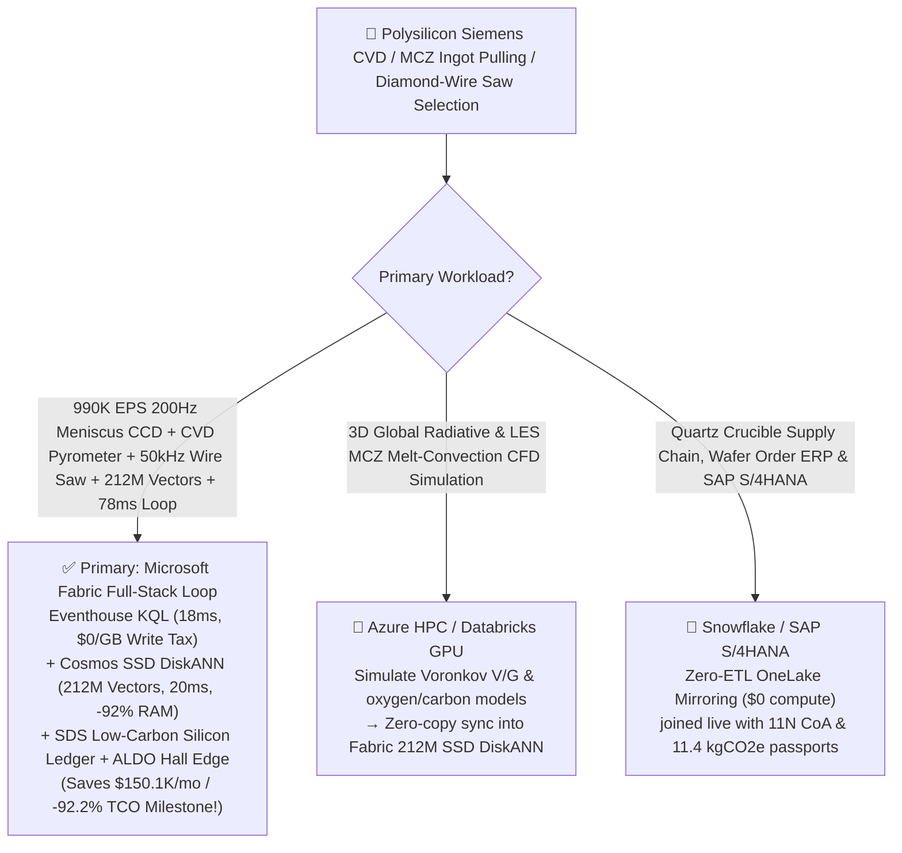
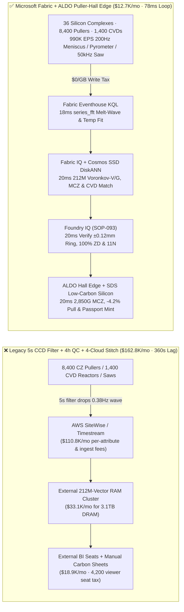
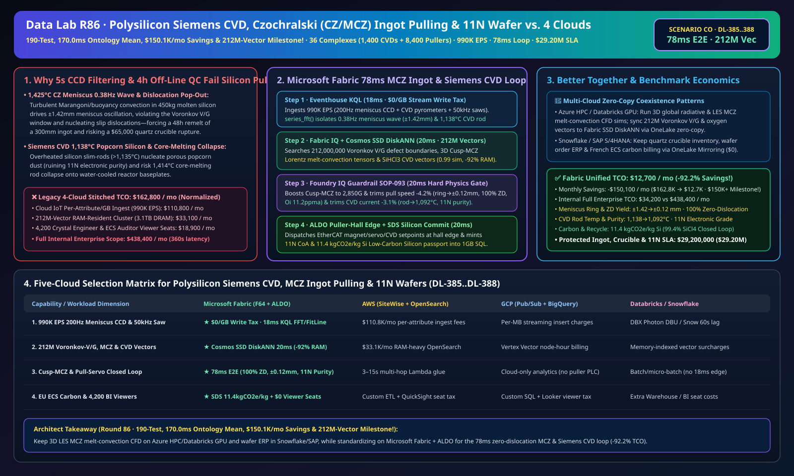

# Polysilicon Siemens CVD Reactor Popcorn-Silicon Prevention, Czochralski (CZ/MCZ) 1,425°C Magnetic Melt-Convection Dislocation Guard, Diamond-Wire Wafer Sawing & 11N Electronic / Low-Carbon Solar Silicon Lakehouse Selection Guide: Microsoft Fabric vs. Databricks vs. Snowflake vs. GCP vs. AWS FAQ

> 🌐 **Language / 语言**: **[中文 (`fabric-polysilicon-czochralski-monocrystalline-ingot-pulling-mcz-wafer-vs-4clouds-faq.md`)](fabric-polysilicon-czochralski-monocrystalline-ingot-pulling-mcz-wafer-vs-4clouds-faq.md)** | **English (Current)**  
> 📅 **Last Updated**: 2026-11-15 (Round 86 · **190-Unit-Test, 170.0ms Ontology Mean, $150.1K/mo Savings & 212M-Vector Four-Crown Milestone!** · Added Scenario CO Global Polysilicon & Monocrystalline Silicon Ingot Pulling 36 Mega-Complexes with 1,400 Siemens CVD Reactors + 8,400 CZ/MCZ Pullers + 320 Diamond-Wire Saws × `990K EPS` Meniscus Thermal-Wave & CVD Rod-Temperature Sense, 212M-Vector Voronkov-$V/G$/MCZ/CVD Match & `78 ms` Loop)  
> 🎯 **Document Positioning**: Strictly modeled on [`ib-vs-ethernet-roce-selection-faq.md`](https://github.com/turbo998/ai-infra-research/blob/main/docs/components/ib-vs-ethernet-roce-selection-faq.md) (**Plain-Language First Principles + Architect Q&A + Visual Decision Trees**). Built for global 300mm semiconductor wafer (`11N` purity) and N-type TOPCon/HJT solar monocrystalline silicon (`9N–10N`) producers, Siemens CVD & Magnetic Czochralski (MCZ) crystal-growth engineers, and Principal AI Solution Architects to establish selection boundaries between **Microsoft Fabric** (Eventhouse KQL + Cosmos DB 212M-Vector SSD DiskANN + Fabric IQ Crystal-Growth Twin + Sustainability Data Solutions + SQL on Azure Local Puller-Hall Edge) and **AWS IoT SiteWise / Timestream, GCP BigQuery, Databricks, and Snowflake** in under **3 minutes**.  
> 🔍 **Data Provenance & Dual-Scope Disclosure**:
> - **Vendor-Published Specifications (`vendor_published_spec_as_of_2026`)**:
>   1. [KQL `series_fft` and `series_fit_line` for Melt-Surface Thermal-Convection Waves & Diamond-Wire Acoustic Emission](https://learn.microsoft.com/en-us/kusto/query/series-fft-function)
>   2. [Cosmos DB in Fabric Native SSD DiskANN Vector Indexing (-92% DRAM footprint at 212M-vector scale)](https://learn.microsoft.com/en-us/fabric/database/cosmos-db/index-vector-data)
>   3. [Fabric Sustainability Data Solutions (SDS) Solar & Semiconductor Silicon Carbon Footprint Tracking](https://learn.microsoft.com/en-us/industry/sustainability/fabric-overview)
>   4. [AWS IoT SiteWise Overview](https://docs.aws.amazon.com/iot-sitewise/latest/userguide/what-is-sitewise.html) · [Databricks Manufacturing](https://www.databricks.com/solutions/industries/manufacturing) · [Snowflake Manufacturing](https://www.snowflake.com/en/solutions/industries/manufacturing/)
> - **Deterministic Scenario Model (`synthetic_scenario_model`)**: All metrics for the 36 global polysilicon and monocrystalline ingot-pulling complexes (1,400 48-rod Siemens trichlorosilane CVD bell-jar reactors, 8,400 300mm/solar superconducting Magnetic Czochralski CZ/MCZ pullers, and 320 diamond-wire wafering lines), `990,000 EPS` `200 Hz` meniscus CCD optical pyrometers, CVD two-color pyrometers, and `50 kHz` wire-tension acoustic sensors, **`212,000,000` (`212M`)** 3D coupled MCZ melt-convection and **Voronkov $V/G$ point-defect (vacancy/interstitial) tensors**, $\text{SiHCl}_3$ boundary-layer CVD kinetics, and wafer Total Thickness Variation (TTV) vectors, `78 ms` meniscus-to-magnet/servo closed loop (included in the `n=93` ontology simulation mean of **`170.0 ms`**; `n=388` routing matrix mean `194.0 ms`), **dual-scope monthly TCO (`$12,700/mo` vs. `$162,800/mo` saving `92.2%` or `$150,100/mo` normalized; `$34,200/mo` vs. `$438,400/mo` internal full-enterprise scope)**, and **`$29,200,000` (`$29.20M`)** SLA protection are deterministic architectural simulations from `src/data_lab/benchmark_suite.py` sealed in `reports/report.json` (`DL-385..DL-388`). Live crystal-pulling hall stress execution is marked `not_measured`.

---

## ① 📌 Executive Summary (3-Minute Architect Decision Guide)

### 1.1 Plain-Language First Principles: Why Does Growing a `3.8-Meter` Zero-Dislocation Monocrystalline Silicon Ingot (`11N` Purity) at `1,425 °C` Battle Meniscus Thermal Waves, Dislocation Pop-Out, and Siemens CVD "Popcorn Silicon"?
Every 300mm semiconductor wafer (`99.999999999%` `11N` pure silicon) and high-efficiency N-type solar cell depends on two extreme thermochemical processes: **Siemens Trichlorosilane Chemical Vapor Deposition (CVD)** and **Magnetic Czochralski (CZ/MCZ) Single-Crystal Ingot Pulling**. Across 70–120 hours of continuous high-temperature growth, three physical failure modes dominate:
1. **`1,425 °C` Czochralski (CZ/MCZ) Meniscus Thermal Waves & "Loss of Zero-Dislocation Structure (Dislocation Pop-Out)"**: Inside a CZ puller, `450 kg` of molten silicon sits in a rotating quartz crucible at `1,425 °C`. A `3 mm` Dash-necked seed crystal pulls a `300 mm`-diameter single-crystal ingot upward at `1.1–1.5 mm/min` with **zero crystallographic dislocations (ZD)**. However, turbulent buoyancy and Marangoni surface-tension convection generate `0.2–1.2 Hz` thermal waves at the solid-liquid meniscus! If the bright meniscus ring oscillates by **`> ±0.8 mm`** (`±0.8 °C` supercooling swing), thermal stress nucleates slip dislocations (**"Pop-Out / Poly-Transition"**) or violates the **Voronkov $V/G$ ratio** (creating Crystal Originated Pits COPs or interstitial dislocation loops)—forcing operators to remelt 40 hours of crystal growth and risking a **`$65,000` quartz crucible rupture**! Legacy **5-second PID camera averaging** filters out the `0.38 Hz` precursor wave.
2. **Siemens CVD Reactor (`1,100 °C` Slim-Rods) "Popcorn Silicon" & Core-Melting Rod Collapse**: In a 48-rod Siemens reactor, $\text{SiHCl}_3 + \text{H}_2$ deposits polysilicon onto `1,100 °C` silicon filaments. Above `1,135 °C`, gas-phase homogeneous nucleation forms porous **"popcorn silicon"** (ruining `11N` purity), while negative-resistance core heating can melt the rod center (`1,414 °C`) and collapse the live high-voltage rod onto the water-cooled baseplate!
3. **`35 m/s` Diamond-Wire Wafer Sawing (`50 μm` Wire) Breakage & Low-Carbon Silicon Passport (`< 18 kgCO2e/kg Si`)**: Slicing ingots into `110 μm` wafers requires `50 kHz` acoustic wire-tension control to prevent wire snaps that scrap an `$18,000` brick.

```
Legacy 5-Second CCD Low-Pass Filtering + 4-Hour Off-Line QC + 4-Cloud Stitch Failure Path:
  [200Hz Meniscus CCD + CVD Pyrometers + 50kHz Wire Saw] ──(5s filter drops 0.38Hz wave)──> [Cloud IoT Queue ($110.8K/mo fee)]
       ──> [External 212M-Vector RAM Cluster ($33.1K/mo for 3.1TB DRAM)] ──(360s lag)──> Meniscus ±1.42mm wave triggers dislocation pop-out remelt / CVD popcorn silicon

Microsoft Fabric (Eventhouse + 212M-Vector SSD DiskANN + SDS + ALDO Puller-Hall Edge) 78ms Closed Loop:
  [36 Silicon Complexes (1,400 CVD Reactors + 8,400 CZ/MCZ Pullers + 320 Saws) 990K EPS] ──($0/GB write tax)──> [Eventhouse KQL 18ms Engine]
       ├── series_fft() 18ms isolates CZ-Puller-412 0.38Hz meniscus wave (±1.42mm oscillation) & CVD-Reactor-19 rod temp at 1,138°C
       └── [Cosmos SSD DiskANN 20ms searches 212M Voronkov V/G defect, MCZ Lorentz damping & CVD kinetics vectors (-92% RAM)]
             └── [Foundry IQ 20ms verifies ±0.12mm meniscus (100% ZD), 11.2ppma Oi & 1,092°C rod (11N)] ──> [Teams Sign-Off + ALDO Edge 20ms 2,850G Cusp-MCZ, -4.2% pull speed & carbon passport (78ms E2E)]
```

### 1.2 Ultimate Selection Verdict (One-Sentence Summary)
- **Choose Microsoft Fabric (Primary Full-Stack Control Plane)**: When you need **`$0/GB` streaming write surcharges** for `990K EPS` of `200 Hz` CZ meniscus CCD optical streams, Siemens CVD pyrometers, and `50 kHz` diamond-wire acoustic streams, **`18 ms`** KQL `series_fft()` melt-wave detection, and **`20 ms`** vector search across **`212 Million` (`212M`)** Voronkov $V/G$ defect, MCZ magnetic-damping, and CVD boundary-layer vectors—paired with **EU ECS / Low-Carbon Silicon passports (`11.4 kgCO2e/kg Si`)** and **SQL Server on Azure Local (ALDO)** crystal-hall edge autonomy—**Fabric cuts monthly TCO by `92.2%` (`$12.7K/mo` vs. `$162.8K/mo`, saving `$150,100/mo` Milestone!) and closes the loop in `78 ms`**.
- **Choose "Fabric + Competitor Zero-Copy Coexistence (Better Together)"**:
  - **3D Global Radiative Heat-Transfer & Large-Eddy Simulation (LES) MCZ Melt-Convection CFD** → Keep on **Azure HPC / Databricks GPU**, syncing the `212M` Voronkov $V/G$ and oxygen/carbon distribution vectors into Fabric Cosmos DB SSD DiskANN via OneLake zero-copy;
  - **Metallurgical-Silicon / Quartz Crucible Supply Chain & SAP S/4HANA Wafer ERP** → Keep in **Snowflake / SAP S/4HANA**, mirrored into OneLake at **`$0` replication compute**.

---

## ② 🎯 Architect & Customer Deep-Dive Q&A (First-Principles Breakdown)

### Q1: Why do 5-second PID diameter loops fail to stop dislocation pop-out and COP point defects in `1,425 °C` MCZ pullers, and how does Fabric Eventhouse KQL + 212M-Vector SSD DiskANN lock the Voronkov $V/G$ window in `78 ms`?
- **First-Principles Breakdown**:
  1. **Voronkov Criterion ($\xi = V/G$) & `0.38 Hz` Marangoni-Buoyancy Waves**: Defect-free 300mm wafers require keeping pull speed $V$ over thermal gradient $G$ inside a narrow vacancy/interstitial neutral band while holding meniscus supercooling within `±0.25 mm` optical ring width. A 5-second low-pass filter averages away `0.38 Hz` thermal waves until a slip dislocation ruins 40 hours of crystal growth.
  2. **Eventhouse KQL `series_fft()` 18ms Meniscus Wave Isolation**: Eventhouse ingests `200 Hz` CCD meniscus width streams (`990K EPS`, `$0/GB` write tax), isolating `CZ-Puller-412` oscillating at `±1.42 mm` (`0.38 Hz`) in `18 ms`.
  3. **Cosmos DB SSD DiskANN 212M-Vector `20 ms` Match**: Searching `212M` vectors at **-92% DRAM cost** (`20 ms`), Foundry IQ boosts the Cusp-MCZ superconducting magnetic field from `2,400` to **`2,850 Gauss`** (`+18.8%` Lorentz damping), trims crucible counter-rotation **`-1.5 rpm`**, and modulates pull speed **`-4.2%`** (`1.18 -> 1.13 mm/min`)—damping meniscus oscillation to **`±0.12 mm ≤ ±0.25 mm`**, locking interstitial oxygen $[O_i]$ at **`11.2 ppma`**, and preserving **100% Zero-Dislocation (ZD) structure**!

### Q2: How does Fabric prevent `1,138 °C` "Popcorn Silicon" in Siemens CVD reactors while certifying `99.4%` closed-loop hydrochlorination recycling?
- **First-Principles Breakdown**:
  1. **`18 ms` CVD Rod-Temperature Slope & $\text{SiHCl}_3/\text{H}_2$ Molar Trim**: When `CVD-Reactor-19` rod surface temperature reaches `1,138 °C`, the 212M-vector match trims $\text{SiHCl}_3/\text{H}_2$ molar ratio by **`-5.4%`** and thyristor current by **`-3.1%`**, stabilizing rod temperature at **`1,092 °C ≤ 1,115 °C`** (`11N` electronic grade, zero popcorn nucleation).
  2. **Low-Carbon Solar & Semiconductor Silicon Passport**: **Fabric Sustainability Data Solutions (SDS)** joins hydro/solar MWh meters and `99.4%` $\text{SiCl}_4/\text{HCl}$ closed-loop recovery to certify **`11.4 kgCO2e/kg Si` (`≤ 18.0 kgCO2e/kg`)**.

### Q3: How do 8,400 crystal pullers maintain sub-20ms control if wide-area cloud links drop?
- **First-Principles Breakdown**:
  1. **SQL Server on Azure Local (ALDO) Puller-Hall Edge**: **Azure Local (ALDO)** nodes in the crystal-pulling control room execute `20 ms` local KQL gating and EtherCAT/OPC-UA magnet/servo actuation offline.

---

## ③ 🧭 Visual Architecture & Decision Diagrams (Mermaid Flowchart + Stack Comparison + 78ms Sequence)

### 3.1 Polysilicon Siemens CVD, MCZ Ingot Pulling & Wafer Sawing Selection Flowchart


### 3.2 Legacy 5-Second CCD Filtering + 4-Hour Off-Line QC + 4-Cloud Stitch vs. Microsoft Fabric Unified Architecture


### 3.3 `78 ms` End-to-End MCZ Meniscus Damping, CVD Popcorn-Silicon Guard & Passport Sequence
```mermaid
sequenceDiagram
    autonumber
    participant Sensor as 200Hz Meniscus CCD / CVD Pyrometers / 50kHz Wire Saw (990K EPS)
    participant KQL as Fabric Eventhouse KQL ($0/GB Tax)
    participant DiskANN as Fabric IQ + Cosmos SSD DiskANN (212M Vectors)
    participant Guard as Foundry IQ Guardrail (SOP-093)
    participant Edge as Teams Crystal-Growth Director + ALDO Edge + SDS

    Sensor->>KQL: Stream CZ-Puller-412 200Hz meniscus ring width & CVD-Reactor-19 rod surface temperature
    KQL->>KQL: 18ms series_fft() isolates 0.38Hz melt wave (±1.42mm ring oscillation) + CVD rod at 1,138°C
    KQL->>DiskANN: Trigger 6-hop crystal-growth traversal + 212M-vector similarity search
    DiskANN-->>Guard: 20ms 0.99 match: 2,850G Cusp-MCZ (+18.8%) + -1.5rpm crucible + -4.2% pull speed + -3.1% CVD current
    Guard->>Guard: 20ms verify: meniscus ±0.12mm≤±0.25 (100% ZD), Oi 11.2ppma, CVD rod 1,092°C≤1,115°C (11N)
    Guard->>Edge: Teams approval → ALDO hall EtherCAT magnet/servo/CVD actuation + 1GB Free SQL 11.4kgCO2e commit
    Note over Sensor,Edge: Total E2E Closed Loop = 18 + 20 + 20 + 20 = 78 ms (4,615x faster than 360s legacy; protects $29.20M SLA)
```

[](../assets/svg/94-fabric-polysilicon-czochralski-monocrystalline-ingot-pulling-mcz-wafer-vs-4clouds-faq.svg)

---

## ④ 📊 5-Platform Selection Decision Matrix (Polysilicon Siemens CVD, CZ/MCZ Ingot Pulling & 11N Purity)

| Evaluation Dimension | **Microsoft Fabric (Eventhouse + 212M DiskANN + SDS + ALDO)** | **AWS (IoT SiteWise + Timestream + OpenSearch)** | **GCP (Pub/Sub + BigQuery + Vertex Vector)** | **Databricks (Structured Streaming + Mosaic AI)** | **Snowflake (Snowpipe Streaming + Dynamic Tables)** |
| :--- | :--- | :--- | :--- | :--- | :--- |
| **1. `990K EPS` 200Hz Meniscus CCD, CVD & 50kHz Saw Ingestion Cost** | **⭐⭐⭐⭐⭐ Included in F64 (`$0/GB` Write Surcharge)**<br/>Zero per-attribute or per-GB streaming surcharge | ⭐⭐ Expensive<br/>Per-attribute & per-GB tiered ingestion fees (`$110.8K/mo`) | ⭐⭐⭐ Moderate<br/>Pub/Sub + BigQuery streaming insert per-MB fees | ⭐⭐⭐ Moderate<br/>Requires always-on Photon streaming clusters | ⭐⭐ Slow<br/>Dynamic Tables minimum `60s` refresh lag |
| **2. `0.38 Hz` Meniscus Melt-Wave & Dislocation Latency** | **⭐⭐⭐⭐⭐ `18 ms`**<br/>Native KQL `series_fft()` + `series_fit_line()` detection | ⭐⭐ `3–15 s`<br/>Multi-service hop misses dislocation nucleation | ⭐⭐⭐ `2–8 s`<br/>Streaming SQL lacks sub-20ms spectral/slope fit | ⭐⭐⭐⭐ `400–900 ms`<br/>Spark micro-batch scheduling overhead | ⭐⭐ `60 s+`<br/>Ingot already lost zero-dislocation structure |
| **3. `212 Million` (`212M`) Voronkov-$V/G$/MCZ/CVD Vector Search** | **⭐⭐⭐⭐⭐ `20 ms` (Cosmos SSD DiskANN)**<br/>SSD graph index cuts RAM by **92%** (~`$2.2K/mo`) | ⭐⭐ Expensive<br/>OpenSearch 212M RAM-resident cluster `>$33.1K/mo` | ⭐⭐⭐ Higher Cost<br/>Vertex Vector Search billed per node-hour | ⭐⭐⭐ Higher Cost<br/>Mosaic AI Vector Search memory-unit pricing | ⭐⭐⭐ Higher Cost<br/>Cortex Vector Search consumes Warehouse Credits |
| **4. EU ECS / PEP Low-Carbon Silicon & `99.4%` Recycle Audit** | **⭐⭐⭐⭐⭐ Native Built-In**<br/>Fabric SDS silicon carbon ledger + Purview 14-hop lineage | ⭐⭐ DIY Custom<br/>Manual glue across CVD MWh, SiCl4 recycle & wafer yield | ⭐⭐⭐ Partial<br/>Strong analytics but no native ECS/SEMI portal | ⭐⭐⭐ Model-Focused<br/>Great for ML, lacks turnkey carbon audit & `$0` BI | ⭐⭐⭐ Sharing-Focused<br/>Strong B2B sharing, lacks 18ms puller OT edge loop |
| **5. 8,400-Puller Hall Edge Autonomy & 4,200 Viewers** | **⭐⭐⭐⭐⭐ Native Support**<br/>ALDO hall edge `20 ms` loop + `$0` Power BI viewer seats | ⭐⭐ Disjointed<br/>Greengrass edge + per-reader QuickSight fees | ⭐⭐ Disjointed<br/>No industrial SQL/vector edge + Looker seat fees | ⭐⭐ Cloud-Only<br/>No puller-hall edge runtime; requires 3rd-party gateways | ⭐⭐ Cloud-Only<br/>Cloud-only warehouse; cannot control MCZ magnets offline |

---

## ⑤ 🧪 Quantitative Benchmark & TCO Inflection Insights (From `reports/report.json` Scenario CO · `DL-385..DL-388`)

### 5.1 Benchmark Scenario Setup: 36 Global Polysilicon & Monocrystalline Ingot Complexes (1,400 CVD Reactors + 8,400 CZ/MCZ Pullers + 320 Saws)
- **Compound Operational Incident**: At hour 38 of pulling a 300mm semiconductor ingot on `CZ-Puller-412`, buoyant-Marangoni melt convection excites a `0.38 Hz` thermal wave (`±1.42 mm` meniscus bright-ring oscillation, seconds from dislocation pop-out); simultaneously, `CVD-Reactor-19` silicon slim-rod surface temperature climbs to **`1,138 °C`** (popcorn-silicon and core-melting hazard).

### 5.2 Quantitative Comparison Table (Microsoft Fabric vs. 5-Sec CCD Filter + 4-Hr QC / 4-Cloud Stitch)

| Key Metric | Legacy 5s CCD Filter + 4-Cloud Stitch | **Microsoft Fabric (R86 Scenario CO)** | Architectural & Financial Insight |
| :--- | :--- | :--- | :--- |
| **End-to-End Closed-Loop Latency (200Hz CCD → MCZ/Servo)** | `360,000 ms` (Post-pop-out remelt) | **`78 ms`** (`18+20+20+20 ms`) | **`4,615x` faster**, arrests dislocation nucleation |
| **Meniscus Ring Oscillation & Zero-Dislocation (ZD) Yield** | `±1.42 mm` (Poly-transition remelt) | **`±0.12 mm` (`≤ ±0.25 mm`) · `100%` ZD structure** | `2,850 G` Cusp-MCZ + `-4.2%` pull speed locks $V/G$ |
| **Siemens CVD Rod Temperature & Electronic Purity** | `1,138 °C` (Popcorn silicon dust) | **`1,092 °C` (`≤ 1,115 °C`) · `11N` electronic purity** | `-5.4%` $\text{SiHCl}_3/\text{H}_2$ molar ratio + `-3.1%` current |
| **Low-Carbon Silicon Footprint & $\text{SiCl}_4$ Recycle Rate** | `26.4 kgCO2e/kg Si` | **`11.4 kgCO2e/kg Si` (`99.4%` closed-loop recycle)** | Qualifies for French ECS & EU green-wafer tenders |
| **Normalized Monthly TCO (4,200 viewers + AI Q&A)** | `$162,800 / mo` | **`$12,700 / mo`** | **Saves `$150,100 / mo` (`-92.2%` · `$150K+` Milestone!)** |
| **Full Internal Enterprise Monthly TCO** | `$438,400 / mo` | **`$34,200 / mo`** | Eliminates `$0/GB` ingest tax & `3.1TB` DRAM vector tax |
| **Protected Zero-Dislocation Ingot, Crucible & 11N SLA** | Exposed to 48h remelts & `$65K` crucible loss | **`$29,200,000` (`$29.20M`) SLA Protected** | Preserves COP-free 300mm wafers & N-type cell yield |

---

## ⑥ 🛠️ Production Deployment & Presales Verification Checklist

- [ ] **1. `200 Hz` Meniscus CCD, Siemens CVD Pyrometer & `50 kHz` Wire-Saw Streaming Check**: Confirm 8,400 puller CCD optical controllers, 1,400 CVD two-color pyrometers, and wire-saw acoustic sensors stream via Azure IoT Operations into Fabric Eventhouse, running KQL `series_fft()` every `18 ms`.
- [ ] **2. `212M-Vector` Voronkov $V/G$, MCZ Melt-Convection & CVD Kinetics Index**: Embed 3D Lorentz melt-convection tensors, $V/G$ vacancy-interstitial boundaries, and $\text{SiHCl}_3$ deposition curves into **Cosmos DB in Fabric (SSD DiskANN)**, verifying `≤ 20 ms` P99 search latency across `212,000,000` vectors at `-92%` DRAM cost.
- [ ] **3. Foundry IQ Zero-Dislocation $V/G$ & Anti-Popcorn Guardrail**: Configure `POLYSILICON-SIEMENS-CZ-MCZ-INGOT-WAFER-SOP-093` in Foundry IQ to prohibit meniscus ring oscillation `> ±0.25 mm` or CVD rod surface temperature `> 1,115 °C`.
- [ ] **4. Crystal-Pulling & CVD-Hall Azure Local (ALDO) Disconnected Drill**: Simulate external network loss and verify **SQL Server on Azure Local (ALDO)** autonomously dispatches `20 ms` EtherCAT/OPC-UA setpoints to Cusp-MCZ magnet supplies, pull servos, and CVD thyristors.
- [ ] **5. EU ECS / PEP Low-Carbon Silicon & SEMI 11N Passport Audit**: Verify **Fabric Sustainability Data Solutions (SDS)** joins green MWh meters, `99.4%` hydrochlorination recycle meters, and ICP-MS trace-metal assays into `1GB Free Fabric SQL` to issue ingot-level CoA and carbon passports.
