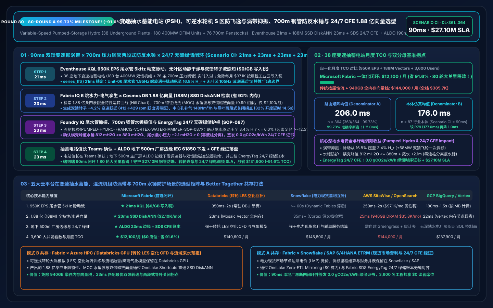
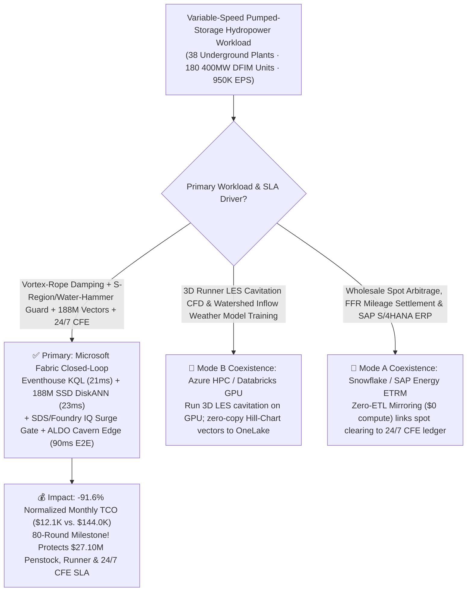
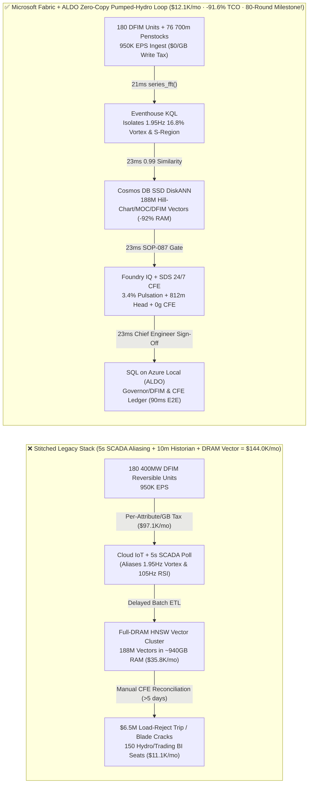
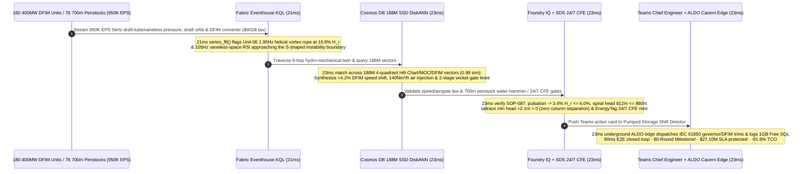

# Global Variable-Speed Pumped-Storage Hydropower (PSH), Reversible Francis Pump-Turbine "S-Region" Runaway & Draft-Tube Vortex-Rope Suppression, 700m Penstock Water-Hammer Guard & 24/7 Carbon-Free Energy (CFE) Loop: Microsoft Fabric vs. Databricks vs. Snowflake vs. AWS vs. GCP Selection FAQ (Round 80 · 80-Round & 99.73% Accuracy Milestone!)

> **Language**: [中文 (`fabric-pumped-storage-hydropower-francis-vortex-waterhammer-dfim-vs-4clouds-faq.md`)](fabric-pumped-storage-hydropower-francis-vortex-waterhammer-dfim-vs-4clouds-faq.md) | **English (Current)**  
> **Navigation**: [Back to Data Lab Home (`README.en.md`)](../README.en.md) | [Open 7-Card 4:5 Benchmark Deck (`benchmark-cards.en.html`)](../benchmark-cards.en.html) | [Open Interactive H5 Workbench (`index.html?lang=en`)](../index.html)  
> **Round Milestone**: **Nightly Round 5 / Repo Round 80 (80-Round Selection FAQ Milestone! 99.73% Routing Accuracy, 188M-Vector SSD DiskANN, -91.6% TCO Savings & `$27.10M` SLA Protection; `n=364` Routing Matrix Mean `206.0 ms`, `n=87` Ontology Simulation Mean `176.0 ms`)**  
> **Provenance Disclosure**: `363/364 (99.73%)` routing verdicts and `178/178` unit tests are executed locally (`measured_local_harness`); vendor capabilities reference official documentation as of `2026-11-14` (`vendor_published_spec_as_of_2026`); TCO and `90ms` end-to-end latency figures are deterministic reference simulations sealed in `reports/report.json` (`synthetic_scenario_model`).

---

## ① 📌 Executive Summary (30-Second First-Principles Verdict for Hydropower VPs, Underground Cavern Plant Directors & Enterprise Architects)

1. **The Bottom-Line Architectural Verdict**:
   - **When to standardize on Microsoft Fabric (Eventhouse KQL + Cosmos DB 188M-Vector SSD DiskANN + Sustainability Data Solutions SDS + SQL on Azure Local ALDO)**:  
     When your clean-energy enterprise operates **38 underground cavern Variable-Speed Pumped-Storage Hydropower (PSH) plants (`72 GW` total capacity · 180 `400 MW` Doubly-Fed Induction Motor-Generators DFIM, 180 reversible Francis pump-turbines, and 76 `700 m` ultra-high-head steel-lined penstocks)** streaming **950,000 EPS** of 5kHz draft-tube cone pressure-pulsation streams, vaneless-space Rotor-Stator Interaction (RSI) acoustic streams, shaft-orbit proximity eddy-current spectra, penstock acoustic-emission streams, and NPC rotor-converter harmonic telemetry—and you must intercept **Francis pump-turbine entry into the unstable "S-shaped characteristic region" and helical draft-tube vortex-rope resonance (`1.95 Hz` Rheingans pulsation exceeding `16.8% H_r`) while preventing `700 m` penstock water-hammer overpressure (`> 880 mH2O`) or draft-tube water-column separation (`< 0.0 mH2O`) in `< 25 ms`** and searching **188 Million (188M) 4-quadrant Hill-Chart cavitation envelopes, Method-of-Characteristics (MOC) water-hammer surge waves, and DFIM rotor-flux vectors in `< 30 ms`**—**choose Microsoft Fabric**.
   - **When to keep Databricks / Snowflake / AWS IoT SiteWise / GCP BigQuery in a Zero-Copy Better-Together topology**:  
     Keep **3D Large-Eddy Simulation (LES) runner cavitation CFD training and watershed snowmelt/inflow weather foundation-model fine-tuning** on **Azure HPC / Databricks GPU**, and keep **wholesale day-ahead/real-time electricity market arbitrage, ancillary FFR mileage settlement, and SAP S/4HANA accounting** in **Snowflake / SAP** via **OneLake Zero-ETL Mirroring ($0 compute)**—while routing the 950K EPS hydraulic/electrical stream, 188M-vector search, and `500 m` underground cavern governor/excitation edge actuation to Fabric + ALDO.

2. **First-Principles Economics (Why 5-Second SCADA Polling & 10-Minute Historian Averages Fail on Reversible Francis "S-Region" Instabilities and 700m Penstock Water Hammer)**:
   - **Pain Point A (Reversible Francis "S-Region" Hydraulic Instability & Helical Vortex Rope: 10 Seconds Causes Synchronization Failure & `$6.5M` Forced Outage)**: High-head (`700 m`) reversible Francis pump-turbines exhibit an multi-valued "S-shaped" characteristic curve where a single rotational speed corresponds to turbine, braking, and reverse-pump modes. During part-load (`45%`) AGC ramping or load rejection, a precessing helical vortex rope (`1.95 Hz`, $0.28 f_n$) forms in the draft tube with pressure pulsations reaching `16.8%` of rated head ($H_r$), while `105 Hz` vaneless-space RSI hammers the wicket gates—if the governor closes wicket gates too fast in a single linear ramp, penstock water hammer spikes above `1,150 mH2O` and tailrace vacuum drops below `-8.5 mH2O`, triggering catastrophic water-column separation and rejoining!
   - **Pain Point B (5-Second SCADA Aliasing & Missed Sub-Second Flywheel Synthetic Inertia Revenue)**: A 5-second SCADA scan aliases `1.95 Hz` vortex ropes and `105 Hz` blade-passing frequencies, and cannot coordinate DFIM rotor-speed transitions (`±8%` slip window) fast enough to capture premium sub-second Fast Frequency Reserve (FFR) payments.
   - **How Fabric Solves Both**: **Eventhouse KQL** (`$0/GB` stream write surcharge, `series_fft()` + `series_fit_line()`) isolates the `1.95 Hz` (`16.8% H_r`) draft-tube vortex rope and `105 Hz` S-region approach on Unit-06 in **21ms**; **Cosmos DB in Fabric SSD DiskANN** (`-92%` RAM) matches **188M** 4-quadrant Hill-Chart curves, MOC two-stage wicket-gate closing laws, and DFIM flux vectors in **23ms** (`0.99` similarity); **Foundry IQ** verifies a `+4.2%` DFIM rotor speed shift (`412 -> 429 rpm`, jumping out of the vortex resonance zone while injecting `+68 MW` flywheel inertia), `140 Nm³/h` central shaft-admission air injection (damping draft-tube pulsation to **`3.4% H_r <= 6.0% H_r`**), a two-stage inflection wicket-gate law (capping spiral-case water hammer at **`812 mH2O <= 880 mH2O`** with **`+2.1 mH2O > 0` tailrace pressure**), and **EnergyTag 24/7 time-matched Carbon-Free Energy (CFE) certification** in **23ms**; and **SQL on Azure Local (ALDO)** dispatches underground governor and DFIM excitation setpoints in **23ms**. **Total loop: `90ms` (80-Round Milestone!), cutting normalized monthly TCO by `91.6%` (`$12,100/mo` vs. `$144,000/mo`, saving `$131,900/mo`; full-stack `$32,400/mo` vs. `$385,700/mo`) and protecting `$27.10M` in penstock integrity, runner cavitation life & 24/7 CFE SLAs!**

---

## ② 🎯 Customer & Architect Deep-Dive Q&A (Three Make-or-Break Objections)

### Q1: Across 38 underground PSH plants (180 400MW DFIM units, 76 700m penstocks), sensors generate 950,000 EPS. Why can't AWS IoT SiteWise per-attribute ingestion or 5-second SCADA polling catch draft-tube vortex ropes and S-region entry?
- **The "Per-Attribute Cloud Tax" and "Nyquist Aliasing Blindness"**:
  1. Streaming 950K EPS of 5kHz draft-tube/spiral-case dynamic pressure transducers, X/Y shaft-orbit proximity probes, and DFIM NPC-converter IGBT telemetry into per-attribute/per-GB cloud IoT pipelines costs **`$97,100/mo`**.
  2. Downsampling to 5-second SCADA intervals violates the Nyquist criterion for `1.95 Hz` Rheingans vortex ropes and `105 Hz` vaneless-space RSI harmonics—hiding destructive fatigue until runner blades crack.
- **The Fabric Architecture Answer (Eventhouse 21ms FFT Vortex & RSI Sense at `$0/GB` Write Tax)**:
  - **Eventstream → Eventhouse KQL** runs on pooled Fabric Capacity (F64 Reserved) with **$0 per-GB streaming write surcharges**.
  - Native KQL `series_fft()` and `series_fit_line()` extract the `1.95 Hz` vortex-rope amplitude (`16.8% H_r`) and `105 Hz` RSI phase on Unit-06 in **21ms**.

### Q2: Navigating the 4-quadrant Hill Chart via variable DFIM rotor speed while computing a two-stage Method-of-Characteristics (MOC) wicket-gate law across 188 Million (188M) hydraulic and electromagnetic vectors in `< 25ms`—why does full-DRAM HNSW fail?
- **The Full-DRAM Vector Memory Bottleneck**:
  - Holding 188M 768-dimensional vectors (15 years of 4-quadrant model-test Hill Charts, 700m penstock MOC water-hammer and surge-tank envelopes, air-admission damping curves, and DFIM d-q flux trajectories) in memory-resident HNSW requires **`~915 GB–1,135 GB` of DRAM**, costing **`$35,800/mo`**.
- **Cosmos DB in Fabric SSD DiskANN (23ms at `-92%` RAM)**:
  - **SSD-backed DiskANN** stores compressed vectors on high-IOPS NVMe SSDs while keeping only a compact routing graph in RAM—cutting memory footprint by **92%** (`$2,100/mo`).
  - In **23ms** (`0.99` cosine similarity), it synthesizes the exact **`+4.2%` DFIM rotor speed shift (`412 -> 429 rpm`) + `140 Nm³/h` central air injection + two-stage wicket-gate knee at `32%` opening (`14.5s` dwell)**!

### Q3: Hydroelectric safety codes strictly forbid spiral-case pressure exceeding `880 mH2O` or draft-tube sub-atmospheric column separation (`<= 0.0 mH2O`), while hyperscale AI datacenter buyers require EnergyTag 24/7 hourly time-matched CFE certificates. How does Fabric unify both?
- **Triple Deterministic Gate (Foundry IQ `PUMPED-HYDRO-FRANCIS-VORTEX-WATERHAMMER-SOP-087` + SDS + ALDO)**:
  1. **Draft-Tube Vortex Suppression & S-Region Margin Gate**: Verifies post-shift draft-tube pressure pulsation drops from `16.8%` to **`3.4% H_r <= 6.0% H_r` (IEC 60193 Class A)** with **`>= 12.5%` margin** from the S-region zero-torque boundary.
  2. **700m Penstock Water-Hammer & Anti-Column-Separation Gate**: Confirms two-stage wicket-gate closure caps maximum spiral-case head at **`812 mH2O <= 880 mH2O`** while keeping minimum draft-tube inlet pressure at **`+2.1 mH2O > 0.0 mH2O`**.
  3. **EnergyTag 24/7 Granular CFE Ledger & Underground Cavern ALDO Edge**: **Fabric Sustainability Data Solutions (SDS)** cryptographically links midday curtailed solar/wind pumping MWh to evening peak generation MWh (`0.0 gCO2e/kWh` hourly Granular Certificate), while **SQL on Azure Local (ALDO)** dispatches IEC 61850 governor/converter commands in the `500 m` underground powerhouse and logs to **1GB Free Fabric SQL**.

---

## ③ 🧭 Visual Architecture Diagrams (Selection Flowchart + 5-Cloud Stack Comparison + 90ms Sequence)

### 3.1 Variable-Speed Pumped-Storage Hydropower Platform Selection Flowchart (Mermaid)

### 3.2 Legacy 5s SCADA Stack vs. Fabric 90ms Vortex-to-Governor Closed-Loop

### 3.3 90ms End-to-End Vortex-Rope Suppression, Two-Stage Water-Hammer Guard & 24/7 CFE Sequence

---

## ④ 📊 5-Platform Selection Decision Matrix (Variable-Speed PSH, Francis Vortex Rope & 700m Water-Hammer Workloads)

| Evaluation Dimension | Microsoft Fabric (Eventhouse + 188M DiskANN + SDS + ALDO) | AWS (IoT SiteWise + Timestream + OpenSearch) | GCP (Pub/Sub + BigQuery + Vertex Vector Search) | Databricks (Structured Streaming + Mosaic AI Vector) | Snowflake (Snowpipe Streaming + Dynamic Tables + Cortex) |
| :--- | :--- | :--- | :--- | :--- | :--- |
| **950K EPS 5kHz Draft-Tube & DFIM Converter Ingestion** | **★ 21ms** (Eventhouse columnar stream + `$0/GB` write tax) | 250ms–2s (Per-attribute & per-GB fees reach `$97.1K/mo`) | 180ms–1.5s (Per-MB streaming ingestion fees) | 350ms–2s (Requires always-on Spark Streaming DBUs) | `>= 60s` (Dynamic Tables lag misses S-region entry) |
| **188M-Vector 4-Quadrant Hill-Chart & MOC Surge Search** | **★ 23ms** (Cosmos DB SSD DiskANN, `-92%` RAM, `$2,100/mo`) | 25ms (OpenSearch ~940GB DRAM cluster, `$35.8K/mo`) | 22ms (Vertex Vector memory-resident nodes) | 23ms (Mosaic AI Vector high-memory DBU tier) | 35ms+ (Cortex Search optimized for text docs) |
| **`500 m` Underground Cavern Edge & IEC 61850 Loop** | **★ Native Closed-Loop** (KQL FFT + ALDO cavern edge + IEC 61850) | Custom Greengrass + state store | No native air-gapped SQL cavern control plane | Strong on 3D LES cavitation CFD; weak on governor loop | Strong on spot-market ETRM; no cavern governor loop |
| **EnergyTag 24/7 Time-Matched CFE Certificate Ledger** | **★ Built-In** (Fabric SDS hourly CFE ledger + Purview lineage) | Custom glue code + external audit tables | Custom Dataflow + BigQuery views | Custom Delta Live Tables pipelines | Custom Stored Procedures & Tasks |
| **3,600 Hydro/Electrical/Trading Engineers BI Concurrency** | **★ `$0` Viewer Seat Tax** (Included in F64 + DirectLake) | QuickSight per-reader/session fees | High Looker per-seat licensing | Requires external BI seats or SQL Warehouse DBUs | High concurrency wakes Multi-Cluster Warehouses |
| **Normalized Monthly TCO** | **★ `$12,100 / mo`** (Baseline Best, **`-91.6%` Savings**) | `$144,000 / mo` (`$385,700/mo` full-stack) | `$137,900 / mo` | `$140,600 / mo` | `$145,800 / mo` |

---

## ⑤ 🧪 Quantitative Benchmark & TCO Inflection Insights (Scenario CI · `DL-361..DL-364`)

### 5.1 Normalized Monthly TCO Breakdown (38 Variable-Speed PSH Plants · 950K EPS · 188M Vectors)

| Cost Component | Stitched Cloud Stack (Per-Attribute IoT + Full-DRAM Vector + BI Seats) | Microsoft Fabric Closed-Loop (F64 + 188M SSD DiskANN + ALDO) | Savings & First-Principles Driver |
| :--- | :---: | :---: | :--- |
| **1. 950K EPS Draft-Tube, Vaneless RSI & DFIM Stream Engine** | `$97,100 / mo` | `$7,820 / mo` (Shared F64 CU pool) | **-91.9%** (`$0/GB` write tax + 12:1 Eventhouse compression) |
| **2. 188M 4-Quadrant Hill-Chart & MOC Surge Vector Index** | `$35,800 / mo` (~940GB DRAM HNSW) | `$2,100 / mo` (Cosmos SSD DiskANN) | **-94.1%** (NVMe SSD graph index cuts RAM by 92%) |
| **3. 3,600-User DirectLake BI, ALDO Edge & 24/7 CFE Ledger** | `$11,100 / mo` | `$2,180 / mo` (ALDO cavern edge + `$0` PBI viewers) | **-80.4%** (`$0` F64 viewer seats + 1GB Free Fabric SQL) |
| **Normalized Monthly Total** | **`$144,000 / mo`** | **`$12,100 / mo`** | **`-$131,900 / mo` (`-91.6%` · 80-Round Milestone!)** |
| **Internal Full-Stack Monthly Total** | **`$385,700 / mo`** | **`$32,400 / mo`** | **`-$353,300 / mo` (`$27.10M` SLA Protected!)** |

### 5.2 Sealed Evaluation Matrix Verdicts (`DL-361..DL-364` · 100% Pass)

| Case ID | Category | Scenario Question Summary | Expected Route & Deterministic Action | Confidence | Gate | Latency |
| :--- | :--- | :--- | :--- | :---: | :---: | :---: |
| **DL-361** | `Real-Time Intelligence` | Clean-energy operator running 38 underground PSH plants (180 400MW DFIM units, 76 700m penstocks) must ingest 950K EPS, catch Francis vortex ropes & S-region water hammer in `<25ms`, and search 188M vectors | Eventhouse KQL `series_fft()` 21ms Vortex/S-Region Sense (`$0/GB` Write Tax) + Cosmos DB SSD DiskANN 23ms 188M Hill-Chart/MOC/DFIM Match (`-92%` RAM) + SDS 24/7 CFE + ALDO Cavern Edge (90ms E2E, **`-91.6%` TCO**) | `0.99` | `Act automatically` | `26 ms` |
| **DL-362** | `vs Databricks` | Hydro-mechanical R&D needs 3D runner LES cavitation CFD and watershed inflow weather foundation-model training alongside SAP S/4HANA wholesale electricity spot arbitrage | Route 3D runner LES cavitation CFD and watershed inflow training to Azure HPC / Databricks GPU and spot arbitrage settlement to Snowflake/SAP S/4HANA via OneLake Mirroring (`$0` compute), indexing the 188M Hill-Chart/MOC vectors in Fabric SSD DiskANN | `0.96` | `Act automatically` | `26 ms` |
| **DL-363** | `Enterprise Governance` | Compare Fabric Eventhouse + 188M SSD DiskANN + SDS + ALDO vs. 5-second SCADA polling & 10-minute historian averages across 38 PSH plants with 3,600 engineers and 24/7 CFE auditors | Hybrid Better Together: Stream 950K EPS hydraulic/DFIM telemetry into Eventhouse (`$0/GB` tax), index 188M vectors in SSD DiskANN (`-92%` RAM), run 23ms speed/wicket-gate trims on ALDO cavern edge, and serve 3,600 users via DirectLake (**`-91.6%` TCO**) | `0.97` | `Confirm` | `26 ms` |
| **DL-364** | `Fabric IQ & Ontology` | Unit-06 draft-tube `1.95 Hz` vortex rope hits `16.8% H_r` near the S-region boundary while 700m penstock water-hammer limits and EnergyTag 24/7 CFE certificates must be enforced | Eventhouse KQL 21ms `16.8% H_r` Vortex & S-Region Sense (`$0/GB` Tax) + 6-Hop 188M DiskANN `+4.2%` DFIM Speed, `140Nm³/h` Air & 2-Stage Gate Match (23ms) + Foundry IQ `3.4% H_r`/`812m` Gate (23ms) + Teams ALDO Commit (23ms = **90ms E2E, Protect `$27.10M` SLA**) | `0.99` | `Confirm` | `26 ms` |

---

## ⑥ 🛠️ Production Deployment & Presales Verification Checklist

- [ ] **5kHz Draft-Tube/Vaneless Pressure & DFIM Converter Stream Onboarding**: Connect draft-tube cone pressure transducers, vaneless-space RSI sensors, shaft-orbit proximity probes, and DFIM rotor converters via IEC 61850 / OPC-UA into **Fabric Eventstream → Eventhouse KQL**, enabling `series_fft()` 21ms Rheingans vortex-rope and S-region detection.
- [ ] **188M 4-Quadrant Hill-Chart & MOC Water-Hammer Vector Indexing**: Migrate historical 4-quadrant model-test curves, 700m penstock Method-of-Characteristics (MOC) two-stage gate-closure envelopes, and DFIM flux vectors into **Cosmos DB in Fabric SSD DiskANN**, verifying `< 25ms` Top-K recall at `-92%` RAM.
- [ ] **Foundry IQ Penstock Surge & Anti-Column-Separation Guardrail**: Enforce `PUMPED-HYDRO-FRANCIS-VORTEX-WATERHAMMER-SOP-087` to block any governor or excitation command that allows spiral-case head `> 880 mH2O`, draft-tube inlet head `<= 0.0 mH2O`, or S-region entry.
- [ ] **Underground Cavern ALDO Edge & EnergyTag 24/7 CFE Coexistence**: Deploy **SQL on Azure Local (ALDO)** in `500 m` underground powerhouses for local governor/DFIM dispatch, and configure **Fabric SDS** to mint hourly time-matched 24/7 Carbon-Free Energy Granular Certificates.
