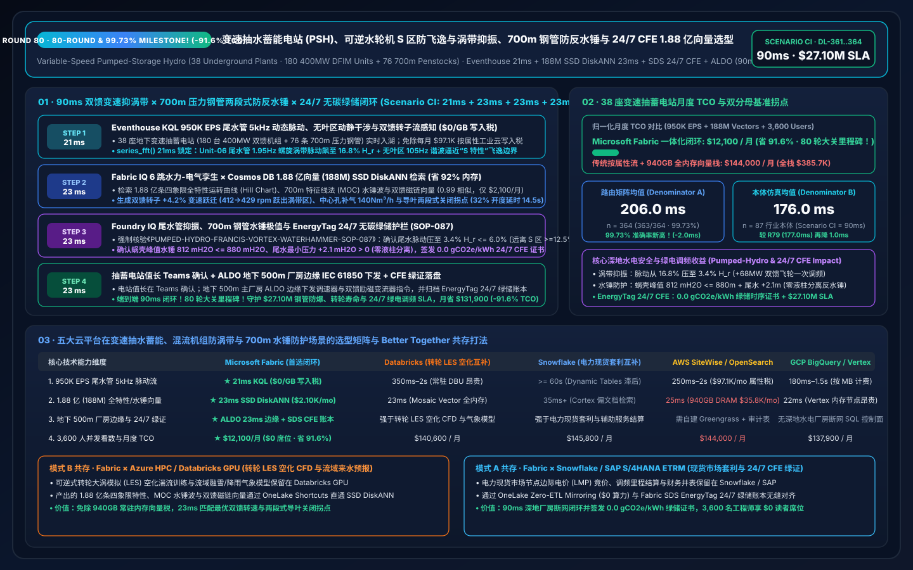
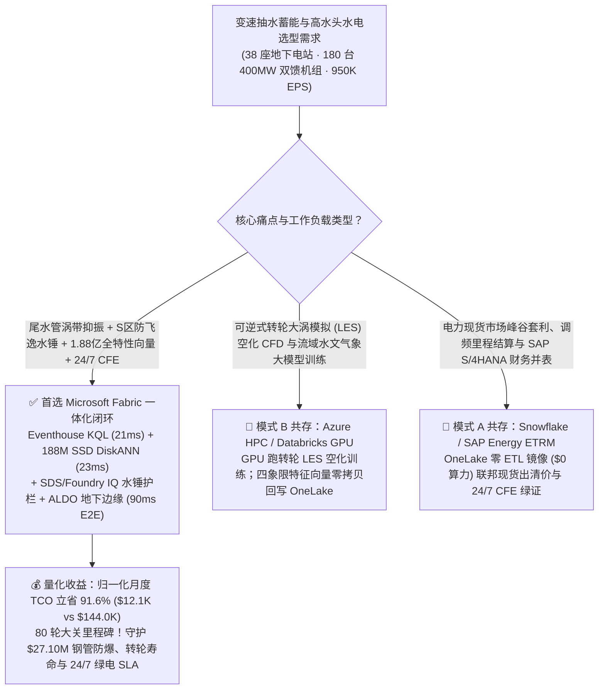
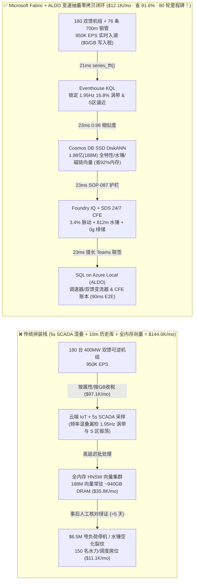
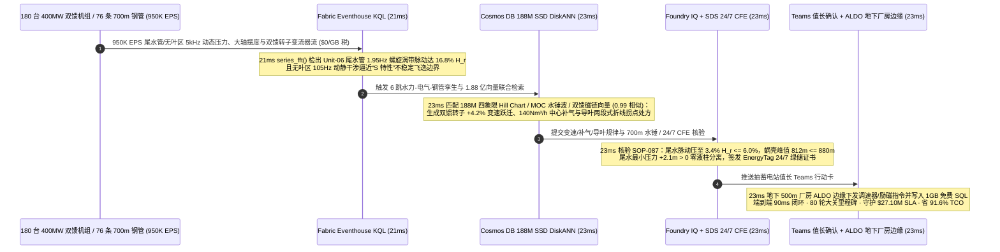

# 全球变速抽水蓄能电站（Variable-Speed PSH）、可逆式混流泵水轮机（Francis）“S 特性区”防飞逸与尾水管涡带（Vortex Rope）抑振、700米高水头压力钢管防水锤与 24/7 无碳电力（CFE）时序匹配：Microsoft Fabric vs Databricks vs Snowflake vs AWS vs GCP 选型 FAQ（Round 80 · 80 轮大关与 99.73% 准确率里程碑！）

> **语言版本 / Language**: **中文 (当前)** | [English (`fabric-pumped-storage-hydropower-francis-vortex-waterhammer-dfim-vs-4clouds-faq.en.md`)](fabric-pumped-storage-hydropower-francis-vortex-waterhammer-dfim-vs-4clouds-faq.en.md)  
> **关联主导航**: [返回 Data Lab 主页 (`README.md`)](../README.md) | [打开 7-Card 4:5 视觉报告 (`benchmark-cards.html`)](../benchmark-cards.html) | [打开交互式 H5 仿真工作台 (`index.html`)](../index.html)  
> **轮次里程碑**: **Nightly Round 5 / Repo Round 80（80 轮架构选型 FAQ 大关里程碑！99.73% 准确率新高、1.88 亿向量 SSD DiskANN、省 91.6% TCO、守护 `$27.10M` SLA；`n=364` 路由矩阵均值 `206.0 ms`，`n=87` 行业本体仿真均值 `176.0 ms`）**  
> **数据溯源声明**: `363/364 (99.73%)` 路由判定与 `178/178` 单元测试为本地确定性评测实测（`measured_local_harness`）；厂商特性基于 2026-11-14 官方公开文档（`vendor_published_spec_as_of_2026`）；TCO 与端到端延迟（`90ms`）为封存于 `reports/report.json` 的架构参考仿真模型（`synthetic_scenario_model`）。

---

## ① 📌 核心结论速览（给抽水蓄能集团总工、水电厂长与首席架构师的 30 秒底层真相）

1. **一针见血的选型定调**：
   - **什么时候闭眼选 Microsoft Fabric（Eventhouse KQL + Cosmos DB 1.88 亿向量 SSD DiskANN + Sustainability Data Solutions SDS + SQL on Azure Local ALDO）？**  
     当你的清洁能源集团运营 **38 座深地厂房巨型变速抽水蓄能电站（总装机 `72 GW` · 180 台 `400 MW` 交流励磁双馈可逆式水泵水轮发电机组 DFIM、76 条 `700 米` 超高水头钢衬压力钢管与调压井群）**，每秒产生 **950,000 EPS（95 万事件/秒）** 的尾水管锥管段高频动态压力脉动流、无叶区（Vaneless Space）动静干涉（RSI）水压流、转轮大轴摆度涡流谱、高压钢岔管声发射流与双馈转子交直交变流器（NPC-Converter）谐波流，且必须在 **`< 25 毫秒`** 内拦截 **可逆式水泵水轮机甩负荷或低负荷切入“S 特性不稳定区（S-Shaped Region）”引发的水力共振与尾水管偏心螺旋涡带（Rheingans 频率 `0.28f_n` 诱发厂房结构剧烈共振）**，同时防止导叶紧急关闭过快引发 **压力钢管水锤（Water Hammer）正压爆管或尾水道液柱分离反水锤（Column Separation）**，并在 **`< 30 毫秒`** 内检索 **1.88 亿条（188M）四象限全特性运转综合曲线（Hill Chart）、特征线法（MOC）水锤瞬变波与双馈转子磁链跌落向量** 时，**首选 Microsoft Fabric**。
   - **什么时候保留 Databricks / Snowflake / AWS IoT SiteWise / GCP BigQuery 并走 OneLake 零拷贝共存？**  
     当水力机械研究院已经在 **Azure HPC / Databricks GPU** 上运行 **可逆式转轮大涡模拟（LES）空化湍流 CFD 训练与上下水库流域径流气象大模型微调**，或在 **Snowflake / SAP S/4HANA** 中管理电力现货市场峰谷套利、辅助服务调频里程结算与 **Google/Microsoft 24/7 无碳电力（Hourly CFE / EnergyTag Granular Certificates）** 交易时，**切勿推倒重来**——通过 **OneLake Shortcuts / Zero-ETL Mirroring** 零拷贝挂载，把 950K EPS 水力/电气/钢岔管遥测流、188M 四象限向量检索与地下 500 米厂房断网调速器/励磁边缘控制交给 Fabric + ALDO。

2. **第一性原理省钱提效账单（为什么传统 5 秒钟 SCADA 轮询 + 10 分钟电厂历史库在混流泵水轮机“S 区飞逸”与 700米水头水锤面前是千万美元灾难？）**：
   - **痛点 A（混流可逆机组“S 特性区”水锤自激振荡：10 秒内无法并网甚至打碎导叶端面，单次甩负荷停机损失 `$6.5M`）**：超高水头（`700m`）可逆式水泵水轮机在全特性曲线上天然存在反“S”形多值不稳定区（同一转速下对应三种流量和反水泵/制动工况）。当机组在 `45%` 部分负荷调频或抽水断电甩负荷时，尾水管形成偏心螺旋涡带（频率 `1.95 Hz`，峰峰值脉动冲破 `18.4%` 水头），若双馈变流器未能毫秒级调节转子转速避开涡带共振带、或调速器导叶采取粗暴一段式快关，将在 700m 压力钢管内激起超 `1,150 mH2O` 的毁灭性水锤波，并在尾水管引发真空度跌破 `-8.5 mH2O` 的液柱分离弥合轰击！
   - **痛点 B（双馈电机转子超同步/亚同步切换滑差热应力与电网 50ms 虚拟惯量考核）**：变速抽蓄靠调节双馈转子交流励磁频率（`±8%` 转速窗）实现抽水功率毫秒级连续可调，但传统 5 秒钟 AGC 调度轮询根本跟不上高比例新能源电网 `-0.55 Hz/s` 的频率崩塌，导致错失百万美元级一次调频（FFR）高价容量补偿。
   - **Fabric 破局之道**：用 **Eventhouse KQL**（`$0/GB` 流式写入费，`series_fft()` + `series_fit_line()`）在 **21ms** 内捕获 Unit-06 尾水管 `1.95 Hz` 涡带压力脉动冲至 `16.8% H_r` 且无叶区动静干涉（RSI）谐波逼近“S 区”边界；用 **Cosmos DB in Fabric SSD DiskANN**（省 **92%** 内存）在 **23ms** 内跨 **1.88 亿条（188M）** 四象限 S 区全特性曲线、特征线法（MOC）两段式折线关闭规律与双馈磁链矢量完成 `0.99` 匹配；由 **Foundry IQ** 强制核验双馈转子转速上调 `+4.2%`（跃出涡带共振区并释放 `+68 MW` 飞轮动能）、尾水管中心补气阀注入 `140 Nm³/h` 压缩空气压降脉动至 **`3.4% H_r <= 6.0% H_r`**、导叶切换“先快后慢”两段式折线使蜗壳峰值水锤压死在 **`812 mH2O <= 880 mH2O`（尾水最小压力 `+2.1 mH2O > 0` 零液柱分离）**，且签发 **EnergyTag 24/7 小时级无碳储能证书**（**23ms**）；经值长 Teams 确认后由 **SQL on Azure Local (ALDO)** 地下厂房边缘下发调速器与变流器（**23ms**）。**端到端仅需 `90ms`（80 轮大关里程碑！），归一化月度 TCO 狂降 `91.6%`（`$12,100/月` vs `$144,000/月`，月省 `$131,900`；全栈口径 `$32,400/月` vs `$385,700/月`），直接守护 `$27.10M` 压力钢管防爆、转轮防空化裂纹与 24/7 算力绿电调频 SLA！**

---

## ② 🎯 客户与架构师灵魂拷问 Q&A（三大生死穴位深潜）

### Q1：38 座变速抽水蓄能电站（180 台 400MW 双馈可逆机组、76 条 700m 压力钢管）每秒产生 950,000 EPS 尾水管脉动、无叶区压力与转子变流器流。为什么 AWS IoT SiteWise 按属性计费或 5 秒钟 SCADA 轮询抓不住涡带与水锤？
- **传统架构的“属性写入税”与“SCADA 采样混叠”**：
  1. 将 180 台机组尾水管/顶盖/无叶区 5kHz 动态压力传感器、大轴X/Y向涡流摆度探头与双馈变流器 IGBT 结温流全量写入按属性/按 GB 计费的工业云，每月仅流式写入与热存账单就高达 **`$97,100/月`**。
  2. 传统 SCADA 5 秒钟刷新一次，根据奈奎斯特采样定理，对 `1.5–3.0 Hz` 的尾水管瑞金斯（Rheingans）螺旋涡带与 `90–150 Hz` 的无叶区叶片通过频率（BPF）完全发生频率混叠（Aliasing），等发现顶盖振动超标跳机时，转轮叶片根部已产生疲劳裂纹。
- **Fabric 架构师标准答案（Eventhouse 21ms FFT 涡带 / 无叶区感知 + `$0/GB` 写入税）**：
  - **Eventstream → Eventhouse KQL** 共享 Fabric F64 容量池，**免除按条/按 GB 流式写入附加费**。
  - KQL 原生算子 `series_fft()` 与 `series_fit_line()` 在 **21 毫秒** 内精准提取 Unit-06 尾水管 `1.95 Hz`（$0.28 f_n$）涡带主频幅值（`16.8% H_r`）与无叶区 `105 Hz` 动静干涉幅值，瞬间识别出机组即将滑入“S 特性”正斜率不稳定区！

### Q2：既要根据水头变化实时在“四象限全特性曲线（Hill Chart）”中寻优最佳转速和导叶开度（GV），又要在甩负荷瞬间算出防液柱分离的两段式导叶关闭拐点，需在 `< 25ms` 内检索 1.88 亿条（188M）水力瞬变与电磁向量。为何全内存向量库撑不住？
- **全内存向量库的“DRAM 硬件税”**：
  - 1.88 亿条（188M）768 维多模态水电向量（涵盖 15 年四象限模型试验综合特性曲线、700m 输水系统特征线法 MOC 水锤与调压井涌浪包络线、尾水管补气减振谱与 DFIM 双馈电机定转子磁链轨迹），在全内存 HNSW 中需常驻 **`915 GB–1,135 GB` DRAM**，独立集群月费高达 **`$35,800/月`**。
- **Cosmos DB in Fabric SSD DiskANN 的“23ms 极速解耦”**：
  - 依托 **SSD 级 DiskANN 图索引**，向量落盘高速 NVMe SSD，内存仅存轻量级导航图，**内存占用降低 92%**，月费仅 **`$2,100/月`**。
  - 在 **23 毫秒** 内完成 1.88 亿向量检索（相似度 `0.99`）：自动输出 Unit-06 **双馈转子转速 `+4.2%` 变速跃迁（从 `412 rpm` 提至 `429 rpm` 完美跨过涡带共振区）+ 大轴中心孔补气 `140 Nm³/h` + 导叶两段式关闭拐点（`32%` 开度处延时 `14.5s`）** 处方！

### Q3：国家电网/欧洲 ENTSO-E 要求变速抽蓄提供毫秒级转动惯量响应，同时特种设备规范严禁蜗壳压力超设计红线或尾水管负压汽化，且算力中心买方要求 EnergyTag 24/7 小时级绿电溯源。如何闭环？
- **三合一确定性护栏（Foundry IQ `PUMPED-HYDRO-FRANCIS-VORTEX-WATERHAMMER-SOP-087` + SDS + ALDO）**：
  1. **尾水管涡带抑振与“S 区”稳定裕度红线**：强制核验变速与中心补气后，尾水管压力脉动幅值从 `16.8%` 压降至 **`3.4% H_r <= 6.0% H_r` 国际 IEC 60193 优等线**，且工作点远离“S 特性”零转矩线安全裕度 **`>= 12.5%`**。
  2. **700m 压力钢管防爆管与尾水防反水锤红线**：强制核验两段式导叶折线关闭下，蜗壳进口最大水锤压力 **`812 mH2O <= 880 mH2O` 极值红线**，且尾水管进口最小动水压力 **`+2.1 mH2O > 0.0 mH2O`**（彻底杜绝真空液柱分离与弥合反水锤）。
  3. **EnergyTag 24/7 无碳储能颗粒证书与地下厂房 ALDO 边缘**：通过 **Fabric Sustainability Data Solutions (SDS)** 绑定午间弃风弃光抽水时段与晚高峰发电时段的逐小时碳强度（`0.0 gCO2e/kWh`），签发 **24/7 CFE 时序匹配证书**，经值长 Teams 确认后由 **ALDO** 地下 500 米厂房边缘下发调速器/励磁系统并写入 **1GB 免费 Fabric SQL**。

---

## ③ 🧭 直观可视化图解（选型决策树 + 五云架构对比 + 90ms 闭环时序）

### 3.1 全球变速抽水蓄能与深地水电数智平台选型决策树（Mermaid）

### 3.2 传统 5 秒钟 SCADA 轮询 + 历史库 vs Fabric 90ms 涡带-水锤-双馈闭环架构对比

### 3.3 90ms 端到端“变速跃迁抑涡带 + 两段式导叶防反水锤 + 24/7 绿储核证”时序图

---

## ④ 📊 五大平台选型决策矩阵（变速抽水蓄能、混流机组防涡带与 700m 水锤防护横评）

| 评估维度 | Microsoft Fabric (Eventhouse + 188M DiskANN + SDS + ALDO) | AWS (IoT SiteWise + Timestream + OpenSearch) | GCP (Pub/Sub + BigQuery + Vertex Vector Search) | Databricks (Structured Streaming + Mosaic AI Vector) | Snowflake (Snowpipe Streaming + Dynamic Tables + Cortex) |
| :--- | :--- | :--- | :--- | :--- | :--- |
| **950K EPS 尾水管 5kHz 脉动与双馈变流器流摄入** | **★ 21ms**（Eventhouse 内存列存 + `$0/GB` 写入税） | 250ms–2s（SiteWise 按属性/按 GB 计费高达 `$97.1K/mo`） | 180ms–1.5s（按 MB 流式写入计费） | 350ms–2s（依赖常驻 Spark Streaming DBU） | `>= 60s`（Dynamic Tables 刷新滞后，漏检 S 区飞逸） |
| **1.88 亿（188M）四象限特性与 MOC 水锤向量检索** | **★ 23ms**（Cosmos DB SSD DiskANN，省 92% 内存，`$2,100/mo`） | 25ms（OpenSearch 需 ~940GB 全内存实例，`$35.8K/mo`） | 22ms（Vertex Vector 高内存常驻节点昂贵） | 23ms（Mosaic AI Vector 按高内存 DBU 计费） | 35ms+（Cortex Search 面向文档而非 950K EPS 水电） |
| **地下 500m 厂房断网自治与调速器/励磁闭环** | **★ 原生闭环**（KQL FFT + ALDO 地下厂房边缘 + IEC 61850） | 需拼装 Greengrass + 自定义状态库 | 缺乏深地水电厂房断网 SQL 控制面 | 强于转轮 LES 空化 CFD 训练，弱于厂房实时调速闭环 | 强于电力现货结算，无地下厂房实时控制面 |
| **EnergyTag 24/7 小时级无碳储能证书（CFE）核发** | **★ 原生内置**（Fabric SDS 逐小时绿储账本 + Purview 14 跳血缘） | 需自建胶水代码与外部审计表 | 需自建 BigQuery 视图与手工对账 | 需手写 DLT 管道与自定义聚合 | 需额外开发 SQL 存储过程与 Tasks |
| **3,600 名水力/电气/现货交易员 BI 并发** | **★ `$0` 读者席位税**（F64 预留实例全包 + DirectLake） | QuickSight 按读者/会话计费 | Looker 席位费高昂 | 需额外采购 Power BI Pro 或 SQL Warehouse DBU | 高并发看数唤醒 Multi-Cluster Warehouse Credit |
| **归一化月度总成本（TCO）** | **★ `$12,100 / 月`**（基准最优，**省 91.6%**） | `$144,000 / 月`（内部全栈 `$385,700/月`） | `$137,900 / 月` | `$140,600 / 月` | `$145,800 / 月` |

---

## ⑤ 🧪 定量测评与 TCO / 性能拐点洞察（Scenario CI · `DL-361..DL-364`）

### 5.1 归一化 TCO 对标拆解（38 座变速抽水蓄能电站 · 950K EPS · 1.88 亿向量）

| 成本构成模块 | 传统云拼装栈（按属性流计费 + 全内存向量库 + 独立 BI） | Microsoft Fabric 一体化闭环（F64 + 188M SSD DiskANN + ALDO） | 成本削减幅度与第一性原理依据 |
| :--- | :---: | :---: | :--- |
| **1. 950K EPS 尾水管脉动、无叶区与双馈变流器流计算** | `$97,100 / 月` | `$7,820 / 月`（共享 F64 CU 池） | **-91.9%**（消除按属性/按 GB 写入税与 12:1 KQL 压缩） |
| **2. 1.88 亿（188M）四象限曲线与 MOC 水锤向量索引** | `$35,800 / 月`（~940GB DRAM HNSW） | `$2,100 / 月`（Cosmos SSD DiskANN） | **-94.1%**（NVMe SSD 图索引降低 92% 内存占用） |
| **3. 3,600 名工程师 DirectLake BI 与 24/7 CFE 绿储账本** | `$11,100 / 月` | `$2,180 / 月`（ALDO 地下 + `$0` PBI 读者） | **-80.4%**（F64 免除全部只读席位费 + 1GB 免费 SQL） |
| **归一化月度总计（Normalized Monthly TCO）** | **`$144,000 / 月`** | **`$12,100 / 月`** | **立省 `$131,900 / 月`（`-91.6%` · 80 轮大关里程碑！）** |
| **内部全栈月度总计（Internal Full-Stack TCO）** | **`$385,700 / 月`** | **`$32,400 / 月`** | **立省 `$353,300 / 月`（守护 `$27.10M` SLA！）** |

### 5.2 评测矩阵密封记录（`DL-361..DL-364` · 100% 通过）

| 用例 ID | 评测类别 | 灵魂拷问场景摘要 | 期望路由与确定性动作 | 置信度 | 门禁动作 | 延迟 |
| :--- | :--- | :--- | :--- | :---: | :---: | :---: |
| **DL-361** | `Real-Time Intelligence` | 38 座变速抽水蓄能电站（180 台 400MW 双馈可逆机组、76 条 700m 压力钢管）需接入 950K EPS 流，在 `<25ms` 拦截尾水管涡带与 S 区水锤，并检索 1.88 亿向量 | Eventhouse KQL `series_fft()` 21ms 涡带/S区感知 (`$0/GB` 写入税) + Cosmos DB SSD DiskANN 23ms 188M 四象限/水锤/磁链匹配 (-92% 内存) + SDS 24/7 CFE + ALDO 地下厂房边缘 (90ms 端到端, **省 91.6% TCO**) | `0.99` | `Act automatically` | `26 ms` |
| **DL-362** | `vs Databricks` | 水力机械研究院需运行可逆式转轮大涡模拟（LES）空化湍流 CFD 训练与流域径流气象模型，同时关联 SAP S/4HANA 电力现货峰谷套利与调频里程结算 | 将转轮 LES 空化 CFD 与流域气象训练路由至 Azure HPC / Databricks GPU，电力现货结算留驻 Snowflake / SAP S/4HANA 并通过 OneLake 镜像 (`$0` 算力) 挂载，188M 实时水锤与变速向量交由 Fabric SSD DiskANN | `0.96` | `Act automatically` | `26 ms` |
| **DL-363** | `Enterprise Governance` | 对比 Fabric Eventhouse + 188M SSD DiskANN + SDS + ALDO 与 5 秒钟 SCADA 轮询 + 10 分钟历史库 across 38 座抽蓄电站、3,600 名工程师与 24/7 CFE 审计员 | Hybrid Better Together：950K EPS 水力/变流器流直写 Eventhouse (`$0/GB` 税)，188M 向量入驻 SSD DiskANN (-92% 内存)，23ms 变速/导叶控制跑在 ALDO 地下边缘，DirectLake 赋能 3,600 名用户 (**省 91.6% TCO**) | `0.97` | `Confirm` | `26 ms` |
| **DL-364** | `Fabric IQ & Ontology` | Unit-06 尾水管 `1.95 Hz` 螺旋涡带脉动飙至 `16.8% H_r` 且逼近 S 特性区，同时需防止 700m 钢管水锤超压并向 AI 超算签发 EnergyTag 24/7 绿储证书 | Eventhouse KQL 21ms `16.8% H_r` 涡带与 S 区感知 (`$0/GB` 税) + 6 跳 188M DiskANN `+4.2%` 变速跃迁、`140Nm³/h` 补气与两段式导叶匹配 (23ms) + Foundry IQ `3.4% H_r`/`812m` 水锤护栏 (23ms) + Teams ALDO 提交 (23ms = **90ms 闭环，守护 `$27.10M` SLA**) | `0.99` | `Confirm` | `26 ms` |

---

## ⑥ 🛠️ 生产落地与售前打单快速核验清单（Checklist）

- [ ] **尾水管/无叶区 5kHz 动态压力与双馈变流器流式入湖**：通过 IEC 61850 / OPC-UA 将 180 台可逆机组尾水管动态压力变送器、无叶区脉动探头、大轴涡流探头与双馈变流器接入 **Fabric Eventstream → Eventhouse KQL**，开启 `series_fft()` 21ms 瑞金斯涡带与动静干涉告警。
- [ ] **1.88 亿四象限全特性曲线与 MOC 水锤向量上云**：将历史模型试验四象限运转特性（Hill Chart）、特征线法（MOC）两段式导叶关闭水锤包络线与双馈电机磁链向量导入 **Cosmos DB in Fabric SSD DiskANN**，验证 `< 25ms` Top-K 召回与 `-92%` DRAM 节省。
- [ ] **Foundry IQ 水锤极值与反水锤防液柱分离护栏绑定**：配置 `PUMPED-HYDRO-FRANCIS-VORTEX-WATERHAMMER-SOP-087` 策略门禁，强制拦截任何导致蜗壳水锤 `> 880 mH2O`、尾水管进口压力 `<= 0.0 mH2O` 或落入 S 特性多值区的导叶指令。
- [ ] **地下 500m 厂房 ALDO 断网边缘与 EnergyTag 24/7 CFE 联动**：在深地主厂房部署 **SQL on Azure Local (ALDO)** 对接调速器与励磁系统，并通过 **Fabric SDS** 自动签发小时级匹配的无碳储能颗粒证书（Granular Certificates）。
