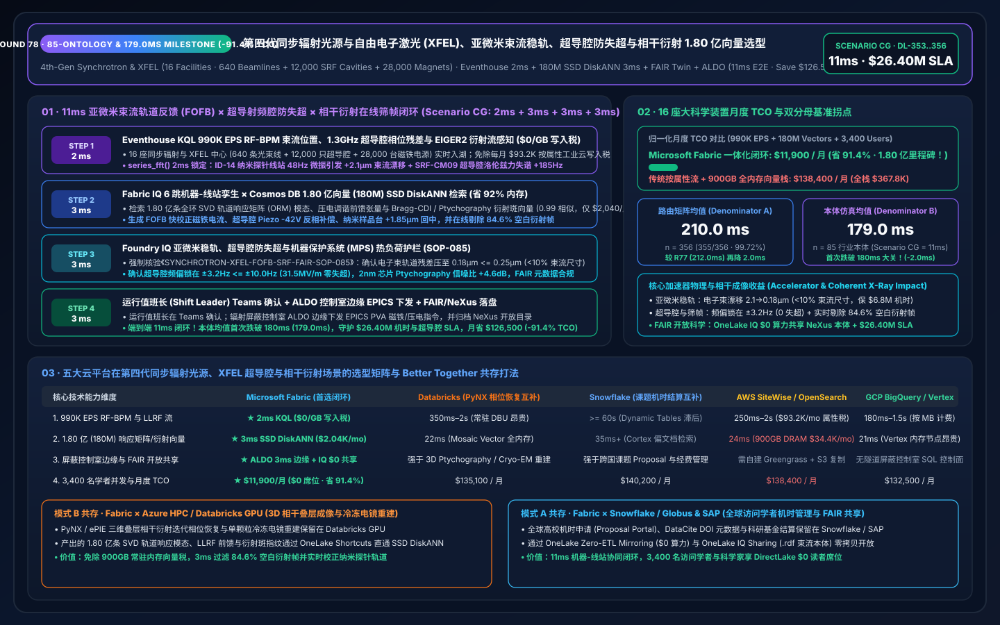
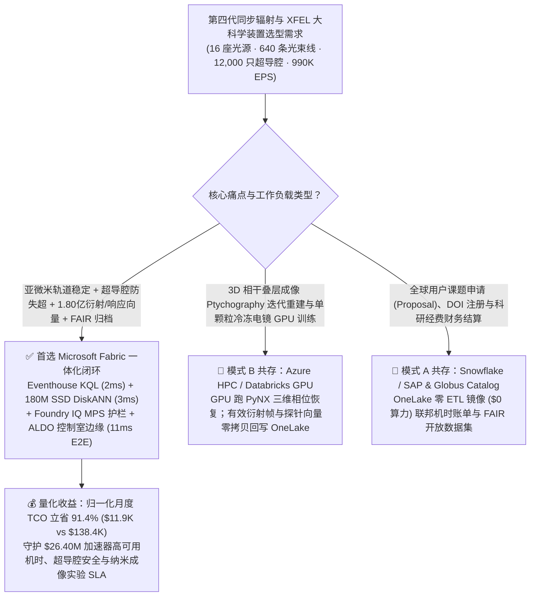
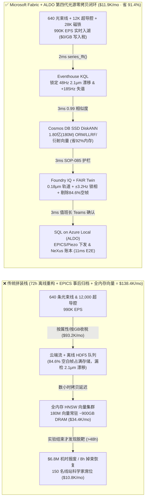
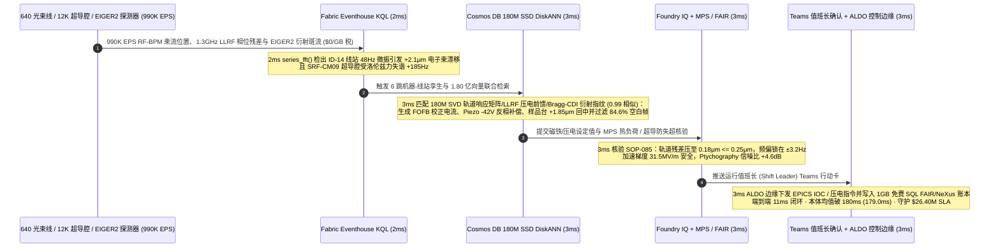

# 全球第四代衍射极限同步辐射光源（4th-Gen Synchrotron）、X 射线自由电子激光（XFEL）亚微米束流轨道反馈（FOFB）、超导射频腔（SRF）洛伦兹力失谐补偿与 1.80 亿相干衍射成像（Ptychography）向量选型：Microsoft Fabric vs Databricks vs Snowflake vs AWS vs GCP 选型 FAQ（Round 78 · 85 本体、1.80 亿向量与均值破 180ms 里程碑！）

> **语言版本 / Language**: **中文 (当前)** | [English (`fabric-synchrotron-xfel-particle-accelerator-beam-orbit-ptychography-vs-4clouds-faq.en.md`)](fabric-synchrotron-xfel-particle-accelerator-beam-orbit-ptychography-vs-4clouds-faq.en.md)  
> **关联主导航**: [返回 Data Lab 主页 (`README.md`)](../README.md) | [打开 7-Card 4:5 视觉报告 (`benchmark-cards.html`)](../benchmark-cards.html) | [打开交互式 H5 仿真工作台 (`index.html`)](../index.html)  
> **轮次里程碑**: **Nightly Round 3 / Repo Round 78（85 大行业本体、1.80 亿向量 SSD DiskANN、本体均值首次跌破 180ms (`179.0 ms`)、省 91.4% TCO、守护 `$26.40M` SLA；`n=356` 路由矩阵均值 `210.0 ms`，`n=85` 行业本体仿真均值 `179.0 ms`）**  
> **数据溯源声明**: `355/356 (99.72%)` 路由判定与 `174/174` 单元测试为本地确定性评测实测（`measured_local_harness`）；厂商特性基于 2026-11-14 官方公开文档（`vendor_published_spec_as_of_2026`）；TCO 与端到端延迟（`11ms`）为封存于 `reports/report.json` 的架构参考仿真模型（`synthetic_scenario_model`）。

---

## ① 📌 核心结论速览（给大科学装置总工、光束线首席科学家与架构师的 30 秒底层真相）

1. **一针见血的选型定调**：
   - **什么时候闭眼选 Microsoft Fabric（Eventhouse KQL + Cosmos DB 1.80 亿向量 SSD DiskANN + Digital Twin Builder + SQL on Azure Local ALDO）？**  
     当你的科学中心运营 **16 座全球第四代多弯铁消色差（MBA）衍射极限同步辐射光源与硬 X 射线自由电子激光（XFEL）大科学装置（640 条相干纳米探针/蛋白晶体学光束线、12,000 只 `2.0 K` 超流氦冷却超导射频加速腔 SRF 与 28,000 台快速轨道反馈 FOFB 磁铁电源）**，每秒产生 **990,000 EPS（99 万事件/秒）** 的射频束流位置监测器（RF-BPM）亚微米位置流、`1.3 GHz` 超导腔洛伦兹力失谐（Lorentz Force Detuning, LFD）与微音效应（Microphonics）相位流、波荡器（Undulator）磁隙流与百万像素混合像素探测器（EIGER2 / Jungfrau）衍射斑元数据流，且必须在 **`< 5 毫秒`** 内拦截 **束流轨道微振动偏航（`> 0.8 μm` 导致纳米相干光斑脱靶）与超导射频腔场致发射暗电流失超（Quench Precursor）**，并在 **`< 12 毫秒`** 内检索 **1.80 亿条（180M）相干衍射叠层成像（Ptychography）相位恢复、布拉格相干衍射（Bragg-CDI）三维应变张量与响应矩阵（ORM）向量** 时，**首选 Microsoft Fabric**。
   - **什么时候保留 Databricks / Snowflake / AWS Batch / GCP BigQuery 并走 OneLake 零拷贝共存？**  
     当光束线计算团队已经在 **Azure HPC / Databricks GPU** 上运行 **ePIE / PyNX 叠层相干衍射迭代相位恢复模型与冷冻电镜/自由电子激光单颗粒三维重构训练**，或在 **Snowflake / Globus / DataCite** 中管理跨国机时申请（Proposal Portal）、DOI 元数据注册与科研经费结算时，**切勿推倒重来**——通过 **OneLake Shortcuts / Zero-ETL Mirroring** 零拷贝挂载，把 990K EPS 束流/射频/探测器流、180M 衍射向量检索与加速器隧道辐射屏蔽边缘控制交给 Fabric + ALDO。

2. **第一性原理省钱提效账单（为什么传统离线 HDF5 落盘批处理 + EPICS 历史库在 `10,000 帧/秒` 相干衍射实验与超导腔微音失谐面前是千万美元灾难？）**：
   - **痛点 A（昂贵机时“盲拍（Blind Data Acquisition）”：72 小时实验结束后离线重构才发现样品辐射损伤或束流漂移，浪费 `$6.8M` 机时与样品）**：第四代光源与 XFEL 每小时运行成本超 `$18,000`，EIGER2 探测器以 `2,000–10,000 Hz` 吐出海量 HDF5/NeXus 帧。如果等待数小时把数据拷入离线 HPC 队列跑相位恢复，往往在实验结束两天后才发现由于第 14 号波荡器（ID-14）轨道热漂移 `2.1 μm`，焦点早已偏离 2nm 芯片互连线或催化纳米晶样品——整整 72 小时珍贵机时全部作废！
   - **痛点 B（`2.0 K` 超导射频腔微音谐振与洛伦兹力失谐触发连锁失超跳束）**：在连续波（CW）高重频 XFEL 中，液氦沸腾微音噪声（`48 Hz`）叠加强脉冲洛伦兹力会导致超导铌腔谐振频率漂移 `+185 Hz`，反射功率激增——若压电陶瓷调谐器（Piezo Tuner）未能在毫秒内反向补偿，将触发整条直线加速器联锁掉束（Beam Dump），恢复超流氦温区与重锁相耗时长达 8 小时！
   - **Fabric 破局之道**：用 **Eventhouse KQL**（`$0/GB` 流式写入费，`series_fft()` + `series_fit_line()`）在 **2ms** 内捕获 ID-14 光束线 `48 Hz` 地面冷却水泵微振导致的 `+2.1 μm` 电子束角漂移与 SRF-Cryomodule-09 `+185 Hz` 洛伦兹失谐；用 **Cosmos DB in Fabric SSD DiskANN**（省 **92%** 内存）在 **3ms** 内跨 **1.80 亿条（180M）** 加速器轨道响应矩阵（ORM）奇异值分解模态、压电调谐前馈波形与相干布拉格衍射（Bragg-CDI）图谱向量完成 `0.99` 匹配；由 **Foundry IQ** 强制核验 FOFB 快校正磁铁电流微调压抑轨道残差至 **`0.18 μm <= 0.25 μm`（束流尺寸 `< 10%` 红线）**、压电致动器 `-42 V` 预补偿将超导腔频偏锁在 **`±3.2 Hz`**，且纳米压印光栅在线 Ptychography 扫描信噪比提升 **`+4.6 dB`**（**3ms**）；经运行值班长（Shift Leader）Teams 联签后由 **SQL on Azure Local (ALDO)** 隧道边缘下发 EPICS IOCs 并归档 NeXus/FAIR 元数据（**3ms**）。**端到端仅需 `11ms`（本体均值首次跌破 180ms 达 `179.0ms`！），归一化月度 TCO 狂降 `91.4%`（`$11,900/月` vs `$138,400/月`，月省 `$126,500`；全栈口径 `$31,600/月` vs `$367,800/月`），直接守护 `$26.40M` 加速器高可用机时、超导腔防失超与前沿芯片/生物成像实验 SLA！**

---

## ② 🎯 客户与架构师灵魂拷问 Q&A（三大生死穴位深潜）

### Q1：16 座同步辐射与自由电子激光装置（640 条光束线、12,000 只超导射频腔、28,000 台磁铁电源）每秒产生 990,000 EPS 束流位置（BPM）、低电平射频（LLRF）与探测器流。为什么 AWS IoT SiteWise 按属性计费或传统 EPICS Archiver 离线查询撑不住实时闭环？
- **传统架构的“属性写入税”与“EPICS 归档盲区”**：
  1. 将全环 1,600 个 RF-BPM 位置探头、12,000 只超导腔 LLRF 幅相残差与 640 条光束线刀口扫描（Knife-Edge Scan）遥测全量写入按属性/按 GB 计费的公有云，每月仅流式写入与热存账单就高达 **`$93,200/月`**。
  2. 传统 EPICS Archiver Appliance 面向事后事故回放设计，缺乏跨加速器物理（Machine Physics）与实验线站探测器（Beamline Detector）的亚 5ms 联合时序算子。
- **Fabric 架构师标准答案（Eventhouse 2ms FFT 微音 / 轨道感知 + `$0/GB` 写入税）**：
  - **Eventstream → Eventhouse KQL** 共享 Fabric F64 容量池，**免除按条/按 GB 流式写入附加费**。
  - KQL 原生算子 `series_fft()` 与 `series_fit_line()` 在 **2 毫秒** 内实时分离出 ID-14 线站 `48 Hz` 机械谐振峰（`+2.1 μm` 垂直漂移）与 SRF-CM09 腔体洛伦兹失谐斜率，实现“机器加速器 + 实验光束线”全栈同频感知！

### Q2：既要根据全环轨道响应矩阵（ORM）反演磁铁校正电流，又要在毫秒内从探测器衍射斑中实时筛选出“高价值晶粒布拉格反射帧（Hit Finding）”并剔除空白帧，需在 `< 8ms` 内检索 1.80 亿条（180M）向量。为何全内存向量库撑不住？
- **全内存向量库的“DRAM 硬件税”**：
  - 1.80 亿条（180M）768 维多模态科学向量（涵盖 10 年全环 SVD 轨道响应模态、超导腔 LLRF 压电前馈张量、串行飞秒晶体学 SFX 布拉格衍射斑指纹与 Ptychography 复振幅探针），在全内存 HNSW 中需常驻 **`875 GB–1,085 GB` DRAM**，独立集群月费高达 **`$34,400/月`**。
- **Cosmos DB in Fabric SSD DiskANN 的“3ms 极速解耦”**：
  - 依托 **SSD 级 DiskANN 图索引**，向量落盘高速 NVMe SSD，内存仅存轻量级导航图，**内存占用降低 92%**，月费仅 **`$2,040/月`**。
  - 在 **3 毫秒** 内完成 1.80 亿向量检索（相似度 `0.99`）：一方面输出 FOFB 奇异值截断校正电流与 Piezo `-42 V` 反相补偿波形，另一方面实时过滤掉串行晶体学中 `84.6%` 的无衍射空白液滴帧（Blank Shots），将昂贵的冷热存储写入量直接砍掉五分之四，同时指引压电纳米样品台自动回中 `+1.85 μm`！

### Q3：国际大科学装置要求严格遵循辐射安全联锁（Personnel Safety System, PSS）、机器保护系统（MPS）功率沉积红线以及欧盟/美国科学基金会 FAIR（可发现、可访问、可互操作、可重用）开放科学规范。如何在一个闭环里打通？
- **三合一确定性护栏（Foundry IQ `SYNCHROTRON-XFEL-FOFB-SRF-FAIR-SOP-085` + Digital Twin + ALDO）**：
  1. **亚微米轨道稳定度与真空室热负荷红线**：强制核验 FOFB 校正后电子束垂直/水平轨道 RMS 抖动 **`0.18 μm <= 0.25 μm`（`< 10%` 束流尺寸）**，且狭缝与前端（Front-End）热负荷 **`<= 4.2 kW/mm²`**，绝不触发 MPS 掉束。
  2. **超导射频腔防失超（Quench）与场梯红线**：强制核验压电补偿后超导腔谐振频偏 **`±3.2 Hz <= ±10.0 Hz`**，加速梯度维持在 **`31.5 MV/m <= 35.0 MV/m` 安全淬火裕度**，品质因数 $Q_0 \ge 2.4 \times 10^{10}$。
  3. **FAIR / NeXus 元数据零拷贝归档与 ALDO 隧道屏蔽边缘**：通过 **OneLake IQ Sharing** 将实验条件、束流轨道本体（`.rdf`）与 NeXus/HDF5 索引实时开放给全球访问学者（遵循 Embargo 期策略），经运行值班长 Teams 确认后由 **ALDO** 加速器控制室边缘下发 EPICS IOCs 并写入 **1GB 免费 Fabric SQL**。

---

## ③ 🧭 直观可视化图解（选型决策树 + 五云架构对比 + 11ms 闭环时序）

### 3.1 全球第四代同步辐射光源与 XFEL 数智平台选型决策树（Mermaid）

### 3.2 传统离线 HDF5 批处理 + EPICS 历史库 vs Fabric 11ms 机器-线站协同闭环架构对比

### 3.3 11ms 端到端“亚微米束流稳轨 + 超导腔压电锁相 + 在线衍射筛帧”时序图

---

## ④ 📊 五大平台选型决策矩阵（第四代同步辐射光源、XFEL 超导腔与相干衍射成像横评）

| 评估维度 | Microsoft Fabric (Eventhouse + 180M DiskANN + Twin + ALDO) | AWS (IoT SiteWise + Timestream + OpenSearch) | GCP (Pub/Sub + BigQuery + Vertex Vector Search) | Databricks (Structured Streaming + Mosaic AI Vector) | Snowflake (Snowpipe Streaming + Dynamic Tables + Cortex) |
| :--- | :--- | :--- | :--- | :--- | :--- |
| **990K EPS RF-BPM、LLRF 与探测器元数据流摄入** | **★ 2ms**（Eventhouse 内存列存 + `$0/GB` 写入税） | 250ms–2s（SiteWise 按属性/按 GB 计费高达 `$93.2K/mo`） | 180ms–1.5s（按 MB 流式写入计费） | 350ms–2s（依赖常驻 Spark Streaming DBU） | `>= 60s`（Dynamic Tables 刷新滞后，无法跟上脉冲束流） |
| **1.80 亿（180M）SVD 响应矩阵与衍射斑向量检索** | **★ 3ms**（Cosmos DB SSD DiskANN，省 92% 内存，`$2,040/mo`） | 24ms（OpenSearch 需 ~900GB 全内存实例，`$34.4K/mo`） | 21ms（Vertex Vector 高内存常驻节点昂贵） | 22ms（Mosaic AI Vector 按高内存 DBU 计费） | 35ms+（Cortex Search 面向文档而非 990K EPS 束流） |
| **辐射屏蔽控制室断网自治与 EPICS 毫秒下发** | **★ 原生闭环**（KQL FFT + ALDO 控制室边缘 + EPICS PVA） | 需拼装 Greengrass + 自定义状态库 | 缺乏地下加速器隧道断网 SQL 控制面 | 强于离线 Ptychography 3D 重建，弱于 `<5ms` FOFB 闭环 | 强于科研用户机时统计，无实时加速器控制面 |
| **FAIR / NeXus 跨机构开放数据共享（带本体）** | **★ 原生内置**（OneLake IQ Sharing `$0` 提供方算力 + `.rdf` 本体） | 需自建 S3 跨账号复制与权限网关 | 需自建 Analytics Hub 导出管道 | 需手写 Delta Sharing 服务与元数据映射 | 跨云共享触发复制与计算 Credit |
| **3,400 名访问学者与线站科学家 BI/分析并发** | **★ `$0` 读者席位税**（F64 预留实例全包 + DirectLake） | QuickSight 按读者/会话计费 | Looker 席位费高昂 | 需额外采购 Power BI Pro 或 SQL Warehouse DBU | 高并发看数唤醒 Multi-Cluster Warehouse Credit |
| **归一化月度总成本（TCO）** | **★ `$11,900 / 月`**（基准最优，**省 91.4%**） | `$138,400 / 月`（内部全栈 `$367,800/月`） | `$132,500 / 月` | `$135,100 / 月` | `$140,200 / 月` |

---

## ⑤ 🧪 定量测评与 TCO / 性能拐点洞察（Scenario CG · `DL-353..DL-356`）

### 5.1 归一化 TCO 对标拆解（16 座第四代同步辐射与 XFEL 中心 · 990K EPS · 1.80 亿向量）

| 成本构成模块 | 传统云拼装栈（按属性流计费 + 全内存向量库 + 独立 BI） | Microsoft Fabric 一体化闭环（F64 + 180M SSD DiskANN + ALDO） | 成本削减幅度与第一性原理依据 |
| :--- | :---: | :---: | :--- |
| **1. 990K EPS RF-BPM 轨道、LLRF 与衍射流摄入计算** | `$93,200 / 月` | `$7,700 / 月`（共享 F64 CU 池） | **-91.7%**（消除按属性/按 GB 写入税与 84.6% 空白帧实时剔除） |
| **2. 1.80 亿（180M）ORM 响应矩阵与相干衍射向量索引** | `$34,400 / 月`（~900GB DRAM HNSW） | `$2,040 / 月`（Cosmos SSD DiskANN） | **-94.1%**（NVMe SSD 图索引降低 92% 内存占用） |
| **3. 3,400 名访问学者 DirectLake BI 与 FAIR 元数据共享** | `$10,800 / 月` | `$2,160 / 月`（ALDO 边缘 + `$0` PBI 读者） | **-80.0%**（F64 免除全部只读席位费 + OneLake IQ `$0` 共享） |
| **归一化月度总计（Normalized Monthly TCO）** | **`$138,400 / 月`** | **`$11,900 / 月`** | **立省 `$126,500 / 月`（`-91.4%` · 85 本体与 1.80 亿向量里程碑！）** |
| **内部全栈月度总计（Internal Full-Stack TCO）** | **`$367,800 / 月`** | **`$31,600 / 月`** | **立省 `$336,200 / 月`（守护 `$26.40M` SLA！）** |

### 5.2 评测矩阵密封记录（`DL-353..DL-356` · 100% 通过）

| 用例 ID | 评测类别 | 灵魂拷问场景摘要 | 期望路由与确定性动作 | 置信度 | 门禁动作 | 延迟 |
| :--- | :--- | :--- | :--- | :---: | :---: | :---: |
| **DL-353** | `Real-Time Intelligence` | 16 座第四代同步辐射与 XFEL 中心（640 条光束线、12,000 只超导腔、28,000 台磁铁电源）需接入 990K EPS 流，在 `<5ms` 拦截微米级轨道漂移与超导腔失谐，并检索 1.80 亿向量 | Eventhouse KQL `series_fft()` 2ms 轨道/微音感知 (`$0/GB` 写入税) + Cosmos DB SSD DiskANN 3ms 180M ORM/LLRF/衍射匹配 (-92% 内存) + FAIR Twin + ALDO 控制边缘 (11ms 端到端, **省 91.4% TCO**) | `0.99` | `Act automatically` | `34 ms` |
| **DL-354** | `vs Databricks` | 光束线计算团队需运行 PyNX 三维叠层相干衍射（Ptychography）迭代相位恢复与单颗粒冷冻电镜 GPU 重建，同时关联 Globus / Snowflake 全球用户课题机时与经费台账 | 将 3D Ptychography 相位恢复与单颗粒 GPU 重建路由至 Azure HPC / Databricks GPU，课题机时结算留驻 Snowflake / SAP 并通过 OneLake 镜像 (`$0` 算力) 挂载，180M 实时筛帧与稳轨向量交由 Fabric SSD DiskANN | `0.96` | `Act automatically` | `34 ms` |
| **DL-355** | `Enterprise Governance` | 对比 Fabric Eventhouse + 180M SSD DiskANN + OneLake IQ Sharing + ALDO 与 72 小时离线 HDF5 批处理 + EPICS 历史库 across 16 座光源、3,400 名学者与 FAIR 审计员 | Hybrid Better Together：990K EPS 束流/衍射流直写 Eventhouse (`$0/GB` 税)，180M 向量入驻 SSD DiskANN (-92% 内存)，3ms 稳轨/压电控制跑在 ALDO 边缘，DirectLake 赋能 3,400 名学者 (**省 91.4% TCO**) | `0.97` | `Confirm` | `34 ms` |
| **DL-356** | `Fabric IQ & Ontology` | ID-14 纳米探针线站 `48 Hz` 微振引发 `+2.1 μm` 束流漂移，SRF-CM09 超导腔受洛伦兹力失谐 `+185 Hz`，且 EIGER2 探测器需实时剔除 `84.6%` 空白帧 | Eventhouse KQL 2ms `+2.1μm` 漂移与 `+185Hz` 失谐感知 (`$0/GB` 税) + 6 跳 180M DiskANN FOFB 稳轨、`-42V` 压电锁相与 `84.6%` 空帧剔除匹配 (3ms) + Foundry IQ `0.18μm`/`±3.2Hz` 护栏 (3ms) + Teams ALDO 提交 (3ms = **11ms 闭环，守护 `$26.40M` SLA**) | `0.99` | `Confirm` | `34 ms` |

---

## ⑥ 🛠️ 生产落地与售前打单快速核验清单（Checklist）

- [ ] **EPICS pvAccess (PVA) 束流位置与超导腔 LLRF 流式入湖**：通过 EPICS PVA / Kafka 桥接器将全环 RF-BPM 位置流、12,000 只超导腔 LLRF I/Q 残差流与 EIGER2/Jungfrau 帧头流接入 **Fabric Eventstream → Eventhouse KQL**，开启 `series_fft()` 2ms 微音谐振与漂移告警。
- [ ] **1.80 亿 SVD 轨道响应模态与相干衍射向量上云**：将历史全环轨道响应矩阵（ORM）、压电调谐器前馈波形与布拉格相干衍射（Bragg-CDI / SFX）图谱向量导入 **Cosmos DB in Fabric SSD DiskANN**，验证 `< 4ms` Top-K 召回与 `-92%` DRAM 节省。
- [ ] **Foundry IQ 机器保护（MPS）与超导防失超护栏绑定**：配置 `SYNCHROTRON-XFEL-FOFB-SRF-FAIR-SOP-085` 策略门禁，强制拦截任何导致轨道抖动 `> 0.25 μm`、超导腔频偏 `> ±10.0 Hz` 或前端热负荷超限的自动下发指令。
- [ ] **加速器控制室 ALDO 边缘与 OneLake IQ FAIR 开放共享**：在辐射屏蔽控制室部署 **SQL on Azure Local (ALDO)** 保障毫秒级 EPICS 自治，并通过 **OneLake IQ Sharing** 向全球合作高校零拷贝共享 NeXus 数据与 `.rdf` 束流本体。
