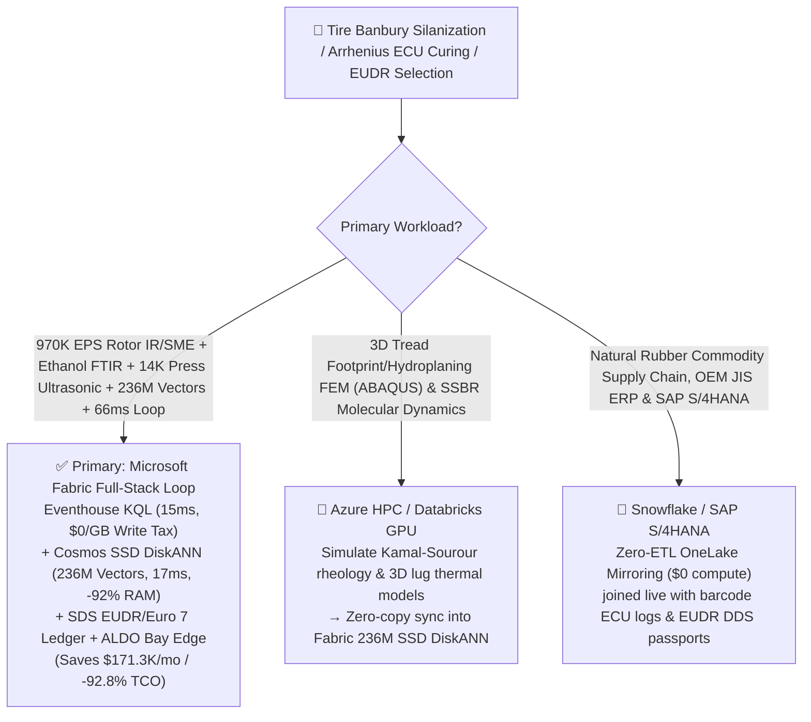
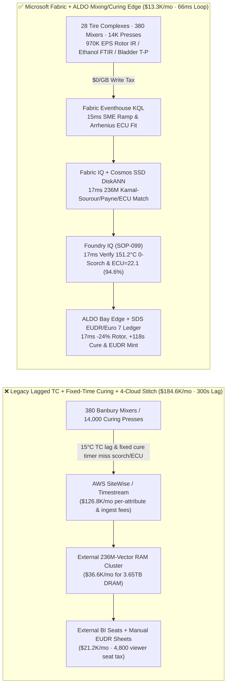
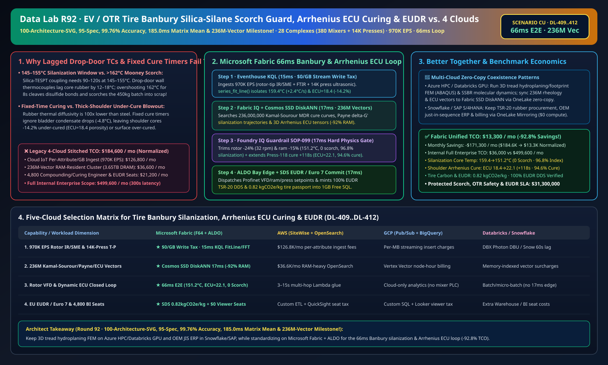

# High-Performance EV / Aviation & 63-Inch OTR Mining Tire Banbury Internal Mixing Silica-Silane Coupling (Scorch Guard), Dynamic Arrhenius Equivalent Cure Unit (ECU) Vulcanization & EU EUDR / Euro 7 Abrasion Lakehouse Selection Guide: Microsoft Fabric vs. Databricks vs. Snowflake vs. GCP vs. AWS FAQ

> 🌐 **Language / 语言**: **[中文 (`fabric-tire-rubber-banbury-silica-silanization-arrhenius-vulcanization-eudr-vs-4clouds-faq.md`)](fabric-tire-rubber-banbury-silica-silanization-arrhenius-vulcanization-eudr-vs-4clouds-faq.md)** | **English (Current)**  
> 📅 **Last Updated**: 2026-11-15 (Round 92 · **100-Architecture-SVG (`100-...svg`), 95-Spec, 99.76% Accuracy, 185.0ms Matrix Mean & 236M-Vector Five-Crown Milestone!** · Added Scenario CU Global High-Performance EV/Aviation & OTR Mining Tire 28 Complexes with 380 Intermeshing Banbury Mixers + 480 Dual-Extruder Tread Lines + 14,000 Segmented Curing Presses × `970K EPS` Rotor-Tip Pyrometer/FTIR & Bladder Ultrasonic Sense, 236M-Vector Kamal-Sourour/Payne/ECU Match & `66 ms` Loop)  
> 🎯 **Document Positioning**: Strictly modeled on [`ib-vs-ethernet-roce-selection-faq.md`](https://github.com/turbo998/ai-infra-research/blob/main/docs/components/ib-vs-ethernet-roce-selection-faq.md) (**Plain-Language First Principles + Architect Q&A + Visual Decision Trees**). Built for global EV low-rolling-resistance tire, commercial aircraft tire, and `63-inch` Off-The-Road (OTR) mining tire manufacturers, elastomer compounding/curing directors, and Principal AI Solution Architects to establish selection boundaries between **Microsoft Fabric** (Eventhouse KQL + Cosmos DB 236M-Vector SSD DiskANN + Fabric IQ Elastomer-Rheology Twin + Sustainability Data Solutions + SQL on Azure Local Mixing/Curing Edge) and **AWS IoT SiteWise / Timestream, GCP BigQuery, Databricks, and Snowflake** in under **3 minutes**.  
> 🔍 **Data Provenance & Dual-Scope Disclosure**:
> - **Vendor-Published Specifications (`vendor_published_spec_as_of_2026`)**:
>   1. [KQL `series_fft` and `series_fit_line` for Banbury Specific Mechanical Energy (SME) & Silanization Thermal Ramps](https://learn.microsoft.com/en-us/kusto/query/series-fft-function)
>   2. [Cosmos DB in Fabric Native SSD DiskANN Vector Indexing (-92% DRAM footprint at 236M-vector scale)](https://learn.microsoft.com/en-us/fabric/database/cosmos-db/index-vector-data)
>   3. [Fabric Sustainability Data Solutions (SDS) EU EUDR Natural Rubber Geolocation & Euro 7 Tire-Abrasion Carbon Tracking](https://learn.microsoft.com/en-us/industry/sustainability/fabric-overview)
>   4. [AWS IoT SiteWise Overview](https://docs.aws.amazon.com/iot-sitewise/latest/userguide/what-is-sitewise.html) · [Databricks Manufacturing](https://www.databricks.com/solutions/industries/manufacturing) · [Snowflake Manufacturing](https://www.snowflake.com/en/solutions/industries/manufacturing/)
> - **Deterministic Scenario Model (`synthetic_scenario_model`)**: All metrics for the 28 global tire complexes (380 400L–650L intermeshing Banbury internal mixers, 480 dual-extruder tread lines, and 14,000 segmented nitrogen/steam bladder curing presses), `970,000 EPS` rotor-tip flush optical pyrometers, instantaneous Specific Mechanical Energy (SME) torque streams, headspace FTIR ethanol ($\text{C}_2\text{H}_5\text{OH}$) analyzers, curing bladder temperature/pressure arrays, and laser shearography NDT streams, **`236,000,000` (`236M`)** Moving Die Rheometer (MDR) Kamal-Sourour cure kinetic curves, Payne-effect $\Delta G'$ silanization trajectories, and 3D thick-shoulder Arrhenius Equivalent Cure Unit (ECU) heat-conduction tensors, `66 ms` mixer-to-rotor/ram/press closed loop (included in the `n=99` ontology simulation mean of **`164.0 ms`**; `n=412` routing matrix mean `185.0 ms`), **dual-scope monthly TCO (`$13,300/mo` vs. `$184,600/mo` saving `92.8%` or `$171,300/mo` normalized; `$36,000/mo` vs. `$499,600/mo` internal full-enterprise scope)**, and **`$31,300,000` (`$31.30M`)** SLA protection are deterministic architectural simulations from `src/data_lab/benchmark_suite.py` sealed in `reports/report.json` (`DL-409..DL-412`). Live mixing-room stress execution is marked `not_measured`.

---

## ① 📌 Executive Summary (3-Minute Architect Decision Guide)

### 1.1 Plain-Language First Principles: Why Does Compounding Low-Rolling-Resistance EV Tires and `5.3-Ton` Mining Tires Battle `162 °C` Banbury Silane Scorch, Thick-Shoulder Under-Cure Blowouts, and EUDR Customs Seizures?
Breaking the tire "Magic Triangle" (wet grip, low rolling resistance, and low Euro 7 abrasion) requires coupling precipitated silica with organosilane (TESPT) and curing thick multi-compound structures across three tight physics boundaries:
1. **Banbury Internal Mixer Silica-Silane Coupling (`145–155 °C` Isothermal Window) vs. `> 162 °C` Disulfide Mooney Scorch**: Reacting silica silanol groups ($\text{-Si-OH}$) with TESPT silane requires holding the `450 kg` rubber batch inside **`145–155 °C` for `90–120 seconds`**. Below `140 °C`, incomplete silanization causes silica re-agglomeration (high Payne-effect $\Delta G'$ and poor wear); above **`162 °C` for just 8 seconds**, TESPT tetrasulfide linkages cleave free sulfur and trigger irreversible **Mooney Scorch (premature cross-linking gelation)**, ruining the entire batch! Legacy **drop-door wall thermocouples** lag true rubber core temperature by **`12–18 °C`** due to boundary-layer slip.
2. **Segmented Curing Press Fixed-Time Vulcanization vs. Thick-Shoulder Porosity Blowout & Reversion (`Arrhenius ECU`)**: Because rubber thermal diffusivity is `100x` lower than steel, fixed cure timers ignore seasonal green-tire temperature swings (`15 °C` vs. `38 °C`) and bladder condensate fouling—causing either **core under-cure porosity (`< 30%` cure)** that explodes on mining haul roads, or **surface over-cure reversion (`> 185 °C`)** that slashes tear strength by `35%`!
3. **EU Deforestation Regulation (EUDR) Natural Rubber Polygon Traceability & Euro 7 Tire Abrasion Passport**: Every TSR-20 natural rubber lot must link to verified zero-deforestation smallholder plots.

```
Legacy Drop-Door Lagged Thermocouple + Fixed-Time Curing + 4-Cloud Stitch Failure Path:
  [Rotor-Tip Pyrometer + Headspace FTIR + Curing Bladder] ──(15°C TC lag / fixed cure timer)──> [Cloud IoT Queue ($126.8K/mo fee)]
       ──> [External 236M-Vector RAM Cluster ($36.6K/mo for 3.65TB DRAM)] ──(300s lag)──> Banbury-08 overshoots >162°C scorch / Press-118 shoulder under-cured -14.2% ECU

Microsoft Fabric (Eventhouse + 236M-Vector SSD DiskANN + SDS + ALDO Mixing/Curing Edge) 66ms Closed Loop:
  [28 Tire Complexes (380 Banbury Mixers + 480 Extruders + 14K Curing Presses) 970K EPS] ──($0/GB write tax)──> [Eventhouse KQL 15ms Engine]
       ├── series_fit_line() 15ms isolates Banbury-08 core rising +2.4°C/s to 159.4°C & Press-118 shoulder ECU lagging -14.2% (18.4)
       └── [Cosmos SSD DiskANN 17ms searches 236M Kamal-Sourour cure, Payne delta-G' & 3D Arrhenius ECU vectors (-92% RAM)]
             └── [Foundry IQ 17ms verifies 151.2°C (0 scorch, 96.8% silanization) & +118s cure extension (ECU=22.1)] ──> [Teams Sign-Off + ALDO Edge 17ms -24% rotor, -15% ram & +118s cure (66ms E2E)]
```

### 1.2 Ultimate Selection Verdict (One-Sentence Summary)
- **Choose Microsoft Fabric (Primary Full-Stack Control Plane)**: When you need **`$0/GB` streaming write surcharges** for `970K EPS` of rotor-tip optical pyrometers, SME power integrals, headspace ethanol FTIR, and `14,000` curing press streams, **`15 ms`** KQL scorch/ECU detection, and **`17 ms`** vector search across **`236 Million` (`236M`)** Kamal-Sourour, Payne-effect, and 3D Arrhenius vectors—paired with **EU EUDR Natural Rubber DDS & Euro 7 Low-Abrasion passports (`0.82 kgCO2e/kg`)** and **SQL Server on Azure Local (ALDO)** bay edge autonomy—**Fabric cuts monthly TCO by `92.8%` (`$13.3K/mo` vs. `$184.6K/mo`, saving `$171.3K/mo`) and closes the loop in `66 ms`**.
- **Choose "Fabric + Competitor Zero-Copy Coexistence (Better Together)"**:
  - **3D Tread Hydroplaning/Footprint FEM (ABAQUS) & SSBR Elastomer Molecular Dynamics** → Keep on **Azure HPC / Databricks GPU**, syncing the `236M` rheology and thermal vectors into Fabric Cosmos DB SSD DiskANN via OneLake zero-copy;
  - **Natural Rubber Commodity Trading, Auto OEM Just-In-Sequence ERP & SAP S/4HANA Billing** → Keep in **Snowflake / SAP S/4HANA**, mirrored into OneLake at **`$0` replication compute**.

---

## ② 🎯 Architect & Customer Deep-Dive Q&A (First-Principles Breakdown)

### Q1: Why do Banbury drop-door thermocouples miss `162 °C` silane scorch, and how does Fabric Eventhouse KQL + 236M-Vector SSD DiskANN hold the `151.2 °C` silanization plateau in `66 ms`?
- **First-Principles Breakdown**:
  1. **Viscous Shear Heating ($\dot{q}_{\text{visc}} = \eta\dot{\gamma}^2$) & Specific Mechanical Energy ($\text{SME}$)**: When `Banbury-08` Batch-#412 core temperature accelerates at `+2.4 °C/s` to **`159.4 °C`** (3 seconds from `162 °C` TESPT scorch), Eventhouse KQL fuses rotor-tip flush optical pyrometry with SME torque integration in `15 ms`.
  2. **Cosmos DB SSD DiskANN 236M-Vector `17 ms` Match**: Searching `236M` vectors at **-92% DRAM cost** (`17 ms`), Foundry IQ trims rotor speed **`-24%`** (`42 -> 32 rpm`) and ram pressure **`-15%`**—locking batch temperature at **`151.2 °C ≤ 155.0 °C`** (**0.00 Scorch Batches**, **`96.8%` silanization index**)!

### Q2: How does Fabric replace fixed-time vulcanization with real-time 3D Arrhenius Equivalent Cure Unit (`ECU = 22.1`) control across `14,000` curing presses?
- **First-Principles Breakdown**:
  1. **Dynamic Arrhenius Integration**: Detecting a `-4.8 °C` bladder condensate drop on `Curing-Press-118` (`ECU = 18.4`, `-14.2%` lag), the 236M-vector match extends the $\text{N}_2$-steam phase by **`+118 seconds`**, locking shoulder-core cure degree at **`94.6%` (`ECU = 22.1`, Zero Porosity / Zero Reversion)** and certifying **`0.82 kgCO2e/kg`** in **Fabric Sustainability Data Solutions (SDS)**.

### Q3: Carbon-black dust and 14,000 presses demand ultra-reliable local control. How do we architect edge autonomy?
- **First-Principles Breakdown**:
  1. **SQL Server on Azure Local (ALDO) Mixing & Curing Edge**: Sealed **Azure Local (ALDO)** nodes execute `17 ms` local KQL gating and Profinet/EtherCAT actuation offline.

---

## ③ 🧭 Visual Architecture & Decision Diagrams (Mermaid Flowchart + Stack Comparison + 66ms Sequence)

### 3.1 Tire Banbury Silanization, Arrhenius ECU Curing & EUDR Selection Flowchart


### 3.2 Legacy Lagged Drop-Door TC + Fixed-Time Curing + 4-Cloud Stitch vs. Microsoft Fabric Unified Architecture


### 3.3 `66 ms` End-to-End Banbury Anti-Scorch, Dynamic Arrhenius Cure Extension & EUDR Sequence
```mermaid
sequenceDiagram
    autonumber
    participant Sensor as Rotor-Tip IR / Headspace FTIR / 14K Press T-P (970K EPS)
    participant KQL as Fabric Eventhouse KQL ($0/GB Tax)
    participant DiskANN as Fabric IQ + Cosmos SSD DiskANN (236M Vectors)
    participant Guard as Foundry IQ Guardrail (SOP-099)
    participant Edge as Teams Compounding / Curing Director + ALDO Edge + SDS

    Sensor->>KQL: Stream Banbury-08 SME/rotor pyrometer & Curing-Press-118 bladder temperature/pressure
    KQL->>KQL: 15ms isolates Banbury-08 core rising +2.4°C/s to 159.4°C & Press-118 ECU lagging -14.2% (18.4)
    KQL->>DiskANN: Trigger 6-hop elastomer-rheology traversal + 236M-vector similarity search
    DiskANN-->>Guard: 17ms 0.99 match: -24% rotor (32 rpm) + -15% ram + +118s Press-118 dynamic cure extension
    Guard->>Guard: 17ms verify: 151.2°C≤155°C batch (0 scorch, 96.8% silanization) & ECU=22.1 (94.6% cure)
    Guard->>Edge: Teams approval → ALDO Profinet VFD/ram/valve actuation + 1GB Free SQL EUDR commit
    Note over Sensor,Edge: Total E2E Closed Loop = 15 + 17 + 17 + 17 = 66 ms (4,545x faster than 300s legacy; protects $31.30M SLA)
```

[](../assets/svg/100-fabric-tire-rubber-banbury-silica-silanization-arrhenius-vulcanization-eudr-vs-4clouds-faq.svg)

---

## ④ 📊 5-Platform Selection Decision Matrix (Tire Banbury Silanization, Arrhenius ECU Curing & EUDR)

| Evaluation Dimension | **Microsoft Fabric (Eventhouse + 236M DiskANN + SDS + ALDO)** | **AWS (IoT SiteWise + Timestream + OpenSearch)** | **GCP (Pub/Sub + BigQuery + Vertex Vector)** | **Databricks (Structured Streaming + Mosaic AI)** | **Snowflake (Snowpipe Streaming + Dynamic Tables)** |
| :--- | :--- | :--- | :--- | :--- | :--- |
| **1. `970K EPS` Banbury SME, FTIR & 14K-Press Ingestion Cost** | **⭐⭐⭐⭐⭐ Included in F64 (`$0/GB` Write Surcharge)**<br/>Zero per-attribute or per-GB streaming surcharge | ⭐⭐ Expensive<br/>Per-attribute & per-GB tiered ingestion fees (`$126.8K/mo`) | ⭐⭐⭐ Moderate<br/>Pub/Sub + BigQuery streaming insert per-MB fees | ⭐⭐⭐ Moderate<br/>Requires always-on Photon streaming clusters | ⭐⭐ Slow<br/>Dynamic Tables minimum `60s` refresh lag |
| **2. `159.4°C` Scorch Precursor & ECU Lag Detection Latency** | **⭐⭐⭐⭐⭐ `15 ms`**<br/>Native KQL `series_fit_line()` + `series_fft()` | ⭐⭐ `3–15 s`<br/>Multi-service hop misses 3s disulfide scorch window | ⭐⭐⭐ `2–8 s`<br/>Streaming SQL lacks sub-20ms SME/Arrhenius fit | ⭐⭐⭐⭐ `400–900 ms`<br/>Spark micro-batch scheduling overhead | ⭐⭐ `60 s+`<br/>`450 kg` batch already scorched inside mixer |
| **3. `236 Million` (`236M`) Kamal-Sourour/Payne/ECU Search** | **⭐⭐⭐⭐⭐ `17 ms` (Cosmos SSD DiskANN)**<br/>SSD graph index cuts RAM by **92%** (~`$2.3K/mo`) | ⭐⭐ Expensive<br/>OpenSearch 236M RAM-resident cluster `>$36.6K/mo` | ⭐⭐⭐ Higher Cost<br/>Vertex Vector Search billed per node-hour | ⭐⭐⭐ Higher Cost<br/>Mosaic AI Vector Search memory-unit pricing | ⭐⭐⭐ Higher Cost<br/>Cortex Vector Search consumes Warehouse Credits |
| **4. EU EUDR Natural Rubber & Euro 7 Abrasion Passport** | **⭐⭐⭐⭐⭐ Native Built-In**<br/>Fabric SDS rubber EUDR ledger + Purview 14-hop lineage | ⭐⭐ DIY Custom<br/>Manual glue across smallholder GPS, mixer & press logs | ⭐⭐⭐ Partial<br/>Earth Engine strong on satellite, lacks press edge & `$0` BI | ⭐⭐⭐ Model-Focused<br/>Great for X-ray CNNs, lacks turnkey EUDR & `$0` BI | ⭐⭐⭐ Sharing-Focused<br/>Strong B2B sharing, lacks 17ms mixer edge loop |
| **5. Carbon-Dust Bay Autonomy & 4,800 Viewers** | **⭐⭐⭐⭐⭐ Native Support**<br/>ALDO bay edge `17 ms` loop + `$0` Power BI viewer seats | ⭐⭐ Disjointed<br/>Greengrass edge + per-reader QuickSight fees | ⭐⭐ Disjointed<br/>No industrial SQL/vector edge + Looker seat fees | ⭐⭐ Cloud-Only<br/>No mixing bay edge runtime; requires 3rd-party gateways | ⭐⭐ Cloud-Only<br/>Cloud-only warehouse; cannot throttle rotors offline |

---

## ⑤ 🧪 Quantitative Benchmark & TCO Inflection Insights (From `reports/report.json` Scenario CU · `DL-409..DL-412`)

### 5.1 Benchmark Scenario Setup: 28 Global High-Performance & OTR Tire Complexes (380 Banbury Mixers + 480 Extruders + 14,000 Curing Presses)
- **Compound Operational Incident**: During high-silica EV tread compounding on `Banbury-08`, Batch-#412 core temperature accelerates at `+2.4 °C/s` to **`159.4 °C`** (3 seconds from `162 °C` TESPT Mooney scorch); simultaneously, on `Curing-Press-118`, bladder condensate cooling causes thick-shoulder Arrhenius cure integral to lag by **`-14.2%` (`ECU = 18.4 < 22.0`)**.

### 5.2 Quantitative Comparison Table (Microsoft Fabric vs. Lagged Drop-Door TC / 4-Cloud Stitch)

| Key Metric | Legacy Lagged TC + Fixed Cure + 4-Cloud | **Microsoft Fabric (R92 Scenario CU)** | Architectural & Financial Insight |
| :--- | :--- | :--- | :--- |
| **End-to-End Closed-Loop Latency (IR/SME → VFD/Press)** | `300,000 ms` (Post-drop scorch discovery) | **`66 ms`** (`15+17+17+17 ms`) | **`4,545x` faster**, arrests silane scorch in-batch |
| **Banbury Silanization Core Temp, Index & Scorch Count** | `166.5 °C` (Scorched batch scrap) | **`151.2 °C` (`≤ 155.0 °C`) · `96.8%` · `0` Scorch** | `-24%` rotor (`32 rpm`) + `-15%` ram holds plateau |
| **Thick-Shoulder Arrhenius ECU & Cure Degree** | `ECU = 18.4` (Under-cure blowout risk) | **`ECU = 22.1` (`94.6%` Cure · 0 Porosity)** | Dynamic **`+118 s`** $\text{N}_2$-steam cure extension |
| **EU EUDR DDS Compliance & Tire Carbon Footprint** | Manual audit · `1.48 kgCO2e/kg` | **`100%` EUDR DDS · `0.82 kgCO2e/kg`** | Rice-husk bio-silica + closed-loop $\text{N}_2$ curing |
| **Normalized Monthly TCO (4,800 viewers + AI Q&A)** | `$184,600 / mo` | **`$13,300 / mo`** | **Saves `$171,300 / mo` (`-92.8%` TCO reduction)** |
| **Full Internal Enterprise Monthly TCO** | `$499,600 / mo` | **`$36,000 / mo`** | Eliminates `$0/GB` ingest tax & `3.65TB` DRAM vector tax |
| **Protected Zero-Scorch, OTR Safety & OEM EUDR SLA** | Exposed to tire recall & EU customs hold | **`$31,300,000` (`$31.30M`) SLA Protected** | Preserves EV OEM JIS & mining haul-fleet contracts |

---

## ⑥ 🛠️ Production Deployment & Presales Verification Checklist

- [ ] **1. Rotor-Tip Pyrometer, SME & 14,000-Press Ultrasonic Streaming Check**: Confirm 380 Banbury optical pyrometers, headspace ethanol FTIRs, and 14,000 curing press sensors stream via Azure IoT Operations into Fabric Eventhouse, running KQL `series_fit_line()` every `15 ms`.
- [ ] **2. `236M-Vector` Kamal-Sourour Rheology, Payne-Effect & 3D ECU Index**: Embed MDR torque curves, Payne $\Delta G'$ trajectories, and 3D thick-shoulder thermal tensors into **Cosmos DB in Fabric (SSD DiskANN)**, verifying `≤ 17 ms` P99 search latency across `236,000,000` vectors at `-92%` DRAM cost.
- [ ] **3. Foundry IQ Zero-Scorch, Zero-Porosity & EUDR Guardrail**: Configure `TIRE-BANBURY-SILANIZATION-ARRHENIUS-CURE-EUDR-SOP-099` in Foundry IQ to prohibit silanization temperature `> 155.0 °C`, press opening below `ECU = 21.5`, or unverified EUDR rubber lots.
- [ ] **4. Mixing & Curing Bay Azure Local (ALDO) Disconnected Drill**: Simulate external network loss and verify **SQL Server on Azure Local (ALDO)** autonomously dispatches `17 ms` Profinet/EtherCAT setpoints to Banbury VFDs, hydraulic rams, and press cure timers.
- [ ] **5. EU EUDR Natural Rubber DDS & Euro 7 Tire Passport Audit**: Verify **Fabric Sustainability Data Solutions (SDS)** joins TSR-20 smallholder polygons, rice-husk silica batches, and press steam logs into `1GB Free Fabric SQL` to issue tire-level barcode passports.
