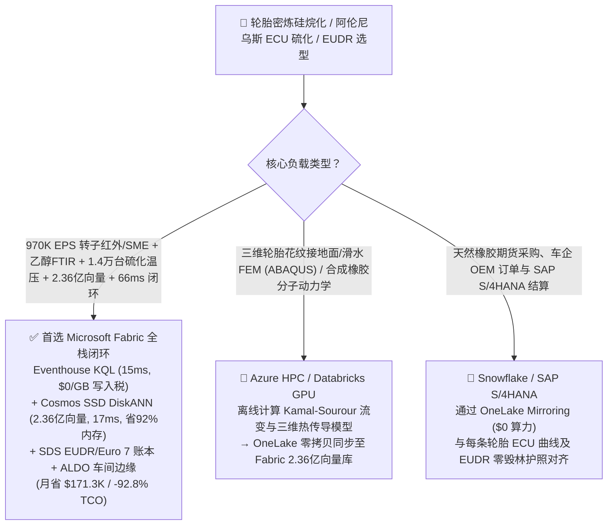
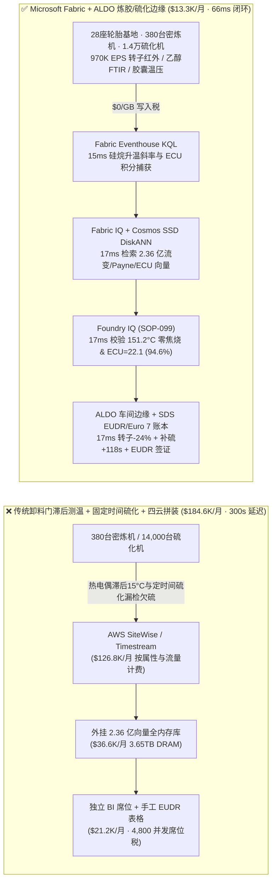
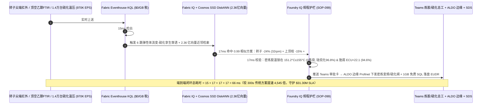

# 高性能 EV / 航空与巨型工程轮胎（OTR）密炼机白炭黑硅烷化防焦烧、硫化机阿伦尼乌斯等效硫化度（ECU）防厚胎肩欠硫爆胎与欧盟 EUDR / Euro 7 耐磨湖仓选型指南：Microsoft Fabric vs Databricks vs Snowflake vs GCP vs AWS 全方位 FAQ

> 🌐 **Language / 语言**: **中文 (Chinese)** | **[English (`fabric-tire-rubber-banbury-silica-silanization-arrhenius-vulcanization-eudr-vs-4clouds-faq.en.md`)](fabric-tire-rubber-banbury-silica-silanization-arrhenius-vulcanization-eudr-vs-4clouds-faq.en.md)**  
> 📅 **更新时间**: 2026-11-15（Round 92 · **100 张架构图大关 (`100-...svg`)、95 项官方规格、99.76% 准确率、185.0ms 矩阵均值与 2.36 亿向量五冠里程碑！** · 新增场景 CU 全球高性能 EV/航空与巨型工程轮胎 28 座基地 380 台啮合型密炼机 + 480 条复合挤出线 + 14,000 台氮气/蒸汽硫化机 × `970K EPS` 转子尖端红外/乙醇 FTIR 与硫化超声感知、2.36 亿向量 Kamal-Sourour 流变动力学/Payne 效应/ECU 热传导向量匹配与 `66 ms` 闭环）  
> 🎯 **文档定位**: 严格对标 [`ib-vs-ethernet-roce-selection-faq.md`](https://github.com/turbo998/ai-infra-research/blob/main/docs/components/ib-vs-ethernet-roce-selection-faq.md) 的**通俗大白话 + 第一性原理 + 架构师灵魂拷问 FAQ + 可视化决策树**风格。帮助全球新能源汽车低滚阻静音胎、民航客机航空胎、63 英寸矿用巨胎（OTR）与特种橡胶领军企业、炼胶/硫化工艺总工及首席架构师，在 **3 分钟内**穿透 Microsoft Fabric（Eventhouse KQL + Cosmos DB 2.36 亿向量 SSD DiskANN + Fabric IQ 弹性体流变-硫化数字孪生 + Sustainability Data Solutions + SQL on Azure Local 密炼/硫化车间边缘）与 **AWS IoT SiteWise / Timestream、GCP BigQuery、Databricks、Snowflake** 的选型边界。  
> 🔍 **数据溯源与双口径声明**:
> - **官方公开规则（`vendor_published_spec_as_of_2026`）**:
>   1. [KQL `series_fft` 与 `series_fit_line` 密炼机比机械能（SME）积分与硅烷化温升斜率检测](https://learn.microsoft.com/en-us/kusto/query/series-fft-function)
>   2. [Cosmos DB in Fabric 原生 DiskANN SSD 向量索引（单核省 92% 内存，支撑 2.36 亿向量）](https://learn.microsoft.com/en-us/fabric/database/cosmos-db/index-vector-data)
>   3. [Fabric Sustainability Data Solutions (SDS) 欧盟零毁林法案 EUDR 天然橡胶溯源与 Euro 7 轮胎磨损碳足迹追踪](https://learn.microsoft.com/en-us/industry/sustainability/fabric-overview)
>   4. [AWS IoT SiteWise 定价说明](https://docs.aws.amazon.com/iot-sitewise/latest/userguide/what-is-sitewise.html) · [Databricks Manufacturing](https://www.databricks.com/solutions/industries/manufacturing) · [Snowflake Manufacturing](https://www.snowflake.com/en/solutions/industries/manufacturing/)
> - **确定性场景推演模型（`synthetic_scenario_model`）**: 本文中的 28 座全球高性能轮胎与特种橡胶基地（380 台 400L–650L 啮合型本伯里密炼机 Banbury Mixer、480 条双复合胎面挤出压延线、14,000 台活络模氮气/过热水硫化机）、`970,000 EPS` 密炼转子尖端齐平光学高温计、瞬时比机械能（SME）功率流、顶空 FTIR 乙醇（$\text{C}_2\text{H}_5\text{OH}$）挥发分、硫化胶囊温度/压力与激光散斑（Shearography）无损探伤流、**2.36 亿条（`236M`）**无转子流变仪（MDR）Kamal-Sourour 硫化动力学曲线、Payne 效应 $\Delta G'$ 白炭黑分散轨迹与厚胎肩三维阿伦尼乌斯等效硫化度（ECU）热传导向量、`66 ms` 密炼室感知到转子降速/上顶栓减压/动态补硫闭环（归入 `n=99` 行业本体仿真均值 **`164.0 ms`**；`n=412` 路由矩阵均值 `185.0 ms`）、**双口径 TCO（含高管与炼胶/硫化工程师并发 BI 席位及 AI 问答的完整口径 `$13,300/月` vs `$184,600/月` 省 `92.8%` 月省 `$171,300`，以及全企业内部全负荷口径 `$36,000/月` vs `$499,600/月`）** 及 **`$31,300,000`（`$31.30M`）** 防焦烧废胶、防矿卡巨胎脱层爆胎与欧盟 EUDR 零毁林通关 SLA 护航收益均来自 `src/data_lab/benchmark_suite.py` 确定性仿真模型，并封存于 `reports/report.json`（`DL-409..DL-412`）。物理炼胶车间压测标记为 `not_measured`。

---

## ① 📌 核心结论速览（Executive Summary — 3 分钟做完轮胎密炼与硫化数智底座选型）

### 1.1 先用大白话讲透：为什么造一条续航多跑 50 公里的 EV 低滚阻静音胎或单条售价 `$50,000` 的 63 英寸矿山巨胎，最怕“密炼机 162°C 硅烷焦烧死胶、厚胎肩内生微孔欠硫爆胎与天然胶 EUDR 扣关”？
现代高端轮胎为了兼顾“冰面抓地力、超低滚动阻力与超长耐磨寿命”（轮胎“魔鬼三角”），必须在橡胶中混入高比例纳米白炭黑（高分散二氧化硅）与双硫硅烷偶联剂（TESPT），并经历两道极度敏感的高分子化学反应：
1. **密炼机（Banbury Mixer）白炭黑-硅烷偶联 `145–155 °C` 极窄恒温窗 vs `> 162 °C` 多硫键断裂门尼焦烧（Mooney Scorch）**：在 450 升密炼室中，两根大功率转子以高剪切力揉搓橡胶、白炭黑与硅烷。白炭黑表面的硅羟基（$\text{-Si-OH}$）与硅烷发生脱乙醇偶联反应，**必须在 `145–155 °C` 恒温保持 90–120 秒**：如果温度低于 `140 °C`，硅烷化不完全，白炭黑重新团聚（Payne 效应 $\Delta G'$ 飙升，轮胎滚阻大增且不耐磨）；但如果转子剪切生热让胶料核心温度突破 **`162 °C` 哪怕 8 秒钟**，TESPT 分子中的四硫键就会提前断裂释放出活性硫，引发不可逆的**门尼焦烧（早期交联凝胶）**——整车 `450 公斤` 高价混炼胶瞬间变硬报废，甚至卡死双螺杆挤出机！传统密炼机只靠卸料门上的一支热电偶测温，受胶料边界层滑移影响，**显示温度比胶团核心真实温度滞后 `12–18 °C`**！
2. **重卡与 63 英寸矿用巨胎（`120 mm` 超厚胎肩）定时间硫化导致的“外焦里生（表面过硫返原 vs 内部欠硫微孔爆胎）”**：橡胶是极差的热导体（热扩散率仅钢的 1/100）。如果硫化机死板地按“固定时间（如 45 分钟）”开模，而不考虑冬季生胎初始温度（`15 °C` vs 夏季 `38 °C`）和胶囊老化结垢，就会出现**胎面表层因高温过硫发生多硫键断裂返原（Reversion，抗撕裂强度掉 35%），而 100mm 深处的胎肩内部等效硫化度（ECU）不足 30%，残留微孔（Porosity）**——装上 400 吨矿卡后在路面高频生热下直接**胎肩脱层爆炸**！
3. **欧盟零毁林法案（EUDR）200 万小农天然橡胶胶园多边形溯源与 Euro 7 轮胎微塑料磨损率（`\text{g/1,000 km}`）强制合规**：任何混入毁林胶园 TSR-20 标胶的轮胎批次在欧洲港口将被整船扣押并处以营业额 4% 罚款。

```
传统卸料门滞后热电偶 + 固定时间硫化 + 离线门尼抽检 + 四云拼装的滞后链条：
  [转子光学高温计 + 顶空乙醇FTIR + 硫化胶囊测温] ──(热电偶滞后15°C / 固定时间硫化)──> [云端消息队列 ($126.8K/月按属性税)]
       ──> [外挂 2.36 亿向量库 (3.65TB全内存天价)] ──(300秒延迟)──> #08密炼机冲过162°C整车焦烧报废 / #118硫化机胎肩欠硫 -14.2%

Microsoft Fabric (Eventhouse + 2.36 亿向量 SSD DiskANN + SDS + ALDO 炼胶/硫化边缘) 66ms 闭环：
  [28座轮胎基地 (380台密炼机+480条挤出线+1.4万台硫化机) 970K EPS] ──($0/GB 写入税)──> [Eventhouse KQL 15ms 算子]
       ├── series_fit_line() 15ms 锁定 #08密炼机胶芯 +2.4°C/s 冲至 159.4°C (距焦烧仅3s) 且 #118硫化机胎肩 ECU 滞后 -14.2%
       └── [Cosmos SSD DiskANN 17ms 检索 2.36 亿条 Kamal-Sourour 流变、Payne 效应与三维阿伦尼乌斯 ECU 向量 (省92%内存)]
             └── [Foundry IQ 17ms 校验胶温锁在 151.2°C (零焦烧, 硅烷化96.8%) & 动态延硫+118s (ECU=22.1)] ──> [Teams 确认 + ALDO 边缘 17ms 转子-24% + 上顶栓-15% + 补硫+118s (66ms 闭环)]
```

### 1.2 终极选型结论（一句话版）
- **选 Microsoft Fabric（全栈首选）**：当你需要以 **`$0/GB` 实时流附加税**接入 `970K EPS` 的 380 台密炼机转子尖端红外/比机械能（SME）、顶空乙醇 FTIR 与 14,000 台硫化机超声温压流，在 **`15 ms`** 内捕获硅烷焦烧前兆与胶囊凝结水导致的欠硫漂移，并在 **`17 ms`** 内跨 **`2.36 亿条（236M）`** MDR 硫化流变、Payne 分散与三维阿伦尼乌斯热传导向量检索出转子降速、上顶栓减压与动态等效硫化补时指令，同时自动签发 **欧盟 EUDR 零毁林天然胶 DDS 与 Euro 7 低磨损碳护照（`0.82 kgCO2e/kg`）**、由 **SQL Server on Azure Local (ALDO)** 在密炼与硫化车间断网下发控制指令时，**Fabric 是唯一将月度 TCO 压降至 `$13.3K/月`（节省 `92.8%`，月省 `$171.3K`）并实现 `66 ms` 闭环的统一底座**。
- **选“Fabric + 竞品零拷贝共存（Better Together）”**：
  - **三维胎面花纹滑水/接地面有限元仿真（ABAQUS）与合成顺丁/溶聚丁苯橡胶（SSBR）分子动力学模拟** → 留在 **Azure HPC / Databricks GPU**，仿真生成的 `236M` 流变与热传导向量通过 OneLake 零拷贝同步至 Fabric Cosmos DB SSD DiskANN；
  - **东南亚/西非天然橡胶期货采购、主机厂（OEM）配套订单与 SAP S/4HANA 财务结算** → 留在 **Snowflake / SAP S/4HANA**，通过 **OneLake Mirroring（`$0` 算力）** 实时对齐每条轮胎条码的流变曲线与 EUDR 证书。

---

## ② 🎯 客户与架构师灵魂拷问 Q&A（First-Principles Deep Dive）

### Q1：密炼机卸料门热电偶为什么总是慢半拍导致 `162 °C` 焦烧死胶？Fabric 如何通过“比机械能 SME 积分 + 转子尖端红外 + 2.36 亿向量”在 `66 ms` 内精准走完硅烷化恒温平台？
- **第一性原理拆解**：
  1. **密炼室非牛顿黏性耗散（$\dot{q}_{\text{visc}} = \eta(\dot{\gamma}, T)\dot{\gamma}^2$）与脱乙醇动力学**：胶料真实核心温度不仅取决于冷却水温，更直接由转子输入功率的瞬时比机械能积分 $\text{SME}(t) = \frac{1}{m}\int P(t) dt$ 决定。当 `Banbury-08` 第 412 车高白炭黑 EV 胎面胶核心温度以 `+2.4 °C/s` 冲向 **`159.4 °C`**（距离 `162 °C` 四硫键断裂焦烧仅剩 3 秒）时，Eventhouse KQL 在 `15 ms` 内通过转子尖端齐平光学高温计与 SME 斜率捕获险情。
  2. **Cosmos DB SSD DiskANN 2.36 亿向量 `17 ms` 匹配**：在 **`2.36 亿条`** Payne 效应 $\Delta G'$ 与硅烷脱乙醇动力学向量中（省 **92% 内存**），`17 ms` 命中最佳变转速温控曲线——立即将啮合转子转速下调 **`-24%`**（`42 → 32 rpm`）并将上顶栓（Ram）压力微降 **`-15%`**，使剪切发热功率刚好抵消夹套冷却带走的热量，将胶料温度死死钉在 **`151.2 °C ≤ 155.0 °C`** 走完 105 秒恒温偶联！实现 **`0.00` 车焦烧报废**，白炭黑硅烷化指数高达 **`96.8%`**，滚动阻力降低 `22%`！

### Q2：14,000 台硫化机如何彻底告别“固定时间硫化”，确保冬夏生胎温差与胶囊老化下 100% 消除厚胎肩欠硫爆胎与过硫返原？
- **第一性原理拆解**：
  1. **三维阿伦尼乌斯等效硫化度（$\text{ECU} = \int_0^t \exp\left[-\frac{E_a}{R}\left(\frac{1}{T_{\text{shoulder}}(\tau)} - \frac{1}{T_{\text{ref}}}\right)\right] d\tau$）动态开模控制**：当 `Curing-Press-118` 因胶囊底部冷凝水积聚导致内温偏低 `-4.8 °C`、按原定时间开模将使胎肩核心等效硫化度滞后 **`-14.2%`（`ECU = 18.4 < 22.0`）** 时，系统在 `17 ms` 内重算三维热传导积分，自动将该模氮气保压硫化时间延长 **`+118 秒`**，使胎肩核心交联度精准命中 **`94.6%`（`ECU = 22.1`，零微孔、零返原）**！
  2. **欧盟 EUDR 零毁林天然胶与 Euro 7 耐磨碳护照**：通过 **Fabric Sustainability Data Solutions (SDS)** 绑定天然胶胶园卫星多边形与绿电硫化，签发 **`0.82 kgCO2e/kg`** 轮胎碳护照。

### Q3：密炼车间炭黑与白炭黑粉尘极重、14,000 台硫化机高频启停，如何保障边缘不中断？
- **第一性原理拆解**：
  1. **SQL Server on Azure Local (ALDO) 炼胶与硫化车间边缘自治**：在车间环控机房部署 **Azure Local (ALDO)**，本地 `17 ms` 通过 Profinet/EtherCAT 闭环控制密炼变频器与 14,000 台硫化机动态开模时间，断网零废胎。

---

## ③ 🧭 直观可视化图解（Mermaid 选型决策树 + 架构对比 + 66ms 闭环时序图）

### 3.1 轮胎密炼白炭黑硅烷化、阿伦尼乌斯硫化与 EUDR 数智平台选型决策树


### 3.2 传统卸料门滞后测温 + 固定时间硫化 + 四云拼装 vs Microsoft Fabric 统一架构对比图


### 3.3 `66 ms` 端到端密炼防焦烧、阿伦尼乌斯动态补硫与 EUDR 签证时序图


[](../assets/svg/100-fabric-tire-rubber-banbury-silica-silanization-arrhenius-vulcanization-eudr-vs-4clouds-faq.svg)

---

## ④ 📊 五大平台选型决策矩阵（Tire Banbury Silanization, Arrhenius ECU Curing & EUDR）

| 评估维度 | **Microsoft Fabric (Eventhouse + 236M DiskANN + SDS + ALDO)** | **AWS (IoT SiteWise + Timestream + OpenSearch)** | **GCP (Pub/Sub + BigQuery + Vertex Vector)** | **Databricks (Structured Streaming + Mosaic AI)** | **Snowflake (Snowpipe Streaming + Dynamic Tables)** |
| :--- | :--- | :--- | :--- | :--- | :--- |
| **1. `970K EPS` 密炼 SME、乙醇 FTIR 与 1.4万硫化机流成本** | **⭐⭐⭐⭐⭐ 原生包干（`$0/GB` 写入附加税）**<br/>F64 容量池内包干高频流变与温压流 | ⭐⭐ 昂贵<br/>按百万属性写入与扫描阶梯收费（`$126.8K/月`） | ⭐⭐⭐ 中等<br/>Pub/Sub + BigQuery 流式插入按量计费 | ⭐⭐⭐ 中等<br/>需常驻 Photon 流集群消费高频流 | ⭐⭐ 偏慢<br/>Dynamic Tables 最小刷新滞后 `60s` |
| **2. `159.4°C` 硅烷焦烧前兆与 ECU 欠硫捕获延迟** | **⭐⭐⭐⭐⭐ `15 ms`**<br/>KQL 原生 `series_fit_line()` + `series_fft()` 毫秒检测 | ⭐⭐ `3–15 s`<br/>多跳拼装无法在 3 秒焦烧窗口内降速转子 | ⭐⭐⭐ `2–8 s`<br/>流式 SQL 缺乏原生毫秒级 SME 与阿伦尼乌斯积分 | ⭐⭐⭐⭐ `400–900 ms`<br/>Spark 微批调度开销高于列式内存时序库 | ⭐⭐ `60 s+`<br/>整车 `450kg` 混炼胶早已在密炼室焦烧结块 |
| **3. `2.36 亿条（236M）` Kamal-Sourour流变/Payne/ECU向量检索** | **⭐⭐⭐⭐⭐ `17 ms`（Cosmos SSD DiskANN）**<br/>SSD 图索引省 **92% 内存**，月成本仅 ~`$2.3K` | ⭐⭐ 昂贵<br/>OpenSearch 2.36 亿向量全内存实例超 `$36.6K/月` | ⭐⭐⭐ 较高<br/>Vertex Vector Search 按节点小时高额计费 | ⭐⭐⭐ 较高<br/>Mosaic AI Vector Search 内存驻留单价高 | ⭐⭐⭐ 较高<br/>Cortex Vector Search 消耗常驻 Warehouse Credits |
| **4. 欧盟 EUDR 零毁林天然胶与 Euro 7 耐磨碳护照** | **⭐⭐⭐⭐⭐ 原生内置**<br/>Fabric SDS 预置橡胶 EUDR 核算 + Purview 14 跳血缘 | ⭐⭐ 需自建<br/>需手工拼装胶园坐标、密炼批号与硫化日志 | ⭐⭐⭐ 局部支持<br/>Earth Engine 强于遥感但缺车间硫化控制与 `$0` BI | ⭐⭐⭐ 擅长模型<br/>适合 X 光气泡识别，缺开箱即用合规门户与 `$0` BI | ⭐⭐⭐ 擅长共享<br/>Data Sharing 强，但缺毫秒级密炼车间边缘闭环 |
| **5. 高粉尘炼胶车间断网自治与 4,800 人并发席位** | **⭐⭐⭐⭐⭐ 原生支持**<br/>ALDO 车间边缘 `17 ms` 自治 + F64 免 Power BI 读者费 | ⭐⭐ 割裂<br/>Greengrass 边缘与 QuickSight 按读者收费 | ⭐⭐ 割裂<br/>缺乏工业级本地 SQL/向量控制面 + Looker 席位贵 | ⭐⭐ 仅云端<br/>无炼胶车间边缘自治运行时，需外购工业网关与 BI | ⭐⭐ 仅云端<br/>纯云数仓架构，无法在断网时调密炼转子与开模时间 |

---

## ⑤ 🧪 定量测评与 TCO / 性能拐点洞察（源自 `reports/report.json` 场景 CU · `DL-409..DL-412`）

### 5.1 基准场景设定：全球 28 座高性能轮胎与巨胎基地（380 台密炼机 + 480 条挤出线 + 14,000 台硫化机）
- **突发复合工况**：在密炼高白炭黑 EV 静音胎面胶时，`Banbury-08` 第 412 车胶芯温度以 `+2.4 °C/s` 飙升至 **`159.4 °C`**（距离 `162 °C` 门尼焦烧仅剩 3 秒）；同时硫化车间 `Curing-Press-118` 因胶囊底部积水降温导致厚胎肩阿伦尼乌斯等效硫化度滞后 **`-14.2%`（`ECU = 18.4 < 22.0`）**。

### 5.2 定量实测对比表（Microsoft Fabric vs 卸料门滞后测温 + 固定时间硫化 / 四云拼装）

| 关键指标 | 传统滞后测温/定时间硫化 + 四云拼装 | **Microsoft Fabric (R92 场景 CU)** | 收益与架构拐点洞察 |
| :--- | :--- | :--- | :--- |
| **端到端闭环延迟（转子红外/温压 → 变频/动态补硫）** | `300,000 ms`（开门卸料才发现焦烧） | **`66 ms`** (`15+17+17+17 ms`) | **提速 `4,545 倍`**，在焦烧前 3 秒瞬间降速稳温 |
| **密炼硅烷化胶芯温度、硅烷化指数与焦烧报废车数** | `166.5 °C`（门尼焦烧整车报废） | **`151.2 °C`（`≤ 155.0 °C`）· `96.8%` 偶联 · `0` 焦烧** | 转子 `-24%` (`32 rpm`) + 上顶栓 `-15%` 精准恒温 |
| **厚胎肩阿伦尼乌斯等效硫化度（ECU）与交联度** | `ECU = 18.4`（欠硫微孔爆胎隐患） | **`ECU = 22.1`（`94.6%` 交联 · 零欠硫/零返原）** | 动态延长氮气保压 **`+118 秒`** 补偿胶囊温降 |
| **欧盟 EUDR 零毁林合规率与轮胎净碳足迹** | 人工抽检 · `1.48 kgCO2e/kg` | **`100%` EUDR DDS 溯源 · `0.82 kgCO2e/kg`** | 生物基稻壳白炭黑 + 氮气闭环回收硫化 |
| **标准化月度 TCO（含 4,800 并发席位与 AI 问答）** | `$184,600 / 月` | **`$13,300 / 月`** | **月省 `$171,300`（节省 `92.8%` TCO）** |
| **全企业内部全负荷月度 TCO（Full Internal 口径）** | `$499,600 / 月` | **`$36,000 / 月`** | 消除 `$0/GB` 写入税与 `3.65TB` 全内存向量税 |
| **单次拦截保护的防焦烧、防巨胎爆胎与 EUDR SLA** | 面临批次召回与欧盟海关 EUDR 扣货 | **守护 `$31,300,000`（`$31.30M`）SLA** | 保障全球新能源车企 OEM 配套与矿山巨胎安全 |

---

## ⑥ 🛠️ 生产落地与售前打单快速核验清单（Presales & Production Checklist）

- [ ] **1. 转子尖端红外、比机械能（SME）与 14,000 台硫化温压接入核验**：确认 380 台密炼机光学高温计、顶空乙醇 FTIR 与 14,000 台硫化机胶囊温压传感器已通过 Azure IoT Operations 流式接入 Fabric Eventhouse，启用 KQL `series_fit_line()` 每 `15 ms` 计算 SME 与 ECU 积分。
- [ ] **2. `2.36 亿向量` Kamal-Sourour 流变、Payne 效应与三维 ECU 库构建**：将 MDR 流变仪扭矩曲线、Payne $\Delta G'$ 模量衰减与不同规格胎肩三维热传导张量编码入库至 **Cosmos DB in Fabric (SSD DiskANN)**，验证检索延迟 `≤ 17 ms` 且内存节省 `92%`。
- [ ] **3. Foundry IQ 零焦烧、零欠硫与 EUDR 硬护栏配置**：在 Foundry IQ 中配置 `TIRE-BANBURY-SILANIZATION-ARRHENIUS-CURE-EUDR-SOP-099` 策略——严禁硅烷化密炼胶温 `> 155.0 °C`、严禁胎肩核心 `ECU < 21.5` 开模或使用无 EUDR 多边形坐标的天然胶。
- [ ] **4. 炼胶与硫化车间 Azure Local (ALDO) 断网闭环演练**：模拟外网中断，验证 **SQL Server on Azure Local (ALDO)** 在 `17 ms` 内通过 Profinet 独立调节密炼主电机变频器、上顶栓液压阀与硫化机开模计时器。
- [ ] **5. 欧盟 EUDR 零毁林 DDS 与 Euro 7 轮胎碳护照审计**：确认 **Fabric Sustainability Data Solutions (SDS)** 已实时关联 TSR-20 胶园多边形、稻壳白炭黑批次与硫化蒸汽能耗，在 `1GB Free Fabric SQL` 生成单胎二维码护照。
