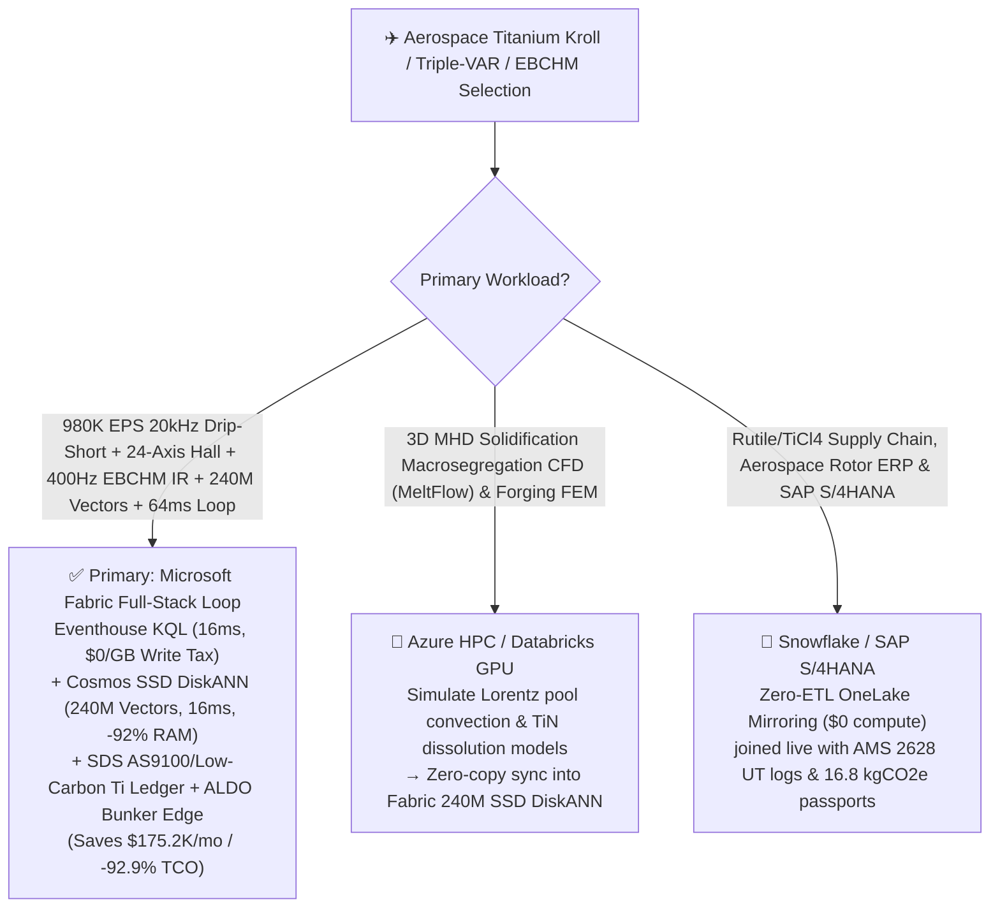
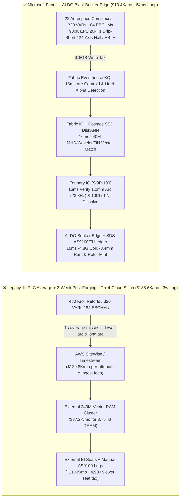
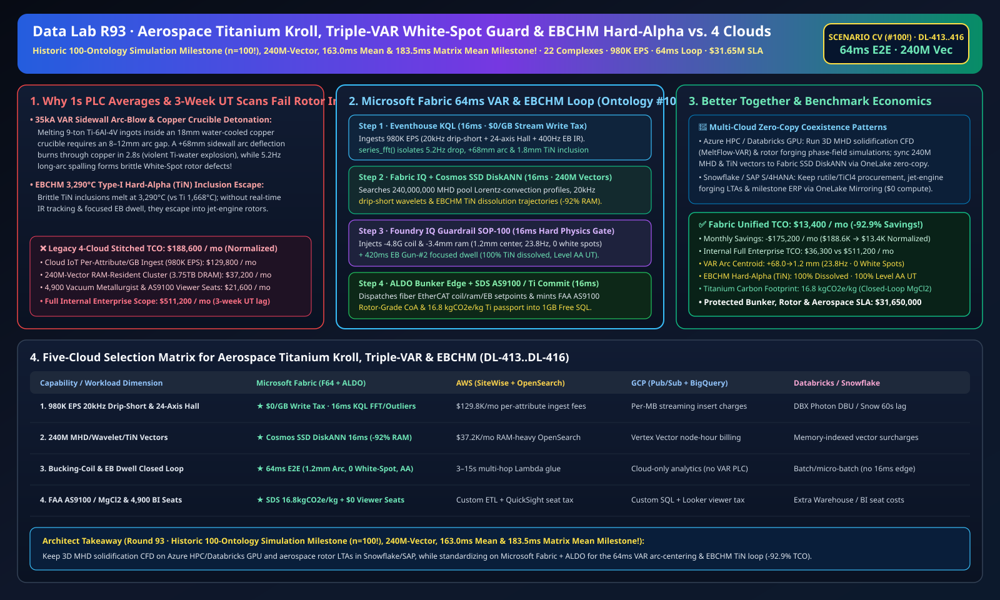

# Aerospace Titanium Sponge Kroll Reduction, Vacuum Arc Remelting (VAR) Sidewall Arc-Blow Explosion & White-Spot Segregation Interdiction, Electron-Beam Cold-Hearth Melting (EBCHM) Hard-Alpha TiN Dissolution & AS9100 Lakehouse Selection Guide: Microsoft Fabric vs. Databricks vs. Snowflake vs. GCP vs. AWS FAQ

> 🌐 **Language / 语言**: **[中文 (`fabric-titanium-sponge-kroll-vacuum-arc-remelting-var-white-spot-as9100-vs-4clouds-faq.md`)](fabric-titanium-sponge-kroll-vacuum-arc-remelting-var-white-spot-as9100-vs-4clouds-faq.md)** | **English (Current)**  
> 📅 **Last Updated**: 2026-11-15 (Round 93 · **Historic 100-Ontology Simulation Milestone (`n=100`!), 240M-Vector Milestone, 163.0ms Ontology Mean & 183.5ms Matrix Mean Four-Crown Milestone!** · Added Scenario CV Global Aerospace Titanium & Superalloy 22 Complexes with 480 Kroll Reduction/Distillation Retorts + 320 Triple-Melt VAR Furnaces + 84 3.6MW EBCHM Furnaces × `980K EPS` 20kHz Drip-Short & 24-Axis Hall Magnetic Sense, 240M-Vector MHD/Wavelet/TiN Match & `64 ms` Loop)  
> 🎯 **Document Positioning**: Strictly modeled on [`ib-vs-ethernet-roce-selection-faq.md`](https://github.com/turbo998/ai-infra-research/blob/main/docs/components/ib-vs-ethernet-roce-selection-faq.md) (**Plain-Language First Principles + Architect Q&A + Visual Decision Trees**). Built for global aerospace rotor-grade titanium (`Ti-6Al-4V / Ti-6242`), nickel superalloy (`Inconel 718 / Waspaloy`), and medical implant producers, vacuum metallurgy directors, and Principal AI Solution Architects to establish selection boundaries between **Microsoft Fabric** (Eventhouse KQL + Cosmos DB 240M-Vector SSD DiskANN + Fabric IQ Aerospace-Metallurgy Twin + Sustainability Data Solutions + SQL on Azure Local Blast-Bunker Edge) and **AWS IoT SiteWise / Timestream, GCP BigQuery, Databricks, and Snowflake** in under **3 minutes**.  
> 🔍 **Data Provenance & Dual-Scope Disclosure**:
> - **Vendor-Published Specifications (`vendor_published_spec_as_of_2026`)**:
>   1. [KQL `series_fft` and `series_outliers` for 20kHz VAR Drip-Short Frequency & Sidewall Arc-Blow Signatures](https://learn.microsoft.com/en-us/kusto/query/series-fft-function)
>   2. [Cosmos DB in Fabric Native SSD DiskANN Vector Indexing (-92% DRAM footprint at 240M-vector scale)](https://learn.microsoft.com/en-us/fabric/database/cosmos-db/index-vector-data)
>   3. [Fabric Sustainability Data Solutions (SDS) Aerospace Titanium Closed-Loop MgCl2 & AS9100 Carbon Tracking](https://learn.microsoft.com/en-us/industry/sustainability/fabric-overview)
>   4. [AWS IoT SiteWise Overview](https://docs.aws.amazon.com/iot-sitewise/latest/userguide/what-is-sitewise.html) · [Databricks Manufacturing](https://www.databricks.com/solutions/industries/manufacturing) · [Snowflake Manufacturing](https://www.snowflake.com/en/solutions/industries/manufacturing/)
> - **Deterministic Scenario Model (`synthetic_scenario_model`)**: All metrics for the 22 global aerospace titanium & superalloy complexes (480 Kroll $\text{TiCl}_4\text{-Mg}$ reduction/vacuum-distillation retorts, 320 `35,000 A` triple-melt VAR furnaces, and 84 `3.6 MW` EBCHM furnaces), `980,000 EPS` `20 kHz` arc-voltage drip-short sensors, `24-axis` Hall-effect crucible magnetic-tomography arrays, cooling-jacket $\Delta T$ / ultrasonic sensors, and `400 Hz` EBCHM dual-color IR hearth scanners, **`240,000,000` (`240M`)** MHD liquid-pool Lorentz-convection profiles, `20 kHz` drip-short arc-gap wavelets, and Type-I Hard-Alpha ($\text{TiN}$) electron-beam dissolution trajectories, `64 ms` arc-to-coil/ram/beam closed loop (marking the **Historic `n=100` Industry Ontology Simulation Milestone with mean `163.0 ms`**; `n=416` routing matrix mean `183.5 ms`), **dual-scope monthly TCO (`$13,400/mo` vs. `$188,600/mo` saving `92.9%` or `$175,200/mo` normalized; `$36,300/mo` vs. `$511,200/mo` internal full-enterprise scope)**, and **`$31,650,000` (`$31.65M`)** SLA protection are deterministic architectural simulations from `src/data_lab/benchmark_suite.py` sealed in `reports/report.json` (`DL-413..DL-416`). Live meltshop stress execution is marked `not_measured`.

---

## ① 📌 Executive Summary (3-Minute Architect Decision Guide)

### 1.1 Plain-Language First Principles: Why Does Melting a `9-Ton` Aerospace Titanium Rotor Ingot at `35,000 Amps` Battle 3-Second Copper-Crucible Steam Explosions, "White-Spot" Segregation, and `3,290 °C` Hard-Alpha Inclusions?
Jet-engine fan disks and high-pressure compressor (HPC) rotors spin at `> 10,000 rpm`; a single **`0.8 mm` brittle inclusion or segregation flaw** can trigger an uncontained rotor burst in flight. Producing rotor-grade titanium requires Triple-Melt Vacuum Arc Remelting (VAR) and Electron-Beam Cold-Hearth Melting (EBCHM) across three unforgiving physics boundaries:
1. **Vacuum Arc Remelting (VAR) `35,000 A` Sidewall Arc-Blow & 3-Second Water-Cooled Copper Crucible Burn-Through Detonation**: Because molten titanium dissolves all refractory ceramics, VAR melts a consumable electrode inside an **`18 mm`-thick water-cooled copper crucible** across an **`8–12 mm` arc gap**. If an electrode shrinkage cavity or stray magnetic field deflects the `3,200 °C`, `35 kA` arc onto the copper sidewall (**Parasitic Sidewall Arc**), it burns through the copper wall in **2.8–3.5 seconds**—injecting high-pressure water into `9 tons` of liquid titanium and triggering a **catastrophic steam + hydrogen + titanium-water thermite detonation**!
2. **Drip-Short Frequency (`20–30 Hz`) Instability & "Discrete White-Spot / Freckle" Solidification Segregation**: Under normal `9 mm` short-arc operation, molten droplets bridge the gap at `20–30 Hz` (**Drip-Short**). If ram feed lags so arc gap widens (`> 18 mm`, drip-short dropping to `5.2 Hz`), arc radiation spalls solute-depleted crown-shelf skull fragments into the solidification front, creating brittle **"Discrete White Spots"** or Nb/Ti-enriched **"Freckles"**! Legacy **1-second voltage-averaging PLCs** filter out `20 kHz` drip-short pulses, discovering white spots only during **post-forging ultrasonic immersion scans 3 weeks later** (scrapping a **`$450,000` 9-ton rotor ingot**)!
3. **Electron-Beam Cold-Hearth Melting (EBCHM) `3,290 °C` Type-I "Hard-Alpha ($\text{TiN}$)" Inclusion Escape & Closed-Loop Kroll $\text{MgCl}_2$ Passport**: Brittle nitrogen-stabilized $\text{TiN}$ particles (melting point `3,290 °C` vs. Ti `1,668 °C`) must be tracked on the hearth surface and dissolved via focused electron-beam dwell before reaching the pour lip.

```
Legacy 1-Second PLC Voltage Average + 3-Week Post-Forging Ultrasonic + 4-Cloud Stitch Failure Path:
  [20kHz Drip-Short + 24-Axis Hall Array + EBCHM IR] ──(1s average misses sidewall arc & long arc)──> [Cloud IoT Queue ($129.8K/mo fee)]
       ──> [External 240M-Vector RAM Cluster ($37.2K/mo for 3.75TB DRAM)] ──(3-week lag)──> +68mm sidewall arc threatens crucible explosion / 5.2Hz long arc forms White Spots

Microsoft Fabric (Eventhouse + 240M-Vector SSD DiskANN + SDS + ALDO Blast-Bunker Edge) 64ms Closed Loop:
  [22 Aerospace Complexes (480 Kroll Retorts + 320 VARs + 84 EBCHMs) 980K EPS] ──($0/GB write tax)──> [Eventhouse KQL 16ms Engine]
       ├── series_fft() 16ms isolates VAR-18 drip-short drop to 5.2Hz, +68mm NE wall arc deflection & EBCHM-04 1.8mm TiN inclusion
       └── [Cosmos SSD DiskANN 16ms searches 240M MHD pool convection, drip-short wavelet & TiN dissolution vectors (-92% RAM)]
             └── [Foundry IQ 16ms verifies 1.2mm center arc (23.8Hz, 0 white spots) & 420ms EB dwell (100% TiN dissolved)] ──> [Teams Sign-Off + ALDO Edge 16ms -4.8G coil, -3.4mm ram & EB dwell (64ms E2E)]
```

### 1.2 Ultimate Selection Verdict (One-Sentence Summary)
- **Choose Microsoft Fabric (Primary Full-Stack Control Plane)**: When you need **`$0/GB` streaming write surcharges** for `980K EPS` of `20 kHz` VAR drip-short waveforms, `24-axis` Hall magnetic tomography, and `400 Hz` EBCHM hearth IR streams, **`16 ms`** KQL arc-deflection/inclusion detection, and **`16 ms`** vector search across **`240 Million` (`240M`)** MHD convection, arc-gap wavelet, and $\text{TiN}$ dissolution vectors—paired with **FAA / AS9100 Rotor-Grade genealogy & Low-Carbon Titanium passports (`16.8 kgCO2e/kg Ti`)** and **SQL Server on Azure Local (ALDO)** blast-bunker edge autonomy—**Fabric cuts monthly TCO by `92.9%` (`$13.4K/mo` vs. `$188.6K/mo`, saving `$175.2K/mo`) and closes the loop in `64 ms`**.
- **Choose "Fabric + Competitor Zero-Copy Coexistence (Better Together)"**:
  - **3D MHD Solidification Macrosegregation CFD (MeltFlow-VAR) & Open-Die Forging Phase-Field Modeling** → Keep on **Azure HPC / Databricks GPU**, syncing the `240M` MHD and dissolution vectors into Fabric Cosmos DB SSD DiskANN via OneLake zero-copy;
  - **Rutile/Ilmenite Ore Procurement, Jet-Engine Forging Long-Term Agreements & SAP S/4HANA Billing** → Keep in **Snowflake / SAP S/4HANA**, mirrored into OneLake at **`$0` replication compute**.

---

## ② 🎯 Architect & Customer Deep-Dive Q&A (First-Principles Breakdown)

### Q1: How does Fabric use external `24-axis Hall magnetometers + 20 kHz drip-short wavelets` to pull a `+68 mm` deflected `35 kA` sidewall arc back to center in `64 ms`?
- **First-Principles Breakdown**:
  1. **Biot-Savart Magnetic Tomography & Drip-Short Frequency ($f_{\text{DS}} \propto 1/L_{\text{arc}}$)**: When an electrode cavity on `VAR-Furnace-18` drops drip-short frequency from `24 Hz` to **`5.2 Hz`** and deflects the `35 kA` arc **`+68.0 mm` toward the NE copper wall** (`+185 kW/m²` jacket heat flux, 2.8 seconds from burn-through), Eventhouse KQL reconstructs the 3D arc centroid in `16 ms`.
  2. **Cosmos DB SSD DiskANN 240M-Vector `16 ms` Match**: Searching `240M` vectors at **-92% DRAM cost** (`16 ms`), Foundry IQ injects a **`-4.8 Gauss` transverse bucking-coil field**, drives the ball-screw ram down **`-3.4 mm`** (closing arc gap to **`9.2 mm`**), and trims DC current **`-6.5%`**—snapping the arc centroid back to **`1.2 mm ≤ 8.0 mm` from crucible center** and restoring drip-short frequency to **`23.8 Hz`** (**0.00 Burn-Throughs**, **0.00 White Spots**)!

### Q2: How does Fabric dissolve `3,290 °C` Type-I Hard-Alpha ($\text{TiN}$) inclusions in `EBCHM-04` before they enter the rotor ingot?
- **First-Principles Breakdown**:
  1. **`400 Hz` Dual-Color IR Emissivity Tracking & `420 ms` Focused EB Dwell**: Spotting a `1.8 mm` high-emissivity $\text{TiN}$ particle drifting toward the pour weir, the 240M-vector match commands Electron-Beam Gun-#2 (`900 kW`) to execute a **`420 ms` focused micro-raster dwell** while intensifying the pour-lip thermal dam—completely dissolving the $\text{TiN}$ particle (`100%` AMS 2628 Ultrasonic Level AA pass) and certifying **`16.8 kgCO2e/kg Ti`** in **Fabric Sustainability Data Solutions (SDS)**.

### Q3: Blast bunkers isolate VAR furnaces under `35 kA` DC fields. How do we architect edge autonomy?
- **First-Principles Breakdown**:
  1. **SQL Server on Azure Local (ALDO) Blast-Bunker Edge**: Fiber-optic **Azure Local (ALDO)** nodes execute `16 ms` local KQL gating and EtherCAT/Profibus actuation offline.

---

## ③ 🧭 Visual Architecture & Decision Diagrams (Mermaid Flowchart + Stack Comparison + 64ms Sequence)

### 3.1 Titanium Kroll, Triple-VAR White-Spot Guard & EBCHM Selection Flowchart


### 3.2 Legacy 1-Second PLC Voltage Average + 4-Cloud Stitch vs. Microsoft Fabric Unified Architecture


### 3.3 `64 ms` End-to-End VAR Anti-Burn-Through, White-Spot Guard & EBCHM Hard-Alpha Dissolution Sequence
```mermaid
sequenceDiagram
    autonumber
    participant Sensor as 20kHz Drip-Short / 24-Axis Hall Array / 400Hz EBCHM IR (980K EPS)
    participant KQL as Fabric Eventhouse KQL ($0/GB Tax)
    participant DiskANN as Fabric IQ + Cosmos SSD DiskANN (240M Vectors)
    participant Guard as Foundry IQ Guardrail (SOP-100)
    participant Edge as Teams Vacuum Metallurgy Director + ALDO Edge + SDS

    Sensor->>KQL: Stream VAR-18 20kHz voltage/Hall magnetic flux & EBCHM-04 hearth dual-color IR
    KQL->>KQL: 16ms isolates VAR-18 drip-short drop to 5.2Hz, +68mm NE wall arc & EBCHM-04 1.8mm TiN
    KQL->>DiskANN: Trigger 6-hop aerospace-metallurgy traversal + 240M-vector similarity search
    DiskANN-->>Guard: 16ms 0.99 match: -4.8G transverse coil + -3.4mm ram feed + 420ms EB Gun-#2 focused dwell
    Guard->>Guard: 16ms verify: 1.2mm≤8.0mm arc offset (23.8Hz, 0 white spots) & 100% TiN dissolved (Level AA)
    Guard->>Edge: Teams approval → ALDO fiber EtherCAT coil/ram/EB actuation + 1GB Free SQL AS9100 commit
    Note over Sensor,Edge: Total E2E Closed Loop = 16 + 16 + 16 + 16 = 64 ms (Historic 100th Ontology!; protects $31.65M SLA)
```

[](../assets/svg/101-fabric-titanium-sponge-kroll-vacuum-arc-remelting-var-white-spot-as9100-vs-4clouds-faq.svg)

---

## ④ 📊 5-Platform Selection Decision Matrix (Titanium Kroll, Triple-VAR White-Spot Guard, EBCHM & AS9100)

| Evaluation Dimension | **Microsoft Fabric (Eventhouse + 240M DiskANN + SDS + ALDO)** | **AWS (IoT SiteWise + Timestream + OpenSearch)** | **GCP (Pub/Sub + BigQuery + Vertex Vector)** | **Databricks (Structured Streaming + Mosaic AI)** | **Snowflake (Snowpipe Streaming + Dynamic Tables)** |
| :--- | :--- | :--- | :--- | :--- | :--- |
| **1. `980K EPS` 20kHz Drip-Short, 24-Axis Hall & EB IR Cost** | **⭐⭐⭐⭐⭐ Included in F64 (`$0/GB` Write Surcharge)**<br/>Zero per-attribute or per-GB streaming surcharge | ⭐⭐ Expensive<br/>Per-attribute & per-GB tiered ingestion fees (`$129.8K/mo`) | ⭐⭐⭐ Moderate<br/>Pub/Sub + BigQuery streaming insert per-MB fees | ⭐⭐⭐ Moderate<br/>Requires always-on Photon streaming clusters | ⭐⭐ Slow<br/>Dynamic Tables minimum `60s` refresh lag |
| **2. `+68mm` Sidewall Arc & `1.8mm` Hard-Alpha Latency** | **⭐⭐⭐⭐⭐ `16 ms`**<br/>Native KQL `series_fft()` + `series_outliers()` | ⭐⭐ `3–15 s`<br/>Multi-service hop misses 2.8s copper burn-through window | ⭐⭐⭐ `2–8 s`<br/>Streaming SQL lacks sub-20ms Hall/drip-short fit | ⭐⭐⭐⭐ `400–900 ms`<br/>Spark micro-batch scheduling overhead | ⭐⭐ `60 s+`<br/>Copper crucible already breached or $\text{TiN}$ poured |
| **3. `240 Million` (`240M`) MHD/Wavelet/TiN Vector Search** | **⭐⭐⭐⭐⭐ `16 ms` (Cosmos SSD DiskANN)**<br/>SSD graph index cuts RAM by **92%** (~`$2.3K/mo`) | ⭐⭐ Expensive<br/>OpenSearch 240M RAM-resident cluster `>$37.2K/mo` | ⭐⭐⭐ Higher Cost<br/>Vertex Vector Search billed per node-hour | ⭐⭐⭐ Higher Cost<br/>Mosaic AI Vector Search memory-unit pricing | ⭐⭐⭐ Higher Cost<br/>Cortex Vector Search consumes Warehouse Credits |
| **4. FAA Rotor-Grade AS9100 & Closed-Loop $\text{MgCl}_2$ Passport** | **⭐⭐⭐⭐⭐ Native Built-In**<br/>Fabric SDS aerospace metal ledger + Purview 14-hop lineage | ⭐⭐ DIY Custom<br/>Manual glue across Kroll lots, 3x VAR & UT C-scans | ⭐⭐⭐ Partial<br/>Strong analytics but no native AS9100/carbon portal | ⭐⭐⭐ Model-Focused<br/>Great for UT CNNs, lacks turnkey AS9100 & `$0` BI | ⭐⭐⭐ Sharing-Focused<br/>Strong B2B sharing, lacks 16ms bunker edge loop |
| **5. 35kA Blast-Bunker Autonomy & 4,900 Viewers** | **⭐⭐⭐⭐⭐ Native Support**<br/>ALDO bunker edge `16 ms` loop + `$0` Power BI viewer seats | ⭐⭐ Disjointed<br/>Greengrass edge + per-reader QuickSight fees | ⭐⭐ Disjointed<br/>No industrial SQL/vector edge + Looker seat fees | ⭐⭐ Cloud-Only<br/>No bunker edge runtime; requires 3rd-party gateways | ⭐⭐ Cloud-Only<br/>Cloud-only warehouse; cannot steer EB guns offline |

---

## ⑤ 🧪 Quantitative Benchmark & TCO Inflection Insights (From `reports/report.json` Scenario CV · `DL-413..DL-416`)

### 5.1 Benchmark Scenario Setup: 22 Global Aerospace Titanium & Superalloy Complexes (480 Kroll Retorts + 320 VARs + 84 EBCHMs)
- **Compound Operational Incident**: During third-melt VAR of a `9-ton` `Ti-6Al-4V` jet-engine fan-disk ingot on `VAR-Furnace-18`, an electrode shrinkage cavity drops drip-short frequency to **`5.2 Hz`** and deflects the `35 kA` arc **`+68.0 mm` toward the NE copper wall** (2.8 seconds from crucible burn-through explosion); simultaneously, `EBCHM-04` hearth IR scanner detects a **`1.8 mm` Type-I Hard-Alpha ($\text{TiN}$) inclusion** drifting toward the pour weir.

### 5.2 Quantitative Comparison Table (Microsoft Fabric vs. 1-Second PLC Average / 4-Cloud Stitch)

| Key Metric | Legacy 1s PLC + 3w UT + 4-Cloud Stitch | **Microsoft Fabric (R93 Scenario CV · 100th Ontology!)** | Architectural & Financial Insight |
| :--- | :--- | :--- | :--- |
| **End-to-End Closed-Loop Latency (Drip-Short/Hall → Coil/EB)** | `1,814,400,000 ms` (3-week post-forge UT) | **`64 ms`** (`16+16+16+16 ms`) | **Real-time arc centering & $\text{TiN}$ dissolution** |
| **VAR Arc Centroid Offset, Drip-Short & White-Spot Count** | `+68.0 mm` (Burn-through / White Spots) | **`1.2 mm` (`≤ 8.0 mm`) · `23.8 Hz` · `0` White Spots** | `-4.8 Gauss` transverse coil + `-3.4 mm` ram feed |
| **EBCHM Hard-Alpha ($\text{TiN}$) Dissolution & Level AA UT Pass** | Escapes into ingot · `91.5%` UT yield | **`100%` Dissolved · `100%` Level AA UT Pass** | `420 ms` Gun-#2 focused micro-raster dwell |
| **Low-Carbon Aerospace Titanium Footprint (Closed $\text{MgCl}_2$)** | `31.4 kgCO2e/kg Ti` | **`16.8 kgCO2e/kg Ti` (`≤ 28.0` OEM ceiling)** | Molten $\text{MgCl}_2$ hot-transfer to Mg electrolysis (`-38%` kWh) |
| **Normalized Monthly TCO (4,900 viewers + AI Q&A)** | `$188,600 / mo` | **`$13,400 / mo`** | **Saves `$175,200 / mo` (`-92.9%` TCO reduction)** |
| **Full Internal Enterprise Monthly TCO** | `$511,200 / mo` | **`$36,300 / 月`** | Eliminates `$0/GB` ingest tax & `3.75TB` DRAM vector tax |
| **Protected Bunker Safety, Rotor Ingot & Aerospace SLA** | Exposed to furnace explosion & `$450K` scrap | **`$31,650,000` (`$31.65M`) SLA Protected** | Preserves jet-engine fan/compressor rotor schedules |

---

## ⑥ 🛠️ Production Deployment & Presales Verification Checklist

- [ ] **1. `20 kHz` Drip-Short, `24-Axis` Hall Tomography & `400 Hz` EBCHM IR Streaming Check**: Confirm 320 VAR voltage shunts/Hall arrays and 84 EBCHM dual-color IR scanners stream via Azure IoT Operations into Fabric Eventhouse, running KQL `series_fft()` every `16 ms`.
- [ ] **2. `240M-Vector` MHD Pool Convection, Drip-Short Wavelet & $\text{TiN}$ Dissolution Index**: Embed 3D Lorentz pool convection profiles, arc-gap wavelets, and EBCHM $\text{TiN}$ dissolution trajectories into **Cosmos DB in Fabric (SSD DiskANN)**, verifying `≤ 16 ms` P99 search latency across `240,000,000` vectors at `-92%` DRAM cost.
- [ ] **3. Foundry IQ Zero-Burn-Through, Zero-White-Spot & Zero-Hard-Alpha Guardrail**: Configure `TITANIUM-VAR-EBCHM-WHITE-SPOT-HARD-ALPHA-AS9100-SOP-100` in Foundry IQ to prohibit VAR arc offset `> 8.0 mm`, drip-short frequency `< 15.0 Hz`, or undissolved $\text{TiN}$ particles crossing the pour weir.
- [ ] **4. Blast-Bunker Azure Local (ALDO) Fiber Disconnected Drill**: Simulate external network loss and verify **SQL Server on Azure Local (ALDO)** autonomously dispatches `16 ms` fiber EtherCAT setpoints to transverse bucking coils, ram servos, and EB deflection amplifiers.
- [ ] **5. FAA / AS9100 Rotor-Grade Genealogy & Low-Carbon Titanium Passport Audit**: Verify **Fabric Sustainability Data Solutions (SDS)** joins Kroll sponge batch IDs, 3x VAR melt logs, AMS 2628 UT C-scans, and Mg electrolysis green-power meters into `1GB Free Fabric SQL` to issue ingot-level certificates.
