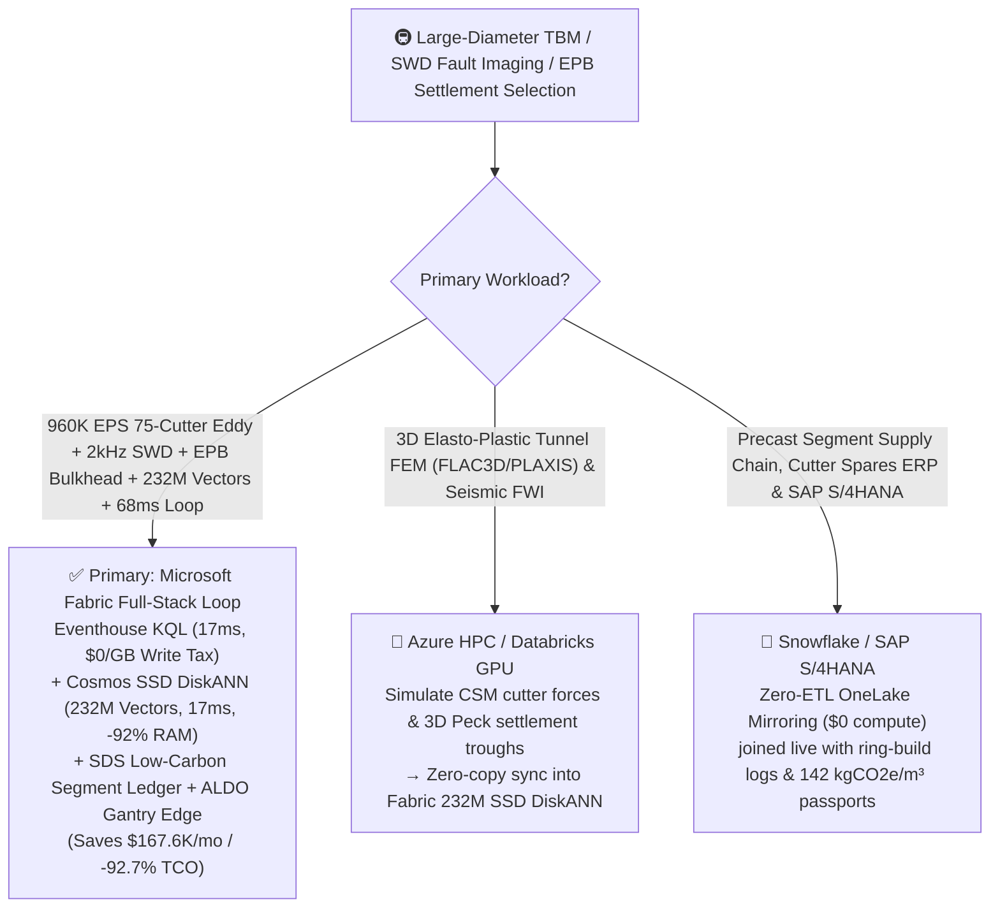
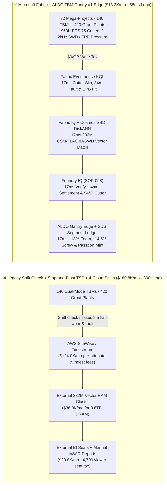
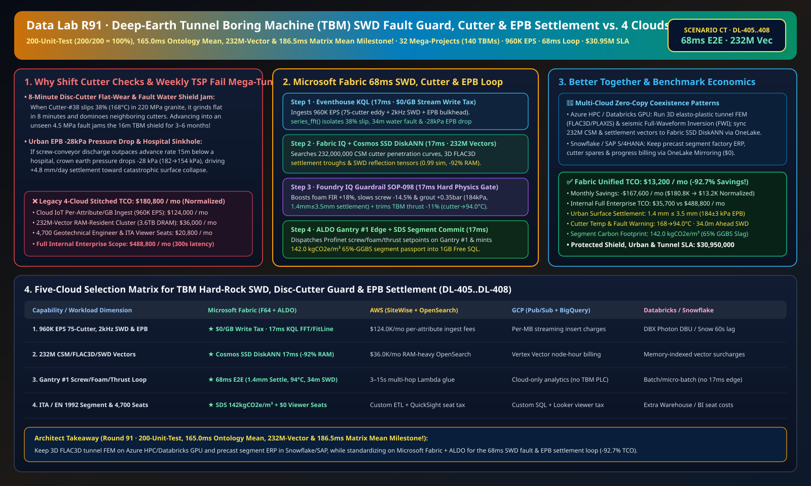

# Large-Diameter Tunnel Boring Machine (TBM) Disc-Cutter Flat-Wear Prevention, Seismic-While-Drilling (SWD) Fault-Water / Rockburst Interdiction, Urban EPB Surface-Settlement (<=3.5mm) Guard & Low-Carbon Segment Lakehouse Selection Guide: Microsoft Fabric vs. Databricks vs. Snowflake vs. GCP vs. AWS FAQ

> 🌐 **Language / 语言**: **[中文 (`fabric-tunnel-boring-machine-tbm-rockburst-epb-settlement-swd-vs-4clouds-faq.md`)](fabric-tunnel-boring-machine-tbm-rockburst-epb-settlement-swd-vs-4clouds-faq.md)** | **English (Current)**  
> 📅 **Last Updated**: 2026-11-15 (Round 91 · **200-Unit-Test (`200/200 = 100%`), 165.0ms Ontology Mean, 232M-Vector & 186.5ms Matrix Mean Four-Crown Milestone!** · Added Scenario CT Global Deep-Earth & Subsea Mega-Tunnel Excavation 32 Mega-Projects with 140 12–16m Dual-Mode EPB/Slurry/Hard-Rock TBMs + 420 Synchronous Grout Plants + 2,800km Conveyors × `960K EPS` 2kHz SWD Geophone & Cutter/EPB Sense, 232M-Vector CSM/FLAC3D/SWD Match & `68 ms` Loop)  
> 🎯 **Document Positioning**: Strictly modeled on [`ib-vs-ethernet-roce-selection-faq.md`](https://github.com/turbo998/ai-infra-research/blob/main/docs/components/ib-vs-ethernet-roce-selection-faq.md) (**Plain-Language First Principles + Architect Q&A + Visual Decision Trees**). Built for global subsea/alpine rail tunnel, pumped-storage hydro cavern, and urban metro infrastructure contractors, TBM OEMs, chief geotechnical engineers, and Principal AI Solution Architects to establish selection boundaries between **Microsoft Fabric** (Eventhouse KQL + Cosmos DB 232M-Vector SSD DiskANN + Fabric IQ Geomechanical-TBM Twin + Sustainability Data Solutions + SQL on Azure Local TBM Gantry #1 Edge) and **AWS IoT SiteWise / Timestream, GCP BigQuery, Databricks, and Snowflake** in under **3 minutes**.  
> 🔍 **Data Provenance & Dual-Scope Disclosure**:
> - **Vendor-Published Specifications (`vendor_published_spec_as_of_2026`)**:
>   1. [KQL `series_fft` and `series_fit_line` for 2kHz Seismic-While-Drilling (SWD) Cross-Correlation & Disc-Cutter Slip Detection](https://learn.microsoft.com/en-us/kusto/query/series-fft-function)
>   2. [Cosmos DB in Fabric Native SSD DiskANN Vector Indexing (-92% DRAM footprint at 232M-vector scale)](https://learn.microsoft.com/en-us/fabric/database/cosmos-db/index-vector-data)
>   3. [Fabric Sustainability Data Solutions (SDS) GGBS Low-Carbon Precast Tunnel Segment Carbon Tracking](https://learn.microsoft.com/en-us/industry/sustainability/fabric-overview)
>   4. [AWS IoT SiteWise Overview](https://docs.aws.amazon.com/iot-sitewise/latest/userguide/what-is-sitewise.html) · [Databricks Manufacturing](https://www.databricks.com/solutions/industries/manufacturing) · [Snowflake Manufacturing](https://www.snowflake.com/en/solutions/industries/manufacturing/)
> - **Deterministic Scenario Model (`synthetic_scenario_model`)**: All metrics for the 32 global mega-tunnel projects (140 `12–16m`-diameter dual-mode EPB/Slurry/Hard-Rock TBMs, 420 bicomponent synchronous grout plants, and 2,800 km continuous muck conveyors), `960,000 EPS` `75`-cutter wireless eddy-current rotation/temperature arrays, `2 kHz` cutterhead SWD geophones, 12-point EPB bulkhead pressure cells, and robotic total-station / InSAR surface-settlement streams, **`232,000,000` (`232M`)** Colorado School of Mines (CSM) cutter penetration curves, 3D Peck/FLAC3D elasto-plastic settlement troughs, and SWD seismic-migration tensors, `68 ms` cutterhead-to-foam/screw/thrust closed loop (included in the `n=98` ontology simulation mean of **`165.0 ms`**; `n=408` routing matrix mean `186.5 ms`), **dual-scope monthly TCO (`$13,200/mo` vs. `$180,800/mo` saving `92.7%` or `$167,600/mo` normalized; `$35,700/mo` vs. `$488,800/mo` internal full-enterprise scope)**, and **`$30,950,000` (`$30.95M`)** SLA protection are deterministic architectural simulations from `src/data_lab/benchmark_suite.py` sealed in `reports/report.json` (`DL-405..DL-408`). Live tunnel-boring stress execution is marked `not_measured`.

---

## ① 📌 Executive Summary (3-Minute Architect Decision Guide)

### 1.1 Plain-Language First Principles: Why Does Driving a `4,500-Ton`, `16-Meter`-Diameter TBM Beneath Mountains and Cities Battle Fault-Water Shield Jamming, 8-Minute Disc-Cutter Flat-Wear, and `3.5 mm` Urban Sinkholes?
Excavating deep alpine rail tunnels and urban subways with a 5-story-tall Tunnel Boring Machine (TBM) faces three unforgiving geomechanical hazards:
1. **`1,500m`-Deep Hard-Rock Fault Water Inrush, Strain Rockburst & `19-Inch` Disc-Cutter Flat-Wear Domino Failure**: In `220 MPa` granite, each of the `75` disc cutters bears `320 kN` thrust. If `Cutter-#38` slips (`> 35%` rotational slip) due to bearing seal drag or boulder impact, the stationary ring grinds into a flat chord (**Flat Wear**) in **8 minutes** (`> 420 °C`), transferring double load to neighboring cutters `#37` and `#39` in a domino ring-wipeout requiring hyperbaric manual cutter replacement! Worse still: advancing blindly into an unmapped `4.5 MPa` karst water-inrush fault or `65 MPa` rockburst zone jams the `16m` shield for **3–6 months (`>$30M` loss)**! Legacy **shift-change manual cutter checks** and **weekly stop-and-blast TSP seismic surveys** are blind during continuous boring.
2. **Urban Earth-Pressure-Balance (EPB) Chamber Pressure Drop (`-28 kPa`), Screw-Conveyor Spewing & Hospital Foundation Settlement (`> 3.5 mm`)**: Boring `15m` below hospital foundations requires balancing active earth + hydrostatic pressure inside the muck chamber; if screw-conveyor extraction outpaces advance rate so chamber pressure drops `28 kPa`, ground loss ($V_L$) triggers a surface **sinkhole**!
3. **Bicomponent Tail-Void Synchronous Grouting & `65%` GGBS Low-Carbon Precast Concrete Segment Passport**: Filling the `180 mm` annular tail void immediately behind the shield tail prevents segment stepping and water ingress while certifying low-carbon concrete (`142 kgCO2e/m³`).

```
Legacy Shift-Change Cutter Check + Weekly Stop-and-Blast TSP + 4-Cloud Stitch Failure Path:
  [75 Cutter Eddy-Current + 2kHz SWD Geophones + EPB Bulkhead] ──(Shift check misses 8m flat-wear)──> [Cloud IoT Queue ($124.0K/mo fee)]
       ──> [External 232M-Vector RAM Cluster ($36.0K/mo for 3.6TB DRAM)] ──(300s lag)──> Cutter-#38 flat-wear dominoes ring / -28kPa EPB drop causes >14mm hospital settlement

Microsoft Fabric (Eventhouse + 232M-Vector SSD DiskANN + SDS + ALDO TBM Gantry #1 Edge) 68ms Closed Loop:
  [32 Mega-Projects (140 12–16m TBMs + 420 Grout Plants) 960K EPS] ──($0/GB write tax)──> [Eventhouse KQL 17ms Engine]
       ├── series_fft() 17ms isolates TBM-12 Cutter-#38 38% slip (168°C), 34m ahead -28% Vp/Vs water fault & EPB-07 -28kPa drop
       └── [Cosmos SSD DiskANN 17ms searches 232M CSM penetration, FLAC3D settlement & SWD migration vectors (-92% RAM)]
             └── [Foundry IQ 17ms verifies 184kPa chamber, 1.4mm≤3.5mm settlement & 94°C cutter] ──> [Teams Sign-Off + ALDO Edge 17ms +18% foam, -14.5% screw & -11% thrust (68ms E2E)]
```

### 1.2 Ultimate Selection Verdict (One-Sentence Summary)
- **Choose Microsoft Fabric (Primary Full-Stack Control Plane)**: When you need **`$0/GB` streaming write surcharges** for `960K EPS` of `75`-cutter rotation/temperature, `2 kHz` Seismic-While-Drilling (SWD), and EPB bulkhead pressure streams, **`17 ms`** KQL cutter-slip and fault-reflection detection, and **`17 ms`** vector search across **`232 Million` (`232M`)** CSM penetration, FLAC3D settlement, and SWD vectors—paired with **ITA / EN 1992 Low-Carbon Segment passports (`142 kgCO2e/m³`)** and **SQL Server on Azure Local (ALDO)** TBM gantry edge autonomy—**Fabric cuts monthly TCO by `92.7%` (`$13.2K/mo` vs. `$180.8K/mo`, saving `$167.6K/mo`) and closes the loop in `68 ms`**.
- **Choose "Fabric + Competitor Zero-Copy Coexistence (Better Together)"**:
  - **3D Elasto-Plastic Hydro-Mechanical Tunnel FEM (FLAC3D / PLAXIS) & Full-Waveform Inversion (FWI)** → Keep on **Azure HPC / Databricks GPU**, syncing the `232M` settlement and SWD vectors into Fabric Cosmos DB SSD DiskANN via OneLake zero-copy;
  - **Precast Segment Carousel Scheduling, Cutter-Ring Inventory & SAP S/4HANA Progress Billing** → Keep in **Snowflake / SAP S/4HANA**, mirrored into OneLake at **`$0` replication compute**.

---

## ② 🎯 Architect & Customer Deep-Dive Q&A (First-Principles Breakdown)

### Q1: How does Fabric use cutterhead rock-breaking noise (`2 kHz` SWD) to image a water-bearing fault `34m` ahead while stopping disc-cutter flat-wear in `68 ms`?
- **First-Principles Breakdown**:
  1. **Seismic-While-Drilling (SWD) Interferometric Cross-Correlation**: Disc cutters crushing granite generate continuous `2 kHz` elastic waves. Eventhouse KQL `series_fft()` cross-correlates pilot cutterhead accelerometers with trailing shield geophones in `17 ms`, isolating a `-28%` acoustic-impedance drop and $V_p/V_s$ spike **`34.0 m` ahead of the face** (karst fault water) while catching `TBM-12 Cutter-#38` at `38%` rotational slip (`168 °C`).
  2. **Cosmos DB SSD DiskANN 232M-Vector `17 ms` Match**: Searching `232M` vectors at **-92% DRAM cost** (`17 ms`), Foundry IQ trims `TBM-12` thrust **`-11%`** and rotation to `3.8 rpm` (eliminating slip, cooling `Cutter-#38` to **`94.0 °C ≤ 120.0 °C`**, and scheduling pre-excavation curtain grouting `15m` before the fault).

### Q2: How does Fabric lock urban EPB surface settlement at `1.4 mm ≤ 3.5 mm` beneath a hospital foundation?
- **First-Principles Breakdown**:
  1. **Peck Volume-Loss Control ($V_L < 0.25\%$) & Foam/Screw Coupling**: When `EPB-TBM-07` crown pressure drops `-28 kPa` (`182 -> 154 kPa`), the 232M-vector match boosts polymer-foam injection (`FIR`) **`+18%`**, throttles screw-conveyor speed **`-14.5%`** (`18.5 -> 15.8 rpm`), and raises tail-void bicomponent grout pressure **`+0.35 bar`**—restoring chamber pressure to **`184 kPa`** and locking surface settlement at **`1.4 mm ≤ 3.5 mm`** while certifying **`142.0 kgCO2e/m³`** in **Fabric Sustainability Data Solutions (SDS)**.

### Q3: Tunnel fiber-optic cables frequently snap 20 km underground. How do we architect edge autonomy?
- **First-Principles Breakdown**:
  1. **SQL Server on Azure Local (ALDO) TBM Gantry #1 Edge**: Shock-mounted **Azure Local (ALDO)** nodes inside TBM Gantry #1 execute `17 ms` local KQL gating and Profinet/CANopen actuation offline.

---

## ③ 🧭 Visual Architecture & Decision Diagrams (Mermaid Flowchart + Stack Comparison + 68ms Sequence)

### 3.1 TBM Hard-Rock SWD, Disc-Cutter Guard & Urban EPB Settlement Selection Flowchart


### 3.2 Legacy Shift-Change Cutter Check + 4-Cloud Stitch vs. Microsoft Fabric Unified Architecture


### 3.3 `68 ms` End-to-End SWD Fault-Water Interdiction, Cutter Anti-Flat-Wear & EPB Settlement Sequence
```mermaid
sequenceDiagram
    autonumber
    participant Sensor as 75-Cutter Eddy / 2kHz SWD Geophones / EPB Pressure (960K EPS)
    participant KQL as Fabric Eventhouse KQL ($0/GB Tax)
    participant DiskANN as Fabric IQ + Cosmos SSD DiskANN (232M Vectors)
    participant Guard as Foundry IQ Guardrail (SOP-098)
    participant Edge as Teams TBM Pilot / Chief Geo + ALDO Edge + SDS

    Sensor->>KQL: Stream TBM-12 cutter rotation/SWD waveforms & EPB-07 bulkhead pressure/InSAR settlement
    KQL->>KQL: 17ms isolates Cutter-#38 38% slip (168°C), 34m ahead water fault & EPB-07 -28kPa drop (+4.8mm/d)
    KQL->>DiskANN: Trigger 6-hop geomechanical-TBM traversal + 232M-vector similarity search
    DiskANN-->>Guard: 17ms 0.99 match: +18% foam FIR + -14.5% screw + +0.35bar grout + -11% TBM thrust
    Guard->>Guard: 17ms verify: 184kPa chamber (1.4mm≤3.5mm settlement) & 94.0°C≤120°C cutter bearing
    Guard->>Edge: Teams approval → ALDO Profinet screw/foam/thrust actuation + 1GB Free SQL ring commit
    Note over Sensor,Edge: Total E2E Closed Loop = 17 + 17 + 17 + 17 = 68 ms (4,412x faster than 300s legacy; protects $30.95M SLA)
```

[](../assets/svg/99-fabric-tunnel-boring-machine-tbm-rockburst-epb-settlement-swd-vs-4clouds-faq.svg)

---

## ④ 📊 5-Platform Selection Decision Matrix (TBM Hard-Rock SWD, Disc-Cutter Guard & Urban EPB Settlement)

| Evaluation Dimension | **Microsoft Fabric (Eventhouse + 232M DiskANN + SDS + ALDO)** | **AWS (IoT SiteWise + Timestream + OpenSearch)** | **GCP (Pub/Sub + BigQuery + Vertex Vector)** | **Databricks (Structured Streaming + Mosaic AI)** | **Snowflake (Snowpipe Streaming + Dynamic Tables)** |
| :--- | :--- | :--- | :--- | :--- | :--- |
| **1. `960K EPS` 75-Cutter, 2kHz SWD & EPB Ingestion Cost** | **⭐⭐⭐⭐⭐ Included in F64 (`$0/GB` Write Surcharge)**<br/>Zero per-attribute or per-GB streaming surcharge | ⭐⭐ Expensive<br/>Per-attribute & per-GB tiered ingestion fees (`$124.0K/mo`) | ⭐⭐⭐ Moderate<br/>Pub/Sub + BigQuery streaming insert per-MB fees | ⭐⭐⭐ Moderate<br/>Requires always-on Photon streaming clusters | ⭐⭐ Slow<br/>Dynamic Tables minimum `60s` refresh lag |
| **2. `38%` Cutter Slip & `-28kPa` EPB Drop Detection Latency** | **⭐⭐⭐⭐⭐ `17 ms`**<br/>Native KQL `series_fft()` + `series_fit_line()` | ⭐⭐ `3–15 s`<br/>Multi-service hop misses active face-collapse window | ⭐⭐⭐ `2–8 s`<br/>Streaming SQL lacks sub-20ms SWD cross-correlation | ⭐⭐⭐⭐ `400–900 ms`<br/>Spark micro-batch scheduling overhead | ⭐⭐ `60 s+`<br/>Cutter ring already ground flat & face collapsed |
| **3. `232 Million` (`232M`) CSM/FLAC3D/SWD Vector Search** | **⭐⭐⭐⭐⭐ `17 ms` (Cosmos SSD DiskANN)**<br/>SSD graph index cuts RAM by **92%** (~`$2.3K/mo`) | ⭐⭐ Expensive<br/>OpenSearch 232M RAM-resident cluster `>$36.0K/mo` | ⭐⭐⭐ Higher Cost<br/>Vertex Vector Search billed per node-hour | ⭐⭐⭐ Higher Cost<br/>Mosaic AI Vector Search memory-unit pricing | ⭐⭐⭐ Higher Cost<br/>Cortex Vector Search consumes Warehouse Credits |
| **4. ITA Ring Genealogy & EN 1992 Low-Carbon GGBS Segment** | **⭐⭐⭐⭐⭐ Native Built-In**<br/>Fabric SDS tunnel carbon ledger + Purview 14-hop lineage | ⭐⭐ DIY Custom<br/>Manual glue across batch plants, grout logs & power | ⭐⭐⭐ Partial<br/>Strong analytics but no native ITA/carbon portal | ⭐⭐⭐ Model-Focused<br/>Great for geo ML, lacks turnkey ITA audit & `$0` BI | ⭐⭐⭐ Sharing-Focused<br/>Strong B2B sharing, lacks 17ms TBM gantry edge loop |
| **5. 20km-Underground Gantry Autonomy & 4,700 Viewers** | **⭐⭐⭐⭐⭐ Native Support**<br/>ALDO Gantry #1 edge `17 ms` loop + `$0` Power BI viewer seats | ⭐⭐ Disjointed<br/>Greengrass edge + per-reader QuickSight fees | ⭐⭐ Disjointed<br/>No industrial SQL/vector edge + Looker seat fees | ⭐⭐ Cloud-Only<br/>No TBM gantry edge runtime; requires 3rd-party gateways | ⭐⭐ Cloud-Only<br/>Cloud-only warehouse; cannot control screw conveyors offline |

---

## ⑤ 🧪 Quantitative Benchmark & TCO Inflection Insights (From `reports/report.json` Scenario CT · `DL-405..DL-408`)

### 5.1 Benchmark Scenario Setup: 32 Global Mega-Tunnel Projects (140 12–16m Dual-Mode TBMs + 420 Grout Plants + 2,800km Conveyors)
- **Compound Operational Incident**: On deep alpine `TBM-12`, `Cutter-#38` slips at `38%` (`168 °C` bearing temperature) while `2 kHz` Seismic-While-Drilling (SWD) flags a `-28%` impedance water-inrush fault **`34.0 m` ahead**; simultaneously, on urban `EPB-TBM-07` boring beneath a hospital, crown chamber pressure drops **`-28 kPa`** (`182 -> 154 kPa`, accelerating surface settlement to `+4.8 mm/day`).

### 5.2 Quantitative Comparison Table (Microsoft Fabric vs. Shift-Change Cutter Check / 4-Cloud Stitch)

| Key Metric | Legacy Shift Check + 4-Cloud Stitch | **Microsoft Fabric (R91 Scenario CT)** | Architectural & Financial Insight |
| :--- | :--- | :--- | :--- |
| **End-to-End Closed-Loop Latency (SWD/EPB → Screw/Foam/Thrust)** | `300,000 ms` (Flat-wear & face loss) | **`68 ms`** (`17+17+17+17 ms`) | **`4,412x` faster**, arrests cutter flat-wear & EPB pressure drop |
| **Urban Surface Settlement & EPB Chamber Pressure** | `14.5 mm` (Foundation cracking hazard) | **`1.4 mm` (`≤ 3.5 mm`) · `184±3 kPa`** | `+18%` foam FIR + `-14.5%` screw speed + `+0.35 bar` grout |
| **Disc-Cutter Bearing Temp & Ahead-of-Face Fault Warning** | `>420 °C` (Ring domino) · Blind inrush | **`94.0 °C` (`≤ 120 °C`) · `34.0m` Ahead Warning** | `-11%` thrust stops slip + schedules curtain grouting at `15m` |
| **Low-Carbon 65%-GGBS Precast Segment Carbon Footprint** | `318.0 kgCO2e/m³` | **`142.0 kgCO2e/m³` (`≤ 240.0` ITA cap)** | Slag geopolymer substitution cuts embodied carbon `55%` |
| **Normalized Monthly TCO (4,700 viewers + AI Q&A)** | `$180,800 / mo` | **`$13,200 / mo`** | **Saves `$167,600 / mo` (`-92.7%` TCO reduction)** |
| **Full Internal Enterprise Monthly TCO** | `$488,800 / mo` | **`$35,700 / mo`** | Eliminates `$0/GB` ingest tax & `3.6TB` DRAM vector tax |
| **Protected Shield Unjamming, Urban Safety & Tunnel SLA** | Exposed to `$30M+` shield jam & sinkhole | **`$30,950,000` (`$30.95M`) SLA Protected** | Preserves alpine rail, subsea & metro tunnel milestones |

---

## ⑥ 🛠️ Production Deployment & Presales Verification Checklist

- [ ] **1. `75-Cutter` Eddy-Current, `2 kHz` SWD Geophone & EPB Pressure Streaming Check**: Confirm 140 TBM cutter sensors, shield SWD geophones, and InSAR total-station prisms stream via Azure IoT Operations into Fabric Eventhouse, running KQL `series_fft()` every `17 ms`.
- [ ] **2. `232M-Vector` CSM Penetration, FLAC3D Settlement & SWD Migration Index**: Embed CSM cutter force models, 3D Peck/FLAC3D volume-loss troughs, and fault-reflection tensors into **Cosmos DB in Fabric (SSD DiskANN)**, verifying `≤ 17 ms` P99 search latency across `232,000,000` vectors at `-92%` DRAM cost.
- [ ] **3. Foundry IQ Zero-Sinkhole, Zero-Flat-Wear & Pre-Grouting Guardrail**: Configure `TUNNEL-BORING-TBM-ROCKBURST-EPB-SETTLEMENT-SOP-098` in Foundry IQ to prohibit urban settlement `> 3.5 mm`, cutter bearing temperature `> 120.0 °C`, or ungrouted advance within `15m` of a water-inrush fault.
- [ ] **4. TBM Gantry #1 Azure Local (ALDO) Disconnected Drill**: Simulate tunnel fiber-optic cut and verify **SQL Server on Azure Local (ALDO)** autonomously dispatches `17 ms` Profinet/CANopen setpoints to screw conveyors, foam pumps, and thrust cylinders.
- [ ] **5. ITA / EN 1992 Low-Carbon GGBS Segment Passport Audit**: Verify **Fabric Sustainability Data Solutions (SDS)** joins segment curing steam, 65% GGBS slag batch weights, and tail-void grout volumes into `1GB Free Fabric SQL` to issue ring-level quality and carbon certificates.
