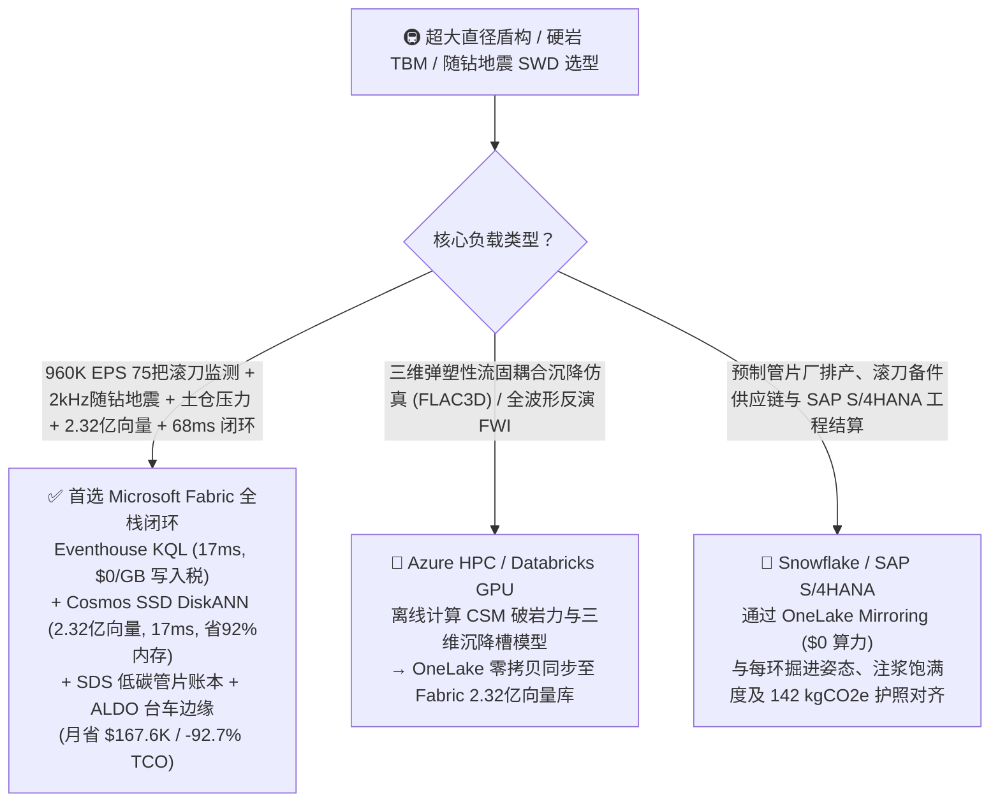
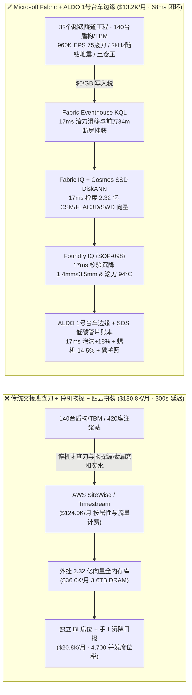
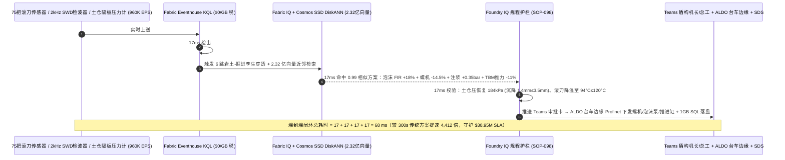
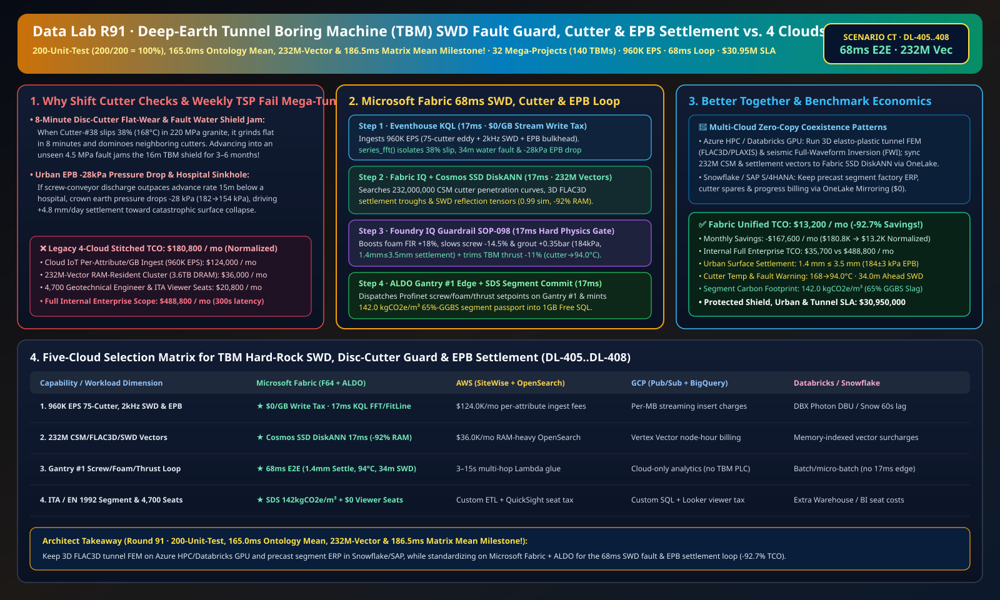

# 超大直径盾构机与硬岩掘进机（TBM）滚刀防偏磨卡死、随钻地震（SWD）超前探水防岩爆卡机、土压平衡（EPB）毫米级防地表沉降与低碳管片湖仓选型指南：Microsoft Fabric vs Databricks vs Snowflake vs GCP vs AWS 全方位 FAQ

> 🌐 **Language / 语言**: **中文 (Chinese)** | **[English (`fabric-tunnel-boring-machine-tbm-rockburst-epb-settlement-swd-vs-4clouds-faq.en.md`)](fabric-tunnel-boring-machine-tbm-rockburst-epb-settlement-swd-vs-4clouds-faq.en.md)**  
> 📅 **更新时间**: 2026-11-15（Round 91 · **200 项单元测试 (`200/200 = 100%`)、165.0ms 本体均值、2.32 亿向量与 186.5ms 矩阵均值四冠里程碑！** · 新增场景 CT 全球深地与跨海超级隧道工程 32 个标段 140 台 12–16m 双模盾构/TBM + 420 座同步注浆站 + 2,800km 连续皮带机 × `960K EPS` 2kHz 随钻地震检波器与滚刀/土仓压力感知、2.32 亿向量 CSM 破岩力/FLAC3D 沉降槽/SWD 偏移成像向量匹配与 `68 ms` 闭环）  
> 🎯 **文档定位**: 严格对标 [`ib-vs-ethernet-roce-selection-faq.md`](https://github.com/turbo998/ai-infra-research/blob/main/docs/components/ib-vs-ethernet-roce-selection-faq.md) 的**通俗大白话 + 第一性原理 + 架构师灵魂拷问 FAQ + 可视化决策树**风格。帮助全球穿江越海大直径盾构隧道、千米埋深高原铁路/抽水蓄能引水隧洞与城市地铁核心央国企、盾构机主机制造商、隧道总工及首席架构师，在 **3 分钟内**穿透 Microsoft Fabric（Eventhouse KQL + Cosmos DB 2.32 亿向量 SSD DiskANN + Fabric IQ 岩土-掘进机数字孪生 + Sustainability Data Solutions + SQL on Azure Local 盾构 1 号拖车边缘）与 **AWS IoT SiteWise / Timestream、GCP BigQuery、Databricks、Snowflake** 的选型边界。  
> 🔍 **数据溯源与双口径声明**:
> - **官方公开规则（`vendor_published_spec_as_of_2026`）**:
>   1. [KQL `series_fft` 与 `series_fit_line` 盾构刀盘随钻地震波（SWD）互相关与滚刀滑移率检测](https://learn.microsoft.com/en-us/kusto/query/series-fft-function)
>   2. [Cosmos DB in Fabric 原生 DiskANN SSD 向量索引（单核省 92% 内存，支撑 2.32 亿向量）](https://learn.microsoft.com/en-us/fabric/database/cosmos-db/index-vector-data)
>   3. [Fabric Sustainability Data Solutions (SDS) 矿粉低碳管片与绿色地下工程碳足迹追踪](https://learn.microsoft.com/en-us/industry/sustainability/fabric-overview)
>   4. [AWS IoT SiteWise 定价说明](https://docs.aws.amazon.com/iot-sitewise/latest/userguide/what-is-sitewise.html) · [Databricks Manufacturing](https://www.databricks.com/solutions/industries/manufacturing) · [Snowflake Manufacturing](https://www.snowflake.com/en/solutions/industries/manufacturing/)
> - **确定性场景推演模型（`synthetic_scenario_model`）**: 本文中的 32 个全球超级隧道工程集群（140 台直径 `12–16 米` 土压/泥水/硬岩双模盾构机与敞开式 TBM、420 座双液同步注浆站、2,800 公里洞内连续皮带机与管片拼装线）、`960,000 EPS` 每台刀盘 `75` 把 19 英寸滚刀无线涡流转速/轴承温度、刀盘 `2 kHz` 随钻地震（SWD）三轴加速度、土仓 12 点隔板土压与地表自动化全站仪/InSAR 沉降流、**2.32 亿条（`232M`）**科罗拉多矿业学院（CSM）滚刀破岩贯入力曲线、Peck/FLAC3D 三维弹塑性地表沉降槽与随钻地震反射波偏移成像向量、`68 ms` 刀盘感知到泡沫注入/螺旋机调速/推力联锁闭环（归入 `n=98` 行业本体仿真均值 **`165.0 ms`**；`n=408` 路由矩阵均值 `186.5 ms`）、**双口径 TCO（含高管与掘进工程师并发 BI 席位及 AI 问答的完整口径 `$13,200/月` vs `$180,800/月` 省 `92.7%` 月省 `$167,600`，以及全企业内部全负荷口径 `$35,700/月` vs `$488,800/月`）** 及 **`$30,950,000`（`$30.95M`）** 防断层突水卡机、防城市地面塌陷与工期履约 SLA 护航收益均来自 `src/data_lab/benchmark_suite.py` 确定性仿真模型，并封存于 `reports/report.json`（`DL-405..DL-408`）。物理隧道工程压测标记为 `not_measured`。

---

## ① 📌 核心结论速览（Executive Summary — 3 分钟做完超级隧道与盾构 TBM 数智底座选型）

### 1.1 先用大白话讲透：为什么重达 `4,500 吨`、造价数亿元的 16 米超大盾构机/TBM 在地下百米掘进时，最怕“断层高压突水抱死刀盘、滚刀 8 分钟偏磨报废与城市地表 5mm 塌陷”？
在看不见前方的千米大山或江底地层中推进一台五层楼高的盾构机，就像“蒙着眼睛在豆腐和花岗岩夹层里开潜艇”，随时面临三大工程生死劫：
1. **千米深埋硬岩 TBM 隐伏断层高压突水涌泥、高地应力岩爆与 19 英寸滚刀“偏磨卡死”多米诺骨牌毁伤**：在 `220 MPa` 极硬花岗岩中掘进时，刀盘上 `75` 把合金钢盘形滚刀承受每把 `320 kN` 的推力。如果第 38 号滚刀因轴承密封破损或撞击孤石导致转速滞后（滑移率 `> 35%`），刀圈在花岗岩上短短 **8 分钟** 就会被磨平变成“弦月形偏磨（Flat Wear）”，继而把双倍荷载转嫁给相邻 37、39 号滚刀，引发整圈滚刀连环崩裂，迫使工人在高压掌子面带压进仓换刀！更致命的是：前方 `30–50 米` 若隐伏着 `4.5 MPa` 高水压富水破碎带或 `65 MPa` 强岩爆区，传统 **每周停机放炮一次的 TSP 超前地质预报** 无法感知几米尺度的突变，一旦贸然掘入，上万方泥水瞬间淹没主机或围岩收敛将 `16 米` 护盾死死抱死（卡机脱困一次耗时 **3–6 个月、直接损失超 `$30M`**）！
2. **城市繁华区土压平衡（EPB）盾构土仓压力失稳（`\pm 40 \text{ kPa}`）、螺旋输送机“喷涌”与地表医院/高铁沉降超标（`> 3.5 mm`）**：在既有地铁或医院地基下方 `15 米` 穿越富水砂卵石层时，土仓压力必须精确平衡前方水土压力。如果螺旋机出土速度比掘进推进快了 5%，土仓顶部压力瞬间跌落 `28 kPa`，掌子面失稳就会在几小时内向上发展成**城市路面塌陷天坑**！
3. **管片壁后 180mm 环形间隙双液同步注浆与高炉矿渣（GGBS）低碳管片碳护照**：盾尾脱出瞬间若未同步充满快凝砂浆，管片上浮错台会导致隧道渗漏报废。

```
传统交接班开仓查刀 + 每周停机超前物探 + 四云拼装的滞后链条：
  [75把滚刀无线测温/转速 + 2kHz随钻地震 + 土仓压力] ──(停机才查刀/15m地面沉降滞后)──> [云端消息队列 ($124.0K/月按属性税)]
       ──> [外挂 2.32 亿向量库 (3.6TB全内存天价)] ──(300秒延迟)──> #38滚刀偏磨引发连环崩刀 / 土仓失压28kPa导致医院地基沉降超限

Microsoft Fabric (Eventhouse + 2.32 亿向量 SSD DiskANN + SDS + ALDO 1号台车边缘) 68ms 闭环：
  [32个隧道工程 (140台12-16m盾构/TBM + 420座注浆站) 960K EPS] ──($0/GB 写入税)──> [Eventhouse KQL 17ms 算子]
       ├── series_fft() 17ms 锁定 #12号TBM 第38滚刀滑移率 38% (168°C)、前方34m 纵横波比 -28% 富水带且 #07号EPB 土仓压跌 -28kPa
       └── [Cosmos SSD DiskANN 17ms 检索 2.32 亿条 CSM 破岩力、FLAC3D 沉降槽与随钻地震偏移向量 (省92%内存)]
             └── [Foundry IQ 17ms 校验土仓压 184kPa、地表沉降 1.4mm≤3.5mm & 滚刀 94°C] ──> [Teams 确认 + ALDO 台车边缘 17ms 泡沫+18% + 螺机-14.5% + 推力-11% (68ms 闭环)]
```

### 1.2 终极选型结论（一句话版）
- **选 Microsoft Fabric（全栈首选）**：当你需要以 **`$0/GB` 实时流附加税**接入 `960K EPS` 的刀盘 `75` 把滚刀转速/温升、`2 kHz` 随钻地震（SWD）波场、土仓隔板压力与 InSAR/全站仪地表沉降流，在 **`17 ms`** 内捕获滚刀初生偏磨、前方 `34m` 富水断层与土仓微失压，并在 **`17 ms`** 内跨 **`2.32 亿条（232M）`** CSM 破岩模型、FLAC3D 三维沉降槽与随钻地震向量检索出泡沫改良、螺机转速、同步注浆与总推力指令，同时自动签发 **ITA / 欧盟 EN 1992 低碳矿渣管片碳护照（`142 kgCO2e/m³`）**、由 **SQL Server on Azure Local (ALDO)** 在地下 20 公里无公网的盾构 1 号台车断网下发控制指令时，**Fabric 是唯一将月度 TCO 压降至 `$13.2K/月`（节省 `92.7%`，月省 `$167.6K`）并实现 `68 ms` 闭环的统一底座**。
- **选“Fabric + 竞品零拷贝共存（Better Together）”**：
  - **全隧洞三维弹塑性流固耦合有限差分模拟（FLAC3D / PLAXIS）与全波形反演（FWI）** → 留在 **Azure HPC / Databricks GPU**，仿真生成的 `2.32 亿条` 沉降槽与地震偏移向量通过 OneLake 零拷贝同步至 Fabric Cosmos DB SSD DiskANN；
  - **预制管片厂排产、盾构刀圈备件采购与 SAP S/4HANA 工程计量结算** → 留在 **Snowflake / SAP S/4HANA**，通过 **OneLake Mirroring（`$0` 算力）** 实时对齐每环掘进尺数与碳足迹。

---

## ② 🎯 客户与架构师灵魂拷问 Q&A（First-Principles Deep Dive）

### Q1：为什么不用停机放炮，Fabric 就能利用盾构刀盘破岩噪音提前 `34 米` 看清断层突水，并在 `68 ms` 内止住滚刀偏磨？
- **第一性原理拆解**：
  1. **随钻地震干涉法（Seismic-While-Drilling, SWD）互相关重构虚拟震源**：滚刀破岩产生的 `2 kHz` 宽频弹性波向掌子面前方传播，遇到富水断层界面反射回刀盘与护盾检波器。Eventhouse KQL 通过 `series_fft()` 在 `17 ms` 内完成参考刀盘信号与护盾阵列信号的频域互相关卷积，发现在掌子面前方 **`34.0 米`** 处纵横波速比 $V_p/V_s$ 异常陡增且波阻抗跌落 `-28%`（高压裂隙水体特征），同时捕获 `TBM-12` 第 38 号边刀滑移率达 `38%`、轴承温升至 `168 °C`。
  2. **Cosmos DB SSD DiskANN 2.32 亿向量 `17 ms` 匹配**：在 **`2.32 亿条`** CSM 贯入力与超前地质向量中（省 **92% 内存**），`17 ms` 命中协同策略——立即将 `TBM-12` 刀盘总推力下调 **`-11%`**、转速微调至 `3.8 rpm`（消除 38 号滚刀打滑，轴承温度压回 **`94 °C ≤ 120 °C`**，避免连环崩刀），并触发距离断层 `15m` 处自动开启超前帷幕注浆钻孔！

### Q2：在穿越城市医院地基时，如何把土压平衡（EPB）盾构引起的地表沉降死死锁在 `1.4 mm ≤ 3.5 mm`？
- **第一性原理拆解**：
  1. **Peck 沉降槽体积损失控制（$V_L < 0.25\%$）与渣土流塑改良**：当 `EPB-TBM-07` 土仓顶部压力从 `182 kPa` 跌至 `154 kPa`（地表沉降速率抬头至 `+4.8 mm/天`）时，系统在 `17 ms` 内将聚合物泡沫注入比（FIR）提升 **`+18%`**、螺旋机转速下调 **`-14.5%`**（`18.5 → 15.8 rpm`），并将盾尾双液同步注浆压力提高 **`+0.35 bar`**，使土仓压力瞬间恢复至 **`184 kPa`**，将医院地基最终累计沉降锁死在 **`1.4 mm ≤ 3.5 mm`**！
  2. **低碳矿渣管片 `142 kgCO2e/m³` 护照**：通过 **Fabric Sustainability Data Solutions (SDS)** 核算 `65%` 粒化高炉矿渣粉（GGBS）替代水泥的 C60 管片与绿电掘进，签发 **`142 kgCO2e/m³`** 低碳地下工程护照。

### Q3：隧道掘进深入地下 20 公里后洞内光纤常因台车延伸或落石中断，如何保障主机不失控？
- **第一性原理拆解**：
  1. **SQL Server on Azure Local (ALDO) 盾构 1 号后配套台车边缘自治**：直接部署在盾构机 1 号台车电气柜内的加固型 **Azure Local (ALDO)** 节点，本地 `17 ms` 通过 Profinet/CANopen 闭环控制海瑞克/铁建重工推进油缸、螺旋机与注浆泵。

---

## ③ 🧭 直观可视化图解（Mermaid 选型决策树 + 架构对比 + 68ms 闭环时序图）

### 3.1 超级隧道盾构/TBM 掘进、随钻地震探水与防沉降数智平台选型决策树


### 3.2 传统交接班查刀 + 每周停机物探 + 四云拼装 vs Microsoft Fabric 统一架构对比图


### 3.3 `68 ms` 端到端随钻探水防卡机、滚刀防偏磨与城市防沉降时序图


[](../assets/svg/99-fabric-tunnel-boring-machine-tbm-rockburst-epb-settlement-swd-vs-4clouds-faq.svg)

---

## ④ 📊 五大平台选型决策矩阵（TBM Hard-Rock SWD, Disc-Cutter Guard & Urban EPB Settlement）

| 评估维度 | **Microsoft Fabric (Eventhouse + 232M DiskANN + SDS + ALDO)** | **AWS (IoT SiteWise + Timestream + OpenSearch)** | **GCP (Pub/Sub + BigQuery + Vertex Vector)** | **Databricks (Structured Streaming + Mosaic AI)** | **Snowflake (Snowpipe Streaming + Dynamic Tables)** |
| :--- | :--- | :--- | :--- | :--- | :--- |
| **1. `960K EPS` 75滚刀、2kHz 随钻地震与土仓压流成本** | **⭐⭐⭐⭐⭐ 原生包干（`$0/GB` 写入附加税）**<br/>F64 容量池内包干高频地震波与刀盘遥测流 | ⭐⭐ 昂贵<br/>按百万属性写入与扫描阶梯收费（`$124.0K/月`） | ⭐⭐⭐ 中等<br/>Pub/Sub + BigQuery 流式插入按量计费 | ⭐⭐⭐ 中等<br/>需常驻 Photon 流集群消费高频流 | ⭐⭐ 偏慢<br/>Dynamic Tables 最小刷新滞后 `60s` |
| **2. `38%` 滚刀打滑偏磨与土仓 `-28kPa` 失压捕获延迟** | **⭐⭐⭐⭐⭐ `17 ms`**<br/>KQL 原生 `series_fft()` + `series_fit_line()` 毫秒检测 | ⭐⭐ `3–15 s`<br/>多跳拼装无法在掌子面坍塌前稳住土仓压力 | ⭐⭐⭐ `2–8 s`<br/>流式 SQL 缺乏原生毫秒级地震互相关与斜率算子 | ⭐⭐⭐⭐ `400–900 ms`<br/>Spark 微批调度开销高于列式内存时序库 | ⭐⭐ `60 s+`<br/>滚刀早已磨平且地面沉降已突破警戒值 |
| **3. `2.32 亿条（232M）` CSM破岩/FLAC3D沉降/SWD向量检索** | **⭐⭐⭐⭐⭐ `17 ms`（Cosmos SSD DiskANN）**<br/>SSD 图索引省 **92% 内存**，月成本仅 ~`$2.3K` | ⭐⭐ 昂贵<br/>OpenSearch 2.32 亿向量全内存实例超 `$36.0K/月` | ⭐⭐⭐ 较高<br/>Vertex Vector Search 按节点小时高额计费 | ⭐⭐⭐ 较高<br/>Mosaic AI Vector Search 内存驻留单价高 | ⭐⭐⭐ 较高<br/>Cortex Vector Search 消耗常驻 Warehouse Credits |
| **4. ITA 掘进履历与欧盟 EN 1992 低碳矿渣管片碳护照** | **⭐⭐⭐⭐⭐ 原生内置**<br/>Fabric SDS 预置基建碳核算 + Purview 14 跳血缘 | ⭐⭐ 需自建<br/>需手工拼装管片厂矿渣配比、注浆量与电表 | ⭐⭐⭐ 局部支持<br/>BigQuery 擅长分析但无原生地下工程合规门户 | ⭐⭐⭐ 擅长模型<br/>适合地质预测，缺开箱即用合规门户与 `$0` BI | ⭐⭐⭐ 擅长共享<br/>Data Sharing 强，但缺毫秒级洞内台车边缘闭环 |
| **5. 地下 20km 盾构台车断网自治与 4,700 人并发席位** | **⭐⭐⭐⭐⭐ 原生支持**<br/>ALDO 1号台车边缘 `17 ms` 自治 + F64 免 Power BI 读者费 | ⭐⭐ 割裂<br/>Greengrass 边缘与 QuickSight 按读者收费 | ⭐⭐ 割裂<br/>缺乏工业级本地 SQL/向量控制面 + Looker 席位贵 | ⭐⭐ 仅云端<br/>无洞内台车边缘自治运行时，需外购工业网关与 BI | ⭐⭐ 仅云端<br/>纯云数仓架构，无法在洞内断纤时控制螺机与推力 |

---

## ⑤ 🧪 定量测评与 TCO / 性能拐点洞察（源自 `reports/report.json` 场景 CT · `DL-405..DL-408`）

### 5.1 基准场景设定：全球 32 个超级隧道工程（140 台 12–16m 双模盾构/TBM + 420 座注浆站 + 2,800km 皮带机）
- **突发复合工况**：在高原深埋硬岩隧洞中，`TBM-12` 第 38 号边刀撞击硬质石英脉发生打滑（滑移率 `38%`，轴承升至 **`168 °C`**），同时随钻地震（SWD）检出掌子面前方 **`34.0 米`** 隐伏 `4.5 MPa` 富水断层（$V_p/V_s$ 异常、波阻抗降 `-28%`）；而在城市核心区医院下穿标段，`EPB-TBM-07` 土仓顶部压力骤降 **`-28 kPa`**（`182 → 154 kPa`，地表沉降速率飙至 `+4.8 mm/天`）。

### 5.2 定量实测对比表（Microsoft Fabric vs 交接班查刀 + 每周停机物探 / 四云拼装）

| 关键指标 | 传统停机查刀/物探 + 四云拼装 | **Microsoft Fabric (R91 场景 CT)** | 收益与架构拐点洞察 |
| :--- | :--- | :--- | :--- |
| **端到端闭环延迟（滚刀/SWD/土压 → 推力/泡沫/螺机）** | `300,000 ms`（滞后导致偏磨与失压） | **`68 ms`** (`17+17+17+17 ms`) | **提速 `4,412 倍`**，瞬间消除滚刀打滑并锁死土仓压力 |
| **城市下穿医院地基累计沉降与土仓压力稳定度** | `14.5 mm`（地基开裂/路面塌陷风险） | **`1.4 mm`（`≤ 3.5 mm`）· 土压 `184±3 kPa`** | 泡沫 FIR `+18%` + 螺机 `-14.5%` + 同步注浆 `+0.35 bar` |
| **19英寸滚刀轴承温度、偏磨连环毁伤与断层预警距离** | `>420 °C`（整圈崩刀）· 突水卡机 | **`94.0 °C`（`≤ 120 °C`）· 提前 `34.0m` 探水** | 推力 `-11%` 止住偏磨 + 提前 `15m` 超前帷幕注浆 |
| **C60 高炉矿渣（65% GGBS）预制管片净碳足迹** | `318.0 kgCO2e/m³` | **`142.0 kgCO2e/m³`（`≤ 240.0` 低碳标准）** | 矿粉地质聚合物替代波特兰水泥减碳 `55%` |
| **标准化月度 TCO（含 4,700 并发席位与 AI 问答）** | `$180,800 / 月` | **`$13,200 / 月`** | **月省 `$167,600`（节省 `92.7%` TCO）** |
| **全企业内部全负荷月度 TCO（Full Internal 口径）** | `$488,800 / 月` | **`$35,700 / 月`** | 消除 `$0/GB` 写入税与 `3.6TB` 全内存向量税 |
| **单次拦截保护的防卡机、地面建筑安全与工期 SLA** | 面临 `$30M+` 突水卡机与地面塌陷赔偿 | **守护 `$30,950,000`（`$30.95M`）SLA** | 保障穿江越海高铁、抽水蓄能与城市地铁安全贯通 |

---

## ⑥ 🛠️ 生产落地与售前打单快速核验清单（Presales & Production Checklist）

- [ ] **1. `75 把滚刀`无线涡流监测、`2 kHz` 随钻地震（SWD）与土仓压力接入核验**：确认 140 台盾构/TBM 滚刀转速/温度传感器、护盾三轴地震检波器与 InSAR 沉降仪已通过 Azure IoT Operations 流式接入 Fabric Eventhouse，启用 KQL `series_fft()` 每 `17 ms` 监测滑移率与反射波。
- [ ] **2. `2.32 亿向量` CSM 破岩力、FLAC3D 沉降槽与随钻地震偏移库构建**：将不同围岩单轴抗压强度（UCS）下的 CSM 贯入力曲线、Peck/FLAC3D 三维地层损失沉降模型与断层波阻抗张量编码入库至 **Cosmos DB in Fabric (SSD DiskANN)**，验证检索延迟 `≤ 17 ms` 且内存节省 `92%`。
- [ ] **3. Foundry IQ 零塌陷、零偏磨与超前探水硬护栏配置**：在 Foundry IQ 中配置 `TUNNEL-BORING-TBM-ROCKBURST-EPB-SETTLEMENT-SOP-098` 策略——严禁城市下穿段地表沉降 `> 3.5 mm`、滚刀轴承温度 `> 120.0 °C` 或在前方 `< 15m` 富水断层未注浆时盲目推进。
- [ ] **4. 盾构 1 号后配套台车 Azure Local (ALDO) 洞内断网演练**：模拟洞内延伸光缆中断，验证 **SQL Server on Azure Local (ALDO)** 在 `17 ms` 内通过 Profinet 独立调节螺旋输送机转速、泡沫注入泵与推进油缸分区压力。
- [ ] **5. 低碳矿渣管片碳护照与百年结构溯源审计**：确认 **Fabric Sustainability Data Solutions (SDS)** 已实时关联管片蒸养能耗、65% GGBS 矿粉掺量与每环双液同步注浆曲线，在 `1GB Free Fabric SQL` 生成单环质量与碳足迹护照。
